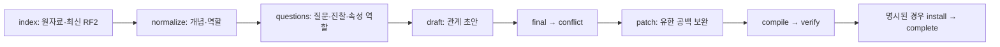

# 새 지식 DB 추출

## 최신 번들 증분 보완 (D58)

`augment-plan → augment → augment-build → augment-install`은 **최신 활성 번들 위에** 누락 개념·관계·질문을 추가하는 별도 경로입니다. 과거 build 선택, 전체 원자료 재색인, D55 correct-bundle의 임상 변경 용도 전환은 없습니다. 상담은 계속 하나의 정적 번들을 읽습니다. 구현과 검증 증빙은 [D58 결정](../DECISION_STATE.md#D58)과 [루트 상태](../PROJECT_STATE.md)를 따릅니다.

첫 seed는 [insomnia_growth.seed.json](augmentation/insomnia_growth.seed.json)입니다. 불면의 수면제 사용장애와 저신장의 CDGP·가족성 저신장, 성장속도·경과·가족력을 보완합니다. 신규 Disease 최대 6개, 전체 신규 Concept 48개, 관계 작업 60개, 질문 48개로 제한합니다. 기존 불면 관계 2개와 GHD 관계 3개만 최종 검토 allowlist에 있으며, 유지·조건 수정·effect 변경·neutral을 구별해 저장합니다. 수면제 복용만으로 사용장애를 지지하지 않고, 성장속도 수치 하나를 모든 연령의 정상 기준으로 만들지 않습니다.

**이번 실행은 완료했습니다.** 당시 최신 부모 `1bcaba1dffb744c468bb191df3267dad`에서 child `cec62f4596bedd9b9488aa75e3d38f04`를 생성해 활성화했습니다. 개념 11개(진단 3개), runtime 관계 9개와 질문 6개를 추가하고 허용된 부모 관계 4개를 변경했습니다. 최종 neutral 4개는 runtime에서 제외했습니다. API Luna medium 실제 전송은 상한 16회 중 7회, 입력 1,203,089·출력 28,298 tokens입니다. 추출 테스트 140개·워크플로우 234개, 실제 부모 빈 delta 보존, production 함수의 후보·질문 검사, 키 없는 재컴파일·추가 호출 없는 재개, 설치 지식의 scripted 상담 3개를 통과했습니다. 실제 모델 상담 정확도·임상·공식 평가는 미실행입니다. [수행 결과](../data/provenance/augmentation-d58-2026-10-21.json)를 따릅니다.

사용자 요청으로 이번 실행의 체크포인트 네 개·mock DB·round-trip/staging 복사본·미사용 로그와 임시 파일 518개(210.27 MiB)를 삭제했습니다. 활성 child와 작업 전부터 있던 부모는 유지하며, 182개 보호 파일의 hash와 삭제 후 loader·prepare를 다시 확인했습니다. [삭제 영수증](../data/provenance/augmentation-d58-cleanup-2026-10-21.json)과 [수용 delta·URI mapping](../data/provenance/augmentation-d58-delta-2026-10-21.json)은 남습니다. 삭제한 `fc03…`, `3472…`, `fa35…`, `7c77…` run의 plan·원래 요청/응답·SQLite는 복구·재개할 수 없습니다.

기존 설치의 마지막 선택은 `config.api-luna.json`의 **OpenAI API / draft·final gpt-6-luna / medium / 배치 40 / 출력 32000 / timeout 600초**입니다. 아래 명령은 이 설정을 유지합니다. 구현 에이전트의 모델 이름을 생성 모델에 적용하지 않습니다. 명시적 `--max-model-requests 16`은 예측 비용이 아니라 **해당 run의 누적 실제 전송 상한**이며 형식 수리·전송 재시도도 셉니다. 입력·출력 token은 실제 응답 usage로 기록합니다.

모든 명령은 프로젝트 루트에서 실행합니다. **Compose 기본 command가 full run이므로 augmentation command를 반드시 명시합니다.**

아래 생성·재개·복구·설치 명령은 체크포인트가 존재할 때의 검증한 운영 절차입니다. 이번 완료 run을 다시 실행하는 명령은 아닙니다. 첫 seed의 relation allowlist는 실행 당시 최신 부모의 ID를 고정했으므로, 후속 보완은 최신 활성 관계를 검토해 seed를 갱신하고 새 plan을 만들어야 합니다. 과거 부모를 선택하거나 존재하지 않는 association을 묵인하지 않습니다. 현재 설치 확인에는 마지막 `verify --manifest /target/manifest.json`만 필요합니다.

```sh
# 코드·공개 설정·seed를 포함한 프로젝트 이미지를 만듭니다.
docker compose build extraction

# 키·네트워크 없이 최신 /target/manifest.json을 읽고 빈 delta 보존 검사를 합니다.
docker compose run --rm -T --no-deps augmentation augment-plan \
  --target /target --seed /app/augmentation/insomnia_growth.seed.json \
  --config /app/config.api-luna.json --output /output/augmentation
```

출력의 `plan` 경로와 `run_id`를 사용합니다. 예를 들어 출력이 `/output/augmentation/PLAN_ID/plan.json`이면 다음과 같습니다. `PLAN_ID`는 출력된 실제 값으로 바꿉니다. plan은 부모 hash, seed, provider/model/effort/batch, prompt와 구현을 고정합니다. 모든 후속 job을 미리 만들지 않고 직전 완료 결과에서 각 workset을 한 번 고정합니다.

```sh
# 이 명령만 실제 유료 API 생성과 최종 임상 검토를 실행합니다. 기본 설치는 없습니다.
docker compose run --rm -T --no-deps extraction augment \
  --plan /output/augmentation/PLAN_ID/plan.json --config /app/config.api-luna.json \
  --work /work --output /output/augmentation --max-model-requests 16

# 키·네트워크 없는 상태 조회와 중단 요청입니다.
docker compose run --rm -T --no-deps control status --run-id PLAN_ID --human
docker compose run --rm -T --no-deps control pause --run-id PLAN_ID

# 동일 plan의 미완료 작업만 재개합니다. 완료·neutral·유효 형제 결과는 재호출하지 않습니다.
docker compose run --rm -T --no-deps extraction augment \
  --plan /output/augmentation/PLAN_ID/plan.json --config /app/config.api-luna.json \
  --work /work --output /output/augmentation --max-model-requests 16 --resume

# 저장된 accepted delta만 재컴파일·검증합니다. 모델 client를 만들지 않습니다.
docker compose run --rm -T --no-deps augmentation augment-build \
  --plan /output/augmentation/PLAN_ID/plan.json --work /work --output /output/augmentation

# 별도 로컬 활성화입니다. parent와 무관한 보관 build도 삭제하지 않습니다.
docker compose run --rm -T --no-deps augmentation augment-install \
  --plan /output/augmentation/PLAN_ID/plan.json --work /work --output /output/augmentation --target /target

docker compose run --rm -T --no-deps verify verify --manifest /target/manifest.json
```

`augmentation`은 network none·키/인증 volume 없음·read-only rootfs이며 `/work`, `/output`, 프로젝트 `/target`만 씁니다. `control`은 기존 keyless status/pause를 그대로 사용합니다. API/구독의 불명 전송 결과는 자동 재전송하지 않습니다. 중복 실행 가능성을 명시적으로 수용한 경우에만 같은 `augment ... --resume --retry-unknown`을 사용합니다. 요청 상한 도달은 완료 작업을 보존한 paused 상태이며, 상한을 늘리려면 새 값을 명시합니다. config나 prompt를 바꿔 이어 붙이는 것은 거절합니다.

설치 시작과 활성화 직전에 최신 parent pins를 다시 확인합니다. 그 사이 다른 작업이 manifest를 바꾸면 child를 보존하고 활성화하지 않습니다. 모든 기존 installer도 같은 target lock을 사용합니다. `.install.lock`은 제출 ZIP에서 제외합니다. 신규 build는 `preserve_ids=True`로 컴파일하고 기존 URI·ValueMatch·ExpectedValue·unit·기본/override 질문·전역 AttributeRole·기존 질환별 guideline payload를 비교합니다. build_id 때문에 바뀐 guideline index bytes는 membership 변경과 구별합니다.

최종 번들은 실제 `graph_candidates`, assessment와 `QuestionTools`로 필수 후보와 DD 질문 도달성을 검사하고, 수면제 정상 복용·행동 unknown·불면 없는 행동 경로·가족력 음성·성장경과 악화·제공 수치 재질문 방지 반례를 통과해야 합니다. neutral을 coverage용 support로 바꾸지 않습니다. 검사 실패 시 활성 manifest는 그대로 두고 저장 결과와 오류를 남깁니다. 실제 상담 정확도나 공식 임상 검증을 대신하지 않습니다. 여러 Context의 약물/episode join은 구현하지 않았으므로 모호한 약물-행동 연결은 qualified 또는 추가 확인으로 유지합니다.

```sh
# 모델·키·네트워크 없는 유지 검증입니다.
docker compose -f compose.yaml -f Dev/tests/workflow/compose.offline.yaml run --rm -T --no-deps \
  -e PYTHONPATH=/workspace/submission:/workspace/Extraction dev \
  python -B -m unittest discover -s Extraction/tests -p 'test_*.py'
docker compose -f compose.yaml -f Dev/tests/workflow/compose.offline.yaml run --rm -T --no-deps dev \
  python -B -m unittest discover -s Dev/tests/workflow -p 'test_*.py'
```


D55의 제한된 오프라인 유지보수 정정은 당시 build `0fd42155c3171c9c9dcf66cb7f733245`와 strict loader를 함께 로컬 활성화한 이력입니다. 당시 보존한 원본과 이후 별도 승인된 삭제 내역은 각 역사적 영수증을 따르며 현재 활성 지식은 위 D58 child입니다. [정정 명세](../data/provenance/v5-maintenance-plan-2026-10-21.json)가 실제 ID/edge와 승인 근거를, [변환 기록](../data/provenance/v5-maintenance-correction-2026-10-21.json)이 전체 RDF 차이와 의미 보존을, [검증 기록](../data/provenance/algorithm-d50-6-2026-10-21.json)이 당시 활성화 결과를 관리합니다. 이 경로는 해시 고정된 runtime 자산에서 의미를 복원하는 예외이며 폐기한 work DB·원래 요청/응답·neutral 판단·source history를 복구하지 않습니다. fresh 신규 생성은 계속 아래의 네 원자료 시작 규칙을 따릅니다.

유지보수 CLI는 `python -m ontoward_extraction correct-bundle --manifest PARENT_MANIFEST --corrections REVIEWED_PLAN --output FRESH_DIRECTORY`입니다. 프로젝트 dev 컨테이너에서 `PYTHONPATH=/workspace/submission:/workspace/Extraction`, network none으로 실행하며 provider·resume·run-id·install 플래그를 받지 않습니다. 검토 명세가 전수 invalid edge와 정확히 일치해야 하며 이름 기반 재정규화 없이 등록 ID, 별도 ExamMethod와 owner별 값을 보존합니다. effect나 비문구 질문 계약이 충돌한 병합은 보류하고 독립적인 타입 정정은 완료합니다. 출력 디렉터리가 이미 있으면 덮어쓰지 않습니다. 새 후보는 원래 loader·strict 검사·coverage·prepare와 전후 canonical graph 비교를 모두 통과해야 합니다. 설치는 기존 installer를 사용하고 `--preserve-build PARENT_BUILD_ID`로 부모를 정리 대상에서 제외합니다. strict gate를 invalid parent에 먼저 적용하지 않습니다.

최초 실제 추출·컴파일·로컬 설치와 이전 work 체크포인트·중복 staging·로그 정리는 [과거 삭제 영수증](../data/provenance/extraction-storage-cleanup-2026-10-21.json)과 [당시 최종 감사 기록](../data/provenance/extraction-final-audit-2026-10-21.json)에 남습니다. 현재 생성기·설정·프롬프트·테스트와 설치된 `submission/knowledge/`는 유지하며 이번 D58의 결과와 정리는 위 별도 영수증을 따릅니다.

이 문서의 status·pause·resume·recover·logs 예시는 체크포인트가 존재하는 별도 작업을 위한 일반 안내입니다. 삭제된 과거 실행은 재개하거나 복구할 수 없습니다. 현재 설치 번들은 작업 DB 없이 `docker compose run --rm --no-deps -T verify verify`로 확인합니다. `status`가 `not_started`를 보여도 설치 번들이 미완료라는 뜻은 아닙니다.

모든 모델 작업이 끝난 뒤 `incomplete_generation_contract`가 나면 저장 결과와 현재 이미지의 정규화·컴파일 코드를 먼저 대조합니다. 같은 입력 ID가 Symptom과 AttributeValue에 함께 쓰였을 때 두 역할을 분리하고 원래 질문을 유지해야 합니다. 단순한 동일 이미지 재시작이나 같은 질문의 추가 생성으로 이 충돌을 덮지 않습니다.

사용자가 현재 세션의 수동 처리를 명시적으로 선택한 경우에는 실패 DB와 원래 작업·요청·응답·사용량·시도 횟수를 그대로 보존한 새 fingerprint에서 문제 필드만 교정할 수 있습니다. 교정 전후·실행 불가 연결의 제외 사유·수동 입력 해시는 SQLite에 따로 남기고, 파생 입력만 컴파일합니다. Test를 신체 EXAM으로 바꾸거나 의미가 없는 ID를 임의 선택하지 않습니다. 전체 loader·coverage 검증을 통과한 뒤 요청된 설치를 진행하며, 실제 적용 결과는 [루트 상태](../PROJECT_STATE.md)와 [데이터 상태](../data/PROJECT_STATE.md)가 관리합니다.

`patch`에서 `string_above_max_length`가 발생한 첫 거절 체크포인트는 `bash Extraction/extraction.sh recover-patch --run-id 기존_ID`로 모델 호출 없이 새 실행 ID에 복구합니다. 수정된 이미지는 어휘·완료 관계를 배치에서 한 번만 전달하고, 각 JSON 메시지를 50,000자 이하로 나누며 40개 배치를 유지합니다. 임상 조건·질문·진찰·단위·scope는 보존하고 검색 별칭은 원래 SQLite에 남깁니다. 복구는 이전 단계가 모두 완료되고 요청이 확정된 해당 실패만 허용하며, 원본 DB·결과·시도 횟수·사용량을 보존합니다. 새 ID를 확인한 뒤 API Luna 설정으로 명시적으로 재개합니다.

D49의 독립 실행기는 네 원자료에서 새 `v5-enum-1` 번들을 만듭니다. 이미지는 **ontoward-extraction:local**, 진입점은 `python -m ontoward_extraction`입니다. 이미지·합성 파이프라인과 실제 RF2/CSV의 읽기 전용 파싱을 검증했습니다. 별도로 승인된 실제 생성의 공급자·실행 ID·진행 상태는 [루트 상태](../PROJECT_STATE.md)·[데이터 상태](../data/PROJECT_STATE.md)를 따릅니다. 실제 번들이 설치되기 전 `prepare()`와 정식 패키징은 `knowledge_bundle_not_installed`로 실패합니다.

## 증분 discovery 범위 충돌의 제한된 복구

두 discovery 결과가 같은 신규 identity를 중복 제안해 `ambiguous_new_identity_use_registered_ref`로 끝난 경우만 `augment-repair-discovery`를 사용할 수 있습니다. 원본이 failed/paused이고 discovery만 완료됐으며 모든 요청 결과가 확정되어야 합니다. 부모·seed·임상 범위·config·완료 결과는 그대로 두고, 명시한 원래 결과 hash와 검토한 파생 discovery를 별도 amendment로 고정합니다. 임상·런타임·다른 단계 prompt가 달라진 복구는 거절합니다.

원본 SQLite와 job result·요청·응답·usage를 덮어쓰지 않습니다. 새 plan fingerprint에 SQLite backup을 만들고 별도 metadata의 amendment만 downstream 입력에 적용합니다. 기존 전송 횟수도 승계하므로 상한 16을 새로 시작하지 않습니다. 이 경로는 폐기 checkpoint 복구나 과거 부모 build 선택 기능이 아닙니다.

```sh
# 최신 부모에서 수정된 계약의 새 augment-plan을 먼저 만듭니다.
# OLD_PLAN_ID/NEW_PLAN_ID와 AMENDMENTS.json은 실제 검토 결과 경로입니다.
docker compose run --rm -T --no-deps augmentation augment-repair-discovery \
  --source-plan /output/augmentation/OLD_PLAN_ID/plan.json \
  --plan /output/augmentation/NEW_PLAN_ID/plan.json \
  --amendments /output/augmentation/AMENDMENTS.json --work /work

# 복구는 모델을 부르지 않습니다. 완료 후 같은 설정과 누적 상한으로 재개합니다.
docker compose run --rm -T --no-deps extraction augment \
  --plan /output/augmentation/NEW_PLAN_ID/plan.json --config /app/config.api-luna.json \
  --work /work --output /output/augmentation --max-model-requests 16 --resume
```

실제 첫 실행의 범위 정정은 [복구 영수증](../data/provenance/augmentation-discovery-scope-repair-2026-10-21.json)에 남깁니다. 결과별 cluster를 검사하고 각 배치의 정확한 job ID와 결과 개수를 schema에 고정하여 같은 오류를 후속 요청에서 거절합니다.

## 최종 검토의 typed 의미 오류 복구

`Feature.status`는 속성값의 부정이 아니라 **Target의 존재 상태**입니다. 같은 Pattern에 Target present와 attribute feature의 status absent를 함께 넣으면 실제 후보 경로가 모순됩니다. 안정된 경과가 필요한 관계는 등록된 Stable trajectory 값을 실제 양성 소견으로 요구하며 unknown을 음성으로 바꾸지 않습니다. 부모가 누구인지 모르면 `subject_member=null`을 사용하고 `parent`라는 미등록 member를 만들지 않습니다. 아이의 성장 조건을 표현할 수 없는 가족 Context Target 관계는 neutral로 완료합니다. 유용한 가족력은 아이의 Target 위에 선택적 조건부 refinement로 검토하고 독립 경로도 유지합니다.

모든 요청·질문 단계가 완료된 후 후보/의미 검사에서 실패한 해당 실행만 `augment-repair-review`로 재검증할 수 있습니다. 원본 DB·모델 결과·usage·시도 수를 보존한 새 fingerprint에서 새 typed 검증에 실패한 검토 행만 pending repair job으로 만듭니다. 이미 유효한 개념·관계 검토·질문은 다시 호출하지 않습니다. 원래 검토 결과는 덮어쓰지 않고 effective result 참조만 새 수용 결과로 바꿉니다. 원래 시도 횟수와 누적 전송 상한을 승계하며, 별도의 다중 심판을 추가하지 않습니다.

```sh
# 최신 parent로 만든 새 plan을 사용합니다. 이 명령 자체는 키·모델 없이 실행합니다.
docker compose run --rm -T --no-deps augmentation augment-repair-review \
  --source-plan /output/augmentation/OLD_PLAN_ID/plan.json \
  --plan /output/augmentation/NEW_PLAN_ID/plan.json --work /work

# 검토가 필요한 행만 동일한 최종 검토 단계에서 수리합니다.
docker compose run --rm -T --no-deps extraction augment \
  --plan /output/augmentation/NEW_PLAN_ID/plan.json --config /app/config.api-luna.json \
  --work /work --output /output/augmentation --max-model-requests 16 --resume
```

## 전체 생성 순서와 DB를 먼저 이해하기



정규화에서는 임상 개념을 먼저 안정화하고 행동 문구는 questions 단계에서 만듭니다. 이후 초안·최종 분류와 충돌 해결·공백 보완을 거쳐 RDF와 질문·지침·manifest를 컴파일합니다. [아틀라스](../Test/atlas.html#extraction)는 각 단계의 입력·기능·출력과 공급자/중단 경계를 도식으로 설명하며, [SQLite 스키마](../Test/atlas.html#sqlite)는 실제 7개 테이블의 열·기본키·논리 연결을 모두 제공합니다.

| 저장 영역 | 내용 | 실행 상담과의 관계 |
|---|---|---|
| work/RUN_ID/jobs.sqlite3 | meta, jobs, requests, usage, source_rows, rf2, rf2_modules | 생성기의 체크포인트. 상담에서 읽지 않습니다. |
| output/RUN_ID/ | schema·vocabulary·clinical·questions·guidelines·manifest | 검증 전 staging입니다. |
| submission/knowledge/builds/BUILD_ID/ | 검증된 build 전용 자산 | 활성 manifest가 마지막에 교체된 뒤 prepare가 읽습니다. |

SQLite에는 SQL 외래 키가 선언되어 있지 않습니다. requests.job_ids의 JSON 배열과 meta의 빌드 신원을 Python이 연결합니다. WAL·FULL 동기화와 worker lock, 수용 transaction이 진행 보존을 담당합니다. 파일 개수나 normalize 완료 비율은 전체 생성 완료율이 아닙니다. 현재 실행을 확인하려면 아래의 키 없는 status/watch를 사용하세요.

| 공급자 | 인증·전송 | 초안 / 최종 분류 |
|---|---|---|
| nova_dev | 루트 환경의 NOVA_DEV_KEY, 선택 NOVA_API_BASE; 세션 밖 원본 SDK Client.chat | openai/gpt-6-luna / openai/gpt-6.1-sol |
| codex_subscription | 새 전용 volume의 ChatGPT device login; codex exec | gpt-6-luna / gpt-6.1-sol |
| openai_api | OPENAI_API_KEY; 공식 Responses API, 도구 없이 구조화 출력 | gpt-6-luna / gpt-6.1-sol |

모든 추출 effort는 **medium**이다. NOVA/API 출력 상한은 초안 8,000·최종 32,000토큰이며 요청 제한 시간은 600초다. Codex CLI에는 강제 출력 토큰 상한을 적용했다고 주장하지 않는다. 유한한 배치와 600초 프로세스 제한을 사용한다. 계정의 모델 접근 가능성은 실제 첫 실행에서 확인하며 오류가 나면 선택 모델을 유지한 채 중단한다. 자동 모델·공급자·계정 전환은 없다.

## 이미지와 키 없는 조회

프로젝트 루트에서 실행한다. 빌드는 Python 3.12와 현재 고정 Python 의존성, `@openai/codex@0.162.1`을 설치한다. 이미지에는 원자료·이전 DB·개발 키·인증 정보를 넣지 않는다.

```sh
docker compose build extraction
docker compose run --rm -T control status
docker compose run --rm -T control pause --run-id RUN_ID
docker compose run --rm -T verify verify --run-id RUN_ID
```

`status`와 `pause`는 키나 client를 만들지 않는다. 실행이 없으면 `not_started`를 반환한다. `verify`는 네트워크 없이 읽기 전용으로 번들·해시·실행 계약·기본 커버리지를 확인한다. 전체 모델 의미와 임상적 정확성을 검증하는 명령은 아니다.

## 실행·진행 확인·로그

질문 생성은 모델이 `id`, `question`, `exam_text`, `attribute_role`, `exam_method`만 반환하는 작은 패치를 사용한다. 이름·별칭·속성·허용 값·system은 Python이 기존 입력에서 그대로 복원하므로 큰 연결 개념을 응답에서 반복하지 않는다. 비어 있는 진찰 방법을 채우는 경우만 새 ExamMethod 한 개를 허용한다. 기본 설정은 Luna medium·배치 10개·출력 상한 8000이며, 명시적으로 선택한 Sol 설정은 아래 계약을 따른다. 현재 실행 모델과 ID는 루트·데이터 운영 상태에서 확인한다.

질문 요청에서도 검색용 별칭과 연결 참조의 중첩 attributes·values·systems를 반복하지 않는다. 질문 대상의 임상 필드·허용 값과 각 참조의 ID·역할·영문/한국어 표제·context·질문 단위·진찰 방법은 유지한다. 완전한 등록 입력은 작업 DB에 보존하고 출력 패치 검증과 결과 복원에는 그 원본을 사용한다. 이 변경은 질문 단계의 전송 자료에만 적용한다.

Luna의 잘린 질문 응답을 이 계약으로 옮길 때는 `bash Extraction/extraction.sh recover-questions --run-id OLD_RUN_ID`를 사용한다. 완료된 정규화·질문과 모든 요청·사용량·시도 횟수를 보존한 새 fingerprint를 만들며, 복구 명령은 모델을 호출하지 않는다.

### 명시적으로 선택하는 Sol 전환

`config.sol.json`과 `switch-sol`은 사용자가 명시적으로 선택할 때만 활성화한다. questions 단계의 실행이 안전하게 paused가 되었거나 `CONTEXT_LIMIT_EXCEEDED` 등 허용된 확정 오류로 실패했고, 모든 요청의 결과가 확정됐을 때 다음 명령을 사용한다. 불명 요청과 관련 없는 오류는 거절한다. Sol profile은 초안·최종 모두 `gpt-6.1-sol` medium, 배치 **40개**, 출력 상한 **32000**, NOVA 모델 합산 **하루 100회**다. 완료 결과를 재생성하지 않고 별도 fingerprint에서 남은 작업을 처리한다. 복구 이력은 SQLite에 저장하고 중복 `recovery.json`을 만들지 않는다.

`CONTEXT_LIMIT_EXCEEDED`는 NOVA가 해당 요청을 컨텍스트 제한으로 거절했다는 뜻이다. 추출 요청은 매번 그 배치의 자료만 보내며 이전 대화를 누적하지 않는다. 서버가 실제 토큰 수를 반환하지 않으면 입력 바이트 수만으로 정확한 초과 기준을 단정하지 않는다. 일일 호출 한도와 구별하며, 전환 시 원자료·등록 개념·질문의 임상 의미와 완료 결과를 보존한다. Sol의 100회 한도는 성공한 팀 호출을 KST 자정까지 합산하므로 다른 팀 실행의 사용분도 영향을 줄 수 있다. [NOVA 개발 가이드](https://nova.snubhai.org/docs/)

Sol의 40개 요청에서 `INVALID_REQUEST_BODY`가 확정됐고 질문 입력 생성 코드만 제한적으로 수정했다면 같은 `switch-sol` 명령으로 Sol 설정을 유지한 복구가 가능하다. 실패 요청·시도 횟수를 포함한 새 fingerprint를 만들며 완료 결과를 다시 호출하지 않는다. 서버가 세부 검증 사유를 제공하지 않으면 오류 코드만으로 정확한 입력 상한을 추정하지 않는다.

```sh
bash Extraction/extraction.sh pause --run-id OLD_RUN_ID
# paused 또는 허용된 확정 실패이고 실행 중 worker가 없는지 확인한다.
bash Extraction/extraction.sh switch-sol --run-id OLD_RUN_ID
# 출력된 새 ID로 재개하며 Sol 설정 경로도 지정한다.
bash Extraction/extraction.sh resume --provider nova_dev \
  --config /app/config.sol.json --run-id NEW_RUN_ID --install
```

### 기본 실행과 조회

`draft_packet_item_too_large:jobs`는 API 전송 전에 한 작업의 JSON이 내부 메시지 상한 5만 자를 넘었다는 뜻이다. 큰 `source_material` 목록은 작업 ID로 연결한 여러 JSON 메시지에 나누고, 작업 헤더의 참조와 전체 레코드 수를 함께 전달한다. 같은 요청 안에서 원래 순서대로 합치며 원자료·중복·수치·단위·40개 배치를 유지한다. 메시지를 나누어도 모델 호출 횟수는 늘지 않는다.

이 오류로 실패한 기존 체크포인트는 다음 명령으로 준비한다. `recover-packets`는 다음 배치에서 기존 오류를 재현하고 수정된 패킷을 로컬 검증한 뒤, 완료 결과·인덱스·요청·응답·사용량·시도 횟수를 보존한 별도 fingerprint를 만든다. 네트워크와 키 없이 실행하며 실제 생성을 시작하지 않는다. 출력된 새 ID로 재개한다.

```sh
bash Extraction/extraction.sh recover-packets --run-id OLD_RUN_ID
# 준비가 끝난 뒤 실제 생성을 시작할 때 실행한다.
bash Extraction/extraction.sh resume --provider openai_api \
  --config /app/config.api-luna.json --run-id NEW_RUN_ID --install
```

`invalid_relation_endpoint`는 응답의 질환 또는 Target이 허용된 종류가 아니라는 뜻이다. 예를 들어 Disease 자체나 AttributeValue인 `With aura`를 Target으로 쓸 수 없다. draft 요청은 배치 job ID·질환 ID·허용 Target 참조와 presence/속성 expectation 쌍을 native JSON Schema로 제한한다. 개념 expectation의 불필요한 수치·구간 필드는 막고 quantity·interval의 실제 값·단위·비교·경계는 보존한다. Python도 실제 종류·질환 귀속·등록 속성/값을 다시 검증한다. ContextFactor는 Target과 applicability 양쪽에 사용할 수 있으며 applicability에는 ContextFactor만 허용한다. 필요한 새 개념은 `new:<Kind>:<slug>`와 완전한 정의를 제안하며 등록 개념을 덮어쓰지 않는다.

기존 API Luna 실행에서 이 오류가 발생했다면 먼저 `pause`로 진행 중 응답과 정상 결과를 저장한 후 아래 명령을 사용한다. `recover-endpoints`는 완료 초안·원본 DB·모든 입력·요청·응답·사용량·시도 횟수를 보존한 새 fingerprint를 만든다. 복구 자체는 모델을 호출하지 않으며 불명 결과와 미완료 작업의 시도 상한을 우회하지 않는다. 새 ID로 재개하며 Luna medium·40개 배치를 유지한다.

```sh
bash Extraction/extraction.sh recover-endpoints --run-id OLD_RUN_ID
bash Extraction/extraction.sh resume --provider openai_api \
  --config /app/config.api-luna.json --run-id NEW_RUN_ID --install
```

NOVA가 공통 어휘 전체를 압축한 draft 요청도 `INVALID_REQUEST_BODY`로 거절했다면, 사용자가 선택한 OpenAI API 또는 Codex 구독 경로로 명시적으로 전환할 수 있다. `switch-provider`는 네트워크와 인증 키 없이 원본을 보존한 별도 fingerprint를 만든다. 완료된 정규화·질문, 원자료 인덱스, 작업 입력·시도 횟수, 모든 과거 요청·응답·공급자·사용량을 그대로 보존하며, 실행 중이던 미완료 draft만 pending으로 되돌린다. 새 요청은 선택한 공급자만 사용한다. 불명 결과, 완료된 draft, 지정 profile 이외의 모델·프롬프트·임상 계약 변경은 거절한다. 사용자가 선택한 API profile `config.api-luna.json`은 초안·최종 모두 **gpt-6-luna medium**, 배치 **40개**, 출력 상한 **32000**이다. API에는 NOVA 일일 쿼터를 적용하지 않는다.

OpenAI API를 선택했다면 프로젝트 루트 `.env`에 `OPENAI_API_KEY`를 직접 설정한다. 키를 채팅·로그·체크포인트에 넣지 않는다. 다음 명령의 첫 단계는 모델을 호출하지 않으며, 재개 단계부터 실제 API 사용량이 발생한다.

```sh
bash Extraction/extraction.sh switch-provider --provider openai_api \
  --run-id eaa7abf36326fdb8fcefc1f52f8f444d
# 위 명령이 출력한 새 run_id를 사용한다.
bash Extraction/extraction.sh resume --provider openai_api \
  --config /app/config.api-luna.json --run-id NEW_RUN_ID --install
```

Codex를 명시적으로 선택하는 경우 `docker compose run --rm codex-login`으로 전용 volume에서 사용자가 로그인하고, 위 두 명령의 provider를 `codex_subscription`, config를 `/app/config.sol.json`으로 지정한다. 기존 호스트 인증을 복사하지 않는다. Codex 경로의 출력 토큰 상한은 강제되지 않으며 유한한 배치와 600초 프로세스 제한을 사용한다. 동일 target이 이미 만들어졌으면 전환을 반복하지 않고 해당 ID로 재개한다.

초안 관계 생성은 40개 질환의 공통 어휘를 요청 안에서 한 번만 전달한다. 표의 열 이름과 짧은 개념 ID를 사용하고, Python이 모델 응답의 ID를 등록 ID로 복원한 뒤 임상 검증을 적용한다. 전체 임상 개념·속성/값 연결·단위·원자료는 유지하며, JSON 메시지를 5만 자 이하의 완전한 조각으로 나누어 **하나의 모델 호출**에 넣는다. 메시지 분할은 배치 축소나 추가 모델 호출이 아니다. 다음 작업 입력도 설정된 배치만 읽으므로 모든 미완료 질환의 큰 입력을 동시에 메모리에 올리지 않는다.

구버전이 같은 전체 어휘를 질환마다 반복하여 100 MB를 넘는 첫 draft 요청에서 실패했다면 `recover-draft`를 사용한다. 완료된 정규화·질문과 모든 요청·사용량·시도 횟수·입력 핀을 보존한 별도 fingerprint를 만들며, 복구 자체는 네트워크·키·모델 호출 없이 실행한다. 수용된 draft, 불명 요청, 달라진 모델/설정/임상 계약은 거절한다. HTTP 413 HTML은 원본 SDK에서 `INVALID_API_RESPONSE`로 보일 수 있으므로 추출 로그에 HTTP 상태도 남긴다.

```sh
bash Extraction/extraction.sh recover-draft --run-id OLD_RUN_ID
bash Extraction/extraction.sh resume --provider nova_dev \
  --config /app/config.sol.json --run-id NEW_RUN_ID --install
```

이전 복구 실행은 전체 원자료 인덱스가 포함된 SQLite를 각각 보관하므로 실행 수에 비례해 저장 공간이 증가한다. 정리한 비활성 체크포인트는 해당 run 디렉터리의 `jobs.sqlite3.gz`로 무손실 보관하고 `archive.json`과 `data/provenance/extraction-checkpoint-archives-2026-10-20.json`에 원본 SHA-256·크기·상태를 남긴다. 전체 압축 해제 결과의 해시와 바이트 수를 확인한 뒤에만 중복 비압축본을 제거한다. 현재 실행 DB는 압축하지 않는다. 과거 체크포인트를 조회하거나 복구하려면 압축본을 원래 `jobs.sqlite3` 경로에 복원하고 기록된 해시를 확인해야 한다.

요청 배치는 `config.json`의 `batch_size`인 **10개로 고정**한다. 출력 누락·형식 오류·출력 중단·과거 재시도 때문에 자동으로 5→2→1개로 줄이지 않는다. 유효한 결과는 보존하고 미완료 작업만 다음 10개 배치에 넣으며, 단계 말미에 남은 작업만 더 작은 배치가 된다. 작업별 출력 검증 6회 상한과 일일 쿼터는 유지한다. `running=10`은 병렬 요청 10회가 아니라 **요청 한 건에 들어간 작업 10개**를 뜻한다.

이전 자동 축소 버전의 정규화 실행은 먼저 안전하게 중단한 뒤 아래 순서로 옮긴다. 입력·설정·모델·프롬프트·임상 계약이 같고, 모든 요청의 결과가 확정된 paused 체크포인트만 허용한다. 원본과 완료 결과·재시도 횟수·원본 응답·사용량을 보존한 새 fingerprint를 만들고, 복구 명령에서는 모델을 호출하지 않는다. 불명 요청이 있으면 이 복구를 거절한다.

```sh
bash Extraction/extraction.sh pause --run-id OLD_RUN_ID
# status에서 paused를 확인한 뒤 실행한다.
docker compose build extraction
bash Extraction/extraction.sh recover-batch --run-id OLD_RUN_ID
# 복구 출력의 새 RUN_ID를 사용한다.
bash Extraction/extraction.sh resume --provider nova_dev --run-id NEW_RUN_ID --install
```

실행 도중 다른 작업이 런타임 reader를 변경했다면 새 정본으로 빌드한 이미지의 `runtime_contract`가 달라 복구가 거절될 수 있다. 이 검사를 우회하거나 정본을 되돌리지 않는다. 이번 배치 수정 이미지는 기존 체크포인트 이미지 `sha256:7e98251763fff539605c50dd15ae22d0b4b1f914bc632ce45a490f5d11a95138`에 추출기 수정만 올려 지식 계약을 보존했다. 재현용 Dockerfile과 검증은 `Tmp/extraction-batch-repair-2026-10-20/`, 영속 증빙은 `data/provenance/extraction-batch-repair-2026-10-20.json`에서 확인한다.

프로젝트 루트의 Bash helper는 stdout·stderr를 화면과 `data/extraction/v5-enum/logs/<UTC시각>-<PID>.log`에 함께 보존한다. 실패 종료 코드도 유지한다. `latest.log`는 가장 최근 로그를 가리킨다.

```sh
# 선택한 공급자로 새 빌드를 시작하고 콘솔 로그를 저장한다.
bash Extraction/extraction.sh run --provider nova_dev --install
```

다른 터미널에서 조회한다. status/watch는 키나 모델 client를 만들지 않고 SQLite를 읽기 전용으로 열며, watch의 Ctrl+C는 조회만 끝낸다.

```sh
bash Extraction/extraction.sh status
bash Extraction/extraction.sh watch
bash Extraction/extraction.sh logs
# 한 빌드만 확인하거나 갱신 간격을 바꾼다.
bash Extraction/extraction.sh watch --run-id RUN_ID --interval 3
```

출력에는 단계·파일 완료 수·transaction으로 확정한 레코드 수·현재 파일 cursor·단계별 job 상태·요청 상태·기록된 모델 호출 수·최근 갱신·오류와 최대 세 작업의 검증 원인이 나온다. 실행 로그의 `request_started`는 전송할 배치를, `request_validated`는 수용·무효 건수와 검증 원인을 보여준다. 시도 상한을 소진한 작업만 failed가 되며 아직 시도하지 않은 작업은 pending으로 남는다. 파일 크기와 뒤 단계의 작업량이 다르므로 파일 수를 전체 완료율이나 남은 시간으로 표시하지 않는다. JSON이 필요하면 기존 `docker compose run --rm -T control status`를 사용한다.

`docker compose run --rm`으로 이미 종료·삭제한 컨테이너의 과거 콘솔은 복구할 수 없다. 기존 실행도 DB의 오류와 cursor는 status에서 확인할 수 있다. 위 helper로 시작한 이후의 콘솔은 logs 명령으로 계속 읽을 수 있다.

### RF2 인덱싱 오류가 난 기존 빌드

실패 run `218abbb17b1438be463b58870fab9d6b`는 RF2 TSV를 일반 CSV의 quote 규칙으로 읽은 버전이다. 실제 255자 이하 term의 따옴표를 해석하다 `field larger than field limit (131072)`가 발생했고, 저장된 term 41개도 원문과 달랐다. 이 run은 보존하되 재개하지 않는다. 단순한 메모리/field limit 증설이나 같은 이미지 재시작으로 고칠 수 없다.

수정 버전은 RF2를 quote 해석 없는 TSV로, BODHI를 정상 CSV로 구분한다. 실제 긴 필드도 처리하되 열 수·CSV 형식 오류는 파일/줄과 함께 실패한다. 수정 코드의 fingerprint가 달라지므로 새 run을 시작하면 별도 DB가 만들어지고 기존 run은 자동 재사용하지 않는다. 컨테이너·인증 volume·기존 DB를 지울 필요가 없다.

```sh
# 수정 이미지가 없다면 빌드한다. 현재 작업에서는 이미 빌드했다.
docker compose build extraction
# 이 오류의 복구는 새 빌드다. 실패한 기존 ID에 --resume을 붙이지 않는다.
bash Extraction/extraction.sh run --provider nova_dev --install
```

정상적인 일시 중단을 재개할 때는 **수정 이미지에서 새로 만든 RUN_ID**와 동일 fingerprint를 사용한다.

```sh
bash Extraction/extraction.sh pause --run-id NEW_RUN_ID
bash Extraction/extraction.sh resume --provider nova_dev --run-id NEW_RUN_ID --install
```

### 정규화 `output_contract_failed:normalize` 복구

스키마 전달이 누락된 NOVA 어댑터는 Python에서 JSON Schema를 받아도 SDK의 messages에 넣지 않았다. 프롬프트는 스키마 준수를 요구했지만 모델은 `uri`, `canonical_name`, `label_ko`처럼 실행 계약과 다른 구조를 만들 수 있었다. 수정 버전은 실제 system 메시지에 스키마 전체와 정확한 최상위 `results`, `job_id`, 개념 필드를 넣는다. NOVA는 프롬프트로 형식을 요청하고 Python이 엄격하게 수용한다. API·Codex의 native JSON Schema 경로는 유지한다.

컨테이너를 다시 만드는 것만으로 기존 이미지의 이 결함은 고쳐지지 않는다. 코드가 바뀌면 fingerprint도 달라지므로 예전 ID를 강제로 `--resume`하지 않는다. **원자료 인덱싱 완료·NOVA 정규화 실패·수용 결과 0개·모든 요청 처리 완료** 조건을 만족하는 이 오류에 한해 명시적 오프라인 복구를 제공한다. RF2 파싱이 잘못된 이전 인덱스에는 사용할 수 없다.

```sh
# 수정 이미지가 없다면 빌드한다. 모델 호출이나 로그인을 하지 않는다.
docker compose build extraction
# 기존 실행이 종료된 뒤, 아래 복구를 한 번만 실행한다.
bash Extraction/extraction.sh recover --run-id OLD_RUN_ID
```

복구는 네트워크와 키 없는 `recovery` 서비스를 쓴다. 실제 원자료 hash·설정·모델·파서·스키마·실행 계약의 일치를 확인한 뒤 SQLite backup으로 별도 fingerprint의 DB를 만든다. 원본 DB는 보존한다. 과거 요청·응답·사용량은 복사하고, 이전 실패/시도 횟수는 새 DB의 recovery metadata와 `recovery.json`에 기록한다. 새 계약의 시도 횟수만 0에서 시작하며 NOVA 일일 사용량은 유지한다. 수용된 결과·불명 요청·변경된 입력이 있으면 거절한다.

완료 출력의 새 `run_id`는 `ready` 상태다. 이 명령 자체는 모델 생성이나 설치를 시작하지 않는다. 이미 복구했다면 다시 복구할 필요 없이 새 ID로 조회·재개한다. 원본 실패 ID의 일반 resume 제한은 그대로다.

```sh
bash Extraction/extraction.sh status --run-id NEW_RUN_ID
# 아래 명령부터 실제 NOVA 요청을 시작한다. 완료되면 검증 후 설치한다.
bash Extraction/extraction.sh resume --provider nova_dev --run-id NEW_RUN_ID --install
```

### 빈 BODHI 행의 `missing_generated_concepts`

모든 임상 필드가 비어 있고 UUID에도 보이지 않는 문자만 있는 원자료 행은 생성할 개념이 없다. 이 경우 모델이 반환한 빈 배열을 반복 거절하면 6회 상한에서 전체 정규화가 멈출 수 있다. 수정 버전은 원본의 모든 필드·이름이 공백 또는 Unicode format 문자뿐이고 SNOMED 설명·정의도 없는 BODHI 개념 행만 모델 전송 전에 제외한다. 실제 내용이 있는 후보의 빈 결과는 계속 오류로 처리한다.

`recover-empty --run-id OLD_RUN_ID`는 이 조건으로 실패한 실행에 한해 네트워크·모델 호출 없이 새 체크포인트를 만든다. 완료 결과·요청·응답·사용량·모든 시도 횟수와 원본 DB를 보존하고, 빈 행만 빈 완료 결과와 SQLite `excluded:<job_id>` 기록으로 남긴다. 복구 이력도 SQLite에 저장하므로 별도 대용량 `recovery.json`은 생성하지 않는다. 복구 후 출력된 새 ID로 `resume --provider nova_dev --run-id NEW_RUN_ID --install`을 실행한다. 이미 재개한 실행은 중복으로 시작하지 않고 status/watch로 확인한다.

### 정규화 중 행동 문구 오류와 안전한 중단

`invalid_rendered_korean_length_or_normalization` 또는 `concepts.N.question`의 검증 오류는 해당 행을 재시도한다는 뜻이다. 같은 응답의 유효한 행은 이미 저장된다. `pause_requested=true`, `state=paused`, `error=null`이면 안전한 중단 요청을 처리한 상태다. 진행 중이던 응답까지 저장한 뒤 종료하며, 장애로 응답을 잃은 상태와 구별한다.

정규화 단계는 개념·역할을 만들고 실행 문구는 다음 questions 단계가 만든다. 정규화 응답의 `question`, `exam_text`, `attribute_role.clarification`은 원본 응답에 보존하되 수용 전에 null로 제외한다. 질문 생성에서는 한국어 Hangul·NFC·치환 후 1–30자를 검증하고 `affirmative=true`는 presence에만 허용한다. duration·quantity 이외 질문에는 units를 넣지 않는다. 오류에는 필드·실제 길이·언어·검증 이유가 나온다.

수정 전 버전에서 이 오류가 반복되면 먼저 안전하게 일시 중단하고 종료를 확인한다. 이후 **완료된 원자료 인덱스·동일한 입력/임상 계약·처리 완료된 요청·행동 문구 오류만 있는 정규화 단계**에서만 별도 복구를 실행한다.

```sh
bash Extraction/extraction.sh pause --run-id OLD_RUN_ID
bash Extraction/extraction.sh status --run-id OLD_RUN_ID
# paused로 종료한 뒤 실행한다. 새 모델 호출은 하지 않는다.
bash Extraction/extraction.sh recover-text --run-id OLD_RUN_ID
```

복구는 원본 DB와 이미 done인 결과 바이트·시도 횟수를 보존한다. 별도 fingerprint의 복사본에서 미완료 행의 최신 저장 응답을 로컬로 다시 검증한다. 모델 재호출이나 사용량 중복 집계 없이 회복할 수 있는 행을 done으로 저장하고, 나머지는 새 계약의 시도 예산으로 남긴다. 과거 복구 이력·요청·응답·사용량도 유지한다. 불명 요청이나 다른 임상 검증 오류가 있으면 거절한다. 이전의 수용 결과 0개 전용 recover 명령과 다른 복구 경로다.

출력의 새 RUN_ID를 사용한다. 이미 복구한 경우 아래 재개만 실행하며, 이 명령부터 실제 모델 호출이 시작된다.

```sh
bash Extraction/extraction.sh resume --provider nova_dev --run-id NEW_RUN_ID --install
```

### `PROVIDER_RESPONSE_INVALID`와 요청 ID 복구

NOVA가 유효한 모델 응답을 제공하지 못한 경우다. [현재 공식 개발 가이드](https://nova.snubhai.org/docs/)는 이 명시적 오류에는 새 요청을 사용하고, 결과가 불명인 전송·PROVIDER_UNAVAILABLE·REQUEST_PENDING에는 같은 ID를 유지하도록 안내한다. 모델이 반환한 JSON을 로컬에서 거절한 경우와 구별한다.

수정 실행기는 확정된 오류의 요청·payload·오류를 failed로 보존하고, 같은 모델·설정·내용에 새 request_id를 발급한다. 최대 5회 전송 시도 후 중단하며 모델이나 공급자를 바꾸지 않는다. 요청 교체를 출력 검증 시도로 추가 집계하지 않는다. 로그의 `provider_response_failed`는 HTTP 상태와 실패 ID를, `provider_retry_new_request_id`는 이전·새 ID를 보여준다. 응답 수용은 실제 성공한 요청 ID에 기록한다.

수정 전 이미지에서 같은 ID를 반복하다 `persistent_provider_failure:PROVIDER_RESPONSE_INVALID`로 실패한 정규화 실행은 아래 명령으로 복구한다. 불명 결과는 이 명령으로 처리하지 않는다.

```sh
# 실패한 worker가 종료한 뒤 실행한다. 이 복구 자체는 모델을 부르지 않는다.
bash Extraction/extraction.sh recover-provider --run-id OLD_RUN_ID
# 출력의 새 ID로 재개한다. 이 명령부터 실제 NOVA 요청을 시작한다.
bash Extraction/extraction.sh resume --provider nova_dev --run-id NEW_RUN_ID --install
```

입력·프롬프트·모델·임상 계약이 일치하는 별도 fingerprint의 복사본을 만든다. 완료 결과·입력 cursor·모든 시도 횟수·수용 요청·사용량을 보존한다. 명시적 오류가 남은 요청만 failed로 분류하고 미완료 작업을 pending으로 바꾼다. 원본 DB와 이전 복구 이력은 보존하며 재개 시 완료 작업을 다시 부르지 않는다. 이미 실행 중이면 중복 재개하지 않고 status/watch/logs로 확인한다.

## 실제 생성 때 선택할 실행

아래 명령은 다음 세션의 **실제 모델 호출**을 시작한다. 공급자 하나를 고른 뒤 실행한다. NOVA/API 키는 루트 `.env` 또는 명시적 환경으로 주입하며 제출 공개 `.env`에는 넣지 않는다.

```sh
# 둘 중 선택한 키 기반 경로 하나만 실행한다.
docker compose run --rm -T extraction run --provider nova_dev --install
docker compose run --rm -T extraction run --provider openai_api --install

# 구독 경로는 사용자가 전용 저장소에서 로그인한 뒤 실행한다.
docker compose run --rm codex-login
docker compose run --rm -T extraction run --provider codex_subscription --install
```

구독 로그인은 [공식 ChatGPT 인증](https://learn.chatgpt.com/docs/auth)과 [비대화형 실행](https://learn.chatgpt.com/docs/non-interactive-mode)을 사용한다. `ontoward_extraction-codex-state` volume은 기존 `ontology-extraction` 인증 저장소와 별개다. 구독 실행에는 API/NOVA 키를 전달하지 않고, read-only sandbox·명시적 모델·JSON Schema·사용자 설정 무시·shell/web/agents 비활성 설정을 적용한다. 기존 인증 volume과 기존 컨테이너는 보존한다.

입력·공급자·모델·설정·프롬프트·생성 코드·스키마가 fingerprint를 정하며 `data/extraction/v5-enum/work/RUN_ID/jobs.sqlite3`에 저장한다. 공급자가 바뀌면 다른 RUN_ID의 새 빌드가 된다. 기존 RUN_ID와 다른 fingerprint를 강제로 재사용할 수 없다. 출력은 `data/extraction/v5-enum/output/RUN_ID/`다. 커스텀 설정은 [config.json](config.json)을 별도 읽기 전용 경로로 마운트하고 `--config`로 지정한다.

## 중단·재개·불명 결과

다른 터미널의 `control pause --run-id RUN_ID` 또는 worker의 SIGINT/SIGTERM은 새 작업·요청·전송 재시도를 막는다. 진행 중 한 요청은 최대 600초 동안 응답을 받고 저장·수용한 뒤 `paused`로 종료한다. Compose 종료 유예는 660초이고 자동 재시작은 없다. 쿼터 대기도 중단할 수 있다.

```sh
docker compose run --rm -T control status --run-id RUN_ID
docker compose run --rm -T control pause --run-id RUN_ID
# 같은 공급자·설정·입력을 사용한다.
docker compose run --rm -T extraction run --provider nova_dev --run-id RUN_ID --resume --install
```

완료된 job과 `neutral` 결과는 다시 호출하지 않는다. 받은 응답을 DB에 먼저 저장하므로 수용 도중 중단되어도 로컬 응답을 복구한다. 강제 종료로 유효한 저장 응답을 잃으면 `outcome_unknown`이다. NOVA는 같은 ID·payload의 지원된 복구를 사용한다. API·CLI는 원격 중복 방지를 가정하지 않고 중단한다. 운영자가 중복 실행 가능성을 수용하고 `--retry-unknown`을 추가해야 새 시도를 허용하며 이전 불명 요청은 보존한다.

NOVA만 KST 일일 호출 상한과 다음 날짜를 사용한다. API·Codex에는 NOVA 한도를 적용하지 않는다. 인증 오류·거절·모델 접근 오류는 명확하게 멈추고 공급자가 준 재시도 시점은 체크포인트와 함께 처리한다. status에는 단계·중단 상태·job/요청 상태·사용량이 나온다.

## 원자료·단계·설치

RF2 Snapshot·배포 메타데이터, BODHI 실제 8개 CSV, DDXPlus evidence/condition JSON, Astra 후보·속성·값·CPX 범위를 읽는다. DDXPlus 환자 ZIP, 옛 생성 RDF·질문·어휘·준비 SQLite, Astra의 과거 snapshot·등록 evidence·정책은 새 DB 입력이 아니다. 원자료 권한과 역할은 [DATA_USE.md](DATA_USE.md)에 기록한다.

인덱싱 → 개념/역할 정규화 → 질문/진찰 → 질환별 유한 관계 초안 → 관계별 최종 분류 → 충돌 해소 → 한 번의 결손 보완 → 컴파일/검증을 실행한다. 일반 관계는 최종 모델의 내부 지식으로 완성할 수 있지만 환자 관찰은 생성하지 못한다. 유효 형제 행은 먼저 확정하고 누락·무효 행만 유한 횟수로 복구한다.

번들은 schema·vocabulary·clinical Turtle, `attribute_roles`가 있는 질문 JSON, guideline index, manifest의 여섯 파일이다. `neutral`은 작업 DB에 완료 상태로 남고 RDF에서는 빠진다. 정성 effect와 명시적 조건·scope만 출력하며 관계 출처·confidence·reviewer·점수 정책은 출력하지 않는다.

`--install`을 주면 검증된 build 전용 파일을 `submission/knowledge/builds/RUN_ID/`에 놓고 manifest를 마지막에 원자적으로 바꾼다. 설치의 짧은 일관성 구간에는 중단을 뒤로 미룬다. 컴파일만 한 뒤 명시적으로 설치할 수도 있다.

```sh
docker compose run --rm -T extraction install --run-id RUN_ID
```

빈 guideline selections는 정상이며 Education이 모델 지식 출처를 명시한다. 선택한 원문이 있으면 문서 경로·hash·인용 검증을 유지한다. 새 실제 번들 설치 이후에만 정식 상담·패키징이 가능하다. 합성 검증 번들을 실제 DB로 설치하지 않는다.

물리적 EXAM의 실행 시점은 current다. 컴파일러는 등록된 진찰 요청에서 구체적인 current 질문 자산을 만든다. any 규칙은 그 자산의 실행 시점을 사용하며 가족 구성원이나 과거 시점을 EXAM으로 관찰했다고 만들지 않는다. 과거·가족의 문진 사실과 속성은 정확히 같은 주체/구성원/시점/관찰/episode에서만 연결한다.
