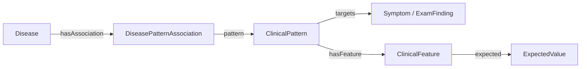

# Ontoward MVP 제품 요구사항

## 목적과 이번 산출물

Ontoward는 N.O.V.A. 모의 환자의 초기 정보에서 출발하여 문진·신체진찰로 필요한 정보를 모으고, S·O·A·P 초진 기록과 주진단 하나를 제출하는 진단 에이전트다. 첫 구현 대상은 예선이며, 본선의 검사 실행과 참가자 모델은 후속 단계로 구분한다.

첫 MVP는 한 증례를 메모리에서 진행한다. 사용자는 에이전트가 어떤 정보를 얻었고, 어떤 후보를 고려하며, 왜 다음 행동을 제안하는지 확인할 수 있어야 한다.

현재 제출 에이전트는 D44의 세 상주 상태와 현재 턴 수명, 항상 문맥 분석 뒤 정확한 Python 연결과 선택적 DB 정규화를 사용한다. 임상 사실은 정식 영어 용어·속성·속성별 값·작은 수치와 필요한 취득 메타데이터로 저장한다. 원문은 해석 문맥과 감사에만 두고, DB 미표현 정보는 기존 범주의 typed note로 SOAP·수집 판단에 보존하며 진단 점수에는 넣지 않는다. D38의 대표 주호소·공유 추론·질문 효용, D40의 보호 수집·예산·Education 응답 경계, D42 임상 핀과 원본 SDK를 유지한다. 진단과 최종 영어 계획은 하나씩 보관하고 SOAP는 제출·확인 동안만 유지한다. 실제 모델 품질·공식 평가는 별도 검증한다.

D15의 정보 보존과 D17의 워크플로우 정책을 유지한다. D18은 이전 지식·문구·승인 배치를 삭제하고 SNOMED CT·BODHI-S 원천 전용 베이스에서 전체 스키마 후보와 한국어 매핑을 재구축한다.

D20은 이 원천 기반에서 공모전 MVP의 첫 연결 그래프를 수용한다. Finding site·Location 값의 실제 기관 계통 경로는 집중 ROS의 inSystem으로, BODHI의 양성·0이 아닌 방향성 영향은 typed Context의 hasSupportingContext로 연결한다. 필수 조건은 Association applicability로 보존하고, 확인되지 않은 조건을 지지로 활성화하지 않는다. 그래프 수용은 추가 임상 승인 대기 없이 진행하며 한국어 문진·진찰 자산은 별도 세션에서 완성한다. 문구 수용 전 실행 manifest는 graph_admitted_text_pending으로 남고 prepare()는 그 사유를 명시한다.

D23은 완전한 원천 기반 후보·매핑·연결·한국어 환자 행동의 공모전용 사용을 승인한다. 별도의 임상 승인이나 사용자 선택을 기다리지 않으며 D20 그래프와 D22 문구의 정확한 해시를 새 수용 영수증에 연결한다. 문구 수용 후 manifest는 admitted가 되고 prepare()는 실제 문진·진찰 문구를 엄격하게 검증한다. 의미·단위·획득 방식이 빠진 레코드는 기술적 제외로 유지한다. 실행 검증은 프로젝트 오프라인 컨테이너에서 한국어 합성 환자·스크립트 Gateway·SOAP·확인 종료와 독립 제출 ZIP을 대상으로 한다.

공식 요구사항 확인일은 **2026-10-14 KST**이다. [개발 가이드](https://nova.snubhai.org/docs/), [참가 규칙](https://nova.snubhai.org/rules/), [평가](https://nova.snubhai.org/evaluation/)와 [10월 13일 공지](https://nova.snubhai.org/qna/)를 보존 SDK 1.0.1 및 기존 참고 문서와 대조했다. 현재 적용 변경은 [10월 14일 규칙 업데이트](assets/nova-competition-2026/CHANGES_2026-10-14.md)에 기록한다. 두 제공 PPTX의 변환과 [10월 12일 비교](assets/nova-competition-2026/CHANGES_2026-10-12.md)는 당시 자료로 유지한다. 홈페이지의 정확한 수정 시각과 새 시작 패키지의 실제 SDK 버전·바이트는 확인하지 않았다.

## 채택한 기술과 역할

D39의 개인용 지식 뷰어는 현재 manifest에 고정된 실행 RDF와 준비용 SQLite를 로컬 브라우저에서 읽기 전용으로 열람한다. 이름·동의어·SCTID·원래 URI로 검색하고, 질환–패턴 연결·조건·속성·기대값을 읽기 쉬운 표시 이름과 방향이 있는 주변 그래프로 탐색한다. 파생 표시 이름과 원천 라벨을 구분하며 원래 URI와 단위·연산자·AND/OR를 보존한다. 준비 DB의 테이블·행·구조·외래 키와 원천 행의 파일·줄·해시를 확인할 수 있다. 외부 자산·모델·다운로드·배포는 사용하지 않으며 실행 그래프와 준비 후보·원천 보관 범위를 구분한다. 이 뷰어는 Test 소유이며 상담 실행이나 제출 산출물에 포함하지 않는다.

D30은 수용된 843개 Disease의 제공 가이드라인 문서 매핑을 준비한다. 동일 SCTID 동의어·문서 역할·관계 범위·원문 해시와 위치를 보존한다. D37은 이 결과의 경량 인덱스를 현재 그래프 build에 고정해 Education에서 사용하며 이전에 삭제한 교육 배치를 복원하지 않는다.

관리 근거 없이 임상 배경·감별 문맥만 확인되는 연결은 background_only로 구분하며 P 필드와 원문 절 선택을 비운다. 모든 질환에 문서가 연결되었다는 것과 모든 질환의 P 내용이 확보되었다는 것은 별도로 집계한다.

| 기술 | 책임 |
|---|---|
| Python | 데이터 준비와 에이전트 실행 코드 |
| LangGraph | 한 증례의 단계와 조건부 이동 |
| Pydantic | 관찰·세션·행동·SOAP·진단의 구조와 경계 검증 |
| N.O.V.A. SDK | 지정 Doctor 호출, 세션 확인, 행동 실행과 최종 제출 |
| 제공 진료지침 | D30 문서 연결과 D37 진단 후 계획의 읽기 전용 원문; 원본을 제출 ZIP에 포함하지 않음 |
| SNOMED CT International·Korean | 판본·모듈 의존성을 고정한 개념·명칭·계층·관계 원천 |
| RDFLib | RDF 생성·로드·조회; 진료 중 준비된 임상 그래프 검색 |
| Turtle | 문서별 추출 결과와 출처별 제출 지식 묶음의 저장 형식 |
| BODHI-S | 현재 변형 정의·질환 연관과 두 방향 likelihood 원천 |
| Docker | Python 실행과 의존성 설치 환경 |

JEV, Laya, HPOA는 사용하지 않는다. 이번 MVP는 대표 합성 사례의 전체 실행을 검증하며 배포·호환성 매트릭스는 도입하지 않는다.

첫 경로는 지정 openai/gpt-6-luna SDK이며 진단 추론·질문 선택은 Python이 담당한다. D37 Education은 같은 모델 high·최대 8000 출력 토큰으로 영어 계획을 생성하고 Doctor는 medium·최대 4000으로 한국어 발화를 만든다. SNOMED 원본 처리는 사전 준비에 한정하며 가이드라인 원문은 진단 고정 이후에만 제공 마운트에서 읽는다.

## 사용자가 경험할 흐름

다섯 내부 세션은 하나의 공식 NOVA 세션 안에서 진행한다. Doctor는 준비된 한국어 문진·진찰 문구를 검증·전달하고 D34 공감과 D37 교육 문장을 생성한다. Gateway·기록용 표현·공감·Education·Doctor 변환은 공통 모델 예산을 사용한다. Python이 검색·점수·진단·전달 순서와 SOAP 직렬화를 담당한다.

| 내부 세션 | 준비와 종료 조건 | 문진 최소 목표 / 최대 |
|---|---|---:|
| Initiation | 초기 정보 구조화 → 인사 → 미확인 onset·course·recurrence·previous_care | 5 / 7 |
| ChiefComplaint | 초기 대표 CC의 전체 속성 → Open Inquiry → 유용한 ROS·상세 | 7 / 14 |
| ContextFactor | 기본 병력 다섯 영역 → 관련 미확인 Context 최대 두 개 보호 → 추가 가치 비교 | 7 / 9 |
| DifferentialDiagnosis | 새 근거에 따른 재계획과 특징·진찰 | 3 / 10 |
| Education | working diagnosis 고정 → 원문·영어 P → 한국어 안내; 환자 답변은 원문 기록만 수행 | 5 / 10 |
| 최종화 | SOAP 구성·검증·필요 시 1회 재구성 → DIAGNOSE → completed 확인 | 0 |

D40의 최소치는 조건부 목표다. 이미 확인한 항목은 생략하고 명료화·소비된 거절을 상한에 포함한다. 세션 간 상한 차용은 없으며 다섯 상한의 합은 50이다. 선택적 질문·공감 전에 현재 필수 수집과 뒤 세션의 조건부 최소량·교육 5턴을 보호한다. CC의 마지막 가용 슬롯은 Open Inquiry에 남긴다.

공감 SAY는 앞선 네 수집 세션에서만 시행한다. Usage.actions는 총 소비 턴, empathy_actions는 공감 부분집합이며 공감은 문진 상한 밖에서 공통 50턴·모델 예산을 사용한다. 필수 수집을 침범하지 않으며 Education 진입 시 대기 공감을 종료한다.

첫 SAY는 “안녕하세요. 병원 오시는 길이 불편하진 않으셨나요?”다. 초기 정보를 먼저 처리하고 주호소를 다시 유도하지 않는다. Initiation은 “언제부터 불편하셨어요?”, “불편한 것이 점점 심해지나요?”, “이전에도 이렇게 불편하신 적 있으셨어요?”, “이전에는 어떻게 치료받으셨나요?”를 순서대로 확인하되 해결된 슬롯은 생략한다. Duration 질문은 onset이며 EpisodeDuration과 구별한다. FindingAttribute가 없어도 기록하고 관련 치료 경험이 명확히 해당 없으면 생략한다.

대표 CC 하나를 환자가 명시한 우선순위로 선택한다. 여러 보고의 우선순위가 모호하면 증례 전체 최대 2회 명료화 안에서 확인하며 임의의 첫 증상으로 대체하지 않는다. 그 CC의 get_symptom_attributes() 전체를 기존 속성 순서와 나머지 URI 순서로 처리한다. 각 항목은 unasked·acquired·recorded_unmapped·unknown·not_applicable·blocked_asset·budget_stopped로 기록하고 처리율과 실제 값 확보율을 구분한다. 같은 관찰에서 얻은 속성은 반복하지 않고 모름도 처리 결과로 인정한다. 한 번에 질문 하나를 전달하되 자발적으로 제공한 여러 사실을 같은 입력에서 보존한다. 대표 CC 정정 시 속성 목록·후보·ROS 기준을 다시 구성하고 전달 이력과 한 번 수행한 Open Inquiry는 보존한다.

D15에서 이미 물었다는 판단은 실제 전달 이력의 `was_asked`, 해결된 정보의 판단은 출처와 확정 값이 있는 `has_resolved_evidence`로 분리한다. 처리 완료라도 unknown·uncertain이나 값 없는 속성은 확보된 사실이 아니다. 일반 질문의 반복은 막으면서 현재 후보의 미해결 조건은 기존 최대 2회 명료화에서 확인한다.

집중 ROS 후보 계통은 대표 CC의 기존 inSystem·BodySystem으로 고정한다. 전체 속성과 Open Inquiry 뒤 현재 질문 가치에 따라 기확인·중복을 제외하여 총 6회 이내 선택하고 새 증상으로 계통을 연쇄 확장하지 않는다. BodySystem은 질환 후보 검색 필터가 아니다.

ContextFactor는 과거력·약물력·알레르기·가족력·사회력의 미확인 기본 문진을 먼저 수행한다. 이후 대표 CC 관련 미확인 전제·지지 Context를 최대 두 개까지 utility와 무관하게 보호한다. 전제조건, utility, 아직 다루지 않은 병력 영역, URI 순으로 선택하며 포괄적 병력 부정을 개별 객체의 음성으로 바꾸지 않는다. 보호 수집 뒤에는 D38 공유 커널로 선택적 질문·EXAM을 비교한다.

D38은 이전 rank_change·spread·unlock 근사값을 제거한다. 선택적 질문과 바인딩 실패의 추가 명료화를 같은 비용 1로 비교하며, 완전히 평가한 양수 가치 질문만 전달한다. 전체 CC 속성 처리와 Open Inquiry, 대표 CC 확인, 교육·공감은 각자의 필수 처리와 자원 한도를 따른다. 임상 근거뿐 아니라 질문 이력·모름·대표 CC·세션·남은 예산이 바뀌면 재계획한다.

원천 지지는 D08의 완전 조건 매칭·정교화 대체·Target별 중복 제거를 유지한다. D17은 Target→공유 Pattern Feature 평가→Association 적용 조건·가중치→Disease 순으로 처리한다. D38 적합도는 대표 CC의 정확한 관찰·에피소드·시점 지지 C + min(4, 다른 Target별 지지 합계) + Context 보강(최대 1) − 제한 반증이며 기본 존재 Pattern의 같은 활성 에피소드 부재만 typicality high=0.5·very_high=1, Target당 1·질환당 2 한도로 반영한다. 미질문·unknown·상세 불일치·다른 에피소드 부재는 감점하지 않는다.

주진단과 감별은 대표 CC의 양성 원천 지지·적용 조건 충족·양수 최종 점수를 요구한다. 추가 보고만으로 회수한 Disease는 CC 설명 경로를 갖춘 것으로 승격하지 않는다. 대표 CC와 같은 Target의 다른 관찰은 추가 보강으로 중복 계산하지 않는다. 적합도·CC 지지·명시적 충돌 수·URI 순으로 정렬하고 선택 질환을 제외한 감별 최대 5개와 실제 확보한 근거를 표시한다. 미완성 Pattern은 질문 가치에만 사용하고 자격이 없으면 확인 주호소의 증상 수준 잠정진단을 사용한다.

| 복구 상황 | 처리 |
|---|---|
| 준비 문구 오류 | prepare 거부 또는 전송 전 거부·미전달 기록; 생성·절단 없음 |
| 구조화 실패·주호소 불명확 | 원문 보존, 증례 전체 명료화 최대 2회와 재검색; 대표 CC 미결정이면 명시적 종료 |
| 후보가 계속 없음 | 확인된 현재 주호소의 증상 수준 잠정진단, 원인 미확정 표시, 질환 치료 없이 준비 안내 |
| 진단 근거 주호소도 없음 | 명시적 실패 |
| 진찰 거절·실행 불가능 | 실제 소견으로 만들지 않고 가능한 다음 행동 |
| 일시 전송 오류·REQUEST_PENDING | 같은 ID·payload로 2초 후 1회 재전송, 미해결이면 unknown 종료 |
| 명시적인 환자·진찰 응답 형식 오류 | 미확인으로 보존하고 새 ID 자동 재시도 없이 다음 가능한 질문 |
| 수집 예산 소진 | 대기 답변 처리 후 확보 사실로 SOAP·DIAGNOSE |
| SOAP 형식 오류 | 보존 사실에서 한 번 재구성하고 재검증 |

공통 한도는 50 행동·모델 200회·입력 500,000·출력 100,000토큰이다. D40의 세션별 상한과 미래 최소량을 보호한다. D41 수집 행동은 문맥 분석·정규화 최소 2회·8192 출력토큰·응답 120초·최종화 120초를 확보한다. 공감은 생성까지 최소 3회·12288 출력토큰을 확보한다. 준비된 Education은 응답 해석용 모델을 예약하지 않고 시간 여유만 유지한다. 받은 응답을 소비한 뒤 DIAGNOSE completed를 확인한다.

D41은 문맥 분석의 검색어와 질문 바인딩으로 진술별 Target·Attribute·허용값을 검색한다. 기본 후보는 진술당 Target 8개·속성 2개·속성값 8개, 확장은 32개·4개·32개를 사용하며 전체 messages 한도를 우선한다. 전체 대화는 감사에 보존하고 과거 문맥은 필요한 기록·대화만 전송한다. 문맥 분석은 기본 1회와 형식 복구 1회, 정규화는 기본·바인딩 복구·강제 매핑과 배치당 별도 형식 복구 최대 1회를 사용한다. 독립 유효 mapping을 고정하고 실패한 진술만 복구하며 마지막에는 Python이 호환 후보로 유효 dictionary를 완성한다. D34의 자유 terminology fallback은 제거한다.

D28의 전체 messages JSON UTF-8 한도인 기본 12 KiB·확장 16 KiB를 D41에서도 유지한다. 현재 입력·질문·스키마를 보존하고 선택 후보·과거 문맥을 조절하며 진술 배치를 나눈다. `CONTEXT_LIMIT_EXCEEDED`의 형식 복구 요청은 최대 8 KiB를 사용한다. 필수 내용만으로도 상한을 넘으면 전송하지 않고 원문과 사유를 감사에 남긴다. 검증된 문맥이 있으면 정규화 실패는 마지막 강제 완료로 처리하고, 문맥 자체가 검증되지 않으면 unknown으로 남긴다. 원격 종료·만료·전송 결과 불명은 별도 실패 경계다. 바이트 상한은 실제 서버 문맥 한도를 확정한 값이 아니며 공식 재검증은 별도 관측이 필요하다.

D29의 원천 한·영 라벨·동의어 검색과 Symptom 주호소 조건을 유지한다. D41 문맥 분석은 임상 진술마다 최대 8개·각 80자 이내의 검색어를 만들며 진단 가설로 새 증상 후보를 제외하지 않는다. 전송한 후보의 정확한 URI·속성 연결·허용값을 Python이 검증한다. 정상 매핑은 동등 개념과 호환 상위 개념을 우선하고, 마지막에는 가장 가까운 호환 DB 개념을 강제 선택한다. 강제 사실은 forced_by=model|deterministic을 기록하며 진단·질문·SOAP가 사용한다. 증례 ID별 규칙·수동 임상 동의어 표·Disease의 증상 전환은 사용하지 않는다. 실제 양성 Symptom이 전혀 없는 비임상·모름 입력을 주호소로 만들지는 않는다.

D36은 검증 전에 `record_id`와 현재 질문의 암묵적 연결을 해석해 최종 저장 필드를 확정하며, 저장 시 목적지를 다시 바꾸지 않는다. SAY나 초기 환자 발언은 기존 EXAM·활력징후 기록을 교체하지 못한다. 환자가 진찰 소견을 부인하면 별도 S 보고로 남기고, 획득된 O 소견의 정정은 같은 대상·관찰·에피소드에 대한 새 EXAM 결과만 허용한다. 초기 활력징후의 취득 경로는 그대로 보존한다.

현재 유효 근거는 주체·관찰·에피소드·Target·Attribute와 current·past·unspecified 시점을 함께 사용한다. 같은 입력의 증상과 종속 속성에 검증 전 일관된 관찰·에피소드 ID를 부여하고 질문 해결과 추론은 공통 EvidenceIndex의 현재 근거를 사용한다. 명시적 정정은 기존 `record_id`를 사용하며, ID가 없으면 `correction=true`와 완전한 동일 키로 기존 기록 하나를 찾아 갱신한다. 모호하거나 여러 기록에 해당하면 수용하지 않고 확인한다. 같은 키의 존재 양성·음성, 동일 범주값의 명시적 긍정·부정, 상충하는 수치는 불확실하게 취급한다. RDF에 cardinality가 없는 범주 속성은 서로 다른 양성 값이나 언급하지 않은 값을 배타적 음성으로 바꾸지 않으며, 주호소 확정·질문 해결 여부·추론·증상 진단 fallback·SOAP가 같은 해석을 사용한다. 서로 다른 에피소드·주체·과거 보고를 마지막 발언 하나로 합치지 않는다.

환자 원문과 인용 구간은 해석 문맥과 감사에 보존한다. D41 SOAP는 DB mapping과 검증된 메타데이터만 의미에 맞는 필드에 기록하며 미해결 원문 구간은 삽입하지 않는다. 인사·수긍·요청·미래 약속은 대화 이력에 둔다. 명료화로 해결된 이전 불확실성은 공통 현재 사실 투영에서 제외하고 서로 다른 가족 구성원·시점·취득 경로를 합치지 않는다.

## D43 초기 해석과 독립 사실 복구

그래프는 turn 0의 process_initial_input에서 초기 opening과 제공 초기 데이터를 먼저 해석·정규화·기록한 뒤 첫 SAY로 이동한다. 주호소 Target 진술과 속성 진술을 분리하고, 검색용 feature 힌트가 있다는 이유로 Target (+)/(-)를 거부하지 않는다. 알려진 대표 CC가 있으면 공통 intake 질문의 Target·관찰·에피소드를 그 CC에 연결한다. 임상 dictionary와 원문 없는 하류 계약은 D41을 유지한다.

문맥 모델에는 그래프 조건 전체가 아닌 관찰용 quantity/interval 스키마를 제공한다. 정상 JSON의 각 진술을 독립 검증하고 유효 행을 고정한 채 무효 행만 1회 복구한다. 초기 우선 호소의 관찰과 원인 불확실성이 혼동되면 집중 문맥 검토 1회를 추가할 수 있으나 실제 모름을 양성으로 강제하지 않는다. 과거에 시작해 지금도 지속되는 호소와 종료된 과거 에피소드를 구별한다.

등록된 수치가 부모 관찰 없이 보고되면 record_only로 보존할 수 있다. 이를 증상 존재나 질환 점수로 바꾸지 않으며 경과·변화량을 절대 신장·체중으로, 치료력 부정을 주호소 부재로 바꾸지 않는다. 원문 위치·거절·복구·진술별 처리 결과는 감사에 보존한다. 실제 C03 저장 응답의 재현과 새로운 집중 검토의 통제 응답, 실제 모델 검증을 구분한다. D42 임상 자산과 d41.1 추론 정책은 그대로 두고 알고리즘 표지는 최신 D44의 d44.1로 관리한다.

## D40 보호 수집과 D41 입력·기록 계약

문맥 분석 wire와 DB dictionary, 내부 CaseState를 분리한다. quote·검색어·미등록 수치와 인구학 정보는 해석 문맥·감사에 두며 정본 사실의 text·record_details·quantities는 비운다. source_ref와 진술별 처리 결과로 원문 출처를 연결한다. 등록된 속성의 수치·단위·구간만 dictionary와 SOAP에 넣고 정상 발달·단순 수치 변화에서 병적 의미를 추정하지 않는다. SOAP는 세션보다 임상 범주와 취득 경로로 배치한다. 코드로 표현 가능한 가정 보고는 S, 초기 취득·실제 EXAM은 O에 두고 O.tests는 비워 둔다. 현재 수용 DB로 표현할 수 없는 초기 활력징후도 자유 문장으로 우회 삽입하지 않는다.

진단 고정은 선택을 유지한다는 뜻이며 확진을 뜻하지 않는다. FixedDiagnosis는 working 상태와 미완료 평가를 보존한다. 영어 P는 현재 평가와 조건부 치료를 구별하고 한국어는 PlanSentence별 조건을 유지한 묶음 전체를 검증·예약하여 전달한다. 진단 의미·다음 행동·조건부 관리·추적·안전을 우선하며 미전달 계획은 완료 교육으로 집계하지 않는다.

## D38 추론 커널과 질문 가치

실제 입력과 가상 답변은 `evaluate(evidence_index, chief_anchor, policy)`와 `evaluate_delta(snapshot, evidence_patch)`의 같은 Feature 매칭·적용 조건·정교화·중복 제거·자격 규칙을 사용한다. 가상 패치는 격리된 근거에만 반영하며 환자 기록·질문 이력·사용량·SOAP·SDK 요청을 변경하지 않는다. 입력→Feature/Pattern, Context→Association/지지 Disease와 refinement 역색인으로 영향받은 계산을 갱신한다. Context는 확보 시점부터 동일하게 계산한다.

현재 관찰에서 관련 Disease·Pattern의 잔여 조건을 찾고 같은 Target·Attribute·주체·관찰·에피소드·시점은 질문 하나로 묶는다. 거짓 적용 조건은 해당 경로를 없애고, 미확인 전제와 존재 확인은 선행 질문으로 둔다. 해결·명시적 모름·자산 차단 질문은 제외한다. 전체 후보는 보존하며 정밀 비교는 현재 8개와 잔여 질문 구조가 다른 잠재 4개로 시작한다. 양수 가치가 없으면 전체 CC 양립 후보로 확대하고 새 근거에 따라 후보가 다시 들어올 수 있다.

존재는 양성·음성, 수치는 임계값·경계·단위별 구간, 범주는 승인된 동치·계층과 양립하는 긍정·명시적 부정 조합을 비교한다. 같은 조건 평가 영역은 합치고 월·년을 고정 일수로 바꾸지 않는다. 모름·거절·해석 실패는 음성이나 정보 있는 답변의 등확률 분기가 아니다.

후보 쌍이 모두 적격이면 `r=clip((F_i-F_j)/4,-1,1)`, 한쪽만 적격이면 ±1, 둘 다 부적격이면 0이다. D는 유효 답변 쌍의 상대 판단 차이를 현재 점수 차이 기반 가중치로 평균하고 E는 답변에 따른 자격 변경 비율을 평균한다. 한 행동 비용은 1, 직접 가치 U1=D+0.25E다. 두 질문 경로는 첫 답변별 후속 가치를 0.5로 할인해 최대 두 행동 비용으로 나눈다. 최대 6질문으로 완성 가능한 경로는 `0.5^(m-1) × (D_joint+0.25E_joint) / m`을 사용한다. 세션별 남은 용량 안의 경로만 비교하고 첫 질문만 전달한 뒤 다시 계산한다. 미래 완성 가능성은 실제 진단 지지가 아니다.

선택당 가상 평가 상한은 512회다. 짧고 영향 후보가 많은 질문부터 평가하며, 한도 안에서 완전히 계산한 직접·후속·완성 경로 가치 중 최댓값을 사용한다. 불완전 영역·경로는 별도 표시하고 양수 완전 평가가 없으면 computation_limit으로 진행하며 정보 소진으로 주장하지 않는다. 선택 이력은 관찰→Pattern→Association, 조건·전제, 답변별 점수 분해·기여·자격, 비용·가치, 가까운 차점과 제외 사유, 실제 답변 뒤 결과와 정책 버전을 보존한다. 이 수치는 구조적 판별 정책 점수이며 확률·EIG가 아니다.

현재 별도 `d41.1` 정책과 manifest 해시를 고정하며 D38·D40의 원천 그래프·출처별 점수·질문·의존성을 보존한다. 합성 독립 매칭, 가상·실제 전체 평가 일치, CC 흐름·완성 경로·일반 불변조건, 수용 RDF 한국어 상담·관측기·독립 ZIP을 Docker에서 검증한다. 실제 Luna 해석·임상 정확성·공식 채점은 별도 외부 실행 증거다.

## 공식 세션·실행 계약

| 항목 | 예선 요구사항 |
|---|---|
| 준비 | `prepare()`에서 증례 접근 없이 지식 자원 준비, 최대 10분 |
| 진료 | 준비 알림 후 `consult(client, resources)`에서 세션 접근, 최대 30분 |
| 모델 | 지정 `openai/gpt-6-luna` Doctor API를 증례당 최소 1회·최대 200회; 입력 500,000·출력 100,000토큰 |
| 행동 | `SAY`·`EXAM`은 각각 1턴, `DIAGNOSE`는 0턴, `TEST`는 차단 |
| 입력 길이 | SAY·EXAM·본선 TEST는 NFC 정규화 후 1–30 유니코드 코드 포인트; 공백·문장부호·줄바꿈 포함 |
| 상호작용 | 최대 50턴; 50번째 응답 이후에도 제한 시간 안에서 DIAGNOSE 가능 |
| 실행 자원 | 증례별 컨테이너, CPU 2코어·RAM 8GB·GPU 없음 |

세션 응답의 남은 턴·마감·허용 행동을 반영한다. 준비 문진·진찰은 생성이나 절단 없이 검증·전달한다. D34 공감과 D37 교육 변환은 지정 모델을 사용하며 전달 전 독립 NFC 1–30자 검증을 적용한다. 교육 변환은 잘못된 묶음 한 번만 복구하고 절단하지 않는다. 대회 공식 제한과 내부 예산 정책을 구분한다.

형식·의미 거절은 실제 수행이나 관찰로 확정하지 않는다. 보존한 공개 규칙에서 `EXAM_NOT_SPECIFIC`·`EXAM_NOT_RECOGNIZED`는 결과 없이 1턴을 사용하며, `ACTION_NOT_AVAILABLE`은 턴을 쓰지 않는다. 응답의 남은 턴을 확인하고 D35의 제한된 동일 요청 1회 재전송만 허용한다. 명시적 환자·진찰 응답 형식 오류를 새 ID로 자동 재시도하지 않으며 세션 종료·만료와 미해결 일시 오류는 명시적으로 종료한다. 기본 예제와 개발 키트만으로 공식 서버의 중복 처리·복구 동작을 검증했다고 주장하지 않는다. [요청과 오류 규칙](https://nova.snubhai.org/docs/)

서버가 받은 빈 내용·길이 초과 SAY/EXAM과 부적절한 EXAM은 1턴을 쓴다. SDK가 전송 전에 ValueError로 막은 요청은 턴을 쓰지 않는다. 빈 Doctor 답변은 호출 200회에는 포함되지만 토큰 예산과 Doctor 비용에서는 제외된다. 공식 session()의 events에 의존하지 않고 실제 대화는 InputInterpreter 문맥에 한 번 유지하고 상세 행동·응답은 Test 감사에 기록한다.

문맥 분석·DB 정규화·empathy는 openai/gpt-6-luna medium을 사용한다. 기본 출력은 4096토큰이며 finish_reason=length는 성공이 아니다. D41의 단계별 복구에서 최대 8000토큰을 사용하고 강제 정규화 이후에도 형식이 무효하면 Python이 유효 dictionary를 완성한다. 문맥 자체의 반복 실패는 unknown으로 남기며 기록용 terminology는 사용하지 않는다. 실제 Luna 의미 품질은 별도 검증이다.

최신 가이드는 제공자 응답 시작 한도를 180초, 새 SDK 기본 대기 시간을 240초로 설명하며 `REQUEST_PENDING`(HTTP 503/409)과 `PROVIDER_UNAVAILABLE`에는 같은 request_id를 유지한 재요청을 안내한다. 보존 SDK 1.0.1의 기본 120초는 수정하지 않는다. 애플리케이션 전송 경계가 최대 240초와 남은 시간·제출 여유로 호출 대기를 제한하고 원래 timeout을 복원한다. 재전송은 같은 요청으로 기록하여 턴·호출·사용량을 중복 계산하지 않는다. 합성 복구와 실제 서버 복구는 별도 검증이다. [요청 대기·문제 해결](https://nova.snubhai.org/docs/)

개발용 create_sample은 팀당 KST 하루 100개, 제출 후 샘플 검증은 별도로 하루 10회, 공식 평가는 팀·단계별 하루 1회다. 세션 종료·만료로 생성 횟수가 돌아오지 않는다. 세션 밖 성공한 gpt-6-luna 호출은 model 생략 여부를 포함해 하루 1,000회로 합산하고 gpt-6.1-sol은 100회다. 증례 안 Doctor 호출은 이 일일 호출 한도와 별도로 증례별 한도를 적용한다. D09 준비의 공유 대장은 실패·불명 요청도 보수적으로 포함하고 날짜별 명시적 잔여 예산 안에서 최대 100회로 제한한다. [개발 한도](https://nova.snubhai.org/docs/)

## 로컬 평가 환경

D27의 `Test/`는 보존된 공모전 SDK·개발 키트·공개 샘플의 인터페이스를 기준으로 예선 실행 경계를 재현한다. `submission/run.py`를 별도 컨테이너에서 그대로 실행하고 로컬 HTTP API가 ready·session·SAY·EXAM·chat·DIAGNOSE를 처리한다. 에이전트는 CPU 2코어·RAM 8GB·읽기 전용 파일시스템과 512MB `/tmp`·전용 `/output`을 사용한다. 내부 네트워크만 연결하며 환자 대본·진찰표·개발 키·참조 정답은 마운트하지 않는다.

기본 `scripted` 모드는 외부 모델 없이 인터페이스와 제출 흐름을 검증한다. 별도 `nova` 모드는 시뮬레이터만 NOVA의 세션 밖 개발 chat에 접속하여 환자·진찰 역할과 기존 Gateway 호출을 처리한다. 공개 `C01`·`C03`·`C10`을 한 번에 하나씩 실행하며, 역할별 비공개 입력과 반환된 관찰을 분리한다. 참조 SOAP는 실행 입력으로 읽지 않는다. 실제 NOVA 실행은 증례와 요청 상한·크레딧 사용 효과를 확인한 범위에서 수행한다.

진료별로 대화·요청 ID·거절·예산·최종 SOAP·완료 영수증과 프로세스 종료 상태를 `Tmp/test-evaluator/`에 보존한다. 동일 ID·payload는 효과를 중복 실행하지 않고 완료 응답을 재생하며, 처리 중에는 REQUEST_PENDING을 반환한다. 이미 출력이 있는 세션은 자동 재개하지 않는다. 로컬 완료는 공식 서버 수락·점수·임상 정확성의 증거가 아니며 채점 상태는 `not_scored`다. 실제 모델과 완전히 격리된 오프라인 실행은 함께 성립하지 않으므로 외부 모델 연결은 시뮬레이터의 명시적 별도 모드로 둔다.

D31의 개인용 웹사이트는 `sh Test/web.sh`로 시작하고 `http://127.0.0.1:8765`에서 증례·응답 모드·요청 상한을 선택한다. 기본은 C10·NOVA·200회이며, 사용자가 실행 버튼을 누르면 기존 실행기가 한 증례를 시작한다. 웹과 CLI는 같은 실행 잠금을 사용하고 페이지 새로고침은 기존 실행 상태를 다시 읽는다. 실행 중에는 상태와 경과 시간을 표시하고 종료 후 상세 리포트를 제공한다. 웹 서버와 프론트엔드는 추가 의존성 없이 프로젝트 컨테이너에서 동작하며, 호스트 셸이 작업 요청 파일을 받아 Docker 실행을 맡는다. 웹 컨테이너에는 개발 키와 Docker 소켓을 전달하지 않는다.

관측 부트스트랩은 submission의 파일을 수정하지 않고 원본 진입점을 실행한다. 실제 그래프 노드·초기 상태·노드별 변경분·SDK 요청과 응답·오류를 기록하고 시뮬레이터의 역할별 모델 요청과 상위 행동 ID를 연결한다. 화면에서 내부 세션과 턴별 대화, 질문·예산·사실의 변화, 후보 순서·점수 기여·근거·선택된 진단, 최종 SOAP와 영수증을 탐색한다. Note 탭은 S·O·A·P의 15개 필드와 별도 diagnosis에 저장된 기록·완료 상태·임상 값·개념·출처를 보여주고, 해당 시점의 실제 생성된 제출 payload 및 최종 수신본과 구분한다. 미구조화 환자 보고는 기록된 구간만 표시하며 새 임상 해석을 생성하지 않는다. 전체 상태와 원시 요청은 상세 영역에서 확인하며, 별도 report.html도 보존한다. 저장된 실행을 열면 현재 뷰어로 리포트만 갱신한다. 인증 헤더와 환경변수는 기록하지 않고 수집되지 않은 과거 상태는 만들어내지 않는다. 실행 실패도 부분 로그와 함께 표시하며 재시작으로 자동 재개하지 않는다.

D31 테스트 리포트는 **정보 흐름**을 기본 화면으로 사용한다. 선택한 턴의 실제 그래프 노드 아래에서 Consultation·InputInterpreter·ClinicalReasoner·InterviewPlanner·Doctor·SubmissionWriter와 상태·모델·전송 담당 객체의 호출을 펼친다. 각 단계의 호출자·인스턴스 경로·자료형·입력·반환값·변경 경로·SDK body와 수신 결과를 확인하고, JSON 문자열은 원문과 해독한 구조를 함께 살핀다. **객체 탐색**은 WorkflowState의 CaseState·InterviewState·SessionContext와 선택적 TurnContext를 구분해 턴 전후의 데이터 트리·필드별 변화·검색·변경 턴 이동을 제공한다. InputResult·ModelResult·EvidenceIndex 등의 임시 반환 객체도 실제 호출 결과에서 확인한다. 내부 호출을 기록하지 않은 과거 실행에는 관측된 노드와 상태만 제공하고 미수집을 표시한다. 수집 범위는 주요 실행 객체 경계이며 Python heap과 가상 분기의 내부 점수 계산 루프 전체를 추적하지 않는다.

## 오프라인 프로젝트 흐름 지도

D32의 `Test/atlas.html`은 개인이 프로젝트 구조를 이해하기 위한 정적 콘텐츠다. 프로젝트 README와 현재 구현을 근거로 전체 준비·진료·제출 경로, 내부 세션과 공통 루프, Pattern 추론과 질문 선택, 준비와 수용의 경계를 도식화한다. 스타일과 SVG를 HTML 한 파일에 포함하며 브라우저 직접 열기·목차 이동·찾기·인쇄만 사용한다. 실행 제어·데이터 자동 조회·자동 갱신·외부 자산·서버·새 의존성·배포는 포함하지 않는다. 기준 날짜·원문 링크·설명용 예제와 현재 검증 한계를 표시하며 submission과 data 자산은 보존한다.

## 최소 데이터·입출력 계약

| 객체 | 소유 정보 |
|---|---|
| CaseState | facts·notes·chief_fact_id·최종 diagnosis·plan·임상 revision |
| SessionContext | 최신 서버 제약·한도·마감·실제 사용량·종료·최소 receipt |
| InterviewState | 현재 세션 질문 대기열·compact 완료 기록·필요한 중단·공감 코드 |
| TurnContext | 현재 입력·행동·제출의 요청·응답·단계; 처리 후 해제 |

임상 주장마다 독립 fact ID와 정식 영어 Target·Attribute·속성별 값·ObservedNumber·present/absent/uncertain/unknown을 둔다. 질문은 별도 대기열이며 완료 뒤 의미 키·목적·출처·취득 턴·처리 결과와 필요한 fact ID만 남긴다. 모름은 질문 처리 완료일 수 있지만 임상 음성으로 바꾸지 않는다. 같은 용어라도 주체·가족 구성원·시점·관찰·에피소드·취득 조건이 다르면 합치지 않는다.

InputInterpreter는 초기 입력과 수집 SAY·EXAM의 모든 답변에 문맥 분석을 호출한다. 짧은 답·모름·수긍·빈 입력도 호출하며 Education 답변은 기록 전용이다. 정확한 연결은 Python이 처리하고 미해결 임상 진술만 공급된 정식 영어 DB 용어를 key로 하는 dictionary 배열에 매핑한다. polarity·허용 속성 값·보고한 수치만 반환하며 원문·요약·메타데이터를 매핑 사본으로 저장하지 않는다.

실제 대화와 환자 맥락은 InputInterpreter에서만 보관·소비하고 모델 교환·오류·복구·대체 전 사실은 실행 상태와 분리된 Test 감사로 기록한다. 환자 사실 자체가 typed canonical 상태이며 별도 CanonicalSnapshot은 두지 않는다. EvidenceIndex는 필요한 지식 경계에서 내부 URI를 찾아 진단 가능한 사실만 계산한다. 질문과 다른 fact ID를 사용하고 완료 결과의 fact_ids로 한 번 연결한다. 등록 수치는 approximate와 구간·단위를 보존하며 SOAP는 qualified scope를 표시한다. 프롬프트 경로는 제출 내부 공개 설정으로 선택한다.

D41은 현재 질문의 Target·Attribute·허용 값·주체·시점과 진술별 원천 라벨·동의어·검색 힌트를 사용한다. 기본 후보는 진술당 Target 8개·속성 2개·속성값 8개, 복구는 Target 32개·속성 4개·값 32개이며 전체 messages 한도를 함께 적용한다. 현재 진단 가설로 새로운 호소를 배제하지 않는다. 여러 진술이 한 후보 예산 때문에 사라지지 않도록 배치를 나눈다. 중복 JSON key·미등록 ID/값·잘못된 관계·비유한 수치·미등록 단위를 거부한다.

D44는 문맥 분석 1회와 행별 복구 1회, 정확한 Python 바인딩 후 필요한 일반 매핑·최종 강제 매핑과 배치당 형식 복구 1회를 사용한다. binding_repair는 제거한다. 정확히 수용한 형제 진술을 고정하고 미해결 진술만 비어 있지 않은 호환 후보로 복구한다. 강제 결과도 polarity·주체·시점·취득 조건을 검증하며 최소 forced 표지만 사실에 남긴다. 시도별 원문·오류·강제 주체는 감사 기록에 둔다. 포괄적 병력 부정·치료력·미등록 측정은 기존 범주의 note와 작은 완료 결과로 처리하고, 미확인 증상 양성·개별 질환 음성·실제 EXAM으로 승격하지 않는다.

문맥 분석은 수집 세션의 감정·공감 요청을 정확한 인용으로 식별하고 별도 공감 생성에는 감정·요청 코드와 canonical 사실만 제공한다. 반복·수긍을 억제하고 새 어려움·명시적 재요청을 구분한다. Education 답변은 원문·전달 이력만 기록하며 임상 추출·공감·재진단·재계획을 수행하지 않는다.

## 정보 객체 수명과 책임 — D44

WorkflowState는 CaseState·InterviewState·SessionContext를 턴 사이에 유지하고 TurnContext만 선택적으로 전달한다. CaseState는 facts·notes·chief_fact_id·diagnosis·plan·revision에 한정한다. 현재 세션 질문과 compact 완료 결과·필요한 수집 중단은 InterviewState가, 서버 제약·사용량·종료와 최소 receipt는 SessionContext가 소유한다. TurnContext에는 노드를 넘어 현재 행동을 이어가는 질문 참조·요청 ID·단계·응답과 제출 작업만 둔다. 입력을 수용하고 완료 질문을 제거한 뒤 turn을 비운다.

ModelResult·InputResult·문맥 진술·후보·mapping·행별 오류·복구 이력·교육 문서 조각은 호출의 지역값이다. 실제 근거 인덱스와 캐시는 최신 한 벌만 재사용하며 사실/주호소가 바뀌면 교체한다. 가상 응답·경로·가상 캐시는 선택 뒤 폐기한다. 실제 대화는 해석기에서 한 번 보관하고 하류나 그래프 상태로 전달하지 않는다. 상세 감사는 Test 경계에서 기록하며 실행 판단에 다시 사용하지 않는다.

질문에 assessment나 가상 결과를 붙이지 않고 미래 세션의 질문을 생성하지 않는다. 완료 후에는 의미 키·목적·처리 결과·필요한 fact ID·출처·취득 턴만 보관한다. chief 진행 수·ROS 대상·Context 확보 수는 사실·지식·완료 결과로 계산한다. 고정 진단·영어 계획은 단일 정본이고 한국어 안내는 같은 대기열에서 sentence ID로 연결한다. SOAP는 최종 제출 작업에만 존재하며 confirmed completed 뒤 해제한다.

수명·정보 보존·취득/정정·속성별 용어·캐시/관측 일치·저장 C03 응답·한국어·Education·독립 ZIP·원본 SDK 로컬 HTTP를 프로젝트 Docker에서 검증한다. 같은 고정 입력의 상태 크기·복사/검증 시간·요청 바이트·호출 수를 측정하며 실제 서비스 성능으로 일반화하지 않는다. 모든 남은 객체·필드의 소유자·생성·소비·폐기·필요 이유는 제출 백서에 기록한다.

## SOAP 기록과 최종 제출

최종 결과는 `client.diagnose(note=..., diagnosis=...)`로 제출한다. 화면·stdout·파일은 공식 제출을 대신하지 않는다. D12에 따라 SDK 1.0.1의 15개 SOAP 문자열 필드와 별도 주진단을 전송 계약으로 사용한다.

| 제출 항목 | 필수 필드 | 내용 |
|---|---|---|
| S | `cc`, `hpi`, `pmh`, `fh`, `sh`, `ros` | 주호소, 현병력, 과거력·약물·알레르기, 가족력, 사회력, 계통 문진 |
| O | `exam`, `tests` | 받은 진찰·검사 소견과 획득 턴; 초기 활력징후는 초기 정보로 표시 |
| A | `evidence`, `differential` | 판단에 사용한 문진·신체진찰 소견 목록과 중요한 감별진단 |
| P | `tests`, `treatment`, `disposition`, `follow_up`, `education` | 추가 검사, 치료, 처치 결정, 추적·경고 증상, 교육 계획 |
| 별도 값 | `diagnosis` | CaseState.diagnosis의 비어 있지 않은 주진단 하나 |

모든 SOAP 칸은 문자열이고 내용이 없는 칸은 빈 문자열로 둔다. 단, 기록 전체를 빈 문자열로만 채우지 않는다. 주진단은 CaseState.diagnosis에 유지하고 별도 diagnosis 인자로 비어 있지 않은 문자열 하나를 보낸다. note.A에는 evidence·differential만 넣는다. 누락·추가 필드와 잘못된 자료형은 제출 전에 거절한다. A.evidence에는 실제로 확보하고 판단에 사용한 문진·신체진찰 소견을 간결하게 목록화하며, 지식 출처나 내부 사고 과정으로 대신하지 않는다. 미확인·미시행 항목은 근거로 채우지 않고 원문은 InputInterpreter 전용 문맥과 Test 감사에서 추적하고 사실은 직접 출처·취득 턴을 보관한다.

D33의 결정론적 렌더러는 가능한 모든 SOAP 내용과 별도 주진단에 원천의 영어 용어를 사용하고, 채워진 각 줄을 `Category: Content`로 고정한다. `S.cc`는 `C.C: Cough`, `Onset: 3 days before presentation`으로 구성하며, 통증이면 같은 주호소·관찰·에피소드에서 확보한 NRS·Location·Quality·Duration을 `Pain assessment:`에 넣는다. NRS 척도와 미확인 점수를 추정하지 않는다. `S.hpi`는 `P.I:`, `Onset:`, `Duration:`, `Aggravating factor:` 등 확인된 범주의 합으로 작성한다.

과거력·가족력·사회력·ROS는 정식 영어 용어와 (+)/(-), 속성별 허용 값·수치를 사용한다. D44의 note는 기존 범주·polarity·간결한 영어 값·별도 typed 수치로 표현하며 SOAP와 수집 판단에 사용한다. 환자 원문·미해결 원문 span과 과거 중첩 객체를 우회 복사하지 않는다. note와 포괄적 병력 부정을 개별 질환 음성이나 진단 근거로 만들지 않는다. 치료력 부정과 지켜본 경험은 previous_care에 보존한다.

`O.exam`은 `V/S:`·`PE:`와 제공된 단위·실제 획득 턴을 보존한다. `A.evidence`는 `Diagnosis: #1. ...`와 `Evidence:`로, 감별은 실제 확보한 근거가 있는 `r/o Diagnosis: reason`으로 작성한다. P도 필드별 영어 범주로 작성하며 D37의 검증된 생성 문장을 보존한다. D15의 주체·현재/과거·발현·속성 값·수치·단위·구간 경계 보존을 유지하되 주체와 발현 표시는 가족·과거·여러 에피소드 구분에 필요할 때만 붙인다. 내부 URI·요청 ID·에피소드 ID는 노출하지 않고, 한 번의 지속시간과 발생 후 경과시간을 구분하며 월·년을 일수로 환산하지 않는다. 영어 명칭이나 승인된 영어 계획이 없는 경우 원천 표현을 보존한다.

공식 안내 표와 제출 예제는 주진단을 별도 diagnosis 값으로 보내도록 안내한다. 사용자는 D12에서 SDK 전송 형식을 선택했다. SDK를 수정하지 않으며 note.A.diagnosis를 추가하지 않는다. 문서·코드의 일치는 공식 서버 수락을 검증한 결과와 구분한다.

예선의 `O.tests`는 빈 문자열이며 향후 필요한 검사와 이유는 `P.tests`에 쓴다. 기록 전체는 UTF-8 100,000바이트, 주진단은 500바이트까지이며 30자 대화 한도는 기록에 적용하지 않는다. 전송 문자열과 기록 크기를 검증한다. 형식 오류는 한 번 재구성하며 서버 INVALID_RECORD_FIELDS 복구는 새 요청 ID를 사용한다. 제출 응답 completed로만 정상 종료를 확인한다. [기록 작성·크기 규칙](https://nova.snubhai.org/docs/)

음성·없음은 질문·확인 또는 제공된 결과가 있을 때만 기록한다. 미확인은 `Allergy: (Unknown)`처럼 남기고, 미시행 진찰·검사와 향후 계획을 실제 결과로 채우지 않는다. 수치·단위·참고범위는 환경이 제공한 것을 보존한다. S·O의 사실은 관찰과 출처·턴으로, A·P의 판단과 계획은 해당 사실과 지침 근거로 추적한다. 내부 사고 과정 전문 대신 사실과 판단을 연결하는 간결한 근거를 작성한다.

D37의 기본 제출에서는 P.tests·treatment·disposition·follow_up·education 각각에 영어 자연어 문장 목록을 생성하고 Category: Content 문자열로 제출한다. 원문에 내용이 없으면 일반 의학 지식으로 보완하며 원문 근거·모델 지식·혼합과 정확한 인용을 내부적으로 구분한다. 미확인 환자 사실은 생성하지 않는다. 한국어 전달 이력은 영어 P를 덮어쓰지 않으며 실패·미전달을 성공으로 기록하지 않는다. 명시적 ONTOWARD_EDUCATION_ENABLED=false는 D26 우회로 동작한다.

D37의 지침 원문 조회는 상대 경로·해시·관계 범위를 검증한다. D41의 원문 없는 canonical 환자 payload와 지침이 전체 messages 64 KiB 안에 들어가면 직접 생성하고, 넘으면 지침을 연속 조각으로 읽고 검증된 지침 인용을 결합한다. 계획 형식 복구는 전체 단계에서 1회, 한국어 변환은 잘못된 묶음에 1회다. 환자 대화·환자 인용·자유 환자 요약은 계획과 한국어 변환 요청에 보내지 않는다.

## v5.0 지식 준비와 검색

D42는 완료된 D41의 DB dictionary와 canonical 환자 입력을 유지하면서 일반 호소 중심의 로컬 재구축을 수행한다. 기존 843개 질환과 v5.0 클래스·관계를 보존하고, 원천 역할·식별자 이력·한영 표현·문진 속성·획득 경로의 누락을 복원한다. 로컬 DDXPlus의 질문·질환 metadata만 수입하며 환자 split·정답·합성 확률은 사용하지 않는다. 표현과 기록용 속성의 추가는 질환 근거의 추가와 구별한다. 새 정성적 연관은 별도 출처의 정책 점수 1을 기본값으로 사용하고 작성자 지정 수준을 보존한다. 문헌이 없는 작성자 판단도 작성자·날짜·주장·조건과 함께 수용할 수 있다. 원천과 기존 수용 영수증 및 D41 동결 ZIP은 유지하고 새 배치로 수용한다.

D42의 등록 수치·단위는 D41이 허용하는 명시적 DB 형식으로만 SOAP에 전달한다. 원문 span·자유 record summary를 복원하지 않는다. 검증은 실제 기본 후보 8개·확장 32개, 전체 messages 상한, canonical 사실·질문·추론·SOAP 및 독립 ZIP의 완료 경로를 대상으로 한다. 모름 답변과 DB 미표현을 별도 집계하며 외부 자료 다운로드·유료 모델·공식 평가는 이 로컬 범위에 포함하지 않는다.

자료 준비와 실행 소비를 구분한다. 원본 RF2·BODHI는 assets/에 보존한다. Dev/ontology/source_projection.py와 v5.py는 제출 전 정규화·RDF 생성·검증을, data/preparation/v5/는 출처·매핑·검토·preview를, submission/knowledge/는 실행 스키마·정책·reader와 별도 수용된 임상 자산을 소유한다. 운영 상태는 root·submission·data 세 범위만 유지한다.

### 핵심 표현

유지할 책임은 Disease → ClinicalPattern → ClinicalFeature, Pattern 기반 감별 후보 검색, Feature 기반 점수 갱신이다. 저장 구조는 질환별 의미를 DiseasePatternAssociation으로 분리한다.

| 객체 | 의미 |
|---|---|
| Disease | 현재 진단 후보로 사용할 확인된 질환 개념 |
| ClinicalPattern | 하나의 Target과 함께 관찰되는 표현 정의; 여러 질환이 공유 |
| ClinicalFeature | Pattern에 귀속되는 원자적 속성·상태 조건 |
| ExpectedValue | concept, concept_set, quantity, interval의 타입 값과 비교 의미 |
| DiseasePatternAssociation | Disease·Pattern·적용 조건, 선택한 원천 라벨·관계 범위·출처 참조 |
| FeatureContribution | 기준과 정교화 Association 사이의 조건부 점수 차이; Python 파생 레코드 |
| BodySystem·ContextFactor | 기존 문진 계통과 확인된 지지 맥락 |
| ExamFinding·ExamMethod | 실제 진찰 소견과 detectedBy·검토된 examRequestText |
| Test | evaluatedBy로 연결한 SOAP P.tests 전용 계획 |

Pattern 동일성은 Target, 조건, 연산·단위, 부정·시간, AND/OR 및 수식 범위로 정하며 Disease·출처에 의존하지 않는다. Association 동일성은 Disease + Pattern + 적용 조건이다. 여러 원천 주장은 각각 보존하고 실행 평가를 선택한다. Feature에는 질환별 중요도를 넣지 않으며 기존 importance·clinicalRole은 v5.0의 입력이 아니다.

Pattern은 정확히 하나의 Symptom 또는 ExamFinding을 Target으로 하고 비어 있지 않은 조건들을 갖는다. 기본 증상의 존재도 expectedStatus Feature로 표현한다. onAttribute와 expected는 유효한 쌍이며 expected의 valueJSON은 엄격한 타입 JSON이다. 실제 그래프 cardinality와 조건은 Python이 검증한다.

### 값·관찰·개념 비교

| 값 종류 | 비교 의미 |
|---|---|
| concept | 정확 일치 또는 승인된 제한적 ValueMatch |
| concept_set | any_of 또는 all_of 조건 |
| quantity | 값·명시 단위·eq/lt/le/gt/ge 연산 |
| interval | 상·하한·명시 단위·경계 포함 여부 |

BODHI location과 laterality, radiating, onset, duration_since, duration_lasts, temporal_pattern, severity, pain_type, aggravated, relieved를 각각 Location, Laterality, RadiationLocation, Onset, TimeSinceOnset, EpisodeDuration, TemporalPattern, Severity, PainQuality, AggravatingFactor, RelievingFactor에 대응한다. characteristic는 실제 양상·색·내용물 등을 의미에 따라 분해하며 진단적 characteristic 역할을 부여하지 않는다. 선택 형식 메타데이터로 AND/OR를 추정하지 않는다.

원천 숫자·연산·단위·기간은 보존하고 없는 단위나 임계값을 생성하지 않는다. 월·년은 달력 단위이며 고정 일수로 바꾸지 않는다. TimeSinceOnset은 발생 이후 경과시간이고 EpisodeDuration은 한 번의 지속시간이다. 다른 소견을 요구하거나 단위·수식 범위를 해결하지 못한 필수 조건은 전체 의존 변형을 unresolved로 보류한다.

구체적인 통증 주호소를 Target으로 유지하고 확인한 부위·방사·양상·시점은 같은 observation/episode 안에 보존한다. 환자 원문·불확실한 개념 해석·정정 전 원문을 유지하며 후보에 맞춰 관찰을 바꾸지 않는다. 지원된 불확실 개념은 검색 합집합에 사용할 수 있지만 독립 확정 근거로 중복 계산하지 않는다.

ValueMatch는 관찰 개념과 기대 개념 사이의 검증된 제한 경로를 기록한다. is_a, regional_part, approved_region을 구분하고 sourceRef를 보존한다. 경로는 환자가 말하지 않은 넓은 위치를 실제 관찰로 생성하지 않는다. BodySystem은 문진 범위만 정하며 질환 검색을 제한하지 않는다.

### 전체 원천 수집과 v5.0 투영

공급된 International 2026-05-01 기반과 Korean 2026-06-15 확장을 정확한 Module Dependency 버전으로 결합한다. 최신 effectiveTime 행 선택 후 활성 여부를 적용하고 동일 버전 충돌·미래 행·누락된 의존성을 거부한다. 영어와 한국어 명칭을 동일 SCTID의 표현으로 연결하고 Korean 고유 개념의 모듈 출처를 보존한다. 다운로드하거나 원본을 수정하지 않는다.

BODHI의 첫 입력은 nodes_condition.csv, nodes_symptom.csv, edges_present_in.csv다. UUID와 자체 SCTID·루트 SCTID·nullable 원값을 분리한다. snomed_id라는 이름만으로 검증된 SCTID나 의미상 올바른 매핑을 주장하지 않는다. Condition이 활성 disorder인지와 현재 실행 역할을 함께 확인하며 과거력·가족력·검사 소견·미확인 ID는 지정된 제외/보류 결과를 갖는다.

2026-10-15 선택한 현재 구축 범위는 공급된 International·Korean 전체 Snapshot과 BODHI-S 전체 8개 CSV다. SQLite는 원천·최신 컴포넌트·정규화·registry·판단·승인 기록을 소유하고 실행 RDF는 v5.0으로 의미를 보존할 수 있는 승인 관계만 담는다. 원천 변형 조건을 유지하며 같은 Disease와 Target이라는 이유로 합치지 않는다. 실제 due_to·associated_with·subtype-intersection 경로의 관계 ID·그룹·모듈·버전·개념·계층 경로를 보존한다. 필수 조건·실행 역할·그룹 범위를 해결하지 못하면 전체 의존 표현을 보류한다.

준비 기록은 모든 입력 행·위치·UUID·원값·파일 해시·매핑·후보 registry·원천 주장을 보존한다. build/export/admit와 korean-freeze/korean은 적재·질환 투영·전체 스키마 카탈로그·한국어 처리·검증·수용을 연결한다. 전체 클래스의 역할 후보와 원천 관계를 JSONL/SQLite로 추출하고 실행 가능한 의존 부분집합을 RDF로 내보낸다. 미해결 원천 표현과 한국어 문구만 Docker Codex CLI에 전달한다. 한국어 전체 작업은 고정된 작업 집합·계산된 유한 호출 상한·요청 대장·실패 무재시도를 적용하며 모델 번역을 Korean RF2 원문으로 주장하지 않는다. 각 노드·관계는 원천 행 또는 명시적 파생 규칙과 연결하고 원천에 없는 임상 연결은 미해결로 남긴다.

### 자동 점수와 정교화

공개 submission/knowledge/scoring_policy.json을 버전·해시로 manifest에 고정한다. BODHI condition_given_symptom을 질환 지지에 사용하고 symptom_given_condition은 D17 질문 가치와 제한 반증에 사용한다. strong_predictor는 추가 가산 없이 보조 정보와 충돌 검토에 둔다.

| BODHI 라벨 | zero | rare | low | medium | high | very_high |
|---|---:|---:|---:|---:|---:|---:|
| 정책 점수 | 0 | 0.5 | 1 | 2 | 3 | 4 |

동일 질환·완전한 표현·범위에 BODHI 평가가 없으면 직접 due_to=2, associated_with=1, subtype-intersection 또는 조건을 보존한 일반화=0.5를 사용한다. 유효한 zero는 대체하지 않는다. 이 수치는 Ontoward의 정렬 정책이며 보정된 확률이나 likelihood ratio가 아니다.

FeatureContribution은 W(D,P') − W(D,P)이다. 한 조건 추가·정교화면 atomic, 여러 조건이 함께 바뀌면 joint로 유지한다. joint 점수를 개별 Feature에 나누지 않는다. 기준이 없는 상세 표현은 전체 점수를 쓰고 개별 기여는 미식별이다. 음수 차분은 기존 지지의 조정이며 자동 임상 반대 근거로 해석하지 않는다.

후보는 Target만으로 넓게 검색한다. 점수는 해당 표현의 모든 Feature와 적용 조건이 확인돼 일치할 때만 활성화한다. 더 구체적인 일치 변형은 점수가 내려가도 조상을 대체한다. 비교 불가능한 일치 변형은 최대값 한 번, 동일 Disease–Target은 반복·출처·에피소드와 관계없이 한 번 집계한다. 서로 다른 Target 지지는 합산한다.

다른 에피소드의 위치·기간·양상을 합치지 않는다. 미질문·불확실 조건은 원천 지지를 활성화하지 않으며 상세 불일치에서 자동 감점하지 않는다. D17의 제한된 기본 존재 반증 외 유병률·집단 보정·그래프 빈도 가산은 보류한다.

### 실행 인터페이스와 수용

| 조회 | 반환 |
|---|---|
| get_patterns_by_target(target_id) | Disease·Pattern·Association ID와 적용 조건·선택 평가 |
| get_target_patterns(target_id) | Target에 연결된 공유 Pattern ID |
| get_pattern_associations(pattern_id) | 공유 Pattern의 질환별 Association |
| get_disease_patterns(disease_id) | 공유 Pattern과 질환별 Association |
| get_pattern_features(pattern_id) | 타입 Feature 조건 |
| get_feature_contributions(association_id) | 기준·정교화 연관과 atomic/joint 차분 |
| get_supporting_context·get_exam_methods·get_planned_tests | 기존 Context, EXAM, SOAP P.tests 경계 |

prepare()는 manifest의 v5.0 스키마·어휘·임상 묶음을 하나의 RDFLib Graph에 로드하고 공개 점수 정책에서 Association 점수와 FeatureContribution을 계산한다. 진료 중 Graph는 읽기 전용이다. 관찰·에피소드와 실제 사실은 CaseState에, 최신 실제 점수·근거 캐시는 그래프 밖의 증례별 reasoner에 둔다. 가상 계산은 질문 평가 뒤 폐기하고 소수 점수를 보존한다. 환자 ObservedNumber는 지식 ExpectedValue와 분리한다.

모든 빌드는 schema_version, registry_version, normalization_version, source_snapshots와 파일 해시, scoring_policy_version과 정책 해시를 고정한다. v5.0 reader가 v5.0 빌드만 소비하며 의미를 삭제하는 v4.2 호환 변환을 만들지 않는다. 임상 자산이 수용되기 전 실제 prepare를 빈 그래프로 우회하지 않는다.

D23의 수용은 원래 그래프 승인과 한국어 생성 증빙을 덮어쓰지 않는다. 새 영수증이 원래 그래프 manifest·승인 해시와 검증된 문구·별도 의미 대조 증빙을 참조하며, 제출 ZIP에는 현재 manifest가 참조하는 지식 파일과 필수 실행 자산만 포함한다.

D18은 v5 이전 파생 자료·starter vocabulary·수동 한국어·과거 preview/승인/RDF·지침 기반 교육 자료와 임시 사본을 삭제한다. 원본 assets는 보존하고 삭제 영수증·빈 v5 베이스·원천 해시와 재실행 코드를 저장한다. 기존 런타임 manifest는 철회하며 새 배치의 명시적 수용 전 prepare()는 실패한다.

첫 수용은 공유 Pattern의 질환별 점수, 복통 2→1→4 대체, joint 차분, 두 기간 축, unknown/applicability 비활성, 에피소드·출처 중복 제거, 원천 제외/보류, 조회부터 SOAP·진단 제출·확인 종료까지의 오프라인 흐름이다. 사람의 임상 검토·실제 진단 성능·공식 SDK 수락·제출은 별도 증거이며 자동 preview 완료로 주장하지 않는다.

## 원천 전용 한국어와 생성 증빙

D21의 현재 한국어 세션은 D20에서 수용된 그래프 중 환자 행동으로 도달할 수 있는 문진·속성 질문·Context 질문·진찰 요청만 생성한다. 내부 명칭·구조 노드를 전수 번역하지 않는다. 새로운 작업 집합에 빌드·원천 자산·코드·프롬프트·요청 ID를 고정하고 JSON Schema의 30자 상한과 별도 Python의 NFC 1–30자 검증을 함께 적용한다. 사용자의 후속 요청에 따라 NOVA_DEV_KEY 개발 chat 경로를 우선하며 모델은 openai/gpt-6-luna, reasoning은 medium이다. 대안인 Docker Codex CLI는 SNU 교육 workspace와 gpt-6-luna·medium만 사용한다. 생성·별도 의미 대조 후 검증된 자산은 data에 보관하고 런타임 수용과 구분한다.

D22는 최신 사용자 요청에 따라 NOVA 전용으로 고정한다. 요청별 짧은 ID를 정본 작업 ID에 일대일로 바인딩하고 해부학적 범위를 보존한다. 실패하면 원시 응답과 이유를 남기고 새 요청 ID로 재개할 수 있으며, 전체 수용 또는 NOVA의 호출·크레딧·쿼터 한도에서 중단한다. 현재 세션 전체 1,000회 요청의 유한 로컬 상한과 같은 한국 날짜를 고정하고 이미 수용한 문구를 다시 호출하지 않는다. 이 명시적인 실패 재개는 이전 D21 중단 대기를 대체하지만, NFC·30자·의미 대조·런타임 수용 경계는 유지한다.

D19의 ExamFinding 추출은 BODHI의 증상 루트에 한정하지 않고 활성 RF2의 신체진찰 Finding method, 임상 Observable 해석, 형태·부위와 Sign 근거를 조사한다. 병력·검사 방법을 신체진찰로 바꾸지 않으며 명시적인 방법이 없는 소견은 획득 미확정으로 남긴다. FindingAttribute는 원천 조건 축과 공급된 ClinicalObservable의 비교 차원을 보존한다. Interprets·Has interpretation의 값은 같은 관계 그룹에서 각각 하나로 확정되는 경우에만 결합하고, 단위·척도·기법 등 Observable 모델 메타데이터와 분리한다. 수치·단위·임계값·진찰 문구를 추측하지 않는다. 전체 소견 후보는 별도 source-findings.ttl에 두고 BODHI 39개 분과와 관찰 영역별 근거·표현·방법·공백을 보고한다. 후보 수와 임상 충분성·실행 가능성을 구분한다.

한국어 작업 집합의 근거는 공통 참조 집합 ID로 연결한다. 속성 질문에는 대상과 해당 대상의 hasAttribute 근거만 연결하며 속성의 전역 근거를 펼쳐 복사하지 않는다. 상세 원천 표현·투영 판단·주장의 정본은 SQLite이며 JSON에는 빌드 ID·테이블·원천 해시를 가진 조회 참조를 둔다. 같은 빌드의 식별된 preview만 DB에서 재생성하며 알 수 없는 중간 결과는 보존한다. 기존 대용량 파생 JSON은 원래 바이트의 해시·크기로 압축 해제를 검증한 보관본과 복원 영수증으로 관리한다. 원본 assets·깨끗한 베이스·요청 신원은 유지한다.

source_catalog.py는 v5의 모든 클래스에 어휘/파생 노드 수와 원천 근거, Korean RF2 명칭·Description 행을 기록한다. 범위는 공모전 온톨로지의 유효한 원천 표현과 필요한 의존 개념이며 넓은 SNOMED 계층 전체를 번역하지 않는다. korean.py는 중복 제거한 누락 명칭 L개·실제 임상 질문 Q개와 입력·코드·프롬프트 해시를 고정한다. 호출 상한은 생성과 별도 자동 의미 대조를 포함한 2 × (ceil(L/20) + ceil(Q/20))이며 이전 NOVA 준비의 하루 100회 제한을 적용하지 않는다. 실제 질문은 하나의 관찰 가능한 내용만 묻고 NFC 1–30자를 준비·전달 양쪽에서 검증한다. 명칭 누락·긴 질문·진단 전제·진찰 연결 미해결·구조 레코드의 비적용 사유를 구분한다. 절단이나 필수 조건 삭제로 길이를 맞추지 않는다. 실패·불명·계정 제한·전체 응답 검증 실패 시 중단하고 자동 재시도나 다음 날 자동 재개를 하지 않는다. 별도 Codex 의미 대조는 독립 임상 검증으로 표시하지 않는다.

evidence.py는 생성 Python·Docker 설정·스키마·점수 정책·입력 해시·클래스별 범위·실행 검증을 별도 generation-evidence.zip으로 저장한다. 검토자는 로컬에 동일한 허가된 원천 패키지를 배치하여 재실행할 수 있다. 원본 RF2·BODHI 패키지·계정 정보와 실행용 제출 ZIP은 이 증빙에 포함하지 않는다. 증빙 파일 생성과 공모전 운영측 실제 제출은 별도다.

## 제공 샘플·벤치마크의 역할

| 자료 | 사용할 단계 | 경계 |
|---|---|---|
| 시작 패키지 | SDK·prepare/consult·공식 샘플 연결의 기준 | 기본 에이전트의 실행·성능·재시도 적합성은 검증하지 않음 |
| 공개 증례 C01·C03·C10 | 초기 정보 입력과 실행 후 누락 검토 | 대본·진찰표·모범 기록을 Doctor의 사전 지식이나 정답 검색에 넣지 않음 |
| 개발 키트 | 후속 로컬 시뮬레이션·디버깅 | 모델·판정·복구가 서버와 같다고 가정하지 않으며 채점·인터넷 차단을 검증하지 않음 |
| AgentClinic-MedQA | 후속 문진·진찰·진단 흐름 자체 평가 | TEST 결과는 예선 실행에서 제외하고 정답은 검토 측에 분리 |
| DDXPlus | 후속 단일 질문 선택·정보 획득 자체 평가 | 증상 코드와 답을 문진으로 연결해야 하며 진찰·검사는 제공하지 않음 |
| ACI-Bench | 후속 대화→SOAP 사실 일치·누락 검토 | 별도 정답 진단 라벨이 없고 화자 표기 오류 가능성을 고려 |

벤치마크는 영어·다른 형식의 외부 자료이며 대회 평가 증례가 아니다. 한국어 30자 질문에 맞추는 번역·재작성의 출처와 처리 과정을 보존한다. 학습·개발·검토 분할을 유지하고 AgentClinic 기본판/확장판 및 ACI 파생 대화의 중복을 관리한다. 전체 벤치마크를 첫 구현이나 제출물에 일괄 포함하지 않는다. 출처·라이선스·인용은 각 패키지에 유지한다. [공개 샘플 안내](assets/nova-samples-2026/README.md), [개발 키트 안내](assets/nova-devkit/README.md), [벤치마크 안내](assets/nova-benchmarks-2026/README.md)

## 제출환경과 실행 자산

submission/run.py는 workflow/runtime.py의 prepare()와 consult(client, resources)를 SDK run_agent()에 전달한다. prepare()는 읽기 전용으로 사용하는 지식과 텍스트 설정을 PreparedResources에 담고 consult()는 증례별 객체와 새 상태를 조립한다. D13의 Consultation 하나가 다섯 내부 세션을 조정하며 graph.py는 노드·엣지·상태 기반 분기와 deep-copy/Pydantic 검증을 연결한다. Doctor·InputInterpreter·InterviewPlanner·ClinicalReasoner·SubmissionWriter는 각각 환자 행동·입력 사실·질문과 교육·진단 추론·최종 제출을 맡는다. rules/는 불변 한도와 순수 판단, state/는 D44 세 상주 상태·현재 턴 모델과 질문·상호작용·사용량 변경 연산, io/는 모델 호출·공식 NOVA 세션·전송 복구를 맡는다. 기존 agents/와 호환 wrapper는 남기지 않는다. knowledge/graph.py의 ClinicalKnowledge는 하나의 RDFLib Graph를 소유한다. import는 API 호출이나 지식 로딩을 수행하지 않는다.

submission/을 런타임 코드의 단일 원본으로 사용한다. 공개 설정인 submission/.env는 ZIP에 포함하고, 같은 폴더의 AGENTS.md·README.md·PROJECT_STATE.md는 제출에서 제외한다. SDK는 assets/nova-starter/nova_sdk.py의 수정 없는 사본이며 버전과 해시는 공모전 출처 기록에 남긴다. 원본 복제 허용은 이 SDK 사본으로 한정한다.

코드 ZIP의 압축 루트에는 run.py와 requirements.txt가 있어야 한다. Dev/packaging/package_submission.py는 package 이미지에 포함되며 입력을 /submission으로 고정한다. Compose package 서비스는 submission/만 읽기 전용으로 연결하여 실행 Python·고정 의존성·공개 .env·config/의 프롬프트와 문구·knowledge/의 필요한 Turtle·JSON만 압축한다. 결과 디렉터리는 Tmp/packaging/만 /output으로 연결한다. root .env, 안내·상태 문서, Dockerfile, Dev·Tmp·원본·추출 중간 결과·캐시는 제외한다. 크기는 압축 50,000,000바이트, 해제 500,000,000바이트, 파일 수는 5,000개 이하다. 심볼릭 링크·경로 이동·중복 경로·암호화를 허용하지 않는다.

제출 의존성은 PyPI의 미리 빌드된 휠을 사용할 수 있는 `name==version` 한 줄 형식으로 고정한다. URL·Git·편집 설치·버전 범위·다른 저장소·소스 빌드는 사용하지 않는다. 의존성 빌드는 제출 버전마다 한 번이며 20분 제한이고 내려받는 휠 합계는 8GB 이하다. 실행 중 인터넷은 차단되고 지정 대회 API만 허용된다. 필요한 자산은 허용된 제출물 또는 제공된 로컬 경로에서 읽는다. 개발 키는 비밀로 유지하고 코드·ZIP·문서에 저장하거나 코딩 도구에 연결하지 않는다. [참가·실행 규칙](https://nova.snubhai.org/rules/), [의존성 오류 한도](https://nova.snubhai.org/docs/)

제출 의존성은 submission/requirements.txt에서 LangGraph 1.2.13, Pydantic 2.14.0, RDFLib 7.6.0으로 고정한다. 루트 Dockerfile은 이 파일을 PyPI 휠로만 설치한다. 추출 도구와 MarkItDown은 제출 의존성에 포함하지 않는다. 기존 ontology-extraction 서비스와 관련 저장소는 별도 준비 환경이며, 그 실행 결과를 제출 환경 검증으로 대체하지 않는다.

공개 submission/.env는 지식 manifest·문맥 분석·DB 정규화·공감·Education·Doctor 프롬프트·공통 문구 경로와 ONTOWARD_EDUCATION_ENABLED=true를 선언한다. 실행 환경값이 우선하며 지식과 설정 경로는 제출 내부 상대 경로다. 지침은 NOVA_GUIDELINES_DIR 기본 /opt/nova/guidelines 아래의 pinned 상대 경로로만 읽고 ZIP에 원문을 넣지 않는다. 자격증명은 root .env와 실행기가 소유한다.

manifest는 schema·vocabulary·bundles·원천 scoring_policy와 D17 reasoning_policy의 경로·해시를 고정한다. 선택 labels·questions·plans도 knowledge 내부다. questions는 text·answer_type·affirmative·interviewable·reason 계약이며 대상|속성 예외가 우선한다. 원인 진단을 전제한 Target은 직접 질문하지 않는다. 모든 실제 발화를 NFC 1–30자로 검증하며 plans와 EXAM은 승인된 준비 자산만 사용한다.

문서별 추출 파일은 제출에서 제외하고 승인된 지식 묶음과 manifest만 필요한 코드와 함께 구성한다. 원본 약 597.2 MB를 RDF 크기로 간주하지 않으며, 제출 묶음의 실제 압축·해제 크기와 코드 전체 파일 수를 확인한다. 준비 10분과 예선 RAM 8GB 제한은 전체 실행 자원에 적용한다. 대표 추출에서 문서 길이·유형을 나누어 triple 수, Turtle 크기, 전체 로딩 시간, 최대 메모리와 주요 조회 시간을 측정한다. 후속 대표 추출의 수치는 data 준비 기록에 남기며 전체 제출 그래프나 진료 실행 환경의 수용 증거로 일반화하지 않는다.

본선에서는 별도 모델 ZIP 최대 32GB와 PPT/PPTX가 필요하다. `prepare()`에서 `NOVA_MODEL_DIR`의 읽기 전용 모델을 직접 로드하고 `client.chat()`을 사용하지 않는다. 가중치·KV 캐시·실행 메모리를 포함하여 A6000 48GB급 GPU 한 장, CPU 8코어·RAM 32GB 안에서 실행해야 한다. 본선 모델 선택·확보·학습·GPU 검증은 후속 단계이며 이번 작업에서 진행하지 않는다.

## MVP에서 확인할 결과와 책임

첫 MVP에서 확인할 결과는 한 증례에 대해 관찰이 누적되고, 관련 근거가 조회되며, 다음 행동과 최종 진단의 이유를 사람이 따라갈 수 있는 흐름이다. 별도의 성능 수치나 임상 정확도를 이 문서만으로 주장하지 않는다.

핵심 HPI는 정해진 최소 슬롯을 처리하고, 그 이후에는 현재 후보 판단을 바꿀 가치가 있는 미확인 항목을 선택한다. 이미 답한 항목을 불필요하게 반복하지 않는다. 최종화에서는 중요한 대안·모순·설명되지 않은 소견을 검토하되 앞선 세션으로 자동 회귀하지 않는다. 예산과 미해결 불확실성을 기록하고 교육·제출을 준비한다.

| 평가 영역 | 배점 | 제품 흐름의 검토 기준 |
|---|---|---|
| 정보수집 | 25 | 필요한 질문·진찰을 실제 수행하고 S·O에 기록 |
| 진단추론 | 15 | 주진단의 공개 5점 척도 판정과 사실에 연결된 근거·감별; 영역 점수 환산은 미공개 |
| 검사·추적 | 10 | 예선의 추가 검사 이유와 추적 계획 |
| 안전 | 15 | 위험 신호 확인, 적절한 처치 결정과 경고 증상 안내 |
| 의사소통 | 15 | 실제 SAY 설명·공감과 환자의 이해 확인 |
| 효율 | 20 | 중복 행동·불필요한 검색·모델 비용 감소 |

이 표는 공개된 평가 영역을 제품 검토에 연결한 것이며 비공개 세부 채점 기준을 재현하지 않는다. 로컬 개발 키트는 채점하지 않는다. 서버 샘플 검증의 참고 점수와 공식 평가 점수도 구분한다. 샘플 검증 없이 리더보드 제출을 선택할 수 있다. 개발 키 sample.py는 비채점이며 제출 ZIP의 샘플 검증은 gpt-6-luna 참고 점수를 제공한다. 공식 평가는 팀·단계별 KST 하루 1회, 예선 5증례를 gpt-6.1-sol로 채점하며 마지막 10증례는 GPT·Claude·Gemini의 평균을 사용한다. 샘플·외부 벤치마크 결과를 공식 성능이나 임상 정확도로 일반화하지 않는다. [평가 단계와 기준](https://nova.snubhai.org/evaluation/)

예선 리더보드 제출은 2026-10-13 오후 KST부터 접수한다. 공개 순위는 팀별 최고 점수이며 동점은 먼저 제출한 팀이 앞선다. 팀이 최종 평가에 선택한 제출과 공개 최고점 순위는 구분한다. 예선 결과로 10팀이 본선에 진출하며, 본선 최종 5팀의 의사 평가와 그 결합 방식은 별도다. 10월 13일 개발 크레딧을 지급액 40,000원으로 복구하고 12:30 이전의 개발 호출·샘플 세션·검증 횟수를 일시 초기화한 것은 해당 날짜의 운영 조치다. 현재 팀 잔액·잔여 횟수·제출 성공은 확인하지 않았다. [운영 공지](https://nova.snubhai.org/qna/), [리더보드 표시 기준](https://nova.snubhai.org/leaderboard/)

### 구현 수용 시나리오

D41의 문맥 분석·정규화·강제 JSON 완료·사실 저장·하류 원문 차단을 기존 D34·D36·D37·D38·D40의 유지된 책임과 함께 프로젝트 오프라인 Docker에서 행동 검증한다. 같은 canonical 사실과 처리 상태에서 원문만 바꿔 진단·질문·SOAP·Education 환자 payload가 바뀌지 않는지 확인한다. 합성 응답과 수용 RDF, 관측기 일치, 독립 ZIP의 원본 SDK/로컬 HTTP 완료를 검증하며 실제 Luna 의미 정확도나 공식 평가와 구분한다.

- 초기 구조화 → 새 인사·미확인 공통 문진 → 대표 CC 전체 속성·Open Inquiry → 기본 병력·관련 Context → 감별 → 응답 기록만 하는 Education → SOAP → 확인된 제출의 전체 흐름.
- Gateway 호출·준비 문구·독립 NFC 검증·미전달 격리, 전체 원문 보존과 관련 문맥 투영.
- 대표 CC의 고정 ROS 계통·기확인 제외·최대 6개·교차 계통 후보와 명료화 2회·증상 수준 진단·근거 없음의 명시적 실패.
- 동일 요청 ID·payload·턴·사용량 보존, 공유 모델 예산과 응답 처리 여유, 교육 답변의 원문 전용 소비와 임상 상태 불변, SOAP 1회 재구성.
- 초기화 전 빈 목록·대기 응답·현재 scope 완료·Context 0점·후보 없음·질문이 남은 선두 후보의 Python 분기와 분기용 LLM 0회.
- 질문 대기열 등록·폐기가 환자 사실을 변경하지 않음과 완료 뒤 질문 제거, Open Inquiry 보존, 새 개정에서 저우선순위 질문 재선택과 일반 전달 질문 반복 방지, 확인 사실·대기 행동·교육 계획 보존.
- 중복 가산 방지·정정 재계산·에피소드 분리·Context 음성/미확인·원천 점수와 정교화 대체·URI 동률·마지막 특징에 따른 순위 변경.
- 엄격한 답과 복합 자유서술, 잘못된 모델 출력, NFC 30/31자, 진찰 거절, TEST 차단, 만료·닫힘·결과 불명, 50번째 응답 뒤 제출.
- 정확한 SOAP 15개 문자열 필드·별도 진단·UTF-8 한도·Doctor 최소 호출·교육 계획과 실제 전달 구분.
- 외부 경로 폴백 차단·누락 manifest 오류·준비 문구 누락·환경값에 따른 문구 변경·SDK 원본과 패키징 경계.
- D38 단일 CC 전체 속성·공유 커널의 가상/실제 일치·판별 가치·완성 경로·512회 제한과 D18 원천 핀 보존, 세 운영 상태 정합화.
- D41 항상 호출·DB dictionary binding·다중 값 저장·강제 완료·원문 변경 불변성과 D40의 가족/에피소드 분리·utility 0 Context 보호·조건 포함 교육 묶음 전달.

D37은 진단 후 관리·교육 문장을 생성하지만 실제 모델 품질과 임상 성능은 별도 검증 대상이다. D18에서 삭제한 지식·교육 배치는 복원하지 않고 D20–D23의 수용 그래프·문진 문구를 보존한다. 원천에 없는 진찰 방법·RDF 임상 연결은 추가하지 않으며 일반 지식으로 보완한 P 문장을 새 그래프 사실로 편입하지 않는다. 원문 다운로드·이전 모델 작업 재개·커밋·배포는 포함하지 않는다. 구현·검증은 [제출 상태](submission/PROJECT_STATE.md), 준비 결과는 [데이터 상태](data/PROJECT_STATE.md), 교차 범위 조정은 [루트 상태](PROJECT_STATE.md)에 기록한다.
