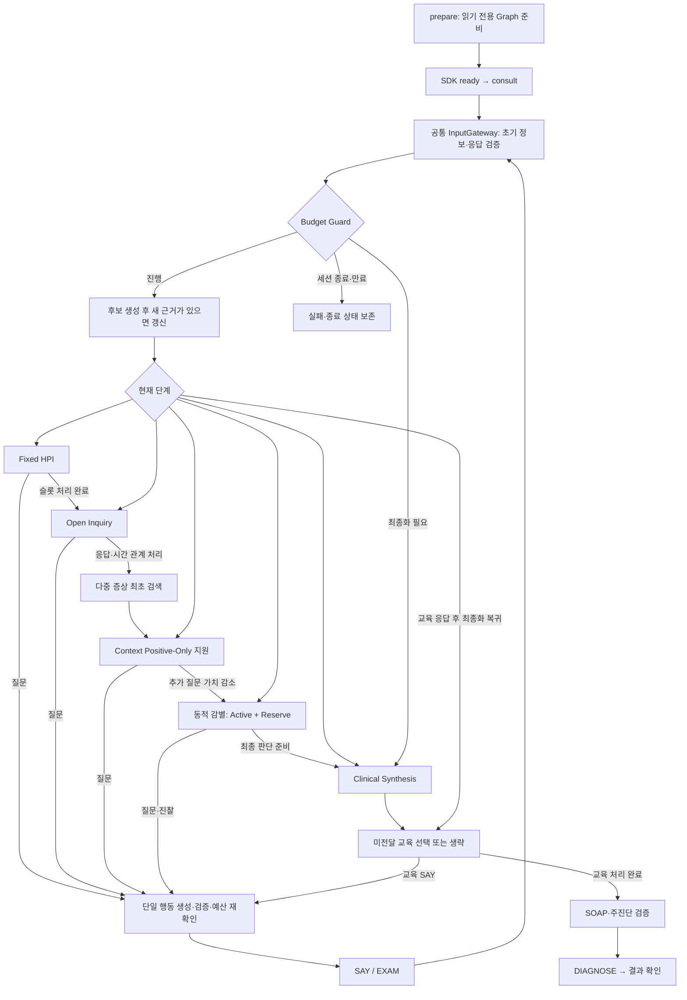

# Ontoward MVP 제품 요구사항

## 목적과 이번 산출물

Ontoward는 N.O.V.A. 모의 환자의 초기 정보에서 출발하여 문진·신체진찰로 필요한 정보를 모으고, S·O·A·P 초진 기록과 주진단 하나를 제출하는 진단 에이전트다. 첫 구현 대상은 예선이며, 본선의 검사 실행과 참가자 모델은 후속 단계로 구분한다.

첫 MVP는 한 증례를 메모리에서 진행한다. 사용자는 에이전트가 어떤 정보를 얻었고, 어떤 후보를 고려하며, 왜 다음 행동을 제안하는지 확인할 수 있어야 한다.

현재 구조는 D11의 임상 워크플로우 골격, D12의 submission 중심 제출 구성, D13의 객체별 실행·RDFLib 책임 분리와 D14의 제출 내부 지식·독립 압축 경계를 따른다. 임상 추출·매칭·순위·질문 생성·SOAP·SDK 실행은 명시적 미구현 경계로 남는다. 문서·구조·패키징 완료는 실제 진료 가능한 MVP나 공식 평가 통과를 뜻하지 않는다. 애플리케이션은 [제출 상태](submission/PROJECT_STATE.md), 자료와 준비 결과는 [데이터 상태](data/PROJECT_STATE.md), 교차 범위 조정은 [루트 상태](PROJECT_STATE.md)가 소유한다. D09의 승인된 510개 어휘에 기반한 추출 스키마·오프라인 검증·영어 프롬프트를 준비하며 실제 자동 추출 실행기와 임상 지식 산출물은 별도다.

공식 요구사항 확인일은 **2026-10-12 KST**이다. [개발 가이드](https://nova.snubhai.org/docs/), [참가 규칙](https://nova.snubhai.org/rules/), [평가](https://nova.snubhai.org/evaluation/)와 SDK 1.0.1을 대조한다. 두 제공 PPTX의 본문·표·발표자 노트를 MarkItDown으로 변환했고, 날짜별 차이와 남은 불일치는 [공모전 변경 비교](assets/nova-competition-2026/CHANGES_2026-10-12.md)에 기록한다. 홈페이지의 정확한 수정 시각은 확인되지 않았다.

## 채택한 기술과 역할

| 기술 | 책임 |
|---|---|
| Python | 데이터 준비와 에이전트 실행 코드 |
| LangGraph | 한 증례의 단계와 조건부 이동 |
| Pydantic | 관찰·세션·행동·SOAP·진단의 구조와 경계 검증 |
| N.O.V.A. SDK | 지정 Doctor 호출, 세션 확인, 행동 실행과 최종 제출 |
| 제공 진료지침 | 제출 전에 추출·검토할 임상 관계와 검사·처치·추적·교육 계획의 근거 원본 |
| Codex CLI | 사용자 어휘 검증 이후 SNU Edu ChatGPT 인증으로 교과서 관계 추출; gpt-6-luna·medium reasoning·Standard |
| RDFLib | RDF 생성·로드·조회; 진료 중 준비된 임상 그래프 검색 |
| Turtle | 문서별 추출 결과와 출처별 제출 지식 묶음의 저장 형식 |
| SNOMED CT | 후속 단계의 임상 개념 식별, 동의어, 상하위 관계 |
| BODHI-S | 후속 단계의 질환과 증상 변형 사이의 출처가 있는 연관 근거 |
| Docker | Python 실행과 의존성 설치 환경 |

JEV, Laya, HPOA는 사용하지 않는다. 이번 추상 골격에는 배포·호환성 매트릭스나 실행 테스트 스위트를 도입하지 않는다. 후속 구현의 수용 시나리오는 이 문서에 요구사항으로 정의한다.

첫 경로는 공식 샘플 API와 지정 `openai/gpt-oss-20b` Doctor 모델이며, 한국어 증례·환자 대화·제출 기록을 처리한다. 제공 지침에서 임상 그래프를 먼저 준비하고 SNOMED CT·BODHI-S를 단계적으로 보강한다. 선택과 적용 범위의 기록은 [결정 상태](DECISION_STATE.md)의 D01·D03·D04·D05·D06·D07·D08·D09·D10·D11·D12가 소유한다. SNOMED 판본과 확보 경로는 D02를 참조하며, 첫 지침 기반 그래프의 선행 조건으로 두지 않는다. 진료 중 지침 원문 검색은 사용하지 않는다.

## 사용자가 경험할 흐름

| 단계 | 들어오는 정보 | 사용자가 확인하는 내용 |
|---|---|---|
| 제출 전 지식 준비 | 카탈로그로 선택한 지침 원본 | 문서별 추출·검토와 승인된 출처별 지식 묶음; 증례 접근 없음 |
| 대회 준비 | 제출된 Turtle 묶음과 manifest | 하나의 RDFLib 그래프에 로드한 실행 자원; 증례 접근 없음 |
| 증례 시작 | 세션의 초기 진술과 활력징후 | 초기 사실, 미확인 항목, 남은 턴·시간 |
| Fixed HPI | 초기 주호소별 적용 가능한 유한한 속성 | 진단 점수에 영향받지 않는 고정 슬롯 처리와 미확인·충돌 |
| Open Inquiry | 다른 증상에 대한 개방형 질문의 응답 | 추가 증상과 주호소의 시간적 관계·에피소드 |
| 최초 후보 검색 | 주호소·추가 증상과 v4.2 패턴 | 증상별 검색 합집합, 부분 매칭과 질환별 설명 범위 |
| Context | 후보와 관련된 미확인 병력·위험인자 | 명시적으로 확인된 맥락의 Positive-Only 지원 |
| 동적 감별 | Active·Reserve 후보와 미확인 특징 | 가치가 있는 질문 하나 또는 진찰 동작 하나 |
| 실행·응답 반영 | 검증한 SAY·EXAM과 실제 응답 | 출처·턴을 가진 관찰, 미응답·모호함·거절 |
| 환자 설명 | 현재 판단과 향후 계획 | 쉬운 한국어 설명, 불확실성, 추적·경고 증상 |
| 최종 제출 | 확인된 사실과 판단·계획 | SOAP 기록, 주진단 하나, 제출 응답 |

HPI는 초기 주호소마다 적용 가능한 속성 목록과 순서를 한 번 정한다. 같은 응답으로 여러 슬롯이 채워지면 재질문하지 않는다. resolved·unknown·not_applicable을 처리된 슬롯으로 구분하며 unresolved conflicted는 완료가 아니다. 명확화의 횟수·정책은 후속 구현에서 정한다. 진단 점수에 따른 조기 종료와 HPI 중 Shadow Differential은 사용하지 않는다. 전역 예산으로 중단하면 hpi_complete=False와 남은 미확인 정보를 유지한다.

HPI 이후 다른 증상을 개방형으로 묻고 최초 후보를 검색한다. 추가 증상에는 개념과 시간 관계를 보존하되 모두에게 전체 HPI를 반복하지 않는다. 여러 주호소와 같은 종류의 서로 다른 증상 발생은 observation_id·episode_id로 구분한다. 같은 환자에게 있다는 이유로 하나의 질환 원인이나 복합 증후군을 확정하지 않는다.

후보 생성 후 Context와 감별 단계의 질문은 동적으로 선택한다. Context는 이미 검색된 후보에만 상한이 있는 양성 지원을 제공하며, 부재·미확인은 감점하거나 후보 생성에 사용하지 않는다. 증상·진찰 소견과 수동 중요도·명시적 모순을 함께 검토하고 Active·Reserve를 보존한다. 새 관찰·정정이 오면 중복 제거된 현재 근거로 재평가하며 점수를 반복 누적하지 않는다. 후보 수·점수식·질문 가치 임계값·단계별 턴 할당은 이번 골격에서 정하지 않는다.

예산이 최초 검색 전에 부족해져도 확보된 관찰로 제한된 최종화를 준비하는 경계를 둔다. 가짜 후보·근거를 생성하지 않고 유효한 제출을 만들 수 없는 경우 실패 상태를 보존한다. 교육 응답도 공통 Gateway에서 처리하며 최종화로 복귀한다. 새로운 근거가 있으면 판단을 갱신하고, 이미 전달한 교육을 자동 반복하지 않는다. 제출은 시도와 확인을 구분하며 성공·실패·결과 불명·세션 종료·만료를 각각 기록한다.

한 번에 활성 증례는 하나다. 새 증례를 시작하면 이전 증례의 관찰과 후보를 비운다. 모델 연결 객체와 RDFLib 그래프는 실행 자원이며 환자 상태에 넣지 않는다. 임상 그래프는 진료 중 읽기 전용으로 사용하고 환자 관찰을 추가하지 않는다.

문진은 한 번에 질문 하나를 한다. 환자가 자발적으로 여러 정보를 답하면 명시한 내용만 항목별로 반영한다. 예를 들어 “열은 있지만 기침은 없다”라는 응답에서도 가래 여부는 미확인으로 남는다. 설명은 30자 제한 안에서 여러 SAY로 나눌 수 있지만 각각 턴을 쓰므로 환자 설명과 종료 제출을 위한 예산을 확보한다.

`EXAM`은 구체적인 신체진찰 동작 하나를 문장으로 요청한다. 진찰 목록은 제공되지 않으며 지침이나 BODHI-S를 환경의 전체 행동 목록으로 취급하지 않는다. 요청과 실제 결과 수신을 구별하고 모델이 예상한 결과를 관찰로 기록하지 않는다. 본선의 `TEST`도 검사 하나를 요청하는 행동이며, 예선에서는 실행할 수 없다.

## 공식 세션·실행 계약

| 항목 | 예선 요구사항 |
|---|---|
| 준비 | `prepare()`에서 증례 접근 없이 지식 자원 준비, 최대 10분 |
| 진료 | 준비 알림 후 `consult(client, resources)`에서 세션 접근, 최대 30분 |
| 모델 | 지정 Doctor API를 증례당 최소 1회·최대 200회; 입력 500,000·출력 100,000토큰 |
| 행동 | `SAY`·`EXAM`은 각각 1턴, `DIAGNOSE`는 0턴, `TEST`는 차단 |
| 입력 길이 | SAY·EXAM·본선 TEST는 NFC 정규화 후 1–30 유니코드 코드 포인트; 공백·문장부호·줄바꿈 포함 |
| 상호작용 | 최대 50턴; 50번째 응답 이후에도 제한 시간 안에서 DIAGNOSE 가능 |
| 실행 자원 | 증례별 컨테이너, CPU 2코어·RAM 8GB·GPU 없음 |

세션 응답의 남은 턴·마감 시각·허용 행동을 실행 판단에 반영한다. 31자 이상 입력은 재작성하며 임의로 잘라 실행하지 않는다. 필요한 설명, 기록 작성, 모델 호출과 제출에 쓸 시간을 남겨 둔다. 시작 패키지의 30턴 사용과 3분 여유는 예제 정책이며 대회가 요구하는 고정값이 아니다. [실행 제한](https://nova.snubhai.org/rules/)

형식·의미 거절은 실제 수행이나 관찰로 확정하지 않는다. 공개 문서에서 `EXAM_NOT_SPECIFIC`·`EXAM_NOT_RECOGNIZED`는 결과 없이 1턴을 사용하며, `ACTION_NOT_AVAILABLE`은 턴을 쓰지 않는다. 응답의 남은 턴을 확인하고 반복 거절을 무한 재시도하지 않는다. 전송 결과가 불명확한 동일 요청은 같은 `request_id`와 내용을 유지한다. 명시적인 모델·환자·진찰 판정 실패가 반환되어 비용·턴을 쓰지 않은 경우의 새 시도는 새 요청으로 구분한다. 제한 시간·호출 예산 안에서 재시도하고 세션 종료·만료를 정상적인 중단 조건으로 처리한다. 기본 예제의 재시도 코드와 개발 키트만으로 공식 서버의 중복 처리·복구 동작을 검증했다고 주장하지 않는다. [요청과 오류 규칙](https://nova.snubhai.org/docs/)

서버가 받은 빈 내용·길이 초과 SAY/EXAM과 부적절한 EXAM은 1턴을 쓴다. SDK가 전송 전에 ValueError로 막은 요청은 턴을 쓰지 않는다. 빈 Doctor 답변은 호출 200회에는 포함되지만 토큰 예산과 Doctor 비용에서는 제외된다. 공식 session()의 events에 의존하지 않고 대화·행동·응답 이력을 CaseState에 유지한다.

## 최소 데이터·입출력 계약

아래 계약은 후속 Python 구현의 최소 의미를 정의한다. 세부 필드와 코드는 애플리케이션 범위에서 구현한다.

| 계약 | 최소 내용 |
|---|---|
| `Observation` | 관찰 ID, 응답 원문, 초기 정보·환자 진술·진찰·검사 출처, 획득 턴 또는 초기 정보 표시, 있음·없음·불확실 상태, 현재·과거·가족력 맥락, 확인된 수치·단위·시점, 선택적인 개념 연결 |
| `CaseState` | 증례·세션, 관찰·에피소드, 초기 주호소, 고정 HPI 슬롯·완료 여부, 추가 증상 처리, 후보 생성 여부·Active/Reserve, 다음·대기 행동과 이력, 남은 예산, Doctor 호출, 교육·SOAP·제출·종료 상태 |
| `Action` | `SAY`·`EXAM`·본선 `TEST`·`DIAGNOSE` 종류, 단일 대상 또는 요청, 선택 목적, 참조한 관찰·근거, 요청 ID와 실행 결과 |
| `Diagnosis` | 우선 진단, 대안 후보, 사용한 관찰·근거, 남은 불확실성, 선택적으로 검증된 SNOMED 개념 |
| `SOAPRecord` | SDK의 모든 S·O·A·P 문자열 필드, 환자 사실과 판단·향후 계획의 구분, 관찰·턴으로 추적할 수 있는 기록 |

아직 묻지 않았거나 응답이 없는 항목은 미확인 목록에 남긴다. 명시적으로 부정된 관찰과 구별한다. 의미가 충돌하는 응답은 원문과 출처를 보존하고 확인 대상으로 표시한다. 진료지침의 일반 지식은 판단 근거이며 이 환자에게 확인된 소견이 아니다. 환자·진찰 응답과 실제 제출 결과도 경계에서 검증한다.

LLM의 구조화 출력과 외부 관찰은 Pydantic의 `model_validate()` 또는 `model_validate_json()`으로 검증한 뒤 상태에 반영한다. LangGraph의 Pydantic 상태 사용만으로 모든 중간 노드 갱신과 최종 출력이 자동 검증되는 것은 아니다. 형식이나 참조가 잘못된 결과는 관찰·실행 행동으로 확정하지 않고, 미확정 이유를 드러낸다. [LangGraph 상태 사용](https://docs.langchain.com/oss/python/langgraph/use-graph-api), [Pydantic 모델](https://pydantic.dev/docs/validation/latest/concepts/models/)

정상 경로의 최초 후보 검토는 Fixed HPI와 Open Inquiry 이후 수행한다. 모델이 만든 수치, 그래프의 연관·특징 표시, BODHI의 정성적 likelihood를 보정된 질환 확률로 표시하지 않는다. 골격의 관찰·SDK payload 사전은 상세 데이터 계약의 구현을 의미하지 않으며 각 경계의 명시적 검증은 후속 작업이다.

## SOAP 기록과 최종 제출

최종 결과는 `client.diagnose(note=..., diagnosis=...)`로 제출한다. 화면·stdout·파일은 공식 제출을 대신하지 않는다. D12에 따라 SDK 1.0.1의 15개 SOAP 문자열 필드와 별도 주진단을 전송 계약으로 사용한다.

| 제출 항목 | 필수 필드 | 내용 |
|---|---|---|
| S | `cc`, `hpi`, `pmh`, `fh`, `sh`, `ros` | 주호소, 현병력, 과거력·약물·알레르기, 가족력, 사회력, 계통 문진 |
| O | `exam`, `tests` | 받은 진찰·검사 소견과 획득 턴; 초기 활력징후는 초기 정보로 표시 |
| A | `evidence`, `differential` | 판단에 사용한 문진·신체진찰 소견 목록과 중요한 감별진단 |
| P | `tests`, `treatment`, `disposition`, `follow_up`, `education` | 추가 검사, 치료, 처치 결정, 추적·경고 증상, 교육 계획 |
| 별도 값 | `diagnosis` | CaseState.diagnosis의 비어 있지 않은 주진단 하나 |

모든 SOAP 칸은 문자열이고 내용이 없는 칸은 빈 문자열로 둔다. 단, 기록 전체를 빈 문자열로만 채우지 않는다. 주진단은 CaseState.diagnosis에 유지하고 별도 diagnosis 인자로 비어 있지 않은 문자열 하나를 보낸다. note.A에는 evidence·differential만 넣는다. 누락·추가 필드와 잘못된 자료형은 제출 전에 거절한다. A.evidence에는 실제로 확보하고 판단에 사용한 문진·신체진찰 소견을 간결하게 목록화하며, 지식 출처나 내부 사고 과정으로 대신하지 않는다. 미확인·미시행 항목은 근거로 채우지 않고 원문·출처·턴은 CaseState에서 추적한다.

공식 안내 표는 주진단을 Assessment에 표시하지만 같은 페이지의 제출 예제와 SDK는 diagnosis를 note 밖에 둔다. 사용자는 D12에서 SDK 전송 형식을 선택했다. SDK를 수정하지 않으며 note.A.diagnosis를 추가하지 않는다. 이 선택은 문서와 코드 경계의 정합화이며 공식 서버 수락을 검증한 결과는 아니다.

예선의 `O.tests`는 빈 문자열이며 향후 필요한 검사와 이유는 `P.tests`에 쓴다. 기록 전체는 UTF-8 100,000바이트, 주진단은 500바이트까지이며 30자 대화 한도는 기록에 적용하지 않는다. 전송 문자열과 기록 크기를 검증하고 제출 응답으로 종료 결과를 확인한다. [기록 작성·크기 규칙](https://nova.snubhai.org/docs/)

음성·없음은 질문·확인 또는 제공된 결과가 있을 때만 기록한다. 미확인은 `Allergy ( )`처럼 남기고, 미시행 진찰·검사와 향후 계획을 실제 결과로 채우지 않는다. 수치·단위·참고범위는 환경이 제공한 것을 보존한다. S·O의 사실은 관찰과 출처·턴으로, A·P의 판단과 계획은 해당 사실과 지침 근거로 추적한다. 내부 사고 과정 전문 대신 사실과 판단을 연결하는 간결한 근거를 작성한다.

교육 계획을 기록하는 것과 환자에게 실제 설명하는 것을 구분한다. 필요한 설명·공감·추적 및 경고 증상 안내는 종료 전에 SAY로 전달하고, 전달 내용과 응답을 증례 상태에 남긴다. 시간·턴 부족으로 설명하지 못한 내용을 설명 완료로 기록하지 않는다. 설명 행동을 더 실행할 수 없으면 미전달 상태를 보존하고 남은 시간 안에 기록·진단 제출을 마친다.

## 지식 준비와 검색

자료 준비는 제공 원본에서 임상 관계와 계획 근거를 추출·검토하여 RDF 지식으로 만드는 후속 작업이다. 제공받은 원본 패키지는 assets/에 보존하며 D12의 수정 없는 SDK 실행 사본만 복제를 허용한다. `Dev/`는 제출 전 추출·후보 검증·RDF 생성·묶음 구성 코드와 프롬프트를, `submission/`는 제출 에이전트와 실행 그래프 조회를, `data/`는 출처·판본·라이선스와 지속 응답·검토·준비 결과·생성 산출물을 맡는다. `Tmp/`는 삭제 가능한 실행 입력·초안이다. Dev·Tmp는 루트 상태에 기록하며 운영 상태는 루트·submission·data 세 범위만 유지한다.

### 제출 전 준비: 제공 지침에서 임상 지식 추출

제공 원본 위치는 공식·샘플 환경의 `NOVA_GUIDELINES_DIR`과 `/opt/nova/guidelines`, 로컬 프로젝트 컨테이너의 `/workspace/assets/guidelines`로 설명한다. 이 원본 경로는 제출 전 준비에 사용하는 계약이며 진료 중 원문 검색의 필수 의존성이 아니다. 전체 지침이나 문서별 추출 중간 결과를 코드 ZIP에 넣지 않고, 실행 중 인터넷에서 원문을 받지 않는다.

제출 전에 원문 근거·임상 관계·적용 조건을 검토하여 필요한 지식을 준비한다. 문서·절의 맥락과 원본 식별을 유지하며 진료 중 추출을 반복하거나 새 문헌을 검색하지 않는다. D09의 준비 스키마와 오프라인 후보 검증을 사용하고 실제 모델 파일럿·임상 검토·RDF 수용은 후속 계약으로 진행한다. 첫 준비 구현에 직접 API 호출이나 OpenAI Python SDK를 추가하지 않는다.

입력은 `assets/guidelines/catalog.csv`의 임상 문서 경로로 선택하며 안내용 Markdown과 공모전 참고 문서를 제외한다. 카탈로그와 원문 머리의 제목, 발행기관, 연도, 언어, 출처 URL, 라이선스와 원문 위치를 data의 외부 준비·검토 기록에 보존한다. 문서 유형·적용 대상·절별 맥락·변환 품질을 확인한다. 자료실의 질환 개요·근거 리뷰·일반인 자료·예방 권고를 모두 같은 수준의 진료지침으로 취급하지 않는다. 서로 다른 권고와 적용 조건은 구분하여 남긴다.

### SNU Edu 기반 자료 준비

Dev/codex/의 최소 CLI 환경을 사용한다. SNU ChatGPT Workspace의 Edu 로그인, gpt-6-luna·medium·Standard와 실제 워크스페이스 UUID 제한을 유지한다. 인증은 전용 프로젝트 Docker volume에 두고 작업 임시 파일은 Tmp/codex/에 둔다.

자료 준비 순서는 영어 자연어 어휘 생성 → 의료인 사용자 승인 → 승인된 어휘에 기반한 Pydantic 스키마·준비 계약 제작 → gpt-6-luna·medium 추출 파일럿 검증이다. 사용자는 2026-10-12 [영어 어휘 목록](data/ontology/vocabulary-candidates.md)의 Disease 100개·Symptom 100개·ExamFinding 60개·AttributeValue 100개·ContextFactor 60개·Test 40개·ExamMethod 50개를 후속 작업 기준으로 승인했다. [승인 기록](data/ontology/vocabulary-approval.json)은 승인 시점과 파일 SHA-256을 보존한다. 설명은 한국어, 용어는 영어로 유지하며 이 510개 자연어 항목의 승인은 문헌 관계나 RDF 수용의 승인과 별도다.

AttributeValue의 첫 77개와 ExamMethod의 첫 24개는 기존 기초 어휘의 영어 명칭을 유지한다. 속성 적용 범위와 contextType 분류는 사용자 검토용 제안이다. 목록 확장으로 Turtle·위치 계층·수치 임계값·새 examRequestText·detectedBy·질환별 관계를 추가하지 않는다. 실제 수치·단위·시점·환자 또는 가족이라는 대상은 환자 상태에 보존하며, Test는 P.tests 계획 대상으로 유지한다.

승인된 어휘에 기반한 스키마·후보 출력 형식·오프라인 검증·영어 프롬프트는 D09의 구현 범위다. 사용자가 지정한 문헌 파일럿은 별도의 제한된 CLI 호출로 수행하고 입력·원응답·실행·검증·검토를 data/preparation/에 보존한다. 각 파일럿의 문헌 선택·호출 한도·중단 기준은 중앙 결정에서 정하며 배치·자동 재개 실행기는 별도다. 기존 의료 어휘 자원의 확장은 가능성과 방향만 검토하며 추가 용어를 자동 수용하지 않는다. 임상 Turtle과 제출용 지식 manifest는 없으며 파일럿 완료를 임상 지식 완성으로 취급하지 않는다.

### 기본 온톨로지와 임상 지식 모델

준비용 [Pydantic 모델](Dev/ontology/models.py)은 승인된 일곱 객체의 영어 명칭만 선택하는 공유 Enum을 사용한다. [기계용 어휘](data/ontology/extraction-vocabulary.json)는 승인 원본·현재 문서·어휘 내용·영수증·온톨로지 입력 해시를 구분하고, [출력 JSON Schema](data/ontology/extraction.schema.json)는 Python 모델에서 생성한다. 모델 응답은 patterns·supporting_contexts·finding_methods·planned_tests 네 배열이며 Feature는 단일 Target Pattern 안에 중첩한다. 기존 속성 이름과 present/absent는 구조 요소이고 원문 인용에는 510개 제한을 적용하지 않는다.

[오프라인 도구](Dev/ontology/tools.py)는 카탈로그 상대 문서 경로·파일 SHA-256·허용 줄 범위로 프롬프트를 만들거나 응답을 검증한다. 관계·Feature별 정확한 인용과 절 맥락을 연결하고, 구조·어휘·근거 실패 시 전체 응답을 거부한다. 새로운 대상·속성·승인 값 조합은 문헌 근거가 있는 후보로 허용하지만 candidate_validated는 형식과 인용 검증만 의미한다. 임상 정합성·동의어 대응·필수 적용 조건·RDF 수용은 별도 검토가 필요하다.

[영어 추출 지침](Dev/ontology/extraction_prompt.md)은 미승인 개념·미표현 정보를 결과에서 제외하고 보류 목록을 만들지 않도록 한다. 필수 조건을 제거하면 의미가 넓어지는 관계는 전체를 제외하며 수치 범주화·위치 계층·복합 조건의 독립 관계 변환을 하지 않는다. 임상 중요도·계통·맥락 분류 확정·진찰 요청문은 모델 출력에서 제외한다. 준비 스키마와 프롬프트를 Codex CLI의 --output-schema에 전달하며 실제 호출은 명시적으로 요청한 파일럿 범위에서만 수행한다. 빈 출력의 형식 통과와 실제 관계·인용·필수 조건 보존을 평가한 비어 있지 않은 추출 품질을 구분한다.

| 개념 또는 관계 | 의미 |
|---|---|
| `Disease` | 진단 후보로 다룰 질환 |
| `Symptom` | 환자가 진술할 수 있는 구체적인 임상 주호소; 통증은 ChestPain·AbdominalPain·Dysuria 등으로 구분 |
| `FindingAttribute`·`AttributeValue` | 증상 속성과 재사용하는 범주형 값; 위치는 평면 구조 |
| `BodySystem` | 비배타적 문진 분류; 질환 후보 필터로 사용하지 않음 |
| `ContextFactor` | 과거력·노출·가족력 등의 맥락; 분류는 contextType 문자열 |
| `ExamFinding`·`ExamMethod` | 신체진찰 소견과 구체적 동작; detectedBy와 examRequestText로 연결 |
| `ClinicalPattern`·`ClinicalFeature` | 질환별 단일 Target 프로필과 그 관찰의 원자적 속성·상태 조건 |
| `Test` | SOAP P.tests의 검사 계획 대상; 현재 진단 추론에서는 사용하지 않음 |
| `hasPattern`·`hasFeature` | 질환의 Pattern과 0개 이상의 부분 매칭 Feature; 자동 AND 규칙이 아님 |
| `presentsAs` | 유지하는 선택적 관계; v4.2 후보 검색의 필수 경로가 아님 |
| `targets`·`onAttribute`·`expectsValue` | Pattern의 단일 Symptom/ExamFinding Target과 Feature의 속성·기대 값 |
| `importance`·`clinicalRole` | 독립적으로 사람이 검토하는 Pattern 중요도와 Feature 역할 |
| `hasSupportingContext` | 패턴 밖의 지지 맥락; 부재를 반대 근거로 사용하지 않음 |
| `evaluatedBy` | SOAP Plan 전용 질환–검사 관계 |
| 명칭·동의어 | 언어를 보존한 표현과 공통 개념 URI |

기본 구조는 [스키마](data/ontology/schema.ttl)와 [기초 어휘](data/ontology/vocabulary.ttl)에 작성한다. v4.2는 클래스 11개, 객체 관계 12개, 데이터 속성 6개를 사용하며 URI는 `urn:ontoward:`로 통일한다. 질환·패턴·특징·맥락 요인·진찰 소견·검사 인스턴스의 제출 임상 관계는 후속 추출·검토로 채운다. 전체 규칙은 [온톨로지 계약](data/ontology/AGENTS.md)과 D08을 따른다. RDFS 선언 자체는 cardinality나 선택 타입을 강제하지 않는다.

통증은 ChestPain·AbdominalPain·Headache·BackPain·Dysuria 등 일반적인 임상 주호소 단위의 구체적인 Symptom으로 구분한다. RightLowerQuadrantPain 같은 세분 노드는 추가하지 않으며 우하복부 통증은 AbdominalPain과 확인한 Location=RightLowerQuadrant로 표현한다. 위치는 평면 구조이고 확인되지 않은 Abdomen을 자동 추가하지 않는다. 같은 에피소드에서 넓은 위치와 세부 위치를 각각 확인했다면 출처와 함께 병렬 보존한다. 양상·시간·유발·악화 요인은 기존 속성을 사용하고 별개 에피소드의 정보를 합치지 않는다. ChestPain의 음성은 AbdominalPain 등 다른 증상의 음성으로 확장하지 않는다.

Dysuria·Odynophagia·Dyspareunia·Dysmenorrhea는 각각 독립적인 Symptom으로 두고 명칭에 담긴 발생 상황과 추가 확인한 속성을 보존한다. 기초 어휘에는 선택한 통증 개념 19개와 기존 통증 속성 13개 연결을 유지한다. 승인된 목록에 새 BodySystem 값이 지정되어 있지 않으므로 해당 분류는 후속 어휘 수용 계약에서 정한다. 일반 Pain이나 Urination 값은 기초 어휘에 두지 않는다. 승인된 나머지 항목의 Turtle 반영은 별도 수용 작업으로 진행한다.

환자 원문, 확인한 위치·상황, 정규화한 증상과 그 불확실성을 같은 observation·episode의 출처와 함께 보존한다. 문진·진찰 근거로 해석을 갱신하고 정정 전 원문을 유지하며, 진단 후보에 맞춰 증상을 바꾸지 않는다. 미특정 통증은 미해결 원문으로 남겨 부위·상황을 확인한다. 근거가 있는 복수의 미확정 증상 해석은 후보 검색 합집합에 사용할 수 있지만 같은 관찰을 여러 확정 증상이나 독립 지지 근거로 중복 계산하지 않는다. 예산이 부족하면 기존의 근거 제한 최종화 경계를 따른다.

한 질환은 문헌이 각각 뒷받침하는 여러 증상 Target의 대안 Pattern을 소유할 수 있다. 예를 들어 StableAngina_ChestPainPattern은 ChestPain을, StableAngina_AbdominalPainPattern은 AbdominalPain을 Target으로 하는 구조를 사용할 수 있다. 이 예시는 구조 설명이며 현재 임상 지식으로 생성하지 않는다. 각 Target에서 독립적으로 질환 후보를 조회하고 모든 Pattern의 동시 일치를 요구하지 않는다. BodySystem으로 질환 후보를 제한하지 않는다. 문헌상 대안적인 질환 표현과 환자 표현의 정정을 구분하며 표현 오류를 보완하려고 근거 없는 질환–증상 관계를 추가하지 않는다.

각 Pattern은 질환 하나와 정확히 하나의 Symptom 또는 ExamFinding Target을 가진다. Feature는 0개 이상이며 각 Feature는 Pattern 하나에서 Target을 상속하고 직접 targets를 갖지 않는다. 속성 조건은 onAttribute·expectsValue를 유효한 쌍으로 두며, 상태 조건은 선택적 expectedStatus=present/absent로 표현한다. 값 쌍이나 상태 조건이 없는 빈 Feature를 만들지 않는다. Test·ContextFactor는 Pattern Target이 아니다. 정확한 수치·기간·시점은 환자 상태에서 관리하고 수치 임계값은 추가하지 않는다.

Pattern의 선택적 importance=characteristic과 Feature의 선택적 clinicalRole=supportive/characteristic/opposing은 사람이 검토하여 독립적으로 부여한다. 미지정은 낮은 중요도가 아니며 기대 부재와 반대 역할을 혼동하지 않는다. 문헌 언급 횟수·자동 중요도·검증되지 않은 복합 증상 가산점은 사용하지 않는다. Selectivity는 완성된 그래프의 Target별 질환 연결 분포에 기반한 후속 기능이며, 현재 스키마 선언·수식·자료형·반영 비율을 정하거나 초기 실행 조건으로 삼지 않는다.

후속 조회는 관찰한 증상·진찰 소견에서 Pattern targets와 hasPattern을 역방향으로 따라 질환을 찾고, 동일 에피소드의 관찰과 Feature를 비교한다. 결과는 matched·contradicted·unknown을 구분한다. 미확인·관계 부재는 unknown이며 범주 값이 다르다는 이유만으로 반대 근거를 만들지 않는다. contradicted는 같은 관찰에서 명시적으로 양립할 수 없는 조건이 확인된 경우에만 사용한다. 역할은 실제 매칭된 조건을 기준으로 해석하며 매칭·순위·다음 행동은 앱의 책임이다.

관계별 원본 경로·절·적용 조건·출처 메타데이터·상충 내용·검토 기록은 data의 준비 자료에서 보존하며 실행 그래프에 출처 노드를 넣지 않는다. 원본은 `assets/guidelines/`에 유지하고 [경로 목록](data/catalog/guideline_paths.txt)은 원본 확인을 위한 경로만 담는다. 파일명이나 이 목록만으로 provenance 검토를 완료했다고 판단하지 않는다. Source·ClinicalClaim·Evidence·SUPPORTED_BY와 환자 상태·SOAP·점수·워크플로 노드는 도입하지 않는다. SOAP A.evidence는 주진단 판단에 사용한 실제 문진·신체진찰 소견 목록이다. 검사 외 치료·처치 결정·추적·교육 계획의 구성은 후속 프로그램 책임이며 이를 위한 새 온톨로지 노드를 이번에 추가하지 않는다.

ExamMethod는 방법 URI를 내부 식별자로, `examRequestText`를 실제 요청 문장으로 사용한다. 후속 앱은 `ExamFinding → detectedBy → ExamMethod → examRequestText`를 조회하고 단일 동작·NFC 1–30 코드 포인트 조건을 검증한 뒤 `client.exam(text)`로 실행한다. SDK에는 공식 진찰 코드 목록이 없으며 요청 문장의 존재는 서버 인식이나 실제 결과를 뜻하지 않는다. examAction 코드를 선언하지 않고 실제 거절·결과를 앱에서 처리한다.

### 문서별 결과와 출처별 제출 묶음

확인한 코퍼스는 16개 출처 그룹의 임상 Markdown 15,904개, 597,185,304바이트다. 이는 원본 규모이며 RDF의 크기·triple 수나 실행 메모리의 측정값이 아니다. 문서별 결과를 유지하면 실패·검토·수정 범위를 구분할 수 있고, 출처별 묶음은 제출 파일 수를 줄인다. 단일 최종 파일로 전체 결과를 고정하지 않는다.

현재 data/ontology/의 스키마·기초 어휘, data/catalog/의 원본 경로 목록과 data/provenance/의 출처 식별을 유지한다. 새로운 문서별 결과·검토·지식 묶음의 개발 경로와 형식은 준비 계약을 채택할 때 정한다. 현재 준비 산출물 디렉터리나 빈 지식 묶음을 만들지 않는다.

| 위치 | 역할 | 제출 포함 |
|---|---|---|
| Dev/codex/ | Codex CLI 설정·인증 준비 | 제외 |
| Dev/packaging/ | 독립 압축 도구 | 제외 |
| Tmp/codex/ | 현재 작업의 임시 출력 | 제외 |
| Tmp/packaging/ | 생성 ZIP | 제외 |
| data/ontology/ | 준비용 스키마·기초 어휘 | 직접 포함하지 않음 |
| data/ontology/vocabulary-candidates.md | 사용자 검토용 영어 Disease·Symptom 자연어 후보 | 제외 |
| data/catalog/·data/provenance/ | 원본 탐색·출처 식별 | 제외 |
| `submission/knowledge/*.ttl` | 완성된 실행 스키마·어휘·임상 관계 묶음 | 포함 |
| `submission/knowledge/manifest.json` | 제출 내부 자산의 상대 경로 목록 | 포함 |
| 필요한 `submission/knowledge/schema.json` | JSON 구조 검증용 스키마 | 포함 |

승인된 결과가 있는 기존 출처 그룹별로 묶음을 만든다. 새로운 진료과 분류 체계는 도입하지 않는다. 문서별 실패·검토 대기·제외·승인 상태와 원본 식별은 데이터 준비 기록이 관리한다. 추가 분할은 실제 산출물 규모를 측정한 뒤 별도 작업에서 판단한다. 운영 상태는 기존 세 범위에만 유지한다. 준비 산출물 형식이 정해지기 전 실행 자산을 임의로 생성하지 않는다.

### 대회 실행: 준비된 그래프만 조회

`prepare()`는 manifest에 명시할 스키마·기초 어휘와 제출 임상 묶음 전체를 하나의 RDFLib `Graph`에 로드한다. 증례 접근이나 원문 추출 없이 준비 알림 전에 실행 자원을 구성하고, `consult(client, resources)`에서 출처 그룹을 가로질러 임상 관계를 조회한다. data의 원본 경로 목록과 준비·검토 기록은 실행 그래프의 입력이 아니다. 여러 파일을 모두 로드하므로 파일 분할 자체를 메모리 절감의 근거로 취급하지 않는다. 첫 MVP에서는 선택적·지연 로딩, Dataset·Named Graph, OWL 추론, 임베딩·벡터 검색이나 별도 그래프 서버를 도입하지 않는다.

검색 계층의 최소 인터페이스 책임은 다음과 같다. 후속 코드의 구체적인 자료형은 `submission/`가 구현한다.

| 조회 기능 | 반환할 내용과 경계 |
|---|---|
| 개념 후보 연결 | URI·명칭 후보와 연결 불확실성; 복합 표현의 증상·속성을 보존하고 미연결 원문 유지 |
| 증상 속성 조회 | 증상에 연결된 속성과 적합한 범주 값; 연속 값은 환자 상태에 유지 |
| 질환 후보 조회 | 관찰한 Target에서 Pattern과 Disease를 역방향 조회한 합집합; presentsAs 의존·확진·확률·계통 필터 없음 |
| 패턴·감별 특징 조회 | Pattern의 단일 대상·수동 중요도와 Feature의 선택적 상태·역할·속성 값; 부분 매칭하며 다른 에피소드를 합치지 않음 |
| 지지 맥락 조회 | 질환에 직접 연결된 ContextFactor; 부재를 반대 근거로 사용하지 않음 |
| 진찰 방법 조회 | detectedBy로 연결된 방법 URI와 examRequestText; 자동 실행·실제 결과가 아님 |
| 검사 계획 조회 | evaluatedBy와 Test를 SOAP P.tests에서만 조회; 진단 추론·다음 진단 행동에서는 사용하지 않음 |

고정된 조회 함수와 필요시 사전 정의한 질의를 사용하며 LLM이 임의 SPARQL을 생성하게 하지 않는다. 한국어 원문과 번역·개념 연결의 불확실성을 유지한다. 중요한 새 관찰이나 후보 변화가 있을 때 조회와 후보 판단을 갱신한다. 조회된 연관·특징 표시는 확률이 아니며 관계의 부재를 질환 배제나 음성 소견으로 해석하지 않는다. 임상 출처별 상충 내용과 적용 조건은 제출 전 data의 외부 준비 기록에서 검토한다.

HPI 이후의 후보 우선순위·다음 행동·최종 진단은 실제 관찰과 세션 예산을 함께 검토하는 앱의 책임이다. 근거가 있는 감별 가치, 미확인 여부, 이미 받은 답변·거절 이력, 남은 턴·시간을 고려해 행동 하나를 선택한다. HPI에는 고정 슬롯 정책을 적용한다. 그래프에 연결되었다는 이유만으로 질문·진찰·검사를 자동 실행하지 않는다.

지침별 출처·라이선스를 유지하고 대회 목적의 비상업적 이용 조건을 따른다. Turtle로 표현한 관계·계획 근거·발췌·번역 등 파생 자료를 제출물에 포함할 때 문서별 조건을 먼저 확인한다. CC BY-ND·BY-NC-ND·공공누리 제4유형 등 변경본 배포가 금지된 자료의 변환본은 제출물에 넣지 않는다. RDF 형식으로 바꾸는 것이 이용 조건을 없애지 않는다. 원본 ZIP의 공식 SHA-256을 압축 해제 폴더의 검증 결과로 대신하지 않는다. [제공 자료의 조건](assets/guidelines/README.md)

### 후속 단계: SNOMED CT·BODHI-S

SNOMED 판본 선택과 원본 확보는 후속 개념 연결 단계에 필요하며 첫 지침 기반 구현을 막지 않는다. 개념 연결이 없어도 환자 원문과 검색·추론 후보를 유지한다.

BODHI를 도입할 때의 첫 범위는 다음 세 BODHI-S CSV다.

- `nodes_condition.csv`: 원본 질환·임상 항목과 유형.
- `nodes_symptom.csv`: UUID로 식별하는 증상 변형과 수식 정보.
- `edges_present_in.csv`: 증상 UUID와 원본 condition 식별자를 잇는 연관 근거.

BODHI의 증상 변형은 동일한 SNOMED 루트 개념을 공유할 수 있다. UUID, 개별 SNOMED 표기 값, 루트 개념, 기간·위치 등의 수식 정보를 보존한다. 원본의 SNOMED 표기 값은 비어 있거나 검증되지 않았을 수 있으므로, 채택한 SNOMED 판본과 대조한 개념 연결과 구분한다. Condition 유형을 확인하여 가족력·생활습관 같은 항목을 무조건 최종 질환으로 취급하지 않는다. [BODHI 원본과 스키마](https://github.com/eka-care/BODHI)

SNOMED CT의 동의어와 계층은 개념을 식별하고 검색을 확장하는 데 사용한다. 질환의 하위 개념을 그 질환에서 나타날 수 있는 증상 목록으로 해석하지 않는다. 먼저 제공 지침에서 검토한 질환–소견 근거를 사용하고, 후속 BODHI 연결은 출처가 구분되는 추가 연관 근거로 보강한다. [SNOMED 지식 표현 범위](https://docs.snomed.org/snomed-ct-specifications/snomed-ct-editorial-guide/readme/snomed-ct-introduction/knowledge-representation)

후속 보강 흐름은 `환자 표현 → 용어 후보 → 검증된 개념 연결 또는 미연결 원문 → BODHI 연관 조회 → 감별 후보와 미확인 항목`이다. 개념 연결이 실패해도 원문과 추론 후보를 보존한다. 자료에 없는 연결을 질환 배제 근거로 사용하지 않는다.

후속 자료도 공통 개념 URI와 원본 식별·검증된 연결을 구분하여 RDF 지식에 반영한다. 진료 중 조회 경로는 RDFLib로 유지하며 지침 원문 검색을 추가하지 않는다. 환자 입력 언어와 자료 연결 순서는 D04·D05, 지식 표현·검색·산출물 구조는 D07을 참조한다.

## 제공 샘플·벤치마크의 역할

| 자료 | 사용할 단계 | 경계 |
|---|---|---|
| 시작 패키지 | SDK·prepare/consult·공식 샘플 연결의 기준 | 기본 에이전트의 실행·성능·재시도 적합성은 검증하지 않음 |
| 공개 증례 C01·C03·C10 | 초기 정보 입력과 실행 후 누락 검토 | 대본·진찰표·모범 기록을 Doctor의 사전 지식이나 정답 검색에 넣지 않음 |
| 개발 키트 | 후속 로컬 시뮬레이션·디버깅 | 모델·판정·복구가 서버와 같다고 가정하지 않으며 채점·인터넷 차단을 검증하지 않음 |
| AgentClinic-MedQA | 후속 문진·진찰·진단 흐름 자체 평가 | TEST 결과는 예선 실행에서 제외하고 정답은 검토 측에 분리 |
| DDXPlus | 후속 단일 질문 선택·정보 획득 자체 평가 | 증상 코드와 답을 문진으로 연결해야 하며 진찰·검사는 제공하지 않음 |
| ACI-Bench | 후속 대화→SOAP 사실 일치·누락 검토 | 별도 정답 진단 라벨이 없고 화자 표기 오류 가능성을 고려 |

벤치마크는 영어·다른 형식의 외부 자료이며 대회 평가 증례가 아니다. 한국어 30자 질문에 맞추는 번역·재작성의 출처와 처리 과정을 보존한다. 학습·개발·검토 분할을 유지하고 AgentClinic 기본판/확장판 및 ACI 파생 대화의 중복을 관리한다. 전체 벤치마크를 첫 구현이나 제출물에 일괄 포함하지 않는다. 출처·라이선스·인용은 각 패키지에 유지한다. [공개 샘플 안내](assets/nova-samples-2026/README.md), [개발 키트 안내](assets/nova-devkit/README.md), [벤치마크 안내](assets/nova-benchmarks-2026/README.md)

## 제출환경과 개발 골격의 차이

submission/run.py는 agents/runtime.py의 prepare()와 consult(client, resources)를 SDK run_agent()에 전달한다. D13에 따라 agents/state.py는 공통 Pydantic 상태를, resources.py는 공유 실행 자원을, session·gateway·interview·reasoning·interface·submission 모듈은 각각의 책임을 가진 객체를 정의한다. workflow.py는 객체 메서드와 routing.py의 상태 분기를 기존 StateGraph에 연결한다. knowledge/graph.py의 ClinicalKnowledge는 하나의 RDFLib Graph를 소유한다. 지식 로딩·임상 처리·예산·상세 검증·SDK 실행은 NotImplementedError로 남긴다. import는 API 호출이나 지식 로딩을 수행하지 않는다.

submission/을 런타임 코드의 단일 원본으로 사용한다. 공개 설정인 submission/.env는 ZIP에 포함하고, 같은 폴더의 AGENTS.md·README.md·PROJECT_STATE.md는 제출에서 제외한다. SDK는 assets/nova-starter/nova_sdk.py의 수정 없는 사본이며 버전과 해시는 공모전 출처 기록에 남긴다. 원본 복제 허용은 이 SDK 사본으로 한정한다.

코드 ZIP의 압축 루트에는 run.py와 requirements.txt가 있어야 한다. Dev/packaging/package_submission.py는 package 이미지에 포함되며 입력을 /submission으로 고정한다. Compose package 서비스는 submission/만 읽기 전용으로 연결하여 실행 Python·고정 의존성·공개 .env와 knowledge/의 필요한 Turtle·JSON만 압축한다. 결과 디렉터리는 Tmp/packaging/만 /output으로 연결한다. root .env, 안내·상태 문서, Dockerfile, Dev·Tmp·원본·추출 중간 결과·캐시는 제외한다. 크기는 압축 50,000,000바이트, 해제 500,000,000바이트, 파일 수는 5,000개 이하다. 심볼릭 링크·경로 이동·중복 경로·암호화를 허용하지 않는다.

제출 의존성은 PyPI의 미리 빌드된 휠을 사용할 수 있는 `name==version` 한 줄 형식으로 고정한다. URL·Git·편집 설치·버전 범위·다른 저장소·소스 빌드는 사용하지 않는다. 의존성 빌드는 제출 버전마다 한 번이며 20분 제한이다. 실행 중 인터넷은 차단되고 지정 대회 API만 허용된다. 필요한 자산은 허용된 제출물 또는 제공된 로컬 경로에서 읽는다. 개발 키는 비밀로 유지하고 코드·ZIP·문서에 저장하거나 코딩 도구에 연결하지 않는다. [참가·실행 규칙](https://nova.snubhai.org/rules/)

제출 의존성은 submission/requirements.txt에서 LangGraph 1.2.13, Pydantic 2.14.0, RDFLib 7.6.0으로 고정한다. 루트 Dockerfile은 이 파일을 PyPI 휠로만 설치한다. 추출 도구와 MarkItDown은 제출 의존성에 포함하지 않는다. 기존 ontology-extraction 서비스와 관련 저장소는 별도 준비 환경이며, 그 실행 결과를 제출 환경 검증으로 대체하지 않는다.

공개 설정 submission/.env는 현재 ONTOWARD_KNOWLEDGE_MANIFEST만 허용하며 D14의 기본값은 knowledge/manifest.json이다. 여러 모듈이 같은 설정·경로 규칙을 공유하도록 .env와 settings.py를 유지한다. settings.py가 읽고 동일 이름의 실행 환경값을 우선한다. 파일 위치는 settings.py의 __file__을 기준으로 결정하여 실행 작업 디렉터리에 의존하지 않는다. 설정 경로와 실행 환경값은 submission/knowledge 내부 상대 경로여야 한다. 실행과 추후 테스트는 완성된 제출 내부 자산만 사용하며 외부 data/로 폴백하지 않는다. 패키지 내부 import는 상대 import를 사용한다. submission/knowledge/에는 graph.py와 실행에 필요한 schema.ttl·vocabulary.ttl·임상 Turtle·manifest 및 필요한 schema JSON을 함께 둔다. JSON Schema는 필요 시 JSON 구조 검증용으로 사용하며 RDF triple 입력과 구분한다. 현재 없는 자산은 빈 파일이나 외부 데이터 참조로 대체하지 않는다. root .env는 개발 연결·빈 개발 키·로컬 지침 경로를 담고 Compose dev에 필요한 값만 전달한다. 공식 토큰과 세션은 실행기가 제공한다.

문서별 추출 파일은 제출에서 제외하고 승인된 지식 묶음과 manifest만 필요한 코드와 함께 구성한다. 원본 약 597.2 MB를 RDF 크기로 간주하지 않으며, 제출 묶음의 실제 압축·해제 크기와 코드 전체 파일 수를 확인한다. 준비 10분과 예선 RAM 8GB 제한은 전체 실행 자원에 적용한다. 대표 추출에서 문서 길이·유형을 나누어 triple 수, Turtle 크기, 전체 로딩 시간, 최대 메모리와 주요 조회 시간을 측정한다. 후속 대표 추출의 수치는 data 준비 기록에 남기며 전체 제출 그래프나 진료 실행 환경의 수용 증거로 일반화하지 않는다.

본선에서는 별도 모델 ZIP 최대 32GB와 PPT/PPTX가 필요하다. `prepare()`에서 `NOVA_MODEL_DIR`의 읽기 전용 모델을 직접 로드하고 `client.chat()`을 사용하지 않는다. 가중치·KV 캐시·실행 메모리를 포함하여 A6000 48GB급 GPU 한 장, CPU 8코어·RAM 32GB 안에서 실행해야 한다. 본선 모델 선택·확보·학습·GPU 검증은 후속 단계이며 이번 작업에서 진행하지 않는다.

## MVP에서 확인할 결과와 책임

첫 MVP에서 확인할 결과는 한 증례에 대해 관찰이 누적되고, 관련 근거가 조회되며, 다음 행동과 최종 진단의 이유를 사람이 따라갈 수 있는 흐름이다. 별도의 성능 수치나 임상 정확도를 이 문서만으로 주장하지 않는다.

HPI는 고정된 정보 슬롯을 처리하고, 그 이후에는 현재 후보 판단을 바꿀 가치가 있는 미확인 항목을 선택한다. 이미 답한 항목을 불필요하게 반복하지 않는다. 최종화에서는 중요한 대안·모순·설명되지 않은 소견을 검토하되 정상 단계로 자동 회귀하는 추가 루프를 이번 골격에 도입하지 않는다. 예산과 미해결 불확실성을 기록하고 교육·제출을 준비한다.

| 평가 영역 | 배점 | 제품 흐름의 검토 기준 |
|---|---|---|
| 정보수집 | 25 | 필요한 질문·진찰을 실제 수행하고 S·O에 기록 |
| 진단추론 | 15 | 주진단과 사실에 연결된 근거·감별 |
| 검사·추적 | 10 | 예선의 추가 검사 이유와 추적 계획 |
| 안전 | 15 | 위험 신호 확인, 적절한 처치 결정과 경고 증상 안내 |
| 의사소통 | 15 | 실제 SAY 설명·공감과 환자의 이해 확인 |
| 효율 | 20 | 중복 행동·불필요한 검색·모델 비용 감소 |

이 표는 공개된 평가 영역을 제품 검토에 연결한 것이며 비공개 세부 채점 기준을 재현하지 않는다. 로컬 개발 키트는 채점하지 않는다. 서버 샘플 검증의 참고 점수와 공식 평가 점수도 구분한다. 샘플 검증 없이 리더보드 제출을 선택할 수 있다. 개발 키 sample.py는 비채점이며 제출 ZIP의 샘플 검증은 gpt-6-luna 참고 점수를 제공한다. 공식 평가는 팀·단계별 KST 하루 1회, 예선 5증례를 gpt-6.1-sol로 채점하며 마지막 10증례는 GPT·Claude·Gemini의 평균을 사용한다. 샘플·외부 벤치마크 결과를 공식 성능이나 임상 정확도로 일반화하지 않는다. [평가 단계와 기준](https://nova.snubhai.org/evaluation/)

### 후속 구현의 수용 시나리오

아래는 아직 실행하지 않은 요구사항이다. 첫 구현 단위를 조정할 때 해당 범위의 검증을 함께 정한다.

- 초기 복수 주호소의 고정 HPI를 에피소드별로 처리하고 한 응답에서 여러 슬롯을 채운다. 충돌을 자동 완료로 바꾸지 않고 예산 중단과 정상 완료를 구분한다.
- Open Inquiry 이후 최초 후보를 검색하며 추가 증상 부재를 전체 ROS 음성으로 확대하지 않는다. 후보 생성 후 새 근거로 Active·Reserve를 재평가한다.
- 검색 전 예산 종료, 교육 응답의 새 근거, 반복 교육 방지, 확인된 제출·실패·결과 불명의 분기를 확인한다.
- NFC 정규화 후 30자는 허용하고 31자는 실행 전에 거절·재작성한다. 결합 문자·공백·문장부호를 포함하고 임의 절단하지 않는다.
- 질문 하나·진찰 동작 하나를 선택하며 복합 요청의 거절을 실제 관찰로 반영하지 않는다. 예선 TEST는 실행 전에 차단한다.
- 50번째 응답 이후 추가 상호작용 없이 제한 시간 안에 DIAGNOSE할 수 있다. 종료 전 설명·기록·제출 예산을 확보하고 만료·호출 한도·반복 실패를 처리한다.
- SDK 15개 SOAP 필드와 별도 비어 있지 않은 diagnosis를 검증한다. A.diagnosis 등 추가 필드, 누락과 비문자열 값은 거절하고 예선 O.tests와 UTF-8 바이트 한도를 확인한다.
- 자발적으로 답한 사실과 명시적인 음성만 반영한다. 미확인·미시행·계획·모순을 보존하고 S·O 소견을 출처·턴으로 추적한다.
- 지침의 일반 지식과 검토용 정답·대본·진찰표를 환자 관찰에 섞지 않는다. 교육 계획과 실제 설명을 구분한다.
- 전송 결과 불명확 시 같은 요청 ID·내용을 보존하고 명시적 실패 이후 새 시도를 구분한다. 공식 서버 복구 동작은 로컬 시뮬레이터 증거와 분리한다.
- 새 증례에서는 관찰·후보·행동·설명·임시 파일을 초기화하고 다른 증례의 기억·예측·통계를 이어 쓰지 않는다.
- 출처가 다른 임상 묶음의 공통 URI로 패턴·특징을 조회하고, 개별 관계의 원본 경로·절·적용 조건·상충 근거는 data의 외부 준비 기록에서 추적한다. 미연결 표현과 없는 관계를 음성 소견·질환 배제로 바꾸지 않는다.
- 구체적인 통증 Symptom과 확인한 세부 속성·원문·해석 불확실성을 같은 에피소드에 보존한다. 미특정 통증을 강제 연결하지 않고 위치를 자동 확장하거나 다른 증상·에피소드의 음성과 근거를 합치지 않는다.
- Pattern의 단일 Target·0개 Feature 허용과 Feature의 상속 Target·선택적 상태·수동 역할·속성 값 제약을 확인한다. 부분 매칭과 계통을 넘는 후보 조회를 유지하며 Test는 SOAP P.tests 조회에서만 사용한다.
- ExamMethod 요청을 client.exam(text) 계약에 맞게 검증하며, 서버 거절이나 미수신 결과를 관찰로 확정하지 않는다.
- 제출된 manifest와 지식 묶음의 일치를 확인하고 증례 접근·원문 추출 없이 로드한다. 대표 자료에서 준비 시간·최대 메모리·조회 시간과 제출 파일 수·크기를 확인하며 파일 분할만으로 자원 적합성을 주장하지 않는다.

구현자는 [Dev 계약](Dev/AGENTS.md), [제출 계약](submission/AGENTS.md), [데이터 계약](data/AGENTS.md)의 책임 경계를 따른다. 사용자 선택은 [중앙 결정 문서](DECISION_STATE.md)에 기록하고 운영 상태에는 결정 ID만 연결한다.

현재 준비 구현·자산·검증 사실은 루트·data 운영 상태에 기록한다. 이번 정리의 실제 검증은 각 상태에 기록하며, 전체 진료·공식 샘플·SOAP 제출·공식 평가·배포는 별도 실행 증거가 필요하다.
