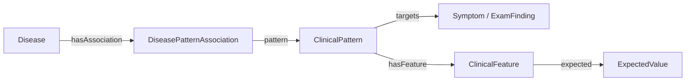

# Ontoward MVP 제품 요구사항

## 목적과 이번 산출물

Ontoward는 N.O.V.A. 모의 환자의 초기 정보에서 출발하여 문진·신체진찰로 필요한 정보를 모으고, S·O·A·P 초진 기록과 주진단 하나를 제출하는 진단 에이전트다. 첫 구현 대상은 예선이며, 본선의 검사 실행과 참가자 모델은 후속 단계로 구분한다.

첫 MVP는 한 증례를 메모리에서 진행한다. 사용자는 에이전트가 어떤 정보를 얻었고, 어떤 후보를 고려하며, 왜 다음 행동을 제안하는지 확인할 수 있어야 한다.

현재 제출 에이전트 범위는 D11의 2026-10-14 Doctor 인터페이스·집중 ROS·제출 복구 MVP이며, D12의 제출 구성, D13의 상태·실행 책임 분리, D14의 제출 내부 자산 경계를 따른다. 별도 준비 범위 D08/D09는 공급된 SNOMED CT·BODHI-S의 v5.0 투영과 자동 점수 계산을 기본 경로로 삼는다. 코드와 합성 전체 흐름의 검증을 실제 임상 자산 승인·Doctor 품질·공식 제출 성공과 구분한다.

공식 요구사항 확인일은 **2026-10-14 KST**이다. [개발 가이드](https://nova.snubhai.org/docs/), [참가 규칙](https://nova.snubhai.org/rules/), [평가](https://nova.snubhai.org/evaluation/)와 [10월 13일 공지](https://nova.snubhai.org/qna/)를 보존 SDK 1.0.1 및 기존 참고 문서와 대조했다. 현재 적용 변경은 [10월 14일 규칙 업데이트](assets/nova-competition-2026/CHANGES_2026-10-14.md)에 기록한다. 두 제공 PPTX의 변환과 [10월 12일 비교](assets/nova-competition-2026/CHANGES_2026-10-12.md)는 당시 자료로 유지한다. 홈페이지의 정확한 수정 시각과 새 시작 패키지의 실제 SDK 버전·바이트는 확인하지 않았다.

## 채택한 기술과 역할

| 기술 | 책임 |
|---|---|
| Python | 데이터 준비와 에이전트 실행 코드 |
| LangGraph | 한 증례의 단계와 조건부 이동 |
| Pydantic | 관찰·세션·행동·SOAP·진단의 구조와 경계 검증 |
| N.O.V.A. SDK | 지정 Doctor 호출, 세션 확인, 행동 실행과 최종 제출 |
| 제공 진료지침 | 기존 입력과 승인·응답·준비 결과를 보존하며, 현재 기본 추출 경로로 자동 재개하지 않음 |
| SNOMED CT International·Korean | 판본·모듈 의존성을 고정한 개념·명칭·계층·관계 원천 |
| RDFLib | RDF 생성·로드·조회; 진료 중 준비된 임상 그래프 검색 |
| Turtle | 문서별 추출 결과와 출처별 제출 지식 묶음의 저장 형식 |
| BODHI-S | 현재 변형 정의·질환 연관과 두 방향 likelihood 원천 |
| Docker | Python 실행과 의존성 설치 환경 |

JEV, Laya, HPOA는 사용하지 않는다. 이번 MVP는 대표 합성 사례의 전체 실행을 검증하며 배포·호환성 매트릭스는 도입하지 않는다.

첫 경로는 공식 샘플 API와 지정 `openai/gpt-6-luna` Doctor 모델이며, 한국어 증례·환자 대화·제출 기록을 처리한다. 2026-10-13 시행된 모델 변경을 사용자가 10월 14일 확인했으며 D01의 선택에 반영한다. 사전 준비는 공급된 International·Korean RF2와 BODHI-S를 모델 호출 없이 v5.0에 투영한다. 선택과 적용 범위는 [결정 상태](DECISION_STATE.md)의 D01·D02·D03·D04·D05·D06·D07·D08·D09·D10·D11·D12가 소유한다. 진료 중 SNOMED 원본이나 지침 문서 검색은 사용하지 않는다.

## 사용자가 경험할 흐름

다섯 내부 세션은 하나의 공식 NOVA 세션 안에서 진행한다. Doctor는 선택된 SAY의 표현을, Gateway는 실제 응답 구조화를 담당하며 모두 `openai/gpt-6-luna`를 사용한다. 질문·교육 선택, 검색, 점수, 진단 선택, SOAP 구성은 Python이다.

| 내부 세션 | 준비와 종료 조건 | 행동 상한 |
|---|---|---:|
| Initiation | 초기 정보·활력징후 보존 후 반드시 인사와 주호소 유도로 시작 | 1 |
| ChiefComplaint | 유지된 HPI → Open Inquiry 1회 → 주호소 계통의 미확인 ROS 최대 6개 | 20 |
| ContextFactor | 증상 후보 합집합 검색, 제한된 명료화·재검색, 관련 Context 문진 | 10 |
| DifferentialDiagnosis | Context 가점과 특징·진찰 질문 처리, 마지막 답까지 재계산 | 14 |
| Education | 질환 또는 증상 수준 진단 선택, InterviewPlanner가 준비 교육 선택 | 5 |
| 최종화 | SOAP 구성·검증·필요 시 1회 재구성 → DIAGNOSE → completed 확인 | 0 |

시작 준비 문구는 “안녕하세요. 무엇이 어떻게 불편하세요?”다. 초기 정보가 있어도 인사·주호소 유도를 수행하며 이미 확인한 세부 사실은 HPI에서 반복하지 않는다. EXAM은 준비된 단일 진찰 문구를 사용한다.

현재 scope 질문은 한 번 준비한다. 대기 응답을 먼저 처리하고 예산에 맞춰 낮은 우선순위 unasked와 QuestionPlan 참조를 함께 삭제한다. 삭제 항목을 다시 만들거나 deferred 큐에 넣지 않는다. 원문·확보 사실·대기 행동·전달 이력·계획은 보존한다. 명료화는 아래의 증례별 한도 안에서 추가하는 별도 질문이다.

집중 ROS는 확인된 주호소의 기존 `inSystem`과 `BodySystem` 관계를 사용한다. 계통들의 증상을 합집합으로 모아 주호소 자체·기확인·중복을 제외하고 URI 순으로 최대 6개 준비한다. HPI 준비 시 목록을 고정하며 Open Inquiry에서 확인한 항목은 실행 전에 건너뛴다. 새 ROS 증상으로 다른 계통을 확장하거나 연결이 없는 계통을 추정하지 않는다. 보존 우선순위는 Open Inquiry, ROS, HPI이며 실행 순서는 HPI, Open Inquiry, ROS다. ChiefComplaint 20턴 안에서 뒤쪽 HPI를 줄여 Open 1턴·가능한 ROS 6턴을 확보한다. BodySystem은 질환 후보 검색을 제한하지 않는다.

Context 질문은 지지 맥락과 Association의 필수 적용 조건을 대상·주체·시간에 맞춰 준비하고 연결 후보 수로 정렬한다. 감별 질문은 후보 순위·원천 typicality·조건부 Feature 점수 변화로 정렬한다. 단독 선두라도 남은 감별을 계속한다. 새로운 관찰·정정·교육 응답이 들어오면 현재 사실에서 후보와 점수를 다시 계산한다. 교육 중 진단이 바뀌면 아직 전달하지 않은 부적합한 설명만 남은 예산 안에서 교체하며 앞 세션으로 돌아가지 않는다. SubmissionWriter는 최종 기록·검증·제출만 담당한다.

점수는 D08 v5.0의 원천 likelihood·SNOMED 기본값과 완전 조건 매칭·정교화 대체 정책을 따른다. 상세 불일치나 부재에서 자동 감점을 만들지 않는다. 확인된 관련 Context는 후보당 최대 +1이고 그 외 0이다. 같은 원관찰·조건을 대안 Pattern이나 출처 수만큼 가산하지 않으며 불확실한 개념 대안·다른 에피소드를 합치지 않는다. 최종 동률은 질환 URI 순이다. 별도 ClinicalSynthesis는 없다.

| 복구 상황 | 처리 |
|---|---|
| Doctor 출력 실패 | 최초 생성 + 최대 2회 재생성 → 검증된 준비 문구 → 그것도 불가하면 미확인/미전달 |
| 구조화 실패·주호소 불명확·후보 없음 | 원문 보존, 증례 전체 명료화 최대 2회와 재검색 |
| 후보가 계속 없음 | 확인된 현재 주호소의 증상 수준 잠정진단, 원인 미확정 표시, 질환 치료 없이 준비 안내 |
| 진단 근거 주호소도 없음 | 명시적 실패 |
| 진찰 거절·실행 불가능 | 실제 소견으로 만들지 않고 가능한 다음 행동 |
| 일시 전송 오류·REQUEST_PENDING | 같은 ID·payload로 2초·5초 후 최대 2회 재전송 |
| 명시적인 환자·진찰 응답 형식 오류 | 새 요청 ID로 한 번 재시도 |
| 수집 예산 소진 | 대기 답변 처리 후 확보 사실로 SOAP·DIAGNOSE |
| SOAP 형식 오류 | 보존 사실에서 한 번 재구성하고 재검증 |

Doctor·Gateway·재생성은 증례 전체 200회·입력 500,000·출력 100,000토큰을 공유한다. 이전 파싱 전용 scope 호출 상한은 사용하지 않는다. 행동 상한은 세션 간 차용하지 않으며 실제 서버 제약을 우선한다. 질문 계획에 표현·응답 처리 호출을 함께 계산하고 Doctor 생성·재생성에서 Gateway 한 호출과 최대 2,048 출력토큰을 남긴다. 입력 토큰은 실제 usage를 누적하며 서버 제한 오류 시 새 수집을 멈춘다. 최종 제출에 120초를 남기고 graph-step 상한은 SDK 턴과 구분한다. 정상 finish는 해당 DIAGNOSE의 completed를 확인한 경우뿐이며 만료·폐쇄·복구 소진 후 결과 불명은 명시적 비정상 종료다.

## 공식 세션·실행 계약

| 항목 | 예선 요구사항 |
|---|---|
| 준비 | `prepare()`에서 증례 접근 없이 지식 자원 준비, 최대 10분 |
| 진료 | 준비 알림 후 `consult(client, resources)`에서 세션 접근, 최대 30분 |
| 모델 | 지정 `openai/gpt-6-luna` Doctor API를 증례당 최소 1회·최대 200회; 입력 500,000·출력 100,000토큰 |
| 행동 | `SAY`·`EXAM`은 각각 1턴, `DIAGNOSE`는 0턴, `TEST`는 차단 |
| 입력 길이 | SAY·EXAM·본선 TEST는 NFC 정규화 후 1–30 유니코드 코드 포인트; 공백·문장부호·줄바꿈 포함 |
| 상호작용 | 최대 50턴; 50번째 응답 이후에도 제한 시간 안에서 DIAGNOSE 가능 |
| 실행 자원 | 증례별 컨테이너, CPU 2코어·RAM 8GB·GPU 없음 |

세션 응답의 남은 턴·마감 시각·허용 행동을 실행 판단에 반영한다. Doctor 생성 이후 별도 Python 단계가 NFC 정규화·빈 출력·30자 한도를 검증한다. 실패 이유와 실제 길이를 전달하여 최대 두 번 재생성한 뒤 준비 문구도 같은 검증기로 확인한다. 임의 절단은 하지 않는다. 필요한 설명, 기록 작성, 모델 호출과 제출에 쓸 시간을 남겨 둔다. 시작 패키지의 30턴 사용과 3분 여유는 예제 정책이며 대회가 요구하는 고정값이 아니다. [실행 제한](https://nova.snubhai.org/rules/)

형식·의미 거절은 실제 수행이나 관찰로 확정하지 않는다. 공개 문서에서 `EXAM_NOT_SPECIFIC`·`EXAM_NOT_RECOGNIZED`는 결과 없이 1턴을 사용하며, `ACTION_NOT_AVAILABLE`은 턴을 쓰지 않는다. 응답의 남은 턴을 확인하고 반복 거절을 무한 재시도하지 않는다. 전송 결과가 불명확한 동일 요청은 같은 `request_id`와 내용을 유지한다. 명시적인 모델·환자·진찰 판정 실패가 반환되어 비용·턴을 쓰지 않은 경우의 새 시도는 새 요청으로 구분한다. D11의 제한된 동일 요청 재전송과 명시적 환자·진찰 응답 오류의 새 ID 재시도만 허용하며 세션 종료·만료는 명시적 종료다. 기본 예제의 재시도 코드와 개발 키트만으로 공식 서버의 중복 처리·복구 동작을 검증했다고 주장하지 않는다. [요청과 오류 규칙](https://nova.snubhai.org/docs/)

서버가 받은 빈 내용·길이 초과 SAY/EXAM과 부적절한 EXAM은 1턴을 쓴다. SDK가 전송 전에 ValueError로 막은 요청은 턴을 쓰지 않는다. 빈 Doctor 답변은 호출 200회에는 포함되지만 토큰 예산과 Doctor 비용에서는 제외된다. 공식 session()의 events에 의존하지 않고 대화·행동·응답 이력을 InteractionState에 유지한다.

Doctor는 `client.chat()`에서 model을 생략해도 현재 지정 모델로 연결된다. `reasoning_effort`는 low·medium·high를 사용하며 temperature는 전송해도 무시된다. 추론 토큰이 max_tokens에 포함되므로 실제 파싱 결과와 남은 토큰 예산을 보고 출력 한도를 판단한다. 현재 소스는 model을 명시하고 temperature는 생략한다. Doctor 표현은 low·최대 1,024토큰, Gateway 구조화는 medium·최대 2,048토큰이며 남은 출력 예산에 맞춰 낮춘다. 실제 Luna 응답의 형식·품질은 미검증이다. [Doctor 변경 공지](https://nova.snubhai.org/qna/)

최신 가이드는 제공자 응답 시작 한도를 180초, 새 SDK 기본 대기 시간을 240초로 설명하며 `REQUEST_PENDING`(HTTP 503/409)과 `PROVIDER_UNAVAILABLE`에는 같은 request_id를 유지한 재요청을 안내한다. 보존 SDK 1.0.1의 기본 120초는 수정하지 않는다. 애플리케이션 전송 경계가 최대 240초와 남은 시간·제출 여유로 호출 대기를 제한하고 원래 timeout을 복원한다. 재전송은 같은 요청으로 기록하여 턴·호출·사용량을 중복 계산하지 않는다. 합성 복구와 실제 서버 복구는 별도 검증이다. [요청 대기·문제 해결](https://nova.snubhai.org/docs/)

개발용 create_sample은 팀당 KST 하루 100개, 제출 후 샘플 검증은 별도로 하루 10회, 공식 평가는 팀·단계별 하루 1회다. 세션 종료·만료로 생성 횟수가 돌아오지 않는다. 세션 밖 성공한 gpt-6-luna 호출은 model 생략 여부를 포함해 하루 1,000회로 합산하고 gpt-6.1-sol은 100회다. 증례 안 Doctor 호출은 이 일일 호출 한도와 별도로 증례별 한도를 적용한다. 현재 v5.0 준비는 모델 호출을 하지 않는다. [개발 한도](https://nova.snubhai.org/docs/)

## 최소 데이터·입출력 계약

| 객체 | 소유 정보 |
|---|---|
| CaseState | 구조화된 S/O/A/P, diagnosis, 질환/증상 종류와 근거 ID |
| SessionContext | 현재 내부 세션, 초기화 여부, 세션별·전역 예산과 마감 |
| DifferentialState | 후보·Pattern·Association·Feature 연결, 실수 점수·조건부 기여·기록 참조 |
| QuestionPlan | 기록 참조, 행동 종류, 실행 순서·삭제 우선순위·준비 문구 |
| InteractionState | 전체 원문 대화·역할별 모델 기록·대기 행동·전달 이력·복구·제출 결과 |

SOAP 항목은 id·scope·status·value·출처 참조를 가진다. status는 unasked/done으로 처리 여부만 나타내며, value의 present/absent/uncertain/unknown은 임상 의미를 구분한다. 모른다는 답도 done으로 닫을 수 있으나 음성으로 바꾸지 않는다. 대상·현재/과거·가족력·관찰·에피소드와 정정을 보존한다. 수치·단위·시간은 원문과 타입 measurement에 보존하며 근거 없는 범주를 추정하지 않는다.

InputInterpreter는 현재 응답, 실제 전달된 문장, InterviewPlanner의 구조화된 질문 의도, 전체 한국어 대화, 기존 관찰과 허용 용어를 함께 읽는다. 정확한 현재 답변 인용과 유효한 대화 context_refs를 검증한다. Doctor의 말·교육을 환자의 양성 소견으로 바꾸지 않는다. Doctor가 표현한 질문의 짧은 답은 원래 템플릿으로 자동 분류하지 않는다. Python 단축 처리는 긍정형 존재 질문으로 명시된 준비 문구와 모름·교육 확인에만 적용한다. 해석 실패는 원문·문제를 보존하고 제한된 명료화를 허용한다. 실제 EXAM 없이 O.exam 소견을 만들지 않는다.

InteractionState는 증례별 실제 전달 문장·환자 답·턴·요청 ID·질문 항목을 보존한다. dialogue()가 두 역할에 같은 전체 대화 뷰를 제공하며 최근 네 로그로 자르지 않는다. 실패 생성·미전송 문구·사용량·전송 오류는 별도 실행 기록에 둔다. PreparedResources나 모델 객체에 증례 기억을 누적하지 않는다. Doctor 프롬프트는 ONTOWARD_DOCTOR_PROMPT, Gateway는 ONTOWARD_PARSER_PROMPT, 문구는 ONTOWARD_TEXTS로 config 내부 파일을 선택한다. 모든 노드 갱신을 검증하며 분기에는 모델을 호출하지 않는다.

## SOAP 기록과 최종 제출

최종 결과는 `client.diagnose(note=..., diagnosis=...)`로 제출한다. 화면·stdout·파일은 공식 제출을 대신하지 않는다. D12에 따라 SDK 1.0.1의 15개 SOAP 문자열 필드와 별도 주진단을 전송 계약으로 사용한다.

| 제출 항목 | 필수 필드 | 내용 |
|---|---|---|
| S | `cc`, `hpi`, `pmh`, `fh`, `sh`, `ros` | 주호소, 현병력, 과거력·약물·알레르기, 가족력, 사회력, 계통 문진 |
| O | `exam`, `tests` | 받은 진찰·검사 소견과 획득 턴; 초기 활력징후는 초기 정보로 표시 |
| A | `evidence`, `differential` | 판단에 사용한 문진·신체진찰 소견 목록과 중요한 감별진단 |
| P | `tests`, `treatment`, `disposition`, `follow_up`, `education` | 추가 검사, 치료, 처치 결정, 추적·경고 증상, 교육 계획 |
| 별도 값 | `diagnosis` | CaseState.diagnosis의 비어 있지 않은 주진단 하나 |

모든 SOAP 칸은 문자열이고 내용이 없는 칸은 빈 문자열로 둔다. 단, 기록 전체를 빈 문자열로만 채우지 않는다. 주진단은 CaseState.diagnosis에 유지하고 별도 diagnosis 인자로 비어 있지 않은 문자열 하나를 보낸다. note.A에는 evidence·differential만 넣는다. 누락·추가 필드와 잘못된 자료형은 제출 전에 거절한다. A.evidence에는 실제로 확보하고 판단에 사용한 문진·신체진찰 소견을 간결하게 목록화하며, 지식 출처나 내부 사고 과정으로 대신하지 않는다. 미확인·미시행 항목은 근거로 채우지 않고 원문·획득 턴은 InteractionState에서 추적하고 CaseState는 출처 ID를 참조한다.

공식 안내 표와 제출 예제는 주진단을 별도 diagnosis 값으로 보내도록 안내한다. 사용자는 D12에서 SDK 전송 형식을 선택했다. SDK를 수정하지 않으며 note.A.diagnosis를 추가하지 않는다. 문서·코드의 일치는 공식 서버 수락을 검증한 결과와 구분한다.

예선의 `O.tests`는 빈 문자열이며 향후 필요한 검사와 이유는 `P.tests`에 쓴다. 기록 전체는 UTF-8 100,000바이트, 주진단은 500바이트까지이며 30자 대화 한도는 기록에 적용하지 않는다. 전송 문자열과 기록 크기를 검증한다. 형식 오류는 한 번 재구성하며 서버 INVALID_RECORD_FIELDS 복구는 새 요청 ID를 사용한다. 제출 응답 completed로만 정상 종료를 확인한다. [기록 작성·크기 규칙](https://nova.snubhai.org/docs/)

음성·없음은 질문·확인 또는 제공된 결과가 있을 때만 기록한다. 미확인은 `Allergy ( )`처럼 남기고, 미시행 진찰·검사와 향후 계획을 실제 결과로 채우지 않는다. 수치·단위·참고범위는 환경이 제공한 것을 보존한다. S·O의 사실은 관찰과 출처·턴으로, A·P의 판단과 계획은 해당 사실과 지침 근거로 추적한다. 내부 사고 과정 전문 대신 사실과 판단을 연결하는 간결한 근거를 작성한다.

교육 계획을 기록하는 것과 환자에게 실제 설명하는 것을 구분한다. 필요한 설명·공감·추적 및 경고 증상 안내는 종료 전에 SAY로 전달하고, 전달 내용과 응답을 증례 상태에 남긴다. 시간·턴 부족으로 설명하지 못한 내용을 설명 완료로 기록하지 않는다. 설명 행동을 더 실행할 수 없으면 준비된 교육 계획과 이미 전달한 이력을 보존하고 미질문 항목은 예산 정책에 따라 삭제한 뒤 기록·진단 제출을 마친다.

## v5.0 지식 준비와 검색

자료 준비와 실행 소비를 구분한다. 원본 RF2·BODHI는 assets/에 보존한다. Dev/ontology/source_projection.py와 v5.py는 제출 전 정규화·RDF 생성·검증을, data/preparation/v5/는 출처·매핑·검토·preview를, submission/knowledge/는 실행 스키마·정책·reader와 별도 수용된 임상 자산을 소유한다. 운영 상태는 root·submission·data 세 범위만 유지한다.

### 핵심 표현

유지할 책임은 Disease → ClinicalPattern → ClinicalFeature, Pattern 기반 감별 후보 검색, Feature 기반 점수 갱신이다. 저장 구조는 질환별 의미를 DiseasePatternAssociation으로 분리한다.

| 객체 | 의미 |
|---|---|
| Disease | 현재 진단 후보로 사용할 확인된 질환 개념 |
| ClinicalPattern | 하나의 Target과 함께 관찰되는 표현 정의; 여러 질환이 공유 |
| ClinicalFeature | Pattern에 귀속되는 원자적 속성·상태 조건 |
| ExpectedValue | concept, concept_set, quantity, interval의 타입 값과 비교 의미 |
| DiseasePatternAssociation | Disease·Pattern·적용 조건, 선택한 원천 라벨·관계 범위·출처 참조 |
| FeatureContribution | 기준과 정교화 Association 사이의 조건부 점수 차이; Python 파생 레코드 |
| BodySystem·ContextFactor | 기존 문진 계통과 확인된 지지 맥락 |
| ExamFinding·ExamMethod | 실제 진찰 소견과 detectedBy·검토된 examRequestText |
| Test | evaluatedBy로 연결한 SOAP P.tests 전용 계획 |

Pattern 동일성은 Target, 조건, 연산·단위, 부정·시간, AND/OR 및 수식 범위로 정하며 Disease·출처에 의존하지 않는다. Association 동일성은 Disease + Pattern + 적용 조건이다. 여러 원천 주장은 각각 보존하고 실행 평가를 선택한다. Feature에는 질환별 중요도를 넣지 않으며 기존 importance·clinicalRole은 v5.0의 입력이 아니다.

Pattern은 정확히 하나의 Symptom 또는 ExamFinding을 Target으로 하고 비어 있지 않은 조건들을 갖는다. 기본 증상의 존재도 expectedStatus Feature로 표현한다. onAttribute와 expected는 유효한 쌍이며 expected의 valueJSON은 엄격한 타입 JSON이다. 실제 그래프 cardinality와 조건은 Python이 검증한다.

### 값·관찰·개념 비교

| 값 종류 | 비교 의미 |
|---|---|
| concept | 정확 일치 또는 승인된 제한적 ValueMatch |
| concept_set | any_of 또는 all_of 조건 |
| quantity | 값·명시 단위·eq/lt/le/gt/ge 연산 |
| interval | 상·하한·명시 단위·경계 포함 여부 |

BODHI location과 laterality, radiating, onset, duration_since, duration_lasts, temporal_pattern, severity, pain_type, aggravated, relieved를 각각 Location, Laterality, RadiationLocation, Onset, TimeSinceOnset, EpisodeDuration, TemporalPattern, Severity, PainQuality, AggravatingFactor, RelievingFactor에 대응한다. characteristic는 실제 양상·색·내용물 등을 의미에 따라 분해하며 진단적 characteristic 역할을 부여하지 않는다. 선택 형식 메타데이터로 AND/OR를 추정하지 않는다.

원천 숫자·연산·단위·기간은 보존하고 없는 단위나 임계값을 생성하지 않는다. 월·년은 달력 단위이며 고정 일수로 바꾸지 않는다. TimeSinceOnset은 발생 이후 경과시간이고 EpisodeDuration은 한 번의 지속시간이다. 다른 소견을 요구하거나 단위·수식 범위를 해결하지 못한 필수 조건은 전체 의존 변형을 unresolved로 보류한다.

구체적인 통증 주호소를 Target으로 유지하고 확인한 부위·방사·양상·시점은 같은 observation/episode 안에 보존한다. 환자 원문·불확실한 개념 해석·정정 전 원문을 유지하며 후보에 맞춰 관찰을 바꾸지 않는다. 지원된 불확실 개념은 검색 합집합에 사용할 수 있지만 독립 확정 근거로 중복 계산하지 않는다.

ValueMatch는 관찰 개념과 기대 개념 사이의 검증된 제한 경로를 기록한다. is_a, regional_part, approved_region을 구분하고 sourceRef를 보존한다. 경로는 환자가 말하지 않은 넓은 위치를 실제 관찰로 생성하지 않는다. BodySystem은 문진 범위만 정하며 질환 검색을 제한하지 않는다.

### 실제 원천의 제한된 투영

공급된 International 2026-05-01 기반과 Korean 2026-06-15 확장을 정확한 Module Dependency 버전으로 결합한다. 최신 effectiveTime 행 선택 후 활성 여부를 적용하고 동일 버전 충돌·미래 행·누락된 의존성을 거부한다. 영어와 한국어 명칭을 동일 SCTID의 표현으로 연결하고 Korean 고유 개념의 모듈 출처를 보존한다. 다운로드하거나 원본을 수정하지 않는다.

BODHI의 첫 입력은 nodes_condition.csv, nodes_symptom.csv, edges_present_in.csv다. UUID와 자체 SCTID·루트 SCTID·nullable 원값을 분리한다. snomed_id라는 이름만으로 검증된 SCTID나 의미상 올바른 매핑을 주장하지 않는다. Condition이 활성 disorder인지와 현재 실행 역할을 함께 확인하며 과거력·가족력·검사 소견·미확인 ID는 지정된 제외/보류 결과를 갖는다.

첫 구축 범위는 Abdominal pain, Cough, Fever이다. 원천 변형의 조건 묶음을 유지하며 같은 Disease와 Target이라는 이유로 여러 변형을 합치지 않는다. SNOMED는 실제 due_to·associated_with·subtype-intersection 경로를 사용하고 관계 ID·그룹·모듈·버전·원천 개념·계층 경로를 보존한다. 필수 조건이나 그룹 수식 범위를 해결하지 못하면 해당 표현 전체를 보류한다.

준비 기록은 source row·파일 위치·UUID·원값·파일 해시·매핑 판단·후보 registry와 모든 원천 주장을 보존한다. 실행 Graph는 선택된 Pattern·Feature·Association, 적용 조건·라벨·관계 범위와 최소 출처 참조만 보유한다. registry candidate와 preview_only는 사람 검토·임상 승인·제출 admission과 별개이며 자동 수용하지 않는다.

### 자동 점수와 정교화

공개 submission/knowledge/scoring_policy.json을 버전·해시로 manifest에 고정한다. BODHI condition_given_symptom을 질환 지지에 사용하고 symptom_given_condition은 해당 질환의 문진 정렬에 사용한다. strong_predictor는 추가 가산 없이 보조 정보와 충돌 검토에 둔다.

| BODHI 라벨 | zero | rare | low | medium | high | very_high |
|---|---:|---:|---:|---:|---:|---:|
| 정책 점수 | 0 | 0.5 | 1 | 2 | 3 | 4 |

동일 질환·완전한 표현·범위에 BODHI 평가가 없으면 직접 due_to=2, associated_with=1, subtype-intersection 또는 조건을 보존한 일반화=0.5를 사용한다. 유효한 zero는 대체하지 않는다. 이 수치는 Ontoward의 정렬 정책이며 보정된 확률이나 likelihood ratio가 아니다.

FeatureContribution은 W(D,P') − W(D,P)이다. 한 조건 추가·정교화면 atomic, 여러 조건이 함께 바뀌면 joint로 유지한다. joint 점수를 개별 Feature에 나누지 않는다. 기준이 없는 상세 표현은 전체 점수를 쓰고 개별 기여는 미식별이다. 음수 차분은 기존 지지의 조정이며 자동 임상 반대 근거로 해석하지 않는다.

후보는 Target만으로 넓게 검색한다. 점수는 해당 표현의 모든 Feature와 적용 조건이 확인돼 일치할 때만 활성화한다. 더 구체적인 일치 변형은 점수가 내려가도 조상을 대체한다. 비교 불가능한 일치 변형은 최대값 한 번, 동일 Disease–Target은 반복·출처·에피소드와 관계없이 한 번 집계한다. 서로 다른 Target 지지는 합산한다.

다른 에피소드의 위치·기간·양상을 합쳐 표현을 충족시키지 않는다. 미질문·불확실한 조건은 추가 점수를 활성화하지 않고 상세 변형 불일치에서 자동 감점을 만들지 않는다. 자동 부재 감점·유병률·집단 보정·그래프 빈도 가산은 첫 정책에서 보류한다. D11의 확인된 Context 최대 +1은 유지하며 Context만으로 후보를 만들지 않는다.

### 실행 인터페이스와 수용

| 조회 | 반환 |
|---|---|
| get_patterns_by_target(target_id) | Disease·Pattern·Association ID와 적용 조건·선택 평가 |
| get_disease_patterns(disease_id) | 공유 Pattern과 질환별 Association |
| get_pattern_features(pattern_id) | 타입 Feature 조건 |
| get_feature_contributions(association_id) | 기준·정교화 연관과 atomic/joint 차분 |
| get_supporting_context·get_exam_methods·get_planned_tests | 기존 Context, EXAM, SOAP P.tests 경계 |

prepare()는 manifest의 v5.0 스키마·어휘·임상 묶음을 하나의 RDFLib Graph에 로드하고 공개 점수 정책에서 Association 점수와 FeatureContribution을 계산한다. 진료 중 Graph는 읽기 전용이다. 관찰·에피소드·점수·근거는 CaseState 및 workflow state에 유지하고 소수 점수를 보존한다. Gateway는 같은 타입 값 계약을 사용한다.

모든 빌드는 schema_version, registry_version, normalization_version, source_snapshots와 파일 해시, scoring_policy_version과 정책 해시를 고정한다. v5.0 reader가 v5.0 빌드만 소비하며 의미를 삭제하는 v4.2 호환 변환을 만들지 않는다. 임상 자산이 수용되기 전 실제 prepare를 빈 그래프로 우회하지 않는다.

현재 Dev의 v4.2 SNOMED·가이드라인 추출 코드와 prompt는 제거한다. data/ontology/v4.2/의 원래 schema·vocabulary, data/ontology/deprecated.json의 예전 JSON 인터페이스·준비 결과, 기존 승인 receipt는 보존한다. 해당 기록은 v5.0 입력이나 재개할 작업이 아니다.

첫 수용은 공유 Pattern의 질환별 점수, 복통 2→1→4 대체, joint 차분, 두 기간 축, unknown/applicability 비활성, 에피소드·출처 중복 제거, 원천 제외/보류, 조회부터 SOAP·진단 제출·확인 종료까지의 오프라인 흐름이다. 사람의 임상 검토·실제 진단 성능·공식 SDK 수락·제출은 별도 증거이며 자동 preview 완료로 주장하지 않는다.

## 제공 샘플·벤치마크의 역할

| 자료 | 사용할 단계 | 경계 |
|---|---|---|
| 시작 패키지 | SDK·prepare/consult·공식 샘플 연결의 기준 | 기본 에이전트의 실행·성능·재시도 적합성은 검증하지 않음 |
| 공개 증례 C01·C03·C10 | 초기 정보 입력과 실행 후 누락 검토 | 대본·진찰표·모범 기록을 Doctor의 사전 지식이나 정답 검색에 넣지 않음 |
| 개발 키트 | 후속 로컬 시뮬레이션·디버깅 | 모델·판정·복구가 서버와 같다고 가정하지 않으며 채점·인터넷 차단을 검증하지 않음 |
| AgentClinic-MedQA | 후속 문진·진찰·진단 흐름 자체 평가 | TEST 결과는 예선 실행에서 제외하고 정답은 검토 측에 분리 |
| DDXPlus | 후속 단일 질문 선택·정보 획득 자체 평가 | 증상 코드와 답을 문진으로 연결해야 하며 진찰·검사는 제공하지 않음 |
| ACI-Bench | 후속 대화→SOAP 사실 일치·누락 검토 | 별도 정답 진단 라벨이 없고 화자 표기 오류 가능성을 고려 |

벤치마크는 영어·다른 형식의 외부 자료이며 대회 평가 증례가 아니다. 한국어 30자 질문에 맞추는 번역·재작성의 출처와 처리 과정을 보존한다. 학습·개발·검토 분할을 유지하고 AgentClinic 기본판/확장판 및 ACI 파생 대화의 중복을 관리한다. 전체 벤치마크를 첫 구현이나 제출물에 일괄 포함하지 않는다. 출처·라이선스·인용은 각 패키지에 유지한다. [공개 샘플 안내](assets/nova-samples-2026/README.md), [개발 키트 안내](assets/nova-devkit/README.md), [벤치마크 안내](assets/nova-benchmarks-2026/README.md)

## 제출환경과 실행 자산

submission/run.py는 workflow/runtime.py의 prepare()와 consult(client, resources)를 SDK run_agent()에 전달한다. prepare()는 읽기 전용으로 사용하는 지식과 텍스트 설정을 PreparedResources에 담고 consult()는 증례별 객체와 새 상태를 조립한다. D13의 Consultation 하나가 다섯 내부 세션을 조정하며 graph.py는 노드·엣지·상태 기반 분기와 deep-copy/Pydantic 검증을 연결한다. Doctor·InputInterpreter·InterviewPlanner·ClinicalReasoner·SubmissionWriter는 각각 환자 행동·입력 사실·질문과 교육·진단 추론·최종 제출을 맡는다. rules/는 불변 한도와 순수 판단, state/는 기존 다섯 상태 모델과 질문·상호작용·사용량 변경 연산, io/는 모델 호출·공식 NOVA 세션·전송 복구를 맡는다. 기존 agents/와 호환 wrapper는 남기지 않는다. knowledge/graph.py의 ClinicalKnowledge는 하나의 RDFLib Graph를 소유한다. import는 API 호출이나 지식 로딩을 수행하지 않는다.

submission/을 런타임 코드의 단일 원본으로 사용한다. 공개 설정인 submission/.env는 ZIP에 포함하고, 같은 폴더의 AGENTS.md·README.md·PROJECT_STATE.md는 제출에서 제외한다. SDK는 assets/nova-starter/nova_sdk.py의 수정 없는 사본이며 버전과 해시는 공모전 출처 기록에 남긴다. 원본 복제 허용은 이 SDK 사본으로 한정한다.

코드 ZIP의 압축 루트에는 run.py와 requirements.txt가 있어야 한다. Dev/packaging/package_submission.py는 package 이미지에 포함되며 입력을 /submission으로 고정한다. Compose package 서비스는 submission/만 읽기 전용으로 연결하여 실행 Python·고정 의존성·공개 .env·config/의 프롬프트와 문구·knowledge/의 필요한 Turtle·JSON만 압축한다. 결과 디렉터리는 Tmp/packaging/만 /output으로 연결한다. root .env, 안내·상태 문서, Dockerfile, Dev·Tmp·원본·추출 중간 결과·캐시는 제외한다. 크기는 압축 50,000,000바이트, 해제 500,000,000바이트, 파일 수는 5,000개 이하다. 심볼릭 링크·경로 이동·중복 경로·암호화를 허용하지 않는다.

제출 의존성은 PyPI의 미리 빌드된 휠을 사용할 수 있는 `name==version` 한 줄 형식으로 고정한다. URL·Git·편집 설치·버전 범위·다른 저장소·소스 빌드는 사용하지 않는다. 의존성 빌드는 제출 버전마다 한 번이며 20분 제한이고 내려받는 휠 합계는 8GB 이하다. 실행 중 인터넷은 차단되고 지정 대회 API만 허용된다. 필요한 자산은 허용된 제출물 또는 제공된 로컬 경로에서 읽는다. 개발 키는 비밀로 유지하고 코드·ZIP·문서에 저장하거나 코딩 도구에 연결하지 않는다. [참가·실행 규칙](https://nova.snubhai.org/rules/), [의존성 오류 한도](https://nova.snubhai.org/docs/)

제출 의존성은 submission/requirements.txt에서 LangGraph 1.2.13, Pydantic 2.14.0, RDFLib 7.6.0으로 고정한다. 루트 Dockerfile은 이 파일을 PyPI 휠로만 설치한다. 추출 도구와 MarkItDown은 제출 의존성에 포함하지 않는다. 기존 ontology-extraction 서비스와 관련 저장소는 별도 준비 환경이며, 그 실행 결과를 제출 환경 검증으로 대체하지 않는다.

공개 설정 submission/.env는 ONTOWARD_KNOWLEDGE_MANIFEST, ONTOWARD_DOCTOR_PROMPT, ONTOWARD_PARSER_PROMPT, ONTOWARD_TEXTS를 선언한다. 기본값은 각각 knowledge/manifest.json, config/doctor.txt, config/input_parser.txt, config/texts.ko.json이다. 실행 환경의 같은 변수값이 우선하며 모두 submission 기준 상대 경로다. settings.py는 manifest/지식은 knowledge 내부, 프롬프트/문구는 config 내부로 제한하고 외부 경로·심볼릭 링크 탈출·상위 디렉터리 폴백을 차단한다. config의 JSON은 고정 질문, 엄격한 답변 어휘, 임상 상태 표시, SOAP 문자열 형식을 담는다. SDK 필드명·상태 코드·RDF URI는 기계 계약으로 Python에 남긴다. 환경값을 적용하려면 prepare()를 다시 실행한다.

지식 manifest는 schema·vocabulary·하나 이상의 bundles와 선택적 questions·plans를 선언하고 각 항목은 submission 기준 상대 path와 SHA-256을 가진다. questions JSON은 속성/대상 URI를 질문 문자열로 매핑하며 {symptom} 자리만 치환한다. plans JSON은 질환 URI별 tests·treatment·disposition·follow_up 문자열과 education 문자열 목록을 담는다. EXAM 문구는 RDF ExamMethod.examRequestText를 사용한다. 없는 질문·임상 관계·계획은 생성하지 않는다. 실제 자산은 제출 내부에 있어야 하며 root data로 폴백하지 않는다. 개발 자격증명은 root .env, 공식 토큰·세션은 실행기 소유이며 공개 문구 설정이 덮어쓰지 않는다.

문서별 추출 파일은 제출에서 제외하고 승인된 지식 묶음과 manifest만 필요한 코드와 함께 구성한다. 원본 약 597.2 MB를 RDF 크기로 간주하지 않으며, 제출 묶음의 실제 압축·해제 크기와 코드 전체 파일 수를 확인한다. 준비 10분과 예선 RAM 8GB 제한은 전체 실행 자원에 적용한다. 대표 추출에서 문서 길이·유형을 나누어 triple 수, Turtle 크기, 전체 로딩 시간, 최대 메모리와 주요 조회 시간을 측정한다. 후속 대표 추출의 수치는 data 준비 기록에 남기며 전체 제출 그래프나 진료 실행 환경의 수용 증거로 일반화하지 않는다.

본선에서는 별도 모델 ZIP 최대 32GB와 PPT/PPTX가 필요하다. `prepare()`에서 `NOVA_MODEL_DIR`의 읽기 전용 모델을 직접 로드하고 `client.chat()`을 사용하지 않는다. 가중치·KV 캐시·실행 메모리를 포함하여 A6000 48GB급 GPU 한 장, CPU 8코어·RAM 32GB 안에서 실행해야 한다. 본선 모델 선택·확보·학습·GPU 검증은 후속 단계이며 이번 작업에서 진행하지 않는다.

## MVP에서 확인할 결과와 책임

첫 MVP에서 확인할 결과는 한 증례에 대해 관찰이 누적되고, 관련 근거가 조회되며, 다음 행동과 최종 진단의 이유를 사람이 따라갈 수 있는 흐름이다. 별도의 성능 수치나 임상 정확도를 이 문서만으로 주장하지 않는다.

HPI는 고정된 정보 슬롯을 처리하고, 그 이후에는 현재 후보 판단을 바꿀 가치가 있는 미확인 항목을 선택한다. 이미 답한 항목을 불필요하게 반복하지 않는다. 최종화에서는 중요한 대안·모순·설명되지 않은 소견을 검토하되 앞선 세션으로 자동 회귀하지 않는다. 예산과 미해결 불확실성을 기록하고 교육·제출을 준비한다.

| 평가 영역 | 배점 | 제품 흐름의 검토 기준 |
|---|---|---|
| 정보수집 | 25 | 필요한 질문·진찰을 실제 수행하고 S·O에 기록 |
| 진단추론 | 15 | 주진단의 공개 5점 척도 판정과 사실에 연결된 근거·감별; 영역 점수 환산은 미공개 |
| 검사·추적 | 10 | 예선의 추가 검사 이유와 추적 계획 |
| 안전 | 15 | 위험 신호 확인, 적절한 처치 결정과 경고 증상 안내 |
| 의사소통 | 15 | 실제 SAY 설명·공감과 환자의 이해 확인 |
| 효율 | 20 | 중복 행동·불필요한 검색·모델 비용 감소 |

이 표는 공개된 평가 영역을 제품 검토에 연결한 것이며 비공개 세부 채점 기준을 재현하지 않는다. 로컬 개발 키트는 채점하지 않는다. 서버 샘플 검증의 참고 점수와 공식 평가 점수도 구분한다. 샘플 검증 없이 리더보드 제출을 선택할 수 있다. 개발 키 sample.py는 비채점이며 제출 ZIP의 샘플 검증은 gpt-6-luna 참고 점수를 제공한다. 공식 평가는 팀·단계별 KST 하루 1회, 예선 5증례를 gpt-6.1-sol로 채점하며 마지막 10증례는 GPT·Claude·Gemini의 평균을 사용한다. 샘플·외부 벤치마크 결과를 공식 성능이나 임상 정확도로 일반화하지 않는다. [평가 단계와 기준](https://nova.snubhai.org/evaluation/)

예선 리더보드 제출은 2026-10-13 오후 KST부터 접수한다. 공개 순위는 팀별 최고 점수이며 동점은 먼저 제출한 팀이 앞선다. 팀이 최종 평가에 선택한 제출과 공개 최고점 순위는 구분한다. 예선 결과로 10팀이 본선에 진출하며, 본선 최종 5팀의 의사 평가와 그 결합 방식은 별도다. 10월 13일 개발 크레딧을 지급액 40,000원으로 복구하고 12:30 이전의 개발 호출·샘플 세션·검증 횟수를 일시 초기화한 것은 해당 날짜의 운영 조치다. 현재 팀 잔액·잔여 횟수·제출 성공은 확인하지 않았다. [운영 공지](https://nova.snubhai.org/qna/), [리더보드 표시 기준](https://nova.snubhai.org/leaderboard/)

### 구현 수용 시나리오

구현 단위를 조립한 뒤 Dev/tests/workflow의 유지 테스트를 프로젝트 dev 컨테이너에서 하나의 오프라인 묶음으로 검증한다. Dev/architecture/WORKFLOW_RULES.md는 실행 규칙과 검증 위치의 색인이다. 리팩토링 전후의 상태 스키마·모델/SDK 요청·질문 순서·사용량·SOAP·종료 의미를 비교한다. 작은 합성 RDF·질문·계획은 임시 제출 복사본의 knowledge 내부에만 배치하며 실제 제출 자산으로 승격하지 않는다.

- 초기 입력 → Doctor 인사·주호소 유도 → HPI → Open Inquiry → 집중 ROS → 후보 검색 → Context → 감별 → 교육 → SOAP → 확인된 제출의 전체 흐름.
- 역할별 프롬프트·호출 기록, 독립 NFC 30자 검증, 2회 재생성·준비 문구·미전달 격리, 실제 질문과 전체 대화의 문맥 참조.
- ROS 계통 합집합·기확인 제외·최대 6개·교차 계통 후보와 명료화 2회·증상 수준 진단·근거 없음의 명시적 실패.
- 동일 요청 ID·payload·턴·사용량 보존, 공유 모델 예산과 응답 처리 여유, 교육 중 새 사실, SOAP 1회 재구성.
- 초기화 전 빈 목록·대기 응답·현재 scope 완료·Context 0점·후보 없음·질문이 남은 선두 후보의 Python 분기와 분기용 LLM 0회.
- CaseState와 QuestionPlan 동시 삭제, Open Inquiry 보존, 삭제 재생성 방지, 확인 사실·대기 행동·교육 계획 보존.
- 중복 가산 방지·정정 재계산·에피소드 분리·Context 음성/미확인·원천 점수와 정교화 대체·URI 동률·마지막 특징에 따른 순위 변경.
- 엄격한 답과 복합 자유서술, 잘못된 모델 출력, NFC 30/31자, 진찰 거절, TEST 차단, 만료·닫힘·결과 불명, 50번째 응답 뒤 제출.
- 정확한 SOAP 15개 문자열 필드·별도 진단·UTF-8 한도·Doctor 최소 호출·교육 계획과 실제 전달 구분.
- 외부 경로 폴백 차단·누락 manifest 오류·준비 문구 누락·환경값에 따른 문구 변경·SDK 원본과 패키징 경계.
- 최신 D11과 루트·submission·data 상태의 정합화, 병행 추출 결과와 임상 검토 차단 사유 보존.

승인된 임상 실행 묶음과 치료·교육 자산은 아직 준비되지 않았다. 합성 검증은 자산 소비 코드와 전체 흐름을 검증하며 실제 Doctor 품질·임상 정확성·공식 SDK 수락·제출·평가는 별도 미검증으로 남긴다. 추출 재개·코퍼스 확대·외부 호출·커밋·배포를 포함하지 않는다. 구현·검증 관측값은 [제출 상태](submission/PROJECT_STATE.md), 준비 결과는 [데이터 상태](data/PROJECT_STATE.md), 교차 범위 조정은 [루트 상태](PROJECT_STATE.md)에 기록한다.
