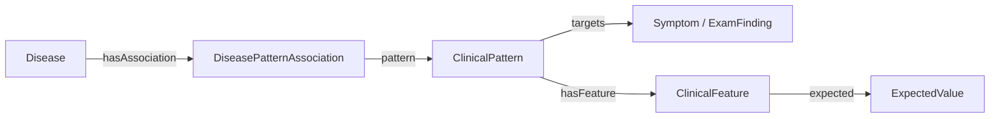

# Ontoward MVP 제품 요구사항

## 목적과 이번 산출물

Ontoward는 N.O.V.A. 모의 환자의 초기 정보에서 출발하여 문진·신체진찰로 필요한 정보를 모으고, S·O·A·P 초진 기록과 주진단 하나를 제출하는 진단 에이전트다. 첫 구현 대상은 예선이며, 본선의 검사 실행과 참가자 모델은 후속 단계로 구분한다.

첫 MVP는 한 증례를 메모리에서 진행한다. 사용자는 에이전트가 어떤 정보를 얻었고, 어떤 후보를 고려하며, 왜 다음 행동을 제안하는지 확인할 수 있어야 한다.

현재 제출 에이전트는 D17의 준비 문구·Pattern 중심 적합도·적응형 문진을 사용한다. D26에 따라 Education은 기본 pass하며 나머지 수집·해석·진단·SOAP·제출 흐름을 완성한다. D11의 세션 구조, D12 SDK·SOAP, D13 책임 분리와 D14 제출 내부 경계를 유지하고 실제 모델·임상 정확성·공식 제출은 별도 검증한다.

D15의 정보 보존과 D17의 워크플로우 정책을 유지한다. D18은 이전 지식·문구·승인 배치를 삭제하고 SNOMED CT·BODHI-S 원천 전용 베이스에서 전체 스키마 후보와 한국어 매핑을 재구축한다.

D20은 이 원천 기반에서 공모전 MVP의 첫 연결 그래프를 수용한다. Finding site·Location 값의 실제 기관 계통 경로는 집중 ROS의 inSystem으로, BODHI의 양성·0이 아닌 방향성 영향은 typed Context의 hasSupportingContext로 연결한다. 필수 조건은 Association applicability로 보존하고, 확인되지 않은 조건을 지지로 활성화하지 않는다. 그래프 수용은 추가 임상 승인 대기 없이 진행하며 한국어 문진·진찰 자산은 별도 세션에서 완성한다. 문구 수용 전 실행 manifest는 graph_admitted_text_pending으로 남고 prepare()는 그 사유를 명시한다.

D23은 완전한 원천 기반 후보·매핑·연결·한국어 환자 행동의 공모전용 사용을 승인한다. 별도의 임상 승인이나 사용자 선택을 기다리지 않으며 D20 그래프와 D22 문구의 정확한 해시를 새 수용 영수증에 연결한다. 문구 수용 후 manifest는 admitted가 되고 prepare()는 실제 문진·진찰 문구를 엄격하게 검증한다. 의미·단위·획득 방식이 빠진 레코드는 기술적 제외로 유지한다. 실행 검증은 프로젝트 오프라인 컨테이너에서 한국어 합성 환자·스크립트 Gateway·SOAP·확인 종료와 독립 제출 ZIP을 대상으로 한다.

공식 요구사항 확인일은 **2026-10-14 KST**이다. [개발 가이드](https://nova.snubhai.org/docs/), [참가 규칙](https://nova.snubhai.org/rules/), [평가](https://nova.snubhai.org/evaluation/)와 [10월 13일 공지](https://nova.snubhai.org/qna/)를 보존 SDK 1.0.1 및 기존 참고 문서와 대조했다. 현재 적용 변경은 [10월 14일 규칙 업데이트](assets/nova-competition-2026/CHANGES_2026-10-14.md)에 기록한다. 두 제공 PPTX의 변환과 [10월 12일 비교](assets/nova-competition-2026/CHANGES_2026-10-12.md)는 당시 자료로 유지한다. 홈페이지의 정확한 수정 시각과 새 시작 패키지의 실제 SDK 버전·바이트는 확인하지 않았다.

## 채택한 기술과 역할

| 기술 | 책임 |
|---|---|
| Python | 데이터 준비와 에이전트 실행 코드 |
| LangGraph | 한 증례의 단계와 조건부 이동 |
| Pydantic | 관찰·세션·행동·SOAP·진단의 구조와 경계 검증 |
| N.O.V.A. SDK | 지정 Doctor 호출, 세션 확인, 행동 실행과 최종 제출 |
| 제공 진료지침 | 보존 원본; D18의 현재 온톨로지·교육 파생 데이터 원천에서 제외 |
| SNOMED CT International·Korean | 판본·모듈 의존성을 고정한 개념·명칭·계층·관계 원천 |
| RDFLib | RDF 생성·로드·조회; 진료 중 준비된 임상 그래프 검색 |
| Turtle | 문서별 추출 결과와 출처별 제출 지식 묶음의 저장 형식 |
| BODHI-S | 현재 변형 정의·질환 연관과 두 방향 likelihood 원천 |
| Docker | Python 실행과 의존성 설치 환경 |

JEV, Laya, HPOA는 사용하지 않는다. 이번 MVP는 대표 합성 사례의 전체 실행을 검증하며 배포·호환성 매트릭스는 도입하지 않는다.

첫 경로는 공식 샘플 API와 지정 `openai/gpt-6-luna` Doctor 모델이며, 한국어 증례·환자 대화·제출 기록을 처리한다. 2026-10-13 시행된 모델 변경을 사용자가 10월 14일 확인했으며 D01의 선택에 반영한다. 사전 준비는 공급된 전체 International·Korean Snapshot과 BODHI-S를 결정론적으로 적재·투영하고 필요한 정규화·한국어 후보에만 D18의 제한된 Docker Codex CLI를 사용한다. 선택과 적용 범위는 [결정 상태](DECISION_STATE.md)의 D01·D02·D03·D04·D05·D06·D07·D08·D09·D10·D11·D12가 소유한다. 진료 중 SNOMED 원본이나 지침 문서 검색은 사용하지 않는다.

## 사용자가 경험할 흐름

다섯 내부 세션은 하나의 공식 NOVA 세션 안에서 진행한다. Doctor는 준비된 한국어를 검증·전달하고 지정 openai/gpt-6-luna는 Gateway 해석에만 사용한다. 질문·교육 선택, 검색, 점수, 진단과 SOAP는 Python이 담당한다.

| 내부 세션 | 준비와 종료 조건 | 행동 예산 |
|---|---|---:|
| Initiation | 초기 정보·활력징후 보존 후 반드시 인사와 주호소 유도로 시작 | 1 |
| ChiefComplaint | 핵심 HPI → Open Inquiry → 적응형 ROS·나머지 속성 | 공통 풀 |
| ContextFactor | Pattern 검색과 관련 Context·적용 조건 문진 | 공통 풀 |
| DifferentialDiagnosis | 새 근거에 따른 재계획과 특징·진찰 | 공통 풀 |
| Education | D26 기본 pass, 설명·이해 확인·정정 행동과 교육 완료 기록 없음 | 0 |
| 최종화 | SOAP 구성·검증·필요 시 1회 재구성 → DIAGNOSE → completed 확인 | 0 |

시작 준비 문구는 “안녕하세요. 무엇이 어떻게 불편하세요?”다. 초기 정보가 있어도 인사·주호소 유도를 수행하며 이미 확인한 세부 사실은 HPI에서 반복하지 않는다. EXAM은 준비된 단일 진찰 문구를 사용한다.

핵심 HPI는 Location·Laterality·PainQuality(없으면 Quality)·TimeSinceOnset·EpisodeDuration·Severity를 적용 가능한 미해결 항목만 주호소별 번갈아 처리한다. Open Inquiry 이후 임상 개정에 따라 미전송 질문을 재계획한다. 낮은 우선순위로 제외한 질문은 새 개정에서 재선택할 수 있으며 일반 전달 질문은 반복하지 않는다. 대기 응답·실제 사실·계획·전달 이력은 보존하고 명료화는 증례 전체 2회다.

D15에서 이미 물었다는 판단은 실제 전달 이력의 `was_asked`, 해결된 정보의 판단은 출처와 확정 값이 있는 `has_resolved_evidence`로 분리한다. 처리 완료라도 unknown·uncertain이나 값 없는 속성은 확보된 사실이 아니다. 일반 질문의 반복은 막으면서 현재 후보의 미해결 조건은 기존 최대 2회 명료화에서 확인한다.

집중 ROS 후보 계통은 확인된 주호소의 기존 inSystem·BodySystem 합집합으로 고정한다. 핵심 HPI와 Open Inquiry 뒤 현재 질문 가치에 따라 기확인·중복을 제외하여 총 6회 이내 선택하고 새 증상으로 계통을 연쇄 확장하지 않는다. BodySystem은 질환 후보 검색 필터가 아니다.

Context와 감별 질문은 현재 후보 간 가능한 점수 변화, 공동 조건의 남은 비용, 주호소 관련성, 원천 typicality를 사용한다. Context의 +1 상한이 이미 충족되었고 적용 조건에도 기여하지 않는 질문은 제외한다. Context보다 유용한 소견 질문·진찰이 있으면 감별 단계로 진행하고, 남은 Context도 같은 가치 순서에서 선택한다. 속성 질문은 같은 관찰·에피소드의 Target 존재가 확인됐을 때만 실행한다. 교육을 명시적으로 활성화한 경우에만 판단 변경에 따른 정정 설명을 사용한다.

원천 지지는 D08의 완전 조건 매칭·정교화 대체·Target별 중복 제거를 유지한다. D17은 Target→공유 Pattern Feature 평가→Association 적용 조건·가중치→Disease 순으로 처리한다. 적합도는 원천 지지+Context−제한 반증이며 기본 존재 Pattern의 같은 활성 에피소드 부재만 typicality high=0.5·very_high=1, Target당 1·질환당 2 한도로 반영한다. 미질문·unknown·상세 불일치·다른 에피소드 부재는 감점하지 않는다.

주진단과 감별은 양성 원천 지지·양수 적합도·확인된 현재 주호소 전체를 설명하는 완전 매칭 자격을 공유한다. 적합도·주호소 설명 비율·명시적 충돌 수·URI 순으로 정렬하고 선택 질환을 제외한 감별 최대 5개와 실제 확보한 근거를 표시한다. 미완성 Pattern은 질문 가치에만 사용하고 자격이 없으면 확인 주호소의 증상 수준 잠정진단을 사용한다.

| 복구 상황 | 처리 |
|---|---|
| 준비 문구 오류 | prepare 거부 또는 전송 전 거부·미전달 기록; 생성·절단 없음 |
| 구조화 실패·주호소 불명확·후보 없음 | 원문 보존, 증례 전체 명료화 최대 2회와 재검색 |
| 후보가 계속 없음 | 확인된 현재 주호소의 증상 수준 잠정진단, 원인 미확정 표시, 질환 치료 없이 준비 안내 |
| 진단 근거 주호소도 없음 | 명시적 실패 |
| 진찰 거절·실행 불가능 | 실제 소견으로 만들지 않고 가능한 다음 행동 |
| 일시 전송 오류·REQUEST_PENDING | 같은 ID·payload로 2초·5초 후 최대 2회 재전송 |
| 명시적인 환자·진찰 응답 형식 오류 | 새 요청 ID로 한 번 재시도 |
| 수집 예산 소진 | 대기 답변 처리 후 확보 사실로 SOAP·DIAGNOSE |
| SOAP 형식 오류 | 보존 사실에서 한 번 재구성하고 재검증 |

공통 한도는 50 행동·모델 200회·입력 500,000·출력 100,000토큰이다. D26의 기본 제출에서는 교육 보호 턴을 두지 않아 전체 행동 풀을 정보수집에 사용할 수 있다. 교육을 명시적으로 활성화한 경우에만 이해 확인 2턴과 정정 1턴을 보호한다. 새 행동 전 Gateway 1회·출력 여유·응답 처리 120초·최종화 120초를 확보하고 이미 받은 답은 응답 여유에서 처리한다. 정상 종료는 DIAGNOSE completed 확인뿐이다.

Gateway 기본 어휘는 256개·32 KiB, 확장은 1,024개·128 KiB다. 필수 Target·Attribute와 Target별 값·현재 원문 검색을 우선하며 후보 생성도 조기 중단한다. 전체 대화는 보존하고 모델에 보내는 과거 문맥은 기본 24기록·6대화·16 KiB, 확장 64기록·12대화·64 KiB다. 현재 응답은 별도 보존한다. 독립 유효 사실은 수용하고 무효 관찰 의존성·충돌 정정은 격리한다. JSON 형식 오류·빈 출력·문맥·연결·사실 복구를 합쳐 추가 호출 1회이며 먼저 수용한 사실을 보존한다.

## 공식 세션·실행 계약

| 항목 | 예선 요구사항 |
|---|---|
| 준비 | `prepare()`에서 증례 접근 없이 지식 자원 준비, 최대 10분 |
| 진료 | 준비 알림 후 `consult(client, resources)`에서 세션 접근, 최대 30분 |
| 모델 | 지정 `openai/gpt-6-luna` Doctor API를 증례당 최소 1회·최대 200회; 입력 500,000·출력 100,000토큰 |
| 행동 | `SAY`·`EXAM`은 각각 1턴, `DIAGNOSE`는 0턴, `TEST`는 차단 |
| 입력 길이 | SAY·EXAM·본선 TEST는 NFC 정규화 후 1–30 유니코드 코드 포인트; 공백·문장부호·줄바꿈 포함 |
| 상호작용 | 최대 50턴; 50번째 응답 이후에도 제한 시간 안에서 DIAGNOSE 가능 |
| 실행 자원 | 증례별 컨테이너, CPU 2코어·RAM 8GB·GPU 없음 |

세션 응답의 남은 턴·마감·허용 행동을 반영한다. 모든 발화는 준비 단계와 전달 전 독립 NFC 1–30자 검증을 통과해야 하며 생성·재생성·절단은 없다. 대회 공식 제한과 D17 내부 예산 정책을 구분한다.

형식·의미 거절은 실제 수행이나 관찰로 확정하지 않는다. 공개 문서에서 `EXAM_NOT_SPECIFIC`·`EXAM_NOT_RECOGNIZED`는 결과 없이 1턴을 사용하며, `ACTION_NOT_AVAILABLE`은 턴을 쓰지 않는다. 응답의 남은 턴을 확인하고 반복 거절을 무한 재시도하지 않는다. 전송 결과가 불명확한 동일 요청은 같은 `request_id`와 내용을 유지한다. 명시적인 모델·환자·진찰 판정 실패가 반환되어 비용·턴을 쓰지 않은 경우의 새 시도는 새 요청으로 구분한다. D11의 제한된 동일 요청 재전송과 명시적 환자·진찰 응답 오류의 새 ID 재시도만 허용하며 세션 종료·만료는 명시적 종료다. 기본 예제의 재시도 코드와 개발 키트만으로 공식 서버의 중복 처리·복구 동작을 검증했다고 주장하지 않는다. [요청과 오류 규칙](https://nova.snubhai.org/docs/)

서버가 받은 빈 내용·길이 초과 SAY/EXAM과 부적절한 EXAM은 1턴을 쓴다. SDK가 전송 전에 ValueError로 막은 요청은 턴을 쓰지 않는다. 빈 Doctor 답변은 호출 200회에는 포함되지만 토큰 예산과 Doctor 비용에서는 제외된다. 공식 session()의 events에 의존하지 않고 대화·행동·응답 이력을 InteractionState에 유지한다.

지정 모델은 Gateway에서 model=openai/gpt-6-luna·reasoning_effort=medium·최대 2,048 출력토큰으로 호출하고 실제 남은 예산을 반영한다. 첫 실질적인 환자 진술을 해석하여 최소 호출을 충족한다. 실제 Luna 의미 해석과 공식 API 수락은 별도 검증이다.

최신 가이드는 제공자 응답 시작 한도를 180초, 새 SDK 기본 대기 시간을 240초로 설명하며 `REQUEST_PENDING`(HTTP 503/409)과 `PROVIDER_UNAVAILABLE`에는 같은 request_id를 유지한 재요청을 안내한다. 보존 SDK 1.0.1의 기본 120초는 수정하지 않는다. 애플리케이션 전송 경계가 최대 240초와 남은 시간·제출 여유로 호출 대기를 제한하고 원래 timeout을 복원한다. 재전송은 같은 요청으로 기록하여 턴·호출·사용량을 중복 계산하지 않는다. 합성 복구와 실제 서버 복구는 별도 검증이다. [요청 대기·문제 해결](https://nova.snubhai.org/docs/)

개발용 create_sample은 팀당 KST 하루 100개, 제출 후 샘플 검증은 별도로 하루 10회, 공식 평가는 팀·단계별 하루 1회다. 세션 종료·만료로 생성 횟수가 돌아오지 않는다. 세션 밖 성공한 gpt-6-luna 호출은 model 생략 여부를 포함해 하루 1,000회로 합산하고 gpt-6.1-sol은 100회다. 증례 안 Doctor 호출은 이 일일 호출 한도와 별도로 증례별 한도를 적용한다. D09 준비의 공유 대장은 실패·불명 요청도 보수적으로 포함하고 날짜별 명시적 잔여 예산 안에서 최대 100회로 제한한다. [개발 한도](https://nova.snubhai.org/docs/)

## 최소 데이터·입출력 계약

| 객체 | 소유 정보 |
|---|---|
| CaseState | 구조화된 S/O/A/P, diagnosis, 질환/증상 종류와 근거 ID |
| SessionContext | 현재 내부 세션, 초기화 여부, 공통 예산과 세션별 사용량과 마감 |
| DifferentialState | 후보·Pattern·Association·Feature 연결, 실수 점수·조건부 기여·기록 참조 |
| QuestionPlan | 기록 참조, 행동 종류, 실행 순서·삭제 우선순위·준비 문구 |
| InteractionState | 전체 원문 대화·역할별 모델 기록·대기 행동·전달 이력·복구·제출 결과 |

SOAP 항목은 id·scope·status·value·출처 참조를 가진다. status는 unasked/done으로 처리 여부만 나타내며, value의 present/absent/uncertain/unknown은 임상 의미를 구분한다. 모른다는 답도 done으로 닫을 수 있으나 음성으로 바꾸지 않는다. 대상·현재/과거·가족력·관찰·에피소드와 정정을 보존한다. 수치·단위·시간은 원문과 타입 measurement에 보존하며 근거 없는 범주를 추정하지 않는다.

InputInterpreter는 현재 응답·실제 준비 질문·답변 계약·관련 관찰과 원문 문맥을 읽는다. 정확한 현재 인용과 제공된 context_refs만 검증하며 Doctor의 말을 환자 소견으로 만들지 않는다. 완전 일치하는 준비 답만 단축 처리하고 복합 답은 Gateway로 해석한다. 독립 유효 사실은 보존하며 실패한 관찰 의존성·정정과 미해결 의미만 복구한다. 실제 EXAM 없이 O.exam 소견을 만들지 않는다.

InteractionState는 실제 발화·환자 답·턴·요청 ID를 증례별 보존한다. dialogue()는 전체 원문 뷰이며 Gateway에는 D17 한도 안에서 관련 관찰·에피소드·출처를 투영한다. ONTOWARD_PARSER_PROMPT와 ONTOWARD_TEXTS만 config 파일을 선택한다. 모든 노드 갱신을 검증하며 분기는 모델 없이 결정한다.

## SOAP 기록과 최종 제출

최종 결과는 `client.diagnose(note=..., diagnosis=...)`로 제출한다. 화면·stdout·파일은 공식 제출을 대신하지 않는다. D12에 따라 SDK 1.0.1의 15개 SOAP 문자열 필드와 별도 주진단을 전송 계약으로 사용한다.

| 제출 항목 | 필수 필드 | 내용 |
|---|---|---|
| S | `cc`, `hpi`, `pmh`, `fh`, `sh`, `ros` | 주호소, 현병력, 과거력·약물·알레르기, 가족력, 사회력, 계통 문진 |
| O | `exam`, `tests` | 받은 진찰·검사 소견과 획득 턴; 초기 활력징후는 초기 정보로 표시 |
| A | `evidence`, `differential` | 판단에 사용한 문진·신체진찰 소견 목록과 중요한 감별진단 |
| P | `tests`, `treatment`, `disposition`, `follow_up`, `education` | 추가 검사, 치료, 처치 결정, 추적·경고 증상, 교육 계획 |
| 별도 값 | `diagnosis` | CaseState.diagnosis의 비어 있지 않은 주진단 하나 |

모든 SOAP 칸은 문자열이고 내용이 없는 칸은 빈 문자열로 둔다. 단, 기록 전체를 빈 문자열로만 채우지 않는다. 주진단은 CaseState.diagnosis에 유지하고 별도 diagnosis 인자로 비어 있지 않은 문자열 하나를 보낸다. note.A에는 evidence·differential만 넣는다. 누락·추가 필드와 잘못된 자료형은 제출 전에 거절한다. A.evidence에는 실제로 확보하고 판단에 사용한 문진·신체진찰 소견을 간결하게 목록화하며, 지식 출처나 내부 사고 과정으로 대신하지 않는다. 미확인·미시행 항목은 근거로 채우지 않고 원문·획득 턴은 InteractionState에서 추적하고 CaseState는 출처 ID를 참조한다.

D15의 결정론적 렌더러는 주체·현재/과거·발현 번호·속성 값·수치·단위·구간 경계를 보존한다. 짧은 “네”도 해당 구조화 사실과 함께 읽을 수 있게 하고 내부 URI·요청 ID·에피소드 ID는 노출하지 않는다. 한 번의 지속시간과 발생 후 경과시간을 구분하며 월·년을 임의로 일수로 환산하지 않는다.

공식 안내 표와 제출 예제는 주진단을 별도 diagnosis 값으로 보내도록 안내한다. 사용자는 D12에서 SDK 전송 형식을 선택했다. SDK를 수정하지 않으며 note.A.diagnosis를 추가하지 않는다. 문서·코드의 일치는 공식 서버 수락을 검증한 결과와 구분한다.

예선의 `O.tests`는 빈 문자열이며 향후 필요한 검사와 이유는 `P.tests`에 쓴다. 기록 전체는 UTF-8 100,000바이트, 주진단은 500바이트까지이며 30자 대화 한도는 기록에 적용하지 않는다. 전송 문자열과 기록 크기를 검증한다. 형식 오류는 한 번 재구성하며 서버 INVALID_RECORD_FIELDS 복구는 새 요청 ID를 사용한다. 제출 응답 completed로만 정상 종료를 확인한다. [기록 작성·크기 규칙](https://nova.snubhai.org/docs/)

음성·없음은 질문·확인 또는 제공된 결과가 있을 때만 기록한다. 미확인은 `Allergy ( )`처럼 남기고, 미시행 진찰·검사와 향후 계획을 실제 결과로 채우지 않는다. 수치·단위·참고범위는 환경이 제공한 것을 보존한다. S·O의 사실은 관찰과 출처·턴으로, A·P의 판단과 계획은 해당 사실과 지침 근거로 추적한다. 내부 사고 과정 전문 대신 사실과 판단을 연결하는 간결한 근거를 작성한다.

D26의 기본 제출에서는 Education을 pass하고 `P.education`을 빈 문자열로 둔다. 나머지 P 필드는 수용된 계획·검사 연결이 있을 때만 채우며 없는 치료·추적 내용을 만들지 않는다. 교육을 명시적으로 활성화한 경우에는 교육 계획과 실제 SAY 전달을 구분하고 전달 내용·응답을 증례 상태에 남긴다. 시간·턴 부족으로 설명하지 못한 내용을 설명 완료로 기록하지 않는다.

## v5.0 지식 준비와 검색

자료 준비와 실행 소비를 구분한다. 원본 RF2·BODHI는 assets/에 보존한다. Dev/ontology/source_projection.py와 v5.py는 제출 전 정규화·RDF 생성·검증을, data/preparation/v5/는 출처·매핑·검토·preview를, submission/knowledge/는 실행 스키마·정책·reader와 별도 수용된 임상 자산을 소유한다. 운영 상태는 root·submission·data 세 범위만 유지한다.

### 핵심 표현

유지할 책임은 Disease → ClinicalPattern → ClinicalFeature, Pattern 기반 감별 후보 검색, Feature 기반 점수 갱신이다. 저장 구조는 질환별 의미를 DiseasePatternAssociation으로 분리한다.

| 객체 | 의미 |
|---|---|
| Disease | 현재 진단 후보로 사용할 확인된 질환 개념 |
| ClinicalPattern | 하나의 Target과 함께 관찰되는 표현 정의; 여러 질환이 공유 |
| ClinicalFeature | Pattern에 귀속되는 원자적 속성·상태 조건 |
| ExpectedValue | concept, concept_set, quantity, interval의 타입 값과 비교 의미 |
| DiseasePatternAssociation | Disease·Pattern·적용 조건, 선택한 원천 라벨·관계 범위·출처 참조 |
| FeatureContribution | 기준과 정교화 Association 사이의 조건부 점수 차이; Python 파생 레코드 |
| BodySystem·ContextFactor | 기존 문진 계통과 확인된 지지 맥락 |
| ExamFinding·ExamMethod | 실제 진찰 소견과 detectedBy·검토된 examRequestText |
| Test | evaluatedBy로 연결한 SOAP P.tests 전용 계획 |

Pattern 동일성은 Target, 조건, 연산·단위, 부정·시간, AND/OR 및 수식 범위로 정하며 Disease·출처에 의존하지 않는다. Association 동일성은 Disease + Pattern + 적용 조건이다. 여러 원천 주장은 각각 보존하고 실행 평가를 선택한다. Feature에는 질환별 중요도를 넣지 않으며 기존 importance·clinicalRole은 v5.0의 입력이 아니다.

Pattern은 정확히 하나의 Symptom 또는 ExamFinding을 Target으로 하고 비어 있지 않은 조건들을 갖는다. 기본 증상의 존재도 expectedStatus Feature로 표현한다. onAttribute와 expected는 유효한 쌍이며 expected의 valueJSON은 엄격한 타입 JSON이다. 실제 그래프 cardinality와 조건은 Python이 검증한다.

### 값·관찰·개념 비교

| 값 종류 | 비교 의미 |
|---|---|
| concept | 정확 일치 또는 승인된 제한적 ValueMatch |
| concept_set | any_of 또는 all_of 조건 |
| quantity | 값·명시 단위·eq/lt/le/gt/ge 연산 |
| interval | 상·하한·명시 단위·경계 포함 여부 |

BODHI location과 laterality, radiating, onset, duration_since, duration_lasts, temporal_pattern, severity, pain_type, aggravated, relieved를 각각 Location, Laterality, RadiationLocation, Onset, TimeSinceOnset, EpisodeDuration, TemporalPattern, Severity, PainQuality, AggravatingFactor, RelievingFactor에 대응한다. characteristic는 실제 양상·색·내용물 등을 의미에 따라 분해하며 진단적 characteristic 역할을 부여하지 않는다. 선택 형식 메타데이터로 AND/OR를 추정하지 않는다.

원천 숫자·연산·단위·기간은 보존하고 없는 단위나 임계값을 생성하지 않는다. 월·년은 달력 단위이며 고정 일수로 바꾸지 않는다. TimeSinceOnset은 발생 이후 경과시간이고 EpisodeDuration은 한 번의 지속시간이다. 다른 소견을 요구하거나 단위·수식 범위를 해결하지 못한 필수 조건은 전체 의존 변형을 unresolved로 보류한다.

구체적인 통증 주호소를 Target으로 유지하고 확인한 부위·방사·양상·시점은 같은 observation/episode 안에 보존한다. 환자 원문·불확실한 개념 해석·정정 전 원문을 유지하며 후보에 맞춰 관찰을 바꾸지 않는다. 지원된 불확실 개념은 검색 합집합에 사용할 수 있지만 독립 확정 근거로 중복 계산하지 않는다.

ValueMatch는 관찰 개념과 기대 개념 사이의 검증된 제한 경로를 기록한다. is_a, regional_part, approved_region을 구분하고 sourceRef를 보존한다. 경로는 환자가 말하지 않은 넓은 위치를 실제 관찰로 생성하지 않는다. BodySystem은 문진 범위만 정하며 질환 검색을 제한하지 않는다.

### 전체 원천 수집과 v5.0 투영

공급된 International 2026-05-01 기반과 Korean 2026-06-15 확장을 정확한 Module Dependency 버전으로 결합한다. 최신 effectiveTime 행 선택 후 활성 여부를 적용하고 동일 버전 충돌·미래 행·누락된 의존성을 거부한다. 영어와 한국어 명칭을 동일 SCTID의 표현으로 연결하고 Korean 고유 개념의 모듈 출처를 보존한다. 다운로드하거나 원본을 수정하지 않는다.

BODHI의 첫 입력은 nodes_condition.csv, nodes_symptom.csv, edges_present_in.csv다. UUID와 자체 SCTID·루트 SCTID·nullable 원값을 분리한다. snomed_id라는 이름만으로 검증된 SCTID나 의미상 올바른 매핑을 주장하지 않는다. Condition이 활성 disorder인지와 현재 실행 역할을 함께 확인하며 과거력·가족력·검사 소견·미확인 ID는 지정된 제외/보류 결과를 갖는다.

2026-10-15 선택한 현재 구축 범위는 공급된 International·Korean 전체 Snapshot과 BODHI-S 전체 8개 CSV다. SQLite는 원천·최신 컴포넌트·정규화·registry·판단·승인 기록을 소유하고 실행 RDF는 v5.0으로 의미를 보존할 수 있는 승인 관계만 담는다. 원천 변형 조건을 유지하며 같은 Disease와 Target이라는 이유로 합치지 않는다. 실제 due_to·associated_with·subtype-intersection 경로의 관계 ID·그룹·모듈·버전·개념·계층 경로를 보존한다. 필수 조건·실행 역할·그룹 범위를 해결하지 못하면 전체 의존 표현을 보류한다.

준비 기록은 모든 입력 행·위치·UUID·원값·파일 해시·매핑·후보 registry·원천 주장을 보존한다. build/export/admit와 korean-freeze/korean은 적재·질환 투영·전체 스키마 카탈로그·한국어 처리·검증·수용을 연결한다. 전체 클래스의 역할 후보와 원천 관계를 JSONL/SQLite로 추출하고 실행 가능한 의존 부분집합을 RDF로 내보낸다. 미해결 원천 표현과 한국어 문구만 Docker Codex CLI에 전달한다. 한국어 전체 작업은 고정된 작업 집합·계산된 유한 호출 상한·요청 대장·실패 무재시도를 적용하며 모델 번역을 Korean RF2 원문으로 주장하지 않는다. 각 노드·관계는 원천 행 또는 명시적 파생 규칙과 연결하고 원천에 없는 임상 연결은 미해결로 남긴다.

### 자동 점수와 정교화

공개 submission/knowledge/scoring_policy.json을 버전·해시로 manifest에 고정한다. BODHI condition_given_symptom을 질환 지지에 사용하고 symptom_given_condition은 D17 질문 가치와 제한 반증에 사용한다. strong_predictor는 추가 가산 없이 보조 정보와 충돌 검토에 둔다.

| BODHI 라벨 | zero | rare | low | medium | high | very_high |
|---|---:|---:|---:|---:|---:|---:|
| 정책 점수 | 0 | 0.5 | 1 | 2 | 3 | 4 |

동일 질환·완전한 표현·범위에 BODHI 평가가 없으면 직접 due_to=2, associated_with=1, subtype-intersection 또는 조건을 보존한 일반화=0.5를 사용한다. 유효한 zero는 대체하지 않는다. 이 수치는 Ontoward의 정렬 정책이며 보정된 확률이나 likelihood ratio가 아니다.

FeatureContribution은 W(D,P') − W(D,P)이다. 한 조건 추가·정교화면 atomic, 여러 조건이 함께 바뀌면 joint로 유지한다. joint 점수를 개별 Feature에 나누지 않는다. 기준이 없는 상세 표현은 전체 점수를 쓰고 개별 기여는 미식별이다. 음수 차분은 기존 지지의 조정이며 자동 임상 반대 근거로 해석하지 않는다.

후보는 Target만으로 넓게 검색한다. 점수는 해당 표현의 모든 Feature와 적용 조건이 확인돼 일치할 때만 활성화한다. 더 구체적인 일치 변형은 점수가 내려가도 조상을 대체한다. 비교 불가능한 일치 변형은 최대값 한 번, 동일 Disease–Target은 반복·출처·에피소드와 관계없이 한 번 집계한다. 서로 다른 Target 지지는 합산한다.

다른 에피소드의 위치·기간·양상을 합치지 않는다. 미질문·불확실 조건은 원천 지지를 활성화하지 않으며 상세 불일치에서 자동 감점하지 않는다. D17의 제한된 기본 존재 반증 외 유병률·집단 보정·그래프 빈도 가산은 보류한다.

### 실행 인터페이스와 수용

| 조회 | 반환 |
|---|---|
| get_patterns_by_target(target_id) | Disease·Pattern·Association ID와 적용 조건·선택 평가 |
| get_target_patterns(target_id) | Target에 연결된 공유 Pattern ID |
| get_pattern_associations(pattern_id) | 공유 Pattern의 질환별 Association |
| get_disease_patterns(disease_id) | 공유 Pattern과 질환별 Association |
| get_pattern_features(pattern_id) | 타입 Feature 조건 |
| get_feature_contributions(association_id) | 기준·정교화 연관과 atomic/joint 차분 |
| get_supporting_context·get_exam_methods·get_planned_tests | 기존 Context, EXAM, SOAP P.tests 경계 |

prepare()는 manifest의 v5.0 스키마·어휘·임상 묶음을 하나의 RDFLib Graph에 로드하고 공개 점수 정책에서 Association 점수와 FeatureContribution을 계산한다. 진료 중 Graph는 읽기 전용이다. 관찰·에피소드·점수·근거는 CaseState 및 workflow state에 유지하고 소수 점수를 보존한다. Gateway는 같은 타입 값 계약을 사용한다.

모든 빌드는 schema_version, registry_version, normalization_version, source_snapshots와 파일 해시, scoring_policy_version과 정책 해시를 고정한다. v5.0 reader가 v5.0 빌드만 소비하며 의미를 삭제하는 v4.2 호환 변환을 만들지 않는다. 임상 자산이 수용되기 전 실제 prepare를 빈 그래프로 우회하지 않는다.

D23의 수용은 원래 그래프 승인과 한국어 생성 증빙을 덮어쓰지 않는다. 새 영수증이 원래 그래프 manifest·승인 해시와 검증된 문구·별도 의미 대조 증빙을 참조하며, 제출 ZIP에는 현재 manifest가 참조하는 지식 파일과 필수 실행 자산만 포함한다.

D18은 v5 이전 파생 자료·starter vocabulary·수동 한국어·과거 preview/승인/RDF·지침 기반 교육 자료와 임시 사본을 삭제한다. 원본 assets는 보존하고 삭제 영수증·빈 v5 베이스·원천 해시와 재실행 코드를 저장한다. 기존 런타임 manifest는 철회하며 새 배치의 명시적 수용 전 prepare()는 실패한다.

첫 수용은 공유 Pattern의 질환별 점수, 복통 2→1→4 대체, joint 차분, 두 기간 축, unknown/applicability 비활성, 에피소드·출처 중복 제거, 원천 제외/보류, 조회부터 SOAP·진단 제출·확인 종료까지의 오프라인 흐름이다. 사람의 임상 검토·실제 진단 성능·공식 SDK 수락·제출은 별도 증거이며 자동 preview 완료로 주장하지 않는다.

## 원천 전용 한국어와 생성 증빙

D21의 현재 한국어 세션은 D20에서 수용된 그래프 중 환자 행동으로 도달할 수 있는 문진·속성 질문·Context 질문·진찰 요청만 생성한다. 내부 명칭·구조 노드를 전수 번역하지 않는다. 새로운 작업 집합에 빌드·원천 자산·코드·프롬프트·요청 ID를 고정하고 JSON Schema의 30자 상한과 별도 Python의 NFC 1–30자 검증을 함께 적용한다. 사용자의 후속 요청에 따라 NOVA_DEV_KEY 개발 chat 경로를 우선하며 모델은 openai/gpt-6-luna, reasoning은 medium이다. 대안인 Docker Codex CLI는 SNU 교육 workspace와 gpt-6-luna·medium만 사용한다. 생성·별도 의미 대조 후 검증된 자산은 data에 보관하고 런타임 수용과 구분한다.

D22는 최신 사용자 요청에 따라 NOVA 전용으로 고정한다. 요청별 짧은 ID를 정본 작업 ID에 일대일로 바인딩하고 해부학적 범위를 보존한다. 실패하면 원시 응답과 이유를 남기고 새 요청 ID로 재개할 수 있으며, 전체 수용 또는 NOVA의 호출·크레딧·쿼터 한도에서 중단한다. 현재 세션 전체 1,000회 요청의 유한 로컬 상한과 같은 한국 날짜를 고정하고 이미 수용한 문구를 다시 호출하지 않는다. 이 명시적인 실패 재개는 이전 D21 중단 대기를 대체하지만, NFC·30자·의미 대조·런타임 수용 경계는 유지한다.

D19의 ExamFinding 추출은 BODHI의 증상 루트에 한정하지 않고 활성 RF2의 신체진찰 Finding method, 임상 Observable 해석, 형태·부위와 Sign 근거를 조사한다. 병력·검사 방법을 신체진찰로 바꾸지 않으며 명시적인 방법이 없는 소견은 획득 미확정으로 남긴다. FindingAttribute는 원천 조건 축과 공급된 ClinicalObservable의 비교 차원을 보존한다. Interprets·Has interpretation의 값은 같은 관계 그룹에서 각각 하나로 확정되는 경우에만 결합하고, 단위·척도·기법 등 Observable 모델 메타데이터와 분리한다. 수치·단위·임계값·진찰 문구를 추측하지 않는다. 전체 소견 후보는 별도 source-findings.ttl에 두고 BODHI 39개 분과와 관찰 영역별 근거·표현·방법·공백을 보고한다. 후보 수와 임상 충분성·실행 가능성을 구분한다.

한국어 작업 집합의 근거는 공통 참조 집합 ID로 연결한다. 속성 질문에는 대상과 해당 대상의 hasAttribute 근거만 연결하며 속성의 전역 근거를 펼쳐 복사하지 않는다. 상세 원천 표현·투영 판단·주장의 정본은 SQLite이며 JSON에는 빌드 ID·테이블·원천 해시를 가진 조회 참조를 둔다. 같은 빌드의 식별된 preview만 DB에서 재생성하며 알 수 없는 중간 결과는 보존한다. 기존 대용량 파생 JSON은 원래 바이트의 해시·크기로 압축 해제를 검증한 보관본과 복원 영수증으로 관리한다. 원본 assets·깨끗한 베이스·요청 신원은 유지한다.

source_catalog.py는 v5의 모든 클래스에 어휘/파생 노드 수와 원천 근거, Korean RF2 명칭·Description 행을 기록한다. 범위는 공모전 온톨로지의 유효한 원천 표현과 필요한 의존 개념이며 넓은 SNOMED 계층 전체를 번역하지 않는다. korean.py는 중복 제거한 누락 명칭 L개·실제 임상 질문 Q개와 입력·코드·프롬프트 해시를 고정한다. 호출 상한은 생성과 별도 자동 의미 대조를 포함한 2 × (ceil(L/20) + ceil(Q/20))이며 이전 NOVA 준비의 하루 100회 제한을 적용하지 않는다. 실제 질문은 하나의 관찰 가능한 내용만 묻고 NFC 1–30자를 준비·전달 양쪽에서 검증한다. 명칭 누락·긴 질문·진단 전제·진찰 연결 미해결·구조 레코드의 비적용 사유를 구분한다. 절단이나 필수 조건 삭제로 길이를 맞추지 않는다. 실패·불명·계정 제한·전체 응답 검증 실패 시 중단하고 자동 재시도나 다음 날 자동 재개를 하지 않는다. 별도 Codex 의미 대조는 독립 임상 검증으로 표시하지 않는다.

evidence.py는 생성 Python·Docker 설정·스키마·점수 정책·입력 해시·클래스별 범위·실행 검증을 별도 generation-evidence.zip으로 저장한다. 검토자는 로컬에 동일한 허가된 원천 패키지를 배치하여 재실행할 수 있다. 원본 RF2·BODHI 패키지·계정 정보와 실행용 제출 ZIP은 이 증빙에 포함하지 않는다. 증빙 파일 생성과 공모전 운영측 실제 제출은 별도다.

## 제공 샘플·벤치마크의 역할

| 자료 | 사용할 단계 | 경계 |
|---|---|---|
| 시작 패키지 | SDK·prepare/consult·공식 샘플 연결의 기준 | 기본 에이전트의 실행·성능·재시도 적합성은 검증하지 않음 |
| 공개 증례 C01·C03·C10 | 초기 정보 입력과 실행 후 누락 검토 | 대본·진찰표·모범 기록을 Doctor의 사전 지식이나 정답 검색에 넣지 않음 |
| 개발 키트 | 후속 로컬 시뮬레이션·디버깅 | 모델·판정·복구가 서버와 같다고 가정하지 않으며 채점·인터넷 차단을 검증하지 않음 |
| AgentClinic-MedQA | 후속 문진·진찰·진단 흐름 자체 평가 | TEST 결과는 예선 실행에서 제외하고 정답은 검토 측에 분리 |
| DDXPlus | 후속 단일 질문 선택·정보 획득 자체 평가 | 증상 코드와 답을 문진으로 연결해야 하며 진찰·검사는 제공하지 않음 |
| ACI-Bench | 후속 대화→SOAP 사실 일치·누락 검토 | 별도 정답 진단 라벨이 없고 화자 표기 오류 가능성을 고려 |

벤치마크는 영어·다른 형식의 외부 자료이며 대회 평가 증례가 아니다. 한국어 30자 질문에 맞추는 번역·재작성의 출처와 처리 과정을 보존한다. 학습·개발·검토 분할을 유지하고 AgentClinic 기본판/확장판 및 ACI 파생 대화의 중복을 관리한다. 전체 벤치마크를 첫 구현이나 제출물에 일괄 포함하지 않는다. 출처·라이선스·인용은 각 패키지에 유지한다. [공개 샘플 안내](assets/nova-samples-2026/README.md), [개발 키트 안내](assets/nova-devkit/README.md), [벤치마크 안내](assets/nova-benchmarks-2026/README.md)

## 제출환경과 실행 자산

submission/run.py는 workflow/runtime.py의 prepare()와 consult(client, resources)를 SDK run_agent()에 전달한다. prepare()는 읽기 전용으로 사용하는 지식과 텍스트 설정을 PreparedResources에 담고 consult()는 증례별 객체와 새 상태를 조립한다. D13의 Consultation 하나가 다섯 내부 세션을 조정하며 graph.py는 노드·엣지·상태 기반 분기와 deep-copy/Pydantic 검증을 연결한다. Doctor·InputInterpreter·InterviewPlanner·ClinicalReasoner·SubmissionWriter는 각각 환자 행동·입력 사실·질문과 교육·진단 추론·최종 제출을 맡는다. rules/는 불변 한도와 순수 판단, state/는 기존 다섯 상태 모델과 질문·상호작용·사용량 변경 연산, io/는 모델 호출·공식 NOVA 세션·전송 복구를 맡는다. 기존 agents/와 호환 wrapper는 남기지 않는다. knowledge/graph.py의 ClinicalKnowledge는 하나의 RDFLib Graph를 소유한다. import는 API 호출이나 지식 로딩을 수행하지 않는다.

submission/을 런타임 코드의 단일 원본으로 사용한다. 공개 설정인 submission/.env는 ZIP에 포함하고, 같은 폴더의 AGENTS.md·README.md·PROJECT_STATE.md는 제출에서 제외한다. SDK는 assets/nova-starter/nova_sdk.py의 수정 없는 사본이며 버전과 해시는 공모전 출처 기록에 남긴다. 원본 복제 허용은 이 SDK 사본으로 한정한다.

코드 ZIP의 압축 루트에는 run.py와 requirements.txt가 있어야 한다. Dev/packaging/package_submission.py는 package 이미지에 포함되며 입력을 /submission으로 고정한다. Compose package 서비스는 submission/만 읽기 전용으로 연결하여 실행 Python·고정 의존성·공개 .env·config/의 프롬프트와 문구·knowledge/의 필요한 Turtle·JSON만 압축한다. 결과 디렉터리는 Tmp/packaging/만 /output으로 연결한다. root .env, 안내·상태 문서, Dockerfile, Dev·Tmp·원본·추출 중간 결과·캐시는 제외한다. 크기는 압축 50,000,000바이트, 해제 500,000,000바이트, 파일 수는 5,000개 이하다. 심볼릭 링크·경로 이동·중복 경로·암호화를 허용하지 않는다.

제출 의존성은 PyPI의 미리 빌드된 휠을 사용할 수 있는 `name==version` 한 줄 형식으로 고정한다. URL·Git·편집 설치·버전 범위·다른 저장소·소스 빌드는 사용하지 않는다. 의존성 빌드는 제출 버전마다 한 번이며 20분 제한이고 내려받는 휠 합계는 8GB 이하다. 실행 중 인터넷은 차단되고 지정 대회 API만 허용된다. 필요한 자산은 허용된 제출물 또는 제공된 로컬 경로에서 읽는다. 개발 키는 비밀로 유지하고 코드·ZIP·문서에 저장하거나 코딩 도구에 연결하지 않는다. [참가·실행 규칙](https://nova.snubhai.org/rules/), [의존성 오류 한도](https://nova.snubhai.org/docs/)

제출 의존성은 submission/requirements.txt에서 LangGraph 1.2.13, Pydantic 2.14.0, RDFLib 7.6.0으로 고정한다. 루트 Dockerfile은 이 파일을 PyPI 휠로만 설치한다. 추출 도구와 MarkItDown은 제출 의존성에 포함하지 않는다. 기존 ontology-extraction 서비스와 관련 저장소는 별도 준비 환경이며, 그 실행 결과를 제출 환경 검증으로 대체하지 않는다.

공개 submission/.env는 ONTOWARD_KNOWLEDGE_MANIFEST=knowledge/manifest.json, ONTOWARD_PARSER_PROMPT=config/input_parser.txt, ONTOWARD_TEXTS=config/texts.ko.json, ONTOWARD_EDUCATION_ENABLED=false를 선언한다. 실행 환경값이 우선하고 경로는 knowledge/config 내부 상대 경로만 허용한다. Education 설정은 true·false만 허용한다. Doctor 생성 설정은 제거하며 SDK 필드·코드는 Python, 자격증명은 root .env와 실행기가 소유한다.

manifest는 schema·vocabulary·bundles·원천 scoring_policy와 D17 reasoning_policy의 경로·해시를 고정한다. 선택 labels·questions·plans도 knowledge 내부다. questions는 text·answer_type·affirmative·interviewable·reason 계약이며 대상|속성 예외가 우선한다. 원인 진단을 전제한 Target은 직접 질문하지 않는다. 모든 실제 발화를 NFC 1–30자로 검증하며 plans와 EXAM은 승인된 준비 자산만 사용한다.

문서별 추출 파일은 제출에서 제외하고 승인된 지식 묶음과 manifest만 필요한 코드와 함께 구성한다. 원본 약 597.2 MB를 RDF 크기로 간주하지 않으며, 제출 묶음의 실제 압축·해제 크기와 코드 전체 파일 수를 확인한다. 준비 10분과 예선 RAM 8GB 제한은 전체 실행 자원에 적용한다. 대표 추출에서 문서 길이·유형을 나누어 triple 수, Turtle 크기, 전체 로딩 시간, 최대 메모리와 주요 조회 시간을 측정한다. 후속 대표 추출의 수치는 data 준비 기록에 남기며 전체 제출 그래프나 진료 실행 환경의 수용 증거로 일반화하지 않는다.

본선에서는 별도 모델 ZIP 최대 32GB와 PPT/PPTX가 필요하다. `prepare()`에서 `NOVA_MODEL_DIR`의 읽기 전용 모델을 직접 로드하고 `client.chat()`을 사용하지 않는다. 가중치·KV 캐시·실행 메모리를 포함하여 A6000 48GB급 GPU 한 장, CPU 8코어·RAM 32GB 안에서 실행해야 한다. 본선 모델 선택·확보·학습·GPU 검증은 후속 단계이며 이번 작업에서 진행하지 않는다.

## MVP에서 확인할 결과와 책임

첫 MVP에서 확인할 결과는 한 증례에 대해 관찰이 누적되고, 관련 근거가 조회되며, 다음 행동과 최종 진단의 이유를 사람이 따라갈 수 있는 흐름이다. 별도의 성능 수치나 임상 정확도를 이 문서만으로 주장하지 않는다.

핵심 HPI는 정해진 최소 슬롯을 처리하고, 그 이후에는 현재 후보 판단을 바꿀 가치가 있는 미확인 항목을 선택한다. 이미 답한 항목을 불필요하게 반복하지 않는다. 최종화에서는 중요한 대안·모순·설명되지 않은 소견을 검토하되 앞선 세션으로 자동 회귀하지 않는다. 예산과 미해결 불확실성을 기록하고 교육·제출을 준비한다.

| 평가 영역 | 배점 | 제품 흐름의 검토 기준 |
|---|---|---|
| 정보수집 | 25 | 필요한 질문·진찰을 실제 수행하고 S·O에 기록 |
| 진단추론 | 15 | 주진단의 공개 5점 척도 판정과 사실에 연결된 근거·감별; 영역 점수 환산은 미공개 |
| 검사·추적 | 10 | 예선의 추가 검사 이유와 추적 계획 |
| 안전 | 15 | 위험 신호 확인, 적절한 처치 결정과 경고 증상 안내 |
| 의사소통 | 15 | 실제 SAY 설명·공감과 환자의 이해 확인 |
| 효율 | 20 | 중복 행동·불필요한 검색·모델 비용 감소 |

이 표는 공개된 평가 영역을 제품 검토에 연결한 것이며 비공개 세부 채점 기준을 재현하지 않는다. 로컬 개발 키트는 채점하지 않는다. 서버 샘플 검증의 참고 점수와 공식 평가 점수도 구분한다. 샘플 검증 없이 리더보드 제출을 선택할 수 있다. 개발 키 sample.py는 비채점이며 제출 ZIP의 샘플 검증은 gpt-6-luna 참고 점수를 제공한다. 공식 평가는 팀·단계별 KST 하루 1회, 예선 5증례를 gpt-6.1-sol로 채점하며 마지막 10증례는 GPT·Claude·Gemini의 평균을 사용한다. 샘플·외부 벤치마크 결과를 공식 성능이나 임상 정확도로 일반화하지 않는다. [평가 단계와 기준](https://nova.snubhai.org/evaluation/)

예선 리더보드 제출은 2026-10-13 오후 KST부터 접수한다. 공개 순위는 팀별 최고 점수이며 동점은 먼저 제출한 팀이 앞선다. 팀이 최종 평가에 선택한 제출과 공개 최고점 순위는 구분한다. 예선 결과로 10팀이 본선에 진출하며, 본선 최종 5팀의 의사 평가와 그 결합 방식은 별도다. 10월 13일 개발 크레딧을 지급액 40,000원으로 복구하고 12:30 이전의 개발 호출·샘플 세션·검증 횟수를 일시 초기화한 것은 해당 날짜의 운영 조치다. 현재 팀 잔액·잔여 횟수·제출 성공은 확인하지 않았다. [운영 공지](https://nova.snubhai.org/qna/), [리더보드 표시 기준](https://nova.snubhai.org/leaderboard/)

### 구현 수용 시나리오

완성한 D17 단위를 프로젝트 dev 컨테이너에서 오프라인 행동 검증한다. 기존 불변조건과 의도한 질문·점수 변경을 구분하며 과거 trace 전체 동일성을 요구하지 않는다. 합성 자산은 Tmp의 제출 복사본에 두고 실제 승인 RDF·독립 ZIP 실행과 원본 보존을 함께 확인한다.

- 초기 입력 → Doctor 인사·주호소 유도 → HPI → Open Inquiry → 집중 ROS → 후보 검색 → Context → 감별 → 교육 → SOAP → 확인된 제출의 전체 흐름.
- Gateway 호출·준비 문구·독립 NFC 검증·미전달 격리, 전체 원문 보존과 관련 문맥 투영.
- ROS 계통 합집합·기확인 제외·최대 6개·교차 계통 후보와 명료화 2회·증상 수준 진단·근거 없음의 명시적 실패.
- 동일 요청 ID·payload·턴·사용량 보존, 공유 모델 예산과 응답 처리 여유, 교육 중 새 사실, SOAP 1회 재구성.
- 초기화 전 빈 목록·대기 응답·현재 scope 완료·Context 0점·후보 없음·질문이 남은 선두 후보의 Python 분기와 분기용 LLM 0회.
- CaseState와 QuestionPlan 동시 삭제, Open Inquiry 보존, 새 개정에서 저우선순위 질문 재선택과 일반 전달 질문 반복 방지, 확인 사실·대기 행동·교육 계획 보존.
- 중복 가산 방지·정정 재계산·에피소드 분리·Context 음성/미확인·원천 점수와 정교화 대체·URI 동률·마지막 특징에 따른 순위 변경.
- 엄격한 답과 복합 자유서술, 잘못된 모델 출력, NFC 30/31자, 진찰 거절, TEST 차단, 만료·닫힘·결과 불명, 50번째 응답 뒤 제출.
- 정확한 SOAP 15개 문자열 필드·별도 진단·UTF-8 한도·Doctor 최소 호출·교육 계획과 실제 전달 구분.
- 외부 경로 폴백 차단·누락 manifest 오류·준비 문구 누락·환경값에 따른 문구 변경·SDK 원본과 패키징 경계.
- D17 워크플로우 보존과 D18 원천 전용 재구축, 루트·submission·data 상태 정합화.

치료·교육 자산과 실제 임상 성능 검증은 별도 준비를 요구한다. D18에서 이전 지식 사용 승인은 철회하며 D20이 새 공모전 그래프의 사용자 수용과 원천 기반 문진 계통·Context 변환을 소유한다. 새 전체 스키마 카탈로그·그래프 수용·한국어 행동 자산·실제 모델/공식 SDK 수락·제출·평가를 각각 분리하여 기록한다. 원천 근거가 없는 진찰 방법·검사 계획·임상 연결을 추가하지 않는다. 이전 작업 재개·새 원천 다운로드·커밋·배포는 포함하지 않는다. 구현·검증은 [제출 상태](submission/PROJECT_STATE.md), 준비 결과는 [데이터 상태](data/PROJECT_STATE.md), 교차 범위 조정은 [루트 상태](PROJECT_STATE.md)에 기록한다.
