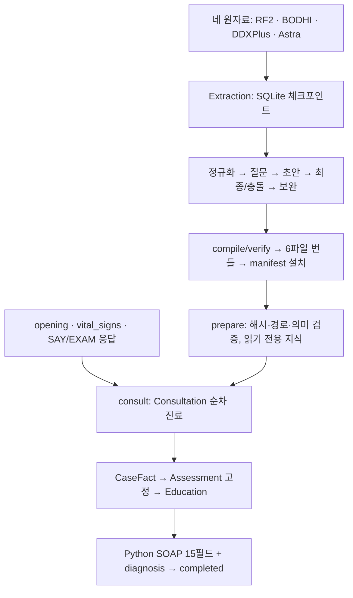

# Ontoward

Ontoward는 N.O.V.A. 예선에서 문진·신체진찰을 수행하고 **15개 SOAP 문자열과 주진단 하나를 제출하는 에이전트**다. 현재 구현은 **D58·d50.8**이며 D57의 입력·수치·원자 수집, D55 strict 지식·D56 진찰 문구, D53의 직접 문진·다섯 전체 문서·실패 비보충, D52 컨텍스트 종료, D51 입력 복구, D49 무점수 지식, D47 세션 소유권·통합 사실·평가 고정과 D48 프롬프트 모듈을 유지한다. Python이 등록 그래프의 관계·조건·질문을 준비하고, 공통 DoctorBrain을 호출한 세션이 질환 순위와 선택 질문을 수용한다.

D56은 현재 저장된 시진·청진·촉진·타진 실행 문구 119개를 정규화한다. `목을 보여 주세요.`는 `목 시진합니다.`, `피부를 눈으로 살펴보세요.`는 `피부 시진합니다.`로 바뀌었다. 복합 동작·특수 수기·필요한 자세와 ID·임상 관계·질문 계약은 보존했다. 문구가 없던 메서드 37개는 그대로 두며 부위 미지정 공용 메서드 2개에는 임의 부위를 넣지 않는다. [D56 결정](DECISION_STATE.md#D56)·[전체 전후 명세](data/provenance/exam-text-normalization-plan-2026-10-21.json)·[현재 검증](data/provenance/exam-text-normalization-2026-10-21.json)을 따른다. 실제 NOVA의 새 문구 수용 여부는 재검증하지 않았다.

**현재 로컬 활성 번들은 D58 build `cec62f4596bedd9b9488aa75e3d38f04`이다.** 실행 당시 최신 부모 `1bcaba1dffb744c468bb191df3267dad` 위에 진단 3개를 포함한 개념 11개, 실행 관계 9개와 질문 6개를 추가하고 허용된 기존 관계 4개를 수정했다. 부모의 수집 메타데이터·질문 override·단위·진찰 문구·지침 payload를 보존했다. 실제 API Luna medium 생성은 16회 상한 중 7회였으며 production loader·후보/질문 검사 뒤 로컬 활성화했다. [최종 생성·보존·설치 증빙](data/provenance/augmentation-d58-2026-10-21.json)을 따른다. 사용자 요청에 따라 이번 작업의 불필요한 체크포인트·중복 번들·DB 임시 파일 518개, 210.27 MiB를 삭제하고 활성 child와 기존 부모를 유지했다. [삭제 명세](data/provenance/augmentation-d58-cleanup-2026-10-21.json)와 [수용 delta](data/provenance/augmentation-d58-delta-2026-10-21.json)를 남겼으며 삭제한 run은 재개할 수 없다. 실제 모델 상담 정확도·임상·공식 평가와 실제 지식의 정식 ZIP은 미실행이다.

[D57](DECISION_STATE.md#D57)은 초기 발화에 이미 있는 기간·감소량·의도성을 같은 chief의 속성으로 수용하고, Mapping이 수치를 다시 쓰는 대신 Python의 검증된 measurement를 참조하게 한다. 미매핑 note도 관찰 범위를 유지하되 서로 다른 수치가 충돌하지 않게 한다. 원자 정보만 수집한 것을 복합 임상 기준의 충족으로 선언하지 않는다. 실제 어휘와 고정 Context·Mapping 응답을 사용한 C10 opening 회귀에서 시점·의도성·감소량/기간 재질문을 제거했고, 별도의 6개월 감소율·재발력·치료력·현재 경과는 미확인으로 유지했다. 이 결과는 새 프롬프트를 실제 모델로 실행한 추출 품질 검증과 구별한다.

**처음에는 [워크플로우·데이터베이스 아틀라스](Test/atlas.html)를 열어 보세요.** 서버 없이 HTML 파일을 직접 열면 진료 순서, 지식 생성, 객체별 기능, 환자 정보와 RDF·SQLite·JSON 스키마를 한 문서에서 읽을 수 있습니다. 색상별 도식 다음에 표와 친절한 설명을 배치했습니다. 2026-10-20의 소스 스냅샷이며 실시간 진행 화면은 아닙니다.

| 알고 싶은 것 | 읽을 문서 |
|---|---|
| 전체 흐름과 저장 구조 | [아틀라스](Test/atlas.html) |
| 한 응답을 사실·평가·질문·교육·SOAP로 바꾸는 원리 | [진료 백서](submission/README.md) |
| 현재 요구사항과 사용자가 선택한 방향 | [PRD](PRD.md) · [D50 결정](DECISION_STATE.md#D50) |
| 새 지식을 만드는 방법·중단·재개·오류 복구 | [추출 안내](Extraction/README.md) |
| 로컬 실행·보존 리포트·읽기 전용 뷰어 | [Test 안내](Test/README.md) |
| 수행 결과와 다음 한정 작업 | [루트 상태](PROJECT_STATE.md) · [제출 상태](submission/PROJECT_STATE.md) · [데이터 상태](data/PROJECT_STATE.md) |

## 최신 번들 위에 필요한 지식만 보완하기

[D58](DECISION_STATE.md#D58)의 별도 augmentation 경로는 최신 활성 manifest를 부모로 읽어 불면의 약물 관련 설명과 저신장의 정상 성장변이, 구별 질문만 유한하게 보완한다. Python이 기존 ID·의미·질문·공유 속성 역할·단위·지침을 보존하고 새 정적 번들을 출력한다. 전체 원자료 재구축이나 상담 overlay는 사용하지 않는다. DD는 현재 평가의 미확인 Context·clarification 질문을 기존 예산과 중복 방지 안에서 선택한다.

키 없는 부모 보존 검사, 실제 생성, 저장 결과 재컴파일, 로컬 활성화를 분리했다. 마지막 선택인 API Luna medium·40개 배치를 유지하며 실제 전송 상한을 명시한다. [정확한 Docker 명령과 한계](Extraction/README.md#최신-번들-증분-보완-d58)를 따른다. 실행 중 더 최신 manifest가 설치되면 이전 부모에서 만든 child가 이를 덮어쓰지 않는다.

## 두 파이프라인을 먼저 구분하기



위쪽은 **지식을 준비하는 과정**, 아래쪽은 **한 환자를 진료하는 과정**입니다. 상담은 원자료나 추출 SQLite를 읽지 않고 설치된 번들만 사용합니다. 환자의 CaseFact는 해당 증례의 메모리에 존재하며 추출 작업 DB와 다른 데이터입니다. 도식이 표시되지 않는 Markdown 뷰어에서는 [아틀라스의 내장 SVG](Test/atlas.html#map)로 같은 흐름을 읽을 수 있습니다.

## 무점수 진료

| 소유자 | 책임 |
|---|---|
| DoctorEar | 초기 입력·SAY·EXAM의 문맥 해석, 정확한 Python 연결, 선택적 정규화, CaseFact 수용 |
| 세션 객체 | 필수 수집, 그래프 검색 자료, LLM 순위·행동의 검증·수용, 평가 고정 |
| DoctorBrain | 같은 지정 모델의 공통 실행·effort·한도·사용량·전송 복구 |
| DoctorMouth | 한국어 표현·진단 안내와 SAY·EXAM |
| Consultation | 다섯 세션·공식 자원·입력→판단→행동의 조정 |
| SubmissionWriter | frozen Assessment와 사실의 Python SOAP·DIAGNOSE·완료 확인 |

Association은 질환·Pattern·명시적 target_scope·applicability·`support / strong_support / against / strong_against`로 구성한다. 새 후보는 positive effect의 Target 또는 applicability 경로로 넓게 회수하고, **전체 Pattern과 applicability가 맞을 때만 effect를 활성화**한다. 부분 일치·수치 불일치가 자동 지지나 반대가 되지 않는다. 기존 후보는 현재 유효한 경로가 있는 동안 보존한다. LLM이 수용한 순서를 점수로 다시 정렬하지 않는다.

Context도 같은 CaseFact를 사용하며 가족 구성원·시점·관찰·episode를 섞지 않는다. 속성 질문에는 같은 Target·scope의 존재 확인이 앞선다. rule의 any와 실제 질문의 current/past/unspecified를 구분한다. 나이·측정값·기간·단위·통증 수치와 실제 취득 경로는 유지한다.

Initiation과 CC 종료에서 순위를 판단하고, Context 종료와 DD 첫 행동을 DD 진입의 한 joint decision으로 합친다. DD는 unknown을 포함한 새 응답을 식별자로 판단한다. Consultation 순차 루프가 LangGraph를 대체하며 최신 평가·facts·chief를 고정한 뒤 Education과 Python SOAP가 공유한다. Education은 영어 P와 한국어 발화를 함께 생성하고 두 결과를 독립 수용한다. 진료 모델은 기존 openai/gpt-6-luna이며 임상·공동 계획은 high, Ear와 남은 Mouth 복구는 medium이다. 추출 모델 설정은 별개다.

Consultation이 검증한 CC 평가 자료만 ContextFactor에 전달한다. EducationSession은 영어 계획과 전달 순서·턴 배분·큐·준비 상태를 관리하고, Mouth는 한국어 표현과 행동 실행을 담당한다. 이미 큐나 전달·미전달 결과가 있는 교육 계획 그룹은 재진입해도 다시 표현하지 않는다.

[D51 후속 결정](DECISION_STATE.md#D51)은 미사용 계약을 정리하고 실제 role clarification을 준비 단계에서 검증한다. Ear의 의미 처리 호출은 문맥 2회·매핑 2회 이내이고 초기 chief도 같은 복구를 공유한다. 첫 후보 강제 확정은 제거했으며 정상 input 2회 보호와 선택적 복구를 구분한다. 진단 안내 모델은 실제 번들 전체의 짧은 한국어 문구가 검증될 때까지 유지한다.

입력 부분 복구는 정상 demographic·형제 진술을 보존하고 typed age와 미매핑 영문 메모를 수용한다. 속성의 그래프 자격은 현재 같은 범위의 존재 확인으로 계산한다. 정확한 단답과 성공 응답의 자원 재사용, 공유 관계 JSON으로 불필요한 호출·조회·중복 표현을 줄인다.

[D52 수정](DECISION_STATE.md#D52)은 설치 후 C10 로그에서 확인한 관계 정의 중복을 제거한다. 같은 target·effect·전체 Pattern·scope·applicability를 질환 간 공유하며 모든 후보·조건·관찰별 근거는 유지한다. CONTEXT_LIMIT_EXCEEDED는 출력 한도를 높여 재시도하지 않고 해당 원인으로 종료한다. 새 실제 NOVA C10의 완료 여부는 별도 실행으로 확인해야 한다.

[D53](DECISION_STATE.md#D53)은 인사·공감 SAY를 삭제하여 초기 입력 수용 후 Initiation의 첫 미확인 질문부터 시작한다. 최대 다섯 전체 문서와 실패 비보충·참고 자료 경계·해시/인용·영어 P/한국어 독립 수용은 유지한다. 당시 인덱스 순서 검증은 [D53 증빙](data/provenance/algorithm-d50-4-2026-10-21.json)에 보존한다.

[D54](DECISION_STATE.md#D54)는 단일 고정 주진단의 문서 중 exact이면서 care_navigation인 항목을 먼저 안정 분할한 뒤 다섯 개를 고정한다. 모순된 Pattern/applicability 경로의 후보 유입을 막고 unknown 부분 후보와 유효한 prior 반대 경로는 유지한다. 교육·안내의 fact ID, 질문의 observation/episode scope, 초기 원문 중복과 mapping 해석 의미, 영어/한국어 어휘 후보를 함께 정리했다. 문서의 내부 path/hash는 모델에 보내지 않고 전체 원문과 UTF-8 인용은 보존한다. [D54 검증](data/provenance/algorithm-d50-5-2026-10-21.json)과 [당시 연결 위반 목록](data/provenance/runtime-link-audit-2026-10-21.json)은 당시 bytes/hash를 고정한 역사적 근거다. 이후 D55는 정정 번들과 strict gate를 함께 활성화했으며 Decreased body weight는 동등성 근거 부족으로 별도 개념을 유지한다.

[D52 증빙](data/provenance/algorithm-d50-3-2026-10-21.json)은 소스·독립 ZIP 회귀 각각 180개, 저장된 두 순위 요청의 임상 입력 동등성, 관측 16시나리오와 독립 합성 상담 3개·원본 SDK completed를 기록한다. 실제 NOVA 재실행과 공식 수용 증거는 포함하지 않는다.

## 추출 이미지와 현재 생성 경계

`ontoward-extraction:local`은 Python 3.12, 고정 프로젝트 의존성, Codex CLI 0.162.1을 포함한다. 공급자는 `nova_dev`, `codex_subscription`, `openai_api` 중 한 빌드에 하나다. 초안 gpt-6-luna·최종 gpt-6.1-sol 모두 medium이며 모델·공급자 fallback은 없다.

```sh
docker compose build extraction
docker compose run --rm -T control status
```

첫 명령은 이미지 빌드이며 다운로드가 필요할 수 있습니다. 둘째는 네트워크 없는 키 없는 로컬 상태 조회입니다. 둘 다 생성이나 로그인을 시작하지 않습니다. 생성·중단·재개·명시적 불명 요청 재시도·설치 명령은 [추출 안내](Extraction/README.md)를 따릅니다. 입력 hash와 job·요청·응답·사용량은 SQLite 체크포인트에 저장합니다. pause와 SIGINT/SIGTERM은 새 전송을 막고 진행 중 응답을 저장한 뒤 종료합니다. 정상 완료·중단 후 자동 재시작하지 않습니다.

실제 빌드 `87e8b4c54b0689453cea91b3bb316290`는 108개 파일·12,587,695행의 색인과 완료 작업을 보존한 상태에서 정보 처리 오류만 수동 교정하고 컴파일·검증·설치를 완료했다. 교정 당시 원래 결과·요청·사용량을 보존하고 추가 모델 호출 0회로 설치했다. 설치 후 보관 해제 요청에 따라 원래 작업 DB는 삭제했으며, 최종 설정·사용량 요약·수동 교정 내역은 [최종 감사 기록](data/provenance/extraction-final-audit-2026-10-21.json)에 남겼다. [수동 처리 증빙](data/provenance/extraction-readiness-repair-2026-10-21.json)과 [데이터 상태](data/PROJECT_STATE.md)가 정확한 범위와 진행을 관리한다.

현재 완료 빌드의 work·staging·콘솔 로그는 정리했으므로 과거 ID로 status·resume·recover를 실행하지 않는다. `status`의 `not_started`는 보관된 작업 DB가 없다는 뜻이며 설치 지식의 완료를 취소하지 않는다. 설치 번들은 `docker compose run --rm --no-deps -T verify verify`로 독립 검증한다. 생성·복구 안내의 예시는 앞으로 별도로 시작한 작업에만 적용한다.

## 디렉터리와 검증

| 경로 | 역할 |
|---|---|
| submission/ | 제출 런타임·설정·설치된 실제 지식 번들과 manifest loader |
| Extraction/ | 네 원자료 기반 생성기·세 공급자·체크포인트·독립 이미지 |
| Dev/ | 유지 행동 회귀·합성 번들 구성·패키저 |
| Test/ | 로컬 평가·관측·읽기 전용 지식 뷰어·독립 SDK 하네스 |
| assets/ | 변경하지 않는 원자료·SDK·주최자 입력 |
| data/ | 원천 custody·과거 결과·철회 기록·새 빌드 work/output·증빙 |
| Tmp/ | 합성 번들·오프라인 실행 로그·임시 ZIP |

```sh
docker compose -f compose.yaml -f Dev/tests/workflow/compose.offline.yaml run --rm -T --no-deps dev python -B -m unittest discover -s Dev/tests/workflow -p 'test_*.py'
```

[D51 후속 증빙](data/provenance/algorithm-d50-2-2026-10-20.json)은 소스·독립 읽기 전용 ZIP의 회귀 각각 176개, 정상 scripted 상담 3개의 전후 행동·사실·평가·P·SOAP·사용량 일치, 관측 16시나리오와 1,516 작업 snapshot 재구성을 기록한다. 독립 합성 ZIP은 원본 SDK·run.py를 통해 21행동·44 HTTP 요청 뒤 completed를 받았다. [D50 증빙](data/provenance/algorithm-d50-2026-10-20.json)은 이전 d50.1의 역사적 수용 기록으로 보존한다. 합성 프로토콜 수용은 실제 모델·임상·공식 성능 검증과 구분한다.

실제 지식 번들의 로컬 생성·검증·설치는 완료했습니다. 설치 번들을 사용한 대표 상담 수용은 다음 한정 작업입니다. 실제 모델 품질·임상적 정확성·공식 평가·정식 ZIP·업로드·배포와 브라우저 시각 검증은 이 설치 검증에 포함하지 않습니다.
