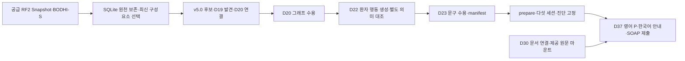

# Ontoward

Ontoward는 N.O.V.A. 예선의 모의 환자에게 문진·신체진찰을 수행하고 **SOAP 초진 기록과 주진단 하나를 제출하는 에이전트**다. Python이 읽기 전용 v5.0 온톨로지에서 근거를 검색하고 질문·점수·진단을 결정한다. LangGraph는 한 증례의 실행 순서와 조건부 이동을 관리하며 지정 `openai/gpt-6-luna`는 발화 해석·기록용 표현·공감·진단 후 계획·한국어 안내를 맡는다. 이 안내는 **2026-10-18, D40 진료 구현과 D39 지식 뷰어**를 기준으로 한다. 처음 읽는 분은 [워크플로우 백서](submission/README.md)에서 인사부터 진단 제출까지와 각 함수의 책임을 따라갈 수 있다.

[PRD](PRD.md)는 동작 요구사항, [결정 문서](DECISION_STATE.md)는 사용자 선택, 각 범위의 PROJECT_STATE.md는 관측된 진행과 다음 작업을 관리한다. 공모전 규칙은 [공모전 참고 자료](assets/nova-competition-2026/README.md)와 [현재 규칙 업데이트](assets/nova-competition-2026/CHANGES_2026-10-14.md)에서 확인한다.

[프로젝트 흐름 지도](Test/atlas.html)는 브라우저에서 직접 여는 개인용 오프라인 안내서다. **온톨로지 14개 클래스와 연결, 실제 LangGraph 노드·분기, 원천 추출·한국어 준비·수용 파이프라인**을 내장 SVG로 보여주며 D38의 추론·질문 선택과 D37 Education도 함께 설명한다. `Test/atlas.html` 파일을 열어 목차·찾기·인쇄로 읽는다. 서버·빌드·스크립트·외부 자산이 필요 없고 내용은 자동 갱신하지 않는다.

**실제 데이터의 이름과 연결을 탐색하려면** 프로젝트 루트에서 `sh Test/knowledge.sh start`를 실행하고 [지식 뷰어](http://127.0.0.1:8766)를 연다. 질환·증상·패턴·조건을 이름으로 검색하고 연결 그래프와 원천 근거를 따라가며, 준비 SQLite의 실제 테이블과 행도 읽기 전용으로 조회한다. 기존 로컬 dev 이미지를 재사용하고 인터넷·모델·호스트 의존성 설치가 필요 없다. 중지는 `sh Test/knowledge.sh stop`이며 자세한 이용법은 [Test 안내](Test/README.md#knowledge-viewer)에 있다.

D38에서는 환자가 우선시한 대표 CC 하나의 연결된 전체 속성을 처리한 뒤 Open Inquiry를 수행한다. 이후 증상 존재·필요한 속성·Context·진찰을 같은 선택기로 비교한다. 실제 답변과 가상 답변은 같은 추론 규칙을 사용하며 최종 점수는 CC 지지 + 추가 Target 보강(최대 4) + Context(최대 1) − 제한 반증이다. 원천 RDF·출처별 점수·한국어 자산·의존성은 보존하고 별도 d40.1 정책을 해시로 고정한다. [D38 결정](DECISION_STATE.md#D38)과 [정책](submission/knowledge/d40-reasoning_policy.json), [수용·출처 기록](data/provenance/algorithm-d40-2026-10-18.json)에서 구체적인 기본값과 검증 경계를 확인할 수 있다.

D37의 현재 제출 설정은 진단을 고정한 뒤 Education을 실행한다. Disease에 연결된 가이드라인 원문을 제공 마운트에서 읽고 전체 실제 대화와 함께 Luna high에 전달해 영어 P 계획을 생성한다. Doctor가 NFC 1–30자 한국어로 변환해 남은 공통 턴 안에서 안내하고, 영어 계획을 보존하여 SOAP·DIAGNOSE를 제출한다. 실제 모델 품질·공식 서버 수락·점수는 별도 검증 대상이다.

D40의 조건부 목표/상한은 Initiation **5/7**, ChiefComplaint **7/14**, ContextFactor **7/9**, DifferentialDiagnosis **3/10**, Education **5/10**이다. 현재 필수 수집과 뒤 세션 최소량·교육 5턴을 보호하고 다른 세션 상한을 빌리지 않는다. 공감도 공통 **50턴·모델 200회·입력 500,000·출력 100,000토큰**을 사용하며 Education에서는 시행하지 않는다. 정상 종료는 DIAGNOSE의 completed 확인이다.

D40은 초기 정보의 환자·보호자 맥락과 수치를 먼저 구조화한다. “안녕하세요. 병원 오시는 길이 불편하진 않으셨나요?”로 시작하고 미확인 onset·경과·유사 경험·이전 치료를 확인한다. 이후 CC 속성과 기본 병력 다섯 영역·관련 Context를 수집한다. SOAP는 임상적 의미로 배치하며 교육 응답은 원문 기록만 한다. 선택 진단은 working diagnosis로 설명하고 치료의 확인 조건을 유지한다. [D40 결정](DECISION_STATE.md#D40)을 따른다.

## 온톨로지와 추출을 읽는 기준



중심 구조는 `Disease → hasAssociation → DiseasePatternAssociation → pattern → ClinicalPattern → hasFeature → ClinicalFeature`다. Pattern은 하나의 Symptom 또는 ExamFinding을 대상으로 하며 여러 질환이 공유한다. 질환별 적용 조건·원천 평가·가중치는 Association에 있다. Feature의 존재·타입 값 조건 전체가 맞아야 지지를 만들고 정교화 Pattern은 조상 점수를 대체한다. [14개 클래스·관계](submission/README.md#ontology-schema)와 [추출 알고리즘](submission/README.md#extraction-pipeline)을 백서에서 확인할 수 있다.

현재 [manifest](submission/knowledge/manifest.json)는 `admitted`, schema `5.0`, algorithm `d40.1`이다. 로드한 실행 RDF에는 Disease 843개, Symptom 490개, Pattern 1,797개, Association 9,401개가 있다. ValueMatch·Test처럼 스키마에 정의되어도 현재 인스턴스가 없는 클래스는 [지도](Test/atlas.html#ontology)에 별도로 표시한다. 원천 역할·의미·단위·획득 방식이 부족한 항목은 기술적 제외로 남긴다.

D30은 843개 Disease의 **문서 연결**을 준비했고 D37은 [탐색 인덱스](submission/knowledge/guideline-index.json)를 현재 build에 고정했다. `background_only`, 원문 근거, 모델 지식 보완은 구분한다. 문서 연결률이 곧 환자별 계획 근거의 충분성을 뜻하지 않는다. 원문은 `NOVA_GUIDELINES_DIR` 아래에서 해시 확인 후 읽으며 ZIP에 포함하지 않는다.

## 구조

```text
Ontoward/
├── AGENTS.md / README.md / PRD.md
├── PROJECT_STATE.md / DECISION_STATE.md
├── Dockerfile / compose.yaml / .dockerignore
├── .gitignore / .env / .env.example
├── submission/
│   ├── run.py / settings.py / nova_sdk.py
│   ├── workflow/    # 책임 객체·규칙·상태·실행 흐름
│   ├── knowledge/   # RDFLib 코드·실행 Turtle·필요한 JSON
│   ├── requirements.txt / .env
│   └── AGENTS.md / README.md / PROJECT_STATE.md
├── Dev/
│   ├── codex/      # 최소 CLI 환경·인증 설정
│   ├── ontology/   # 현재 v5.0 원천 투영
│   ├── guidelines/ # 원문 근거 매핑·D37 탐색 인덱스 준비
│   ├── tests/      # 워크플로우·원천 행동 검증
│   └── packaging/  # 제출 ZIP 구성 도구
├── data/
│   ├── ontology/   # v5.0 구조 계약
│   ├── preparation/v5/ # 로컬 원천 DB·준비 결과와 버전 관리할 요약
│   ├── catalog/    # 원본 경로 목록
│   └── provenance/ # 출처 식별·저장 정리와 복원 영수증
├── assets/         # 주최자 원본과 공모전 참고 문서
├── Test/           # 웹 실행기·진료 과정 리포트·NOVA 모의 환자·격리 컨테이너
└── Tmp/
    ├── codex/      # 임시 Codex 출력
    └── packaging/  # 생성 ZIP
```

루트는 Docker·공통 문서·Dev 도구와 범위 조정을 소유한다. [submission](submission/README.md)은 실행 코드와 애플리케이션 상태, [data](data/README.md)는 자료·준비 결과를 소유한다. 운영 상태는 [루트](PROJECT_STATE.md), [제출 코드](submission/PROJECT_STATE.md), [데이터](data/PROJECT_STATE.md) 세 곳이며 Dev·Tmp에 상태 범위를 추가하지 않는다.

실행 코드는 submission/workflow/에 모여 있다. Consultation 하나가 다섯 세션을 조정하고 Doctor·InputInterpreter·InterviewPlanner·ClinicalReasoner·SubmissionWriter가 각 기능을 맡는다. rules/에서 규칙을, state/에서 상태와 변경 연산을, io/에서 모델·공식 세션·전송 복구를 찾을 수 있다. run.py는 workflow/runtime.py의 prepare·consult를 SDK에 전달한다. RDFLib 조회와 실행 자산은 submission/knowledge/에 둔다. 자세한 함수·상태·예제는 [제출 워크플로우 백서](submission/README.md), 규칙별 구현과 테스트는 [규칙 색인](Dev/architecture/WORKFLOW_RULES.md)을 참고한다.

## 설정과 개발환경

루트 .env는 로컬 개발용이다. .env.example과 같은 세 변수로 대회 API 주소, 개인 개발 키, 컨테이너의 지침 위치를 설정한다. 초기 키는 빈 값이며 Git과 제출 ZIP에 포함하지 않는다. Compose는 필요한 값만 dev 서비스에 전달한다.

submission/.env는 **ZIP에 포함하는 공개 실행 설정**이다. 현재 지원 값은 다음과 같다.

```dotenv
ONTOWARD_KNOWLEDGE_MANIFEST=knowledge/manifest.json
ONTOWARD_PARSER_PROMPT=config/input_parser.txt
ONTOWARD_TERMINOLOGY_PROMPT=config/medical_terminology.txt
ONTOWARD_EMPATHY_PROMPT=config/empathy.txt
ONTOWARD_EDUCATION_PROMPT=config/education.txt
ONTOWARD_EDUCATION_DOCTOR_PROMPT=config/education_doctor.txt
ONTOWARD_TEXTS=config/texts.ko.json
ONTOWARD_EDUCATION_ENABLED=true
```

공통 설정을 중복하지 않도록 .env와 settings.py를 유지한다. settings.py가 prepare()에서 이 파일을 읽으며 파일 경로는 settings.py 위치를 기준으로 결정한다. 실행 위치가 바뀌어도 같은 submission/knowledge를 참조한다. 같은 이름의 환경변수가 있으면 그것이 우선하며 manifest 경로는 submission/knowledge, 프롬프트·문구는 submission/config 내부 상대 경로여야 한다. 단순 KEY=VALUE 형식으로 공백 행과 주석을 허용하고 셸 확장·따옴표 처리는 하지 않는다. 공식 토큰·세션은 실행기가 제공하며 이 파일에 넣지 않는다. 새로운 설정을 추가할 때는 코드의 허용 항목과 실제 소비 위치도 함께 추가한다.

프로젝트 의존성은 호스트에 설치하지 않고 Docker dev 환경을 사용한다.

```sh
docker compose build dev
docker compose run --rm dev
```

Dockerfile은 submission/requirements.txt의 고정 버전을 PyPI 휠로 설치한다. 원천 투영은 기존 dev 이미지의 SQLite·Pydantic·RDFLib를 사용하며 별도 ontology-extraction 서비스와 전용 인증 volume은 준비 환경으로 유지한다. 현재 환자 행동 문구는 D22의 NOVA 전용 경로로 생성·별도 의미 대조를 완료하고 D23에서 수용했다. 과거 Codex CLI 작업이나 실패한 모델 작업을 자동 재개하지 않는다. Dev/ontology와 data가 준비·출처·수용 기록을, submission/knowledge가 실행 자산을 관리한다.

## 로컬 공개 샘플 테스트

[Test 실행 안내](Test/README.md)에 SDK HTTP API와 예선 자원 제약을 재현하는 컨테이너를 둔다. `sh Test/run.sh verify`는 외부 모델 없는 API 경계 검사이고 `sh Test/run.sh C10 scripted`는 기존 제출 에이전트의 오프라인 실행이다. 별도 `nova` 모드는 루트 개발 키로 모의 환자·진찰·Gateway를 호출하며 시뮬레이터만 외부 네트워크를 사용한다. 환자 대본·진찰표·참조 SOAP·개발 키는 에이전트에 연결하지 않는다. 로컬 결과는 채점하지 않으며 공식 평가와 구분한다.

`sh Test/web.sh`로 시작한 뒤 [로컬 테스트 사이트](http://127.0.0.1:8765)에서 증례와 실행 조건을 선택할 수 있다. 기본은 C10·NOVA·최대 200회 요청이며 실행 버튼을 누르면 테스트가 시작된다. 완료되면 같은 페이지에서 실제 대화·내부 세션·턴별 상태 변화·모델 요청·진단 근거와 최종 SOAP를 확인한다. 이전 실행도 다시 열 수 있고 실행별 `report.html`을 보존한다. 사이트는 submission 파일을 수정하지 않으며 실행 실패와 부분 로그도 보여준다. 자세한 관측·실행 경계는 [D31](DECISION_STATE.md#D31)을 따른다.

[D29](DECISION_STATE.md#D29)는 실제 Input Gateway가 주호소를 기존 Symptom 하나에 매핑하도록 요구하고 원천의 한·영 라벨·동의어와 제한된 전체 색인 재검색을 사용한다. Test의 증례별 문자열 매처는 제거했다. 오프라인 회귀와 프로토콜 대역의 통과는 실제 NOVA의 자연어 해석 정확도와 구분한다.

## ZIP 만들기

프로젝트 루트에서 다음 명령을 실행한다.

```sh
docker compose build package
docker compose run --rm -T package
```

결과는 Tmp/packaging/ontoward-submission.zip이다. 압축 루트에는 run.py·requirements.txt·설정·SDK·공개 .env가 놓이고, workflow/·knowledge/ 패키지는 하위 경로를 유지한다. 제출 디렉터리의 AGENTS.md·README.md·PROJECT_STATE.md, 캐시와 루트 개발 .env는 제외된다. package 이미지는 submission/ 입력과 전용 출력만 연결하고 네트워크를 끈다. 구성 도구는 포함 파일·해시·크기·개수를 출력하며, 심볼릭 링크와 허용하지 않은 파일을 거절한다.

수동으로 압축할 때도 **submission 폴더 자체가 아니라 필요한 내부 파일**을 선택하고 안내·상태 문서를 제외한다. .env가 숨김 파일이므로 위 명령 사용을 권장한다. .gitignore는 ZIP 구성 규칙을 대신하지 않는다.

D18의 원천 전용 재구축과 D20 그래프 수용 뒤, D23에서 D22의 한국어 환자 행동 1,309개를 실행 자산으로 수용했다. 현재 manifest는 `admitted`이며 prepare는 문진 1,308개와 진찰 요청 1개를 엄격하게 검증한다. 완전한 원천 기반 표현·매핑·문구의 공모전용 사용은 승인되었으며 추가 사용자·임상 승인 대기가 없다. 의미·단위·획득 방식이 빠진 레코드는 기술적 제외로 남긴다. [런타임 수용 결과](data/preparation/v5/runtime-text-2026-10-16/README.md)에서 한국어 합성 상담·SOAP·확인 종료와 부모 data/assets 없는 독립 ZIP 검증을 확인할 수 있다. 공식 서비스 접속·제출·평가는 실행하지 않았다.

## 자료와 Git 관리

자료 준비는 공급된 International·Korean RF2와 BODHI-S 원본을 v5.0에 투영하고 data에서 검토·수용한 뒤 필요한 실행 자산만 submission/knowledge에 배치하는 흐름이다. 외부 구조는 개발용이며 실행과 테스트가 외부 data/에 의존하지 않는다. 진료 중에는 하나의 읽기 전용 RDFLib Graph를 사용하며 환자 관찰은 CaseState에 둔다. 자세한 온톨로지·대표 CC 전체 속성·그래프 질문 선택·SOAP 계약은 PRD와 D08·D12·D13·D14·D38을 따른다.

Git에는 코드·계약·상태·PPTX 변환 Markdown·간결한 출처와 검토 요약·공개 실행 설정, 활성 manifest가 참조하는 실행 Turtle·한국어 JSON을 남긴다. 대용량 원본, 준비 DB·카탈로그·작업 집합·요청 원문·압축 보관본, 임시 작업, 캐시와 로컬 비밀값은 .gitignore로 제외한다. 이미 추적하던 생성 파일은 추적만 해제하고 로컬 준비 경로에 보존한다. 실행 자산은 GitHub에서 받은 소스에도 함께 있어야 한다.

현재 추론은 `submission/knowledge/`의 수용 자산을 읽고 Education 원문은 지정한 제공 마운트에서 읽는다. 부모 `data/`의 DB·후보는 런타임 입력이 아니다. `data/preparation/v5/source-only-2026-10-16/findings-2026-10-16/ontology.sqlite3`는 준비용 공유 원천 DB로 원래 경로를 유지한다. 과거 D18의 두 DB 확장본은 각 `archives/ontology.sqlite3.gz`에 바이트 단위로 보관했으며 [복원 해시와 영수증](data/provenance/storage-cleanup-2026-10-16-archives.json)을 확인한 뒤 필요할 때만 원래 경로에 복원한다. 과거 스냅샷 복원은 현재 상담 실행에 필요하지 않다.

저장 공간 정리의 범위와 검증은 [정리 영수증](data/provenance/storage-cleanup-2026-10-16.json), [Docker 정리 기록](data/provenance/storage-cleanup-2026-10-16-docker.json), [D24](DECISION_STATE.md#D24)를 참고한다. `.dockerignore`는 의존성·패키징 도구만 빌드 컨텍스트에 허용하므로 로컬 DB나 원본 자료를 이미지에 복사하지 않는다. 현재 파일 목록의 독립 GitHub 소스 ZIP은 `Tmp/packaging/ontoward-github-source.zip`으로 만든다.

[D25](DECISION_STATE.md#D25)에 따라 기존 로컬 main의 작업과 기록은 `codex/pre-cleanup-20261016` 브랜치에 보존하고 정리된 소스와 실행 자산을 새 main과 origin/main에 반영했다. 기존 대용량 blob을 가진 세 로컬 커밋은 보존 브랜치에 남아 있으며 새 main은 확인한 원격 main에서 이어진다. main의 원격 반영에는 일반 push를 사용했고 보존 브랜치는 로컬에 유지한다. [게시 검증 기록](data/provenance/github-publication-2026-10-16.json)에서 원격 대상·확인한 기준 커밋·실행 파일 동일성·객체 크기 검사를 확인할 수 있다. 원천 DB·카탈로그 근거 사전·요청 대장과 보관본은 로컬 준비 경로에 유지한다.

현재 준비는 전체 International·Korean Snapshot과 BODHI-S 8개 CSV를 보존한 SQLite와 원천 전용 v5.0 후보다. [구축 도구](Dev/ontology/README.md)와 [준비 결과](data/preparation/v5/source-only-2026-10-16/README.md)에서 깨끗한 베이스·삭제 영수증·14개 클래스 추출·한국어 작업·생성 증빙을 확인한다. pre-v5 파생 자료, 이전 seed·임상 배치·번역·승인·지침 교육 초안과 그 임시 사본을 삭제했으며 원본 assets는 보존한다.

D17이 채택한 사실별 입력 검증·질문 재계획과 이전 검토의 경계는 [분석 보고서의 채택·보류 근거](Dev/architecture/NOVA_REVIEW_2026-10-15.md)에 남긴다. 현재 D40 정책·독립 ZIP·오프라인 수용의 신원은 [D40 영수증](data/provenance/algorithm-d40-2026-10-18.json), 완료된 임시 자료 정리 범위는 [10월 17일 정리 영수증](Tmp/storage-cleanup-2026-10-17/receipt.json)을 따른다. 문서 갱신이 상담 실행이나 ZIP 재생성을 뜻하지 않는다. 실제 Luna 의미·계획·번역 품질, 독립 임상 정확성, 공식 샘플 재검증·제출·점수는 별도 관측 대상이며 작업 순서와 실제 실행 여부는 각 소유 상태에서 확인한다.
