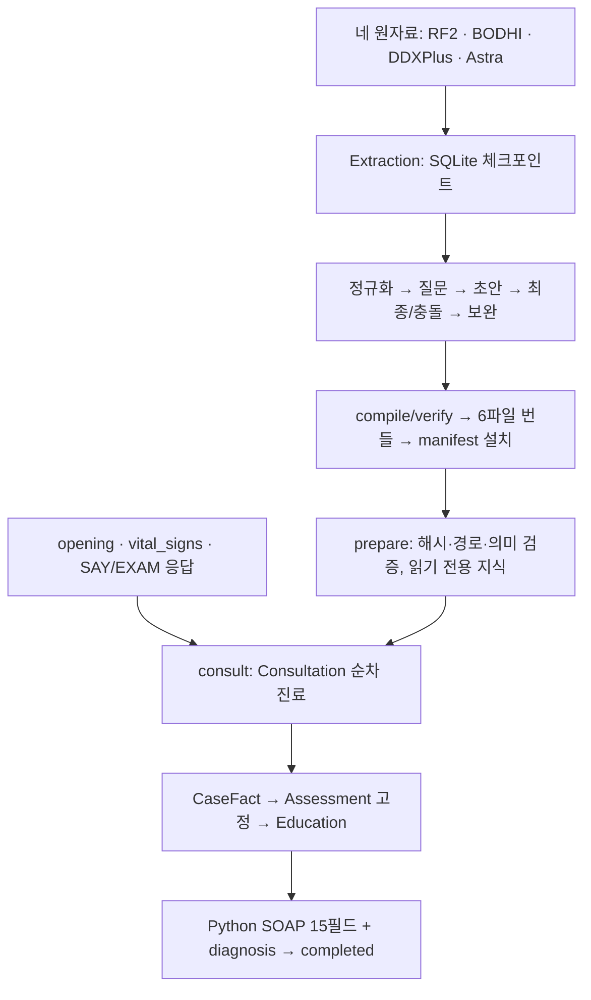

# Ontoward

Ontoward는 N.O.V.A. 예선에서 문진·신체진찰을 수행하고 **15개 SOAP 문자열과 주진단 하나를 제출하는 에이전트**다. 현재 구현은 **D50·d50.1**이며 D49 무점수 지식, D47 세션 소유권·통합 사실·평가 고정과 D48 프롬프트 모듈을 유지한다. Python이 등록 그래프의 관계·조건·질문을 준비하고, 공통 DoctorBrain을 호출한 세션이 질환 순위와 선택 질문을 수용한다.

**기존 실행 DB는 철회했다. 실제 새 지식 번들은 아직 설치하지 않았다.** 현재 `prepare()`와 정식 ZIP 생성은 `knowledge_bundle_not_installed`로 실패한다. 과거 원자료·준비 DB·수용 ZIP·증거는 보존했으며 [철회 영수증](data/extraction/retired-d42-2026-10-19/withdrawal.json)에 해시를 남겼다. 합성 번들은 Tmp/에서만 검증했다.

**처음에는 [워크플로우·데이터베이스 아틀라스](Test/atlas.html)를 열어 보세요.** 서버 없이 HTML 파일을 직접 열면 진료 순서, 지식 생성, 객체별 기능, 환자 정보와 RDF·SQLite·JSON 스키마를 한 문서에서 읽을 수 있습니다. 색상별 도식 다음에 표와 친절한 설명을 배치했습니다. 2026-10-20의 소스 스냅샷이며 실시간 진행 화면은 아닙니다.

| 알고 싶은 것 | 읽을 문서 |
|---|---|
| 전체 흐름과 저장 구조 | [아틀라스](Test/atlas.html) |
| 한 응답을 사실·평가·질문·교육·SOAP로 바꾸는 원리 | [진료 백서](submission/README.md) |
| 현재 요구사항과 사용자가 선택한 방향 | [PRD](PRD.md) · [D50 결정](DECISION_STATE.md#D50) |
| 새 지식을 만드는 방법·중단·재개·오류 복구 | [추출 안내](Extraction/README.md) |
| 로컬 실행·보존 리포트·읽기 전용 뷰어 | [Test 안내](Test/README.md) |
| 수행 결과와 다음 한정 작업 | [루트 상태](PROJECT_STATE.md) · [제출 상태](submission/PROJECT_STATE.md) · [데이터 상태](data/PROJECT_STATE.md) |

## 두 파이프라인을 먼저 구분하기



위쪽은 **지식을 준비하는 과정**, 아래쪽은 **한 환자를 진료하는 과정**입니다. 상담은 원자료나 추출 SQLite를 읽지 않고 설치된 번들만 사용합니다. 환자의 CaseFact는 해당 증례의 메모리에 존재하며 추출 작업 DB와 다른 데이터입니다. 도식이 표시되지 않는 Markdown 뷰어에서는 [아틀라스의 내장 SVG](Test/atlas.html#map)로 같은 흐름을 읽을 수 있습니다.

## 무점수 진료

| 소유자 | 책임 |
|---|---|
| DoctorEar | 초기 입력·SAY·EXAM의 문맥 해석, 정확한 Python 연결, 선택적 정규화, CaseFact 수용 |
| 세션 객체 | 필수 수집, 그래프 검색 자료, LLM 순위·행동의 검증·수용, 평가 고정 |
| DoctorBrain | 같은 지정 모델의 공통 실행·effort·한도·사용량·전송 복구 |
| DoctorMouth | 한국어 표현·공감·진단 안내와 SAY·EXAM |
| Consultation | 다섯 세션·공식 자원·입력→판단→행동의 조정 |
| SubmissionWriter | frozen Assessment와 사실의 Python SOAP·DIAGNOSE·완료 확인 |

Association은 질환·Pattern·명시적 target_scope·applicability·`support / strong_support / against / strong_against`로 구성한다. 새 후보는 positive effect의 Target 또는 applicability 경로로 넓게 회수하고, **전체 Pattern과 applicability가 맞을 때만 effect를 활성화**한다. 부분 일치·수치 불일치가 자동 지지나 반대가 되지 않는다. 기존 후보는 현재 유효한 경로가 있는 동안 보존한다. LLM이 수용한 순서를 점수로 다시 정렬하지 않는다.

Context도 같은 CaseFact를 사용하며 가족 구성원·시점·관찰·episode를 섞지 않는다. 속성 질문에는 같은 Target·scope의 존재 확인이 앞선다. rule의 any와 실제 질문의 current/past/unspecified를 구분한다. 나이·측정값·기간·단위·통증 수치와 실제 취득 경로는 유지한다.

Initiation과 CC 종료에서 순위를 판단하고, Context 종료와 DD 첫 행동을 DD 진입의 한 joint decision으로 합친다. DD는 unknown을 포함한 새 응답을 식별자로 판단한다. Consultation 순차 루프가 LangGraph를 대체하며 최신 평가·facts·chief를 고정한 뒤 Education과 Python SOAP가 공유한다. Education은 영어 P와 한국어 발화를 함께 생성하고 두 결과를 독립 수용한다. 진료 모델은 기존 openai/gpt-6-luna이며 임상·공동 계획은 high, Ear와 남은 Mouth 복구는 medium이다. 추출 모델 설정은 별개다.

Consultation이 검증한 CC 평가 자료만 ContextFactor에 전달한다. EducationSession은 영어 계획과 전달 순서·턴 배분·큐·준비 상태를 관리하고, Mouth는 한국어 표현과 행동 실행을 담당한다. 이미 큐나 전달·미전달 결과가 있는 교육 계획 그룹은 재진입해도 다시 표현하지 않는다.

입력 부분 복구는 정상 demographic·형제 진술을 보존하고 typed age와 미매핑 영문 메모를 수용한다. 속성의 그래프 자격은 현재 같은 범위의 존재 확인으로 계산한다. 정확한 단답과 공감 템플릿, 성공 응답의 자원 재사용, 공유 관계 JSON으로 불필요한 호출·조회·중복 표현을 줄인다.

## 추출 이미지와 현재 생성 경계

`ontoward-extraction:local`은 Python 3.12, 고정 프로젝트 의존성, Codex CLI 0.162.1을 포함한다. 공급자는 `nova_dev`, `codex_subscription`, `openai_api` 중 한 빌드에 하나다. 초안 gpt-6-luna·최종 gpt-6.1-sol 모두 medium이며 모델·공급자 fallback은 없다.

```sh
docker compose build extraction
docker compose run --rm -T control status
```

첫 명령은 이미지 빌드이며 다운로드가 필요할 수 있습니다. 둘째는 네트워크 없는 키 없는 로컬 상태 조회입니다. 둘 다 생성이나 로그인을 시작하지 않습니다. 생성·중단·재개·명시적 불명 요청 재시도·설치 명령은 [추출 안내](Extraction/README.md)를 따릅니다. 입력 hash와 job·요청·응답·사용량은 SQLite 체크포인트에 저장합니다. pause와 SIGINT/SIGTERM은 새 전송을 막고 진행 중 응답을 저장한 뒤 종료합니다. 정상 완료·중단 후 자동 재시작하지 않습니다.

2026-10-20 01:33 KST에 읽은 [로컬 체크포인트 스냅샷](Tmp/docs-atlas-2026-10-20/snapshot.json)에서는 별도 승인으로 시작된 NOVA 빌드 `10282b2e382f085d756e9f6645dc05fe`가 **normalize 단계에서 실행 중**이었습니다. 108/108파일의 12,587,695행을 색인했고 정규화 2,306작업을 완료했습니다. 이것은 전체 생성 완료율이나 임상 품질 지표가 아닙니다. 실제 manifest 설치는 아직 확인되지 않았으며 최신 수치는 [데이터 상태](data/PROJECT_STATE.md)를 따릅니다. 이번 문서 갱신에서는 기존 worker를 중단·재개하거나 모델을 호출하지 않았습니다.

`bash Extraction/extraction.sh status`, `watch`, `logs`로 진행과 저장된 콘솔을 확인한다. NOVA 요청에는 출력 스키마를 포함하며 로그는 요청별 수용·무효 건수와 검증 원인을 보여준다. 스키마 누락은 [스키마 복구](Extraction/README.md#정규화-output_contract_failednormalize-복구), 정규화에서 잘못 생성된 행동 문구는 [행동 문구 복구](Extraction/README.md#정규화-중-행동-문구-오류와-안전한-중단)를 따른다. 후자는 완료 결과를 보존하며 미완료 행의 저장 응답을 모델 재호출 없이 복구한다.

## 디렉터리와 검증

| 경로 | 역할 |
|---|---|
| submission/ | 제출 런타임·설정·새 지식 loader; 실제 manifest는 설치 전까지 없음 |
| Extraction/ | 네 원자료 기반 생성기·세 공급자·체크포인트·독립 이미지 |
| Dev/ | 유지 행동 회귀·합성 번들 구성·패키저 |
| Test/ | 로컬 평가·관측·읽기 전용 지식 뷰어·독립 SDK 하네스 |
| assets/ | 변경하지 않는 원자료·SDK·주최자 입력 |
| data/ | 원천 custody·과거 결과·철회 기록·새 빌드 work/output·증빙 |
| Tmp/ | 합성 번들·오프라인 실행 로그·임시 ZIP |

```sh
docker compose -f compose.yaml -f Dev/tests/workflow/compose.offline.yaml run --rm -T --no-deps dev python -B -m unittest discover -s Dev/tests/workflow -p 'test_*.py'
```

보존된 [D50 증빙](data/provenance/algorithm-d50-2026-10-20.json)은 소스·독립 ZIP 각각의 유지 회귀 169개, 관측 일치 14시나리오, 원본 SDK의 SOAP·completed 수신을 기록합니다. 이들은 합성 프로토콜 수용이며 실제 모델·임상·공식 성능과 다릅니다. 이번 문서 작업은 해당 증빙 13개 파일의 해시를 재확인하고 문서·도식·스키마·링크와 예상된 prepare 실패를 확인했습니다. 실제 상담 회귀를 재실행한 결과로 표현하지 않습니다.

실제 생성은 별도 실행 중이며, 생성 완료 → 검증된 번들 설치 → 실제 번들 대표 상담 수용이 남아 있습니다. 실제 모델 품질·임상적 정확성·공식 평가·업로드·배포와 브라우저 시각 검증은 이번 문서 작업에서 실행하지 않았습니다.
