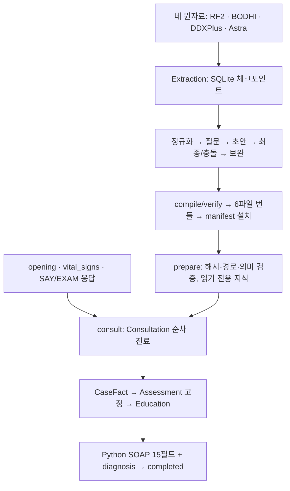

# Ontoward

Ontoward는 N.O.V.A. 예선에서 문진·신체진찰을 수행하고 **15개 SOAP 문자열과 주진단 하나를 제출하는 에이전트**다. 현재 런타임 알고리즘은 **d50.18**다. 중간 오류가 발생한 질문·작업은 실제 수신과 범위를 보존해 마감하고 후속 세션과 최종 작성으로 전진한다. 정상 Writer 실패에는 추가 모델·그래프 조회 없는 최소 SOAP를 사용한다. 실제 matching completed 응답만 제출 성공이며, 수신 미확정에도 생성한 note·diagnosis와 최종 요청 ID·오류는 반환한다. 준비·manifest·임상 출처·수치·scope 검증은 유지한다.

[D70](DECISION_STATE.md#D70)의 제출 전 수정과 집중 오프라인 검사 84개를 완료했다. 현재 제출용 파일은 [d50.18 ZIP](Tmp/packaging/ontoward-submission-d50.18.zip)이며 106개 파일의 소스 일치와 원래 prepare의 948개 질환 로드를 확인했다. 실제 모델·임상·공식 제출은 미실행이다.

[D68](DECISION_STATE.md#D68)은 프롬프트에 넣는 정보 문자열에서 인용 구분 따옴표를 제거하고 원래 환자 발화·facts·그래프·지침은 보존한다. 원문 인용은 원래 UTF-8 구간으로 복원하며 모호한 인용은 거절한다. JSON 구조·출력 계약·식별자·단위와 단어 내부 apostrophe는 보존한다. Education 정상 계획 생성은 **검사·치료 / disposition·follow_up·education의 두 medium 호출**이며 실패 그룹별 복구는 한 번이다. 과거 D66의 네 호출 정책을 이 범위에서 대체한다. [최소 오프라인 검증](Tmp/prompt-education-d68-20261022/focused.log) 51개가 통과했으며 전체 회귀·제출 ZIP 갱신·실제 모델·공식 제출은 수행하지 않았다.

[감별 순위 보존 종료 정책](DECISION_STATE.md#RANKED_DIAGNOSIS22)에 따라 수용된 질환 differential이 있으면 오류·토큰 소진으로 최신 재평가가 실패해도 **목록 첫 질환을 주진단으로 고정**하고 나머지 감별을 보존한다. 마지막 답변의 새 사실·부정·정정 때문에 증상 진단으로 대체하지 않는다. 원래 평가의 revision·chief·응답 ID와 현재 고정 시점은 구별하고 미재평가 한계를 SOAP에 남긴다. 질환 감별이 없는 경우에만 증상 진단을 사용한다. 정상·독립 최소 Writer에 같은 정책을 적용한다. 검증은 [오프라인 기록](Tmp/ranked-finalization-20261022/verification.json)을 따르며 실제 모델 재실행·임상 정확도 검증을 뜻하지 않는다.

[고정 시작·종료 발화](DECISION_STATE.md#FIXED22)는 초기 정보 처리 뒤 두 SAY, Education 종료 뒤 두 SAY를 모델 없이 전달한다. 확정 문구는 NFC 기준 **28·27·28·28자**다. 네 SAY의 답변 원문은 임상 해석·대화·사실·모델 입력과 로컬 Test 응답 로그에 저장하지 않으며 전달·사용량 메타데이터만 유지한다. 최대 예산 수정은 취소하여 **Initiation 5/7·CC 5/10·Context 7/9·DD 15/20·Education 5/10을 유지**한다. 고정 SAY도 공유 50턴에서 차감하고 종료 두 턴을 보호한다. [최소 검증 기록](Tmp/fixed-utterances-20261022/verification.json)은 관련 workflow 145개·simulator/API adapter 48개 통과와 Test 이미지 소스 일치를 기록한다. 실제 모델·공식 제출·제출 ZIP 갱신은 수행하지 않았다.

D67은 저장 실행 `20261022T075835Z-d68af002c5`의 세 문제만 보수한다. DD 질문 거절 뒤 재준비·현재 순위를 보존한 행동 재선택, Education의 정확한 P 외형과 제한적인 누락 wrapper 수용·repair 공간 확보, 영역별 전달 턴 분배와 기질문 문맥·동일 episode의 보수적인 반복 차단을 적용한다. 서로 다른 대상·episode·가족·시점을 합치지 않으며 Education의 전체 실제 전달이나 임상 성능 개선은 새 모델 실행으로 확인하지 않았다. 전체 회귀·패키징·Test 이미지 재구성은 이번에 수행하지 않았다.

D66은 CC를 **5/10**, DD를 **15/20**으로 조정한다. DD는 정상 수신한 **SAY 10회·EXAM 5회**를 확보하고 질문이 부족하면 등록 목록을 소진한 뒤 부족 사유를 남긴다. DD SAY로 얻은 증상 상세는 **S.ros**로 기록한다. D66 당시 Education은 최대 3개 문서를 공유하며 **검사·치료 / disposition / follow_up / education**의 서로 다른 medium 프롬프트 네 개로 생성했다. 현재는 D68의 두 그룹을 사용한다. 영역별 복구는 한 번이며 전달은 기존 7턴 보호·최대 10행동을 유지한다. [구현·검증 기록](Tmp/d66-2026-10-22/verification.json)을 따른다.

[D64](DECISION_STATE.md#D64)는 전체 logical payload의 의미를 보존하고 최종 전송 객체만 정리한다. 작업별 불필요 필드·수치 조건의 명시 기본값을 제외하고 동일한 전체 Pattern과 질환별 기대조건 배열을 공유한다. 수치 Mapping의 범주 값 목록은 wire에서만 생략하며 원래 검증 계약·수치·단위·부정·scope·실행 참조는 유지한다. 모든 역할의 최종 system/user/messages bytes와 nested 개수는 Test에서 관측한다. 이는 token 계측이나 새 입력 차단 정책이 아니며 D66에서는 상세 50개 선택 제한을 철회한다. [의미 보존·전후 bytes·오프라인 검증 증빙](data/provenance/minimal-input-d64-2026-10-22.json)을 따른다. 저장된 실패 request는 모델 호출 없이 재구성했고 실제 모델 수용·임상 품질은 재검증하지 않았다.

[D63](DECISION_STATE.md#D63)에 따라 **적격 질환 후보·수용 Assessment·SOAP 감별의 고정 개수 상한을 철회**했다. Python과 임상 후보 참조는 전체 적격 후보를 유지하고 정상 수용 순위 전부를 보존하며 현재 D70의 note.A.differential은 주진단 외 상위 5개만 기록하며 내부 Assessment 순위는 전부 보존한다. D66은 그래프 relation·evidence·question·condition 표와 질문 allowed_values의 50개 제한도 제거한다. 원래 환자 facts·scope·관계 조건·prior 검증을 유지한다. [D63 당시 회귀](Tmp/d63-2026-10-22/workflow.log)는 62개 후보·전체 SOAP와 100000-byte 초과의 명시적 최소 Writer 복구를 포함하며 실제 모델·임상 성능은 별도다.

현재 제출용 설정은 누적 입력 **500,000**·누적 출력 **100,000**·보고된 요청 입력 **100,000**·호출 출력 최대 **8,000**이다. 실제 completion usage와 optional 서버 잔량만 사용해 max_tokens를 줄이며 출력 잔량 0이면 새 모델 없이 기존 Writer로 종료한다. D70에서는 누적 입력이 300,000에 도달하면 DD 질문 선택·복구만 생략하고 최종 순위 평가→1위 진단 고정→Education으로 진행한다. 최종 감별 평가·입력 해석·Education은 300,000 제한을 적용하지 않고 기존 전체 입력 500,000 한도를 사용한다. 진행 중 선택 요청의 실제 사용량은 사후 정산한다. DD 행동 용량이 0일 때도 선택·복구 모델을 추가 호출하지 않는다. D60의 output 무상한 시험 예외와 D61/D62의 후보·SOAP 개수 제한은 D63이 해당 범위에서 대체하고 당시 결정·로그는 보존한다. 보호자 인구학·가족 병력의 HISTORY 완료 혼동, 정확한 unknown 뒤 재평가 실패, safety 계획 전달 순서도 수정했다. 실모델·공식 서버 평가·제출은 실행하지 않았다.

D56은 현재 저장된 시진·청진·촉진·타진 실행 문구 119개를 정규화한다. `목을 보여 주세요.`는 `목 시진합니다.`, `피부를 눈으로 살펴보세요.`는 `피부 시진합니다.`로 바뀌었다. 복합 동작·특수 수기·필요한 자세와 ID·임상 관계·질문 계약은 보존했다. 문구가 없던 메서드 37개는 그대로 두며 부위 미지정 공용 메서드 2개에는 임의 부위를 넣지 않는다. [D56 결정](DECISION_STATE.md#D56)·[전체 전후 명세](data/provenance/exam-text-normalization-plan-2026-10-21.json)·[현재 검증](data/provenance/exam-text-normalization-2026-10-21.json)을 따른다. 실제 NOVA의 새 문구 수용 여부는 재검증하지 않았다.

**현재 로컬 활성 번들은 D58 build `cec62f4596bedd9b9488aa75e3d38f04`이다.** 실행 당시 최신 부모 `1bcaba1dffb744c468bb191df3267dad` 위에 진단 3개를 포함한 개념 11개, 실행 관계 9개와 질문 6개를 추가하고 허용된 기존 관계 4개를 수정했다. 부모의 수집 메타데이터·질문 override·단위·진찰 문구·지침 payload를 보존했다. 실제 API Luna medium 생성은 16회 상한 중 7회였으며 production loader·후보/질문 검사 뒤 로컬 활성화했다. [최종 생성·보존·설치 증빙](data/provenance/augmentation-d58-2026-10-21.json)을 따른다. 사용자 요청에 따라 이번 작업의 불필요한 체크포인트·중복 번들·DB 임시 파일 518개, 210.27 MiB를 삭제하고 활성 child와 기존 부모를 유지했다. [삭제 명세](data/provenance/augmentation-d58-cleanup-2026-10-21.json)와 [수용 delta](data/provenance/augmentation-d58-delta-2026-10-21.json)를 남겼으며 삭제한 run은 재개할 수 없다. D58 당시 실제 모델 상담 정확도·임상·공식 평가·정식 ZIP은 미실행이었다. D59에서는 아래 로컬 패키징만 추가 확인했다.

[D57](DECISION_STATE.md#D57)은 초기 발화에 이미 있는 기간·감소량·의도성을 같은 chief의 속성으로 수용하고, Mapping이 수치를 다시 쓰는 대신 Python의 검증된 measurement를 참조하게 한다. 미매핑 note도 관찰 범위를 유지하되 서로 다른 수치가 충돌하지 않게 한다. 원자 정보만 수집한 것을 복합 임상 기준의 충족으로 선언하지 않는다. 실제 어휘와 고정 Context·Mapping 응답을 사용한 C10 opening 회귀에서 시점·의도성·감소량/기간 재질문을 제거했고, 별도의 6개월 감소율·재발력·치료력·현재 경과는 미확인으로 유지했다. 이 결과는 새 프롬프트를 실제 모델로 실행한 추출 품질 검증과 구별한다.

**처음에는 [워크플로우·데이터베이스 아틀라스](Test/atlas.html)를 열어 보세요.** 서버 없이 HTML 파일을 직접 열면 진료 순서, 지식 생성, 객체별 기능, 환자 정보와 RDF·SQLite·JSON 스키마를 한 문서에서 읽을 수 있습니다. 색상별 도식 다음에 표와 친절한 설명을 배치했습니다. 2026-10-20의 소스 스냅샷이며 실시간 진행 화면은 아닙니다.

| 알고 싶은 것 | 읽을 문서 |
|---|---|
| 전체 흐름과 저장 구조 | [아틀라스](Test/atlas.html) |
| 한 응답을 사실·평가·질문·교육·SOAP로 바꾸는 원리 | [진료 백서](submission/README.md) |
| 현재 요구사항과 사용자가 선택한 방향 | [PRD](PRD.md) · [D50 결정](DECISION_STATE.md#D50) |
| 새 지식을 만드는 방법·중단·재개·오류 복구 | [추출 안내](Extraction/README.md) |
| 로컬 실행·보존 리포트·읽기 전용 뷰어 | [Test 안내](Test/README.md) |
| 수행 결과와 다음 한정 작업 | [루트 상태](PROJECT_STATE.md) · [제출 상태](submission/PROJECT_STATE.md) · [데이터 상태](data/PROJECT_STATE.md) |

개인 `OPENAI_API_KEY`로 시험하려면 [Test의 OpenAI API 경로](Test/README.md)를 사용합니다. CLI의 `openai_api` 또는 웹의 **OpenAI API · 개인 API 요금**을 명시적으로 선택하며 키는 simulator에만 전달합니다. Test는 시작 전에 현재 실행 파일과 이미지의 일치를 확인합니다. 제출용 NOVA 경로와 알고리즘은 유지하고 개인 API 시험·프로토콜 수신·Education·공식 평가는 구별합니다.

## 최신 번들 위에 필요한 지식만 보완하기

[D58](DECISION_STATE.md#D58)의 별도 augmentation 경로는 최신 활성 manifest를 부모로 읽어 불면의 약물 관련 설명과 저신장의 정상 성장변이, 구별 질문만 유한하게 보완한다. Python이 기존 ID·의미·질문·공유 속성 역할·단위·지침을 보존하고 새 정적 번들을 출력한다. 전체 원자료 재구축이나 상담 overlay는 사용하지 않는다. DD는 현재 평가의 미확인 Context·clarification 질문을 기존 예산과 중복 방지 안에서 선택한다.

키 없는 부모 보존 검사, 실제 생성, 저장 결과 재컴파일, 로컬 활성화를 분리했다. 마지막 선택인 API Luna medium·40개 배치를 유지하며 실제 전송 상한을 명시한다. [정확한 Docker 명령과 한계](Extraction/README.md#최신-번들-증분-보완-d58)를 따른다. 실행 중 더 최신 manifest가 설치되면 이전 부모에서 만든 child가 이를 덮어쓰지 않는다.

## 두 파이프라인을 먼저 구분하기



위쪽은 **지식을 준비하는 과정**, 아래쪽은 **한 환자를 진료하는 과정**입니다. 상담은 원자료나 추출 SQLite를 읽지 않고 설치된 번들만 사용합니다. 환자의 CaseFact는 해당 증례의 메모리에 존재하며 추출 작업 DB와 다른 데이터입니다. 도식이 표시되지 않는 Markdown 뷰어에서는 [아틀라스의 내장 SVG](Test/atlas.html#map)로 같은 흐름을 읽을 수 있습니다.

## 무점수 진료

| 소유자 | 책임 |
|---|---|
| DoctorEar | 초기 입력·SAY·EXAM의 문맥 해석, 정확한 Python 연결, 선택적 정규화, CaseFact 수용 |
| 세션 객체 | 필수 수집, 그래프 검색 자료, LLM 순위·행동의 검증·수용, 평가 고정 |
| DoctorBrain | 같은 지정 모델의 공통 실행·effort·한도·사용량·전송 복구 |
| DoctorMouth | 한국어 표현·진단 안내와 SAY·EXAM |
| Consultation | 다섯 세션·공식 자원·입력→판단→행동의 조정 |
| SubmissionWriter | frozen Assessment와 사실의 Python SOAP·DIAGNOSE·완료 확인 |

Association은 질환·Pattern·명시적 target_scope·applicability·`support / strong_support / against / strong_against`로 구성한다. 새 후보는 positive effect의 Target 또는 applicability 경로로 넓게 회수하고, **전체 Pattern과 applicability가 맞을 때만 effect를 활성화**한다. 부분 일치·수치 불일치가 자동 지지나 반대가 되지 않는다. 기존 후보는 현재 유효한 경로에서 회수하며 모델 후보 참조와 수용 Assessment에는 개수 상한을 두지 않는다. LLM이 수용한 순서를 점수로 다시 정렬하지 않는다.

Context도 같은 CaseFact를 사용하며 가족 구성원·시점·관찰·episode를 섞지 않는다. 속성 질문에는 같은 Target·scope의 존재 확인이 앞선다. rule의 any와 실제 질문의 current/past/unspecified를 구분한다. 나이·측정값·기간·단위·통증 수치와 실제 취득 경로는 유지한다.

Initiation과 CC 종료에서 순위를 판단한다. [D69](DECISION_STATE.md#D69)의 DD는 진입 시 그래프에서 질문 풀을 한 번 만들고 매 턴 후보 질환 이름과 실행 가능한 질문 목록을 함께 제공하여 해당 질환을 감별할 다음 질문을 선택한다. 선행조건·scope·기질문·SAY/EXAM 최소량은 Python이 검사하며, 종료 때 전체 최신 사실과 그래프 후보로 질환 순위를 한 번 평가해 고정한다. Consultation 순차 루프가 LangGraph를 대체하며 고정 평가·facts·chief를 Education과 Python SOAP가 공유한다. Education은 영어 P와 한국어 발화를 함께 생성하고 두 결과를 독립 수용한다. 진료 모델은 기존 openai/gpt-6-luna이며 임상 역할은 high, 영어 P의 두 그룹 생성·복구와 Ear·Mouth는 medium이다. 추출 모델 설정은 별개다.

Consultation이 검증한 CC 평가 자료만 ContextFactor에 전달한다. EducationSession은 영어 계획과 전달 순서·턴 배분·큐·준비 상태를 관리하고, Mouth는 한국어 표현과 행동 실행을 담당한다. 이미 큐나 전달·미전달 결과가 있는 교육 계획 그룹은 재진입해도 다시 표현하지 않는다.

[D51 후속 결정](DECISION_STATE.md#D51)은 미사용 계약을 정리하고 실제 role clarification을 준비 단계에서 검증한다. Ear의 의미 처리 호출은 문맥 2회·매핑 2회 이내이고 초기 chief도 같은 복구를 공유한다. 일반 Ear의 첫 후보 강제 확정은 제거했으며 정상 input 2회 보호와 선택적 복구를 구분한다. 진단 안내 모델은 실제 번들 전체의 짧은 한국어 문구가 검증될 때까지 유지한다.

입력 부분 복구는 정상 demographic·형제 진술을 보존하고 typed age와 미매핑 영문 메모를 수용한다. 속성의 그래프 자격은 현재 같은 범위의 존재 확인으로 계산한다. 정확한 단답과 성공 응답의 자원 재사용, 공유 관계 JSON으로 불필요한 호출·조회·중복 표현을 줄인다.

[D52 수정](DECISION_STATE.md#D52)은 설치 후 C10 로그에서 확인한 관계 정의 중복을 제거한다. 같은 target·effect·전체 Pattern·scope·applicability를 질환 간 공유하며 모든 후보·조건·관찰별 근거는 유지한다. clinical/gateway의 CONTEXT_LIMIT_EXCEEDED는 출력 한도를 높여 즉시 재시도하지 않으며 현재 D61에서는 오류 작업을 pass한 뒤 후속 단계나 최종 작성으로 진행한다. Education 두 role은 아래 D59 예외를 따른다. 새 실제 NOVA C10의 완료 여부는 별도 실행으로 확인해야 한다.

[D53](DECISION_STATE.md#D53)은 당시 인사·공감 SAY를 삭제했다. 현재는 고정 시작 두 SAY를 거친 뒤 Initiation의 첫 미확인 질문을 제공하며 생성형 공감은 복구하지 않는다. 참고 자료 경계·해시/인용·영어 P/한국어 독립 수용은 유지한다. 당시 다섯 전체 문서·실패 비보충 정책과 검증은 [D53 증빙](data/provenance/algorithm-d50-4-2026-10-21.json)에 보존하며 현재 Education 공급은 D59를 따른다.

[D54](DECISION_STATE.md#D54)의 exact AND care_navigation 안정 분할과 그룹 내부 순서는 D59에서도 유지한다. 모순된 Pattern/applicability 경로의 후보 유입을 막고 unknown 부분 후보와 유효한 prior 반대 경로는 유지한다. 교육·안내의 fact ID, 질문의 observation/episode scope, 초기 원문 중복과 mapping 해석 의미, 영어/한국어 어휘 후보를 함께 정리했다. 문서의 내부 path/hash/offset은 모델에 보내지 않고 공급한 원문 span의 UTF-8 인용을 검증한다. [D54 검증](data/provenance/algorithm-d50-5-2026-10-21.json)과 [당시 연결 위반 목록](data/provenance/runtime-link-audit-2026-10-21.json)은 역사적 근거다. 이후 D55는 정정 번들과 strict gate를 함께 활성화했으며 Decreased body weight는 동등성 근거 부족으로 별도 개념을 유지한다.

[D59](DECISION_STATE.md#D59)는 기존 질환 매핑에서 파일당 최대 1 MiB·총 16 MiB만 읽고, 완전한 짧은 ATX 구간과 상위 도입문을 묶어 공급한다. 원자 발췌 JSON은 2 KiB, 전체 documents는 8 KiB, 실제 messages는 32 KiB이며 현재는 최대 3개 검증 문서를 두 Education 계획 호출 전체에서 공유한다. 당시 두 Education role은 잔여 입력 65,536 tokens와 pending sync를 검사했으며 잔여 입력 조건은 [D60](DECISION_STATE.md#D60)에서 제거했다. Education context 오류 후에는 추가 모델을 동기화 전 차단하고, 검증된 영어 P·사용 가능한 한국어를 보존하여 기존 SOAP·DIAGNOSE 완료 경로로 이어간다. 실제 SAY 영수증 없이 전달로 기록하지 않는다. 네 가지 경계 회귀를 포함한 [검증 증빙](data/provenance/algorithm-d50-9-2026-10-21.json)은 실제 모델·임상·공식 성능과 구별한다.

[D52 증빙](data/provenance/algorithm-d50-3-2026-10-21.json)은 소스·독립 ZIP 회귀 각각 180개, 저장된 두 순위 요청의 임상 입력 동등성, 관측 16시나리오와 독립 합성 상담 3개·원본 SDK completed를 기록한다. 실제 NOVA 재실행과 공식 수용 증거는 포함하지 않는다.

## 추출 이미지와 현재 생성 경계

`ontoward-extraction:local`은 Python 3.12, 고정 프로젝트 의존성, Codex CLI 0.162.1을 포함한다. 공급자는 `nova_dev`, `codex_subscription`, `openai_api` 중 한 빌드에 하나다. 초안 gpt-6-luna·최종 gpt-6.1-sol 모두 medium이며 모델·공급자 fallback은 없다.

```sh
docker compose build extraction
docker compose run --rm -T control status
```

첫 명령은 이미지 빌드이며 다운로드가 필요할 수 있습니다. 둘째는 네트워크 없는 키 없는 로컬 상태 조회입니다. 둘 다 생성이나 로그인을 시작하지 않습니다. 생성·중단·재개·명시적 불명 요청 재시도·설치 명령은 [추출 안내](Extraction/README.md)를 따릅니다. 입력 hash와 job·요청·응답·사용량은 SQLite 체크포인트에 저장합니다. pause와 SIGINT/SIGTERM은 새 전송을 막고 진행 중 응답을 저장한 뒤 종료합니다. 정상 완료·중단 후 자동 재시작하지 않습니다.

실제 빌드 `87e8b4c54b0689453cea91b3bb316290`는 108개 파일·12,587,695행의 색인과 완료 작업을 보존한 상태에서 정보 처리 오류만 수동 교정하고 컴파일·검증·설치를 완료했다. 교정 당시 원래 결과·요청·사용량을 보존하고 추가 모델 호출 0회로 설치했다. 설치 후 보관 해제 요청에 따라 원래 작업 DB는 삭제했으며, 최종 설정·사용량 요약·수동 교정 내역은 [최종 감사 기록](data/provenance/extraction-final-audit-2026-10-21.json)에 남겼다. [수동 처리 증빙](data/provenance/extraction-readiness-repair-2026-10-21.json)과 [데이터 상태](data/PROJECT_STATE.md)가 정확한 범위와 진행을 관리한다.

현재 완료 빌드의 work·staging·콘솔 로그는 정리했으므로 과거 ID로 status·resume·recover를 실행하지 않는다. `status`의 `not_started`는 보관된 작업 DB가 없다는 뜻이며 설치 지식의 완료를 취소하지 않는다. 설치 번들은 `docker compose run --rm --no-deps -T verify verify`로 독립 검증한다. 생성·복구 안내의 예시는 앞으로 별도로 시작한 작업에만 적용한다.

## 디렉터리와 검증

| 경로 | 역할 |
|---|---|
| submission/ | 제출 런타임·설정·설치된 실제 지식 번들과 manifest loader |
| Extraction/ | 네 원자료 기반 생성기·세 공급자·체크포인트·독립 이미지 |
| Dev/ | 유지 행동 회귀·합성 번들 구성·패키저 |
| Test/ | 로컬 평가·관측·읽기 전용 지식 뷰어·독립 SDK 하네스 |
| assets/ | 변경하지 않는 원자료·SDK·주최자 입력 |
| data/ | 원천 custody·과거 결과·철회 기록·새 빌드 work/output·증빙 |
| Tmp/ | 합성 번들·오프라인 실행 로그·임시 ZIP |

```sh
docker compose -f compose.yaml -f Dev/tests/workflow/compose.offline.yaml run --rm -T --no-deps dev python -B -m unittest discover -s Dev/tests/workflow -p 'test_*.py'
```

제출 ZIP은 [Dev 패키징 명령](Dev/README.md)의 이미지 갱신·네트워크 차단 압축 순서로 생성한다. 출력은 `Tmp/packaging/ontoward-submission.zip`이며 현재 workflow Python·참조 프롬프트·활성 지식 manifest의 다섯 자산을 포함한다.

[D51 후속 증빙](data/provenance/algorithm-d50-2-2026-10-20.json)은 소스·독립 읽기 전용 ZIP의 회귀 각각 176개, 정상 scripted 상담 3개의 전후 행동·사실·평가·P·SOAP·사용량 일치, 관측 16시나리오와 1,516 작업 snapshot 재구성을 기록한다. 독립 합성 ZIP은 원본 SDK·run.py를 통해 21행동·44 HTTP 요청 뒤 completed를 받았다. [D50 증빙](data/provenance/algorithm-d50-2026-10-20.json)은 이전 d50.1의 역사적 수용 기록으로 보존한다. 합성 프로토콜 수용은 실제 모델·임상·공식 성능 검증과 구분한다.

D59의 좁은 검사 79개는 최초 78개 통과와 오래된 전문 기대 수정 후 영향받은 5개 재확인으로 검증했다. 변경 없는 run.py prepare는 활성 948 Diseases를 로드했고 보호 해시 17개가 일치했다. 정규 패키저로 [로컬 ZIP](Tmp/d59-2026-10-21/package/ontoward-submission.zip)을 한 번 생성하여 새 모듈·프롬프트 포함과 원문 지침 제외를 확인했다. D59 당시 실제 모델 품질·임상적 정확성·공식 평가·최종 버전 선택·업로드·배포·브라우저 시각 검증과 전체 회귀/독립 ZIP 상담은 not_run이었다.

D61에서는 정상 chief가 없고 허용된 확인이 끝나면 등록 Symptom 최대 여덟 개와 gateway 한 번으로 수집 경로를 고정한다. 이 경로는 환자 present fact와 지지 근거를 만들지 않으며 근거 없는 fallback은 불완전한 working problem으로 제출한다. 보고서는 Education 준비·진단 안내·계획별 expected 발화와 전달·P 내용·facts·생성 payload·실제 수신 확인을 분리한다. 새 Test 이미지는 만들었으며 이미 실행 중인 웹 컨테이너는 보존했으므로 해당 실행기를 종료한 뒤 sh Test/web.sh로 다시 시작해야 새 리포트 코드가 적용된다.
