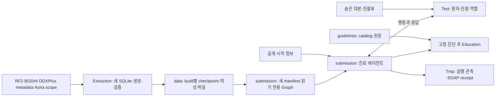

# 제공 자료의 구조와 활용

이 문서는 사람이 `assets/`의 자료를 고르고 서로의 관계를 이해하기 위한 안내다. 각 디렉토리의 `AGENTS.md`는 에이전트가 소비하는 파일 의미·입력 경계·활용 규칙을 담는다. 모든 `README.md`는 사람을 위한 안내이며, 작업 지시나 운영 상태의 원본으로 사용하지 않는다.

`assets/`에는 NOVA 개발 가이드에서 받은 제공 자료를 원래 위치에 보존한다. 새로 작성한 안내 문서는 원본 패키지의 일부가 아니며, 임상 문서 검색·벤치마크 입력·제출물에 섞지 않는다. 전체 관계와 역할은 아래와 같다.

## 디렉토리 지도

```text
assets/
├── AGENTS.md                         # 에이전트용 자료 범위와 공통 규칙
├── README.md                         # 사람이 읽는 자료 안내의 시작점
├── Architecture.md                   # 사람이 읽는 구조·관계·활용 설명
├── nova-competition-2026/             # 공개 사이트에서 정리한 영어 공모전 기술 참고
├── nova-guidelines-catalog.xlsx       # 따로 받은 지침 목록 워크북
├── nova-starter/                      # SDK·기본 에이전트·서버 샘플 클라이언트
├── nova-devkit/                       # 채점 없는 로컬 시뮬레이터
│   └── samples/
│       ├── C01/                      # 수면 문제
│       ├── C03/                      # 소아 성장에 대한 보호자의 걱정
│       └── C10/                      # 의도하지 않은 체중 감소
├── nova-samples-2026/                 # 별도로 받은 공개 샘플 패키지
│   ├── C01/
│   ├── C03/
│   └── C10/
├── nova-benchmarks-2026/               # 영어 연구용 참고 데이터
│   ├── AgentClinic-MedQA/             # 문진·진찰·검사·진단 시나리오
│   ├── DDXPlus/                       # 코드 기반 합성 환자 문진
│   └── ACI-Bench/                     # 진료 대화에서 기록 작성
│       └── aci-bench-corpus/
│           ├── challenge_data/       # 주 데이터의 학습·검증·시험 분할
│           └── src_experiment_data/  # 전사·음성인식 입력의 변형
└── guidelines/                       # 출처별 Markdown 임상 자료
    ├── KR_EuropePMC/
    ├── KR_HealthInfo/
    ├── KR_Journals/
    ├── KR_KDCA/
    ├── KR_KoMGI/
    ├── KR_NCC/
    ├── KR_NECA/
    ├── KR_Societies/
    ├── US_CDC/
    ├── US_EuropePMC/
    ├── US_HIV-Guidelines/
    ├── US_NCBI-Bookshelf/
    ├── US_NCI-PDQ/
    ├── US_StatPearls/
    ├── US_USPSTF/
    └── US_VA-DoD/
```

압축된 DDXPlus 환자 파일 내부는 보존한 자료의 일부이며 새 작업 디렉토리로 취급하지 않는다. `.DS_Store`는 파일시스템 메타데이터다.

## 공모전 기술 참고 문서

[nova-competition-2026](nova-competition-2026/README.md)은 공개 사이트의 규칙·일정·평가·운영 정보와 제공 SDK의 실행·출력 계약을 연결한 프로젝트 작성 문서다. 영어 기술 문서는 에이전트가 소비하며, 이 폴더의 README는 사람이 필요한 문서를 찾는 안내다. [SOURCES.md](nova-competition-2026/SOURCES.md)는 출처와 확인 날짜, 로그인 경계, 실행하지 않은 작업과 아직 알 수 없는 정보를 담는다.

이 폴더는 내려받은 원본 패키지나 임상 코퍼스가 아니다. SDK 구현은 `nova-starter/`, 모의 실행은 `nova-devkit/`, 임상 문서는 `guidelines/`에 그대로 두고 필요한 계약을 참조한다. 공모전 참고 문서 전체를 임상 검색·벤치마크 입력·제출물에서 제외한다. 실제 프로젝트 선택과 구현 범위는 루트 PRD와 중앙 결정 문서가 담당한다.

## 시작 패키지와 개발 키트

| 위치 | 주요 파일의 의미 | 활용 방법 |
| --- | --- | --- |
| [nova-starter](nova-starter/README.md) | `run.py`: 다음 행동 선택과 SOAP 작성의 기본 예제; `nova_sdk.py`: 고정 SDK; `sample.py`: 서버 공개 샘플 클라이언트 | SDK의 준비·진료·최종 제출 경계를 이해하고, 별도 구현 범위에서 `submission/`의 에이전트 설계에 참고한다. |
| `nova-starter/requirements.txt` | 제출용 의존성 선언 예제 | 프로젝트의 submission/requirements.txt와 비교하여 제출 패키지 요구사항을 확인한다. |
| `nova-starter/local.Dockerfile` | Python 3.12와 PyPI 휠 설치, 인터넷 없는 준비 조건을 확인하기 위한 제공 예제 | 별도로 정한 실행 범위에서 제출 조건을 검토할 때 참고한다. 프로젝트 개발환경은 루트 `compose.yaml`의 `dev` 서비스다. |
| [nova-devkit](nova-devkit/README.md) | `develop.py`: 실행 CLI; `nova_local.py`: 환자·진찰 시뮬레이터, 모델 연결, 결과 저장; `run.py`·`nova_sdk.py`: 기본 예제와 SDK | 자체 모델 연결을 사용한 모의 진료나 실행 후 기록 비교에 활용한다. 공식 서버 채점과 실행환경 검증은 별도다. |

SDK의 `run_agent()`는 `prepare()`로 증례와 무관한 자원을 준비한 다음 준비 알림을 보내고 `consult()`에 클라이언트와 준비 자원을 넘긴다. Ontoward에서는 제출 전에 임상 지식을 추출·검토하고 `prepare()`에서 제출된 Turtle 묶음을 하나의 RDFLib 그래프에 로드한다. 진료 중 원문 검색·추출은 수행하지 않는다. 기본 예제의 30턴 사용, 종료 전 3분 여유, JSON 추출과 재시도 방식은 예제의 구현 정책이다. 실제 구현 계약은 루트 [PRD](../PRD.md)를 따른다.

SOAP 기록의 구체적인 필드는 SDK의 `RECORD_FIELDS`가 정의한다. `note`에는 S·O·A·P만 넣고, 주진단은 `client.diagnose(note=..., diagnosis=...)`의 별도 인자로 보낸다. A에는 `evidence`와 `differential`이 있으며 `diagnosis`라는 추가 필드를 넣지 않는다.

개발 키트의 `--case`는 로컬 폴더나 `case.json`을 받는다. 서버 샘플 클라이언트의 `--case`는 공개된 서버 증례 UUID를 받으므로 C10 같은 로컬 이름으로 대신할 수 없다. `develop.py`는 실제 진료를 시작할 때 Doctor와 환자·진찰 모델의 연결을 먼저 확인한다. 기본 `results/` 대신 `--out`으로 `data/`의 결과 위치를 선택해야 제공 패키지 안에 실행 산출물이 쌓이지 않는다.

에이전트용 실행·API 계약은 [공모전 참고 문서](nova-competition-2026/AGENTS.md)를 따른다. 제공 패키지의 설명은 위 원본 README에서 확인한다.

## 공개 샘플: 입력과 검토 자료의 분리

[공개 샘플 패키지](nova-samples-2026/README.md)와 [개발 키트 내 샘플](nova-devkit/samples/README.md)은 같은 세 증례를 제공한다. 두 위치의 대응하는 원본 파일은 내용 해시가 일치하지만 각각의 패키지 위치를 유지한다.

| 증례 | 처음 제공되는 상황 | 활용할 수 있는 흐름 |
| --- | --- | --- |
| C01 | 62세 여성이 잠을 못 자서 수면제 처방을 요청함 | 수면 양상·약물력 문진, 필요한 진찰, 실제 확인한 사실에 근거한 기록 검토 |
| C03 | 6세 남아의 보호자가 작은 키와 성장에 대해 걱정함 | 보호자 문진, 성장 수치와 시점 정리, 진찰·추가 검사 계획의 구분 |
| C10 | 32세 여성이 3개월간 의도하지 않은 체중 감소를 호소함 | 체중 변화·동반 증상 문진, 초점을 둔 진찰, 관찰과 추후 계획의 구분 |

| 파일 또는 필드 | 의미 | 사용 경계 |
| --- | --- | --- |
| `case.json.start_information` | 첫 진술과 활력징후 | Doctor가 시작할 때 받을 수 있는 정보 |
| `case.json.patient_script` | 가상 환자의 상세 대본 | 환자 시뮬레이터의 입력 |
| `case.json.exam_results` | 진찰 동작과 결과의 참조표 | 진찰 판정 경계의 입력 |
| `case.md` | 시작 정보·대본·진찰표의 사람이 읽는 표현 | 증례 구조를 이해하거나 실행을 검토할 때 사용 |
| `model_record.json` | S·O·A·P와 별도 주진단의 모범 기록 | 실행 후 기록 구조와 놓친 항목을 비교 |
| `model_record.md` | 모범 기록의 사람이 읽는 표현 | 실행 후 기록 검토 |

Doctor는 시작 정보 이후에 실제 SAY·EXAM 응답으로 새 사실을 얻는다. 전체 대본·진찰표·모범 기록을 처음부터 주면 정보 획득 과제를 평가할 수 없다. 모범 기록도 작성 수준을 보여 주는 예시이며 공식 만점 답안이나 채점표가 아니다.

에이전트용 세부 계약: [공개 샘플](nova-samples-2026/AGENTS.md), 공개 샘플의 [C01](nova-samples-2026/C01/AGENTS.md)·[C03](nova-samples-2026/C03/AGENTS.md)·[C10](nova-samples-2026/C10/AGENTS.md). 키트 내 샘플은 [제공 README](nova-devkit/samples/README.md)를 참고하며 동일한 입력·검토 경계를 적용한다.

## 참고 벤치마크

세 데이터셋은 영어 텍스트 기반 연구 자료이며 NOVA 평가 증례와는 형식이 다르다.

| 디렉토리 | 파일과 내용 | 활용과 주의점 |
| --- | --- | --- |
| [AgentClinic-MedQA](nova-benchmarks-2026/AgentClinic-MedQA/AGENTS.md) | 기본 JSONL 107건과 확장 JSONL 215건; 각 행의 `OSCE_Examination` 아래에 과제, 환자 역할, 진찰 소견, 검사 결과, 정답 진단 | 모의 진료 및 진단 평가에 참고한다. 확장판에 기본판이 포함되므로 두 파일을 독립 증례처럼 합치지 않는다. 검사 결과는 예선 TEST 실행과 연결하지 않는다. |
| [DDXPlus](nova-benchmarks-2026/DDXPlus/AGENTS.md) | `release_evidences.json`: 증상·병력 코드와 질문·답의 의미; `release_conditions.json`: 질환·ICD-10·중증도; train·validate·test ZIP: 분할별 환자 CSV | 순차 문진과 감별진단 연구에 참고한다. 진찰·검사 데이터가 없는 문진 자료다. `EVIDENCES` 전체와 정답 `PATHOLOGY`는 시작 정보로 노출하지 않는다. |
| [ACI-Bench](nova-benchmarks-2026/ACI-Bench/AGENTS.md) | 진료 대화와 참조 기록의 쌍 | 대화에서 기록을 작성하는 과제에 참고한다. 독립적인 정답 진단 라벨을 가진 진단 벤치마크로 취급하지 않는다. |
| [aci-bench-corpus](nova-benchmarks-2026/ACI-Bench/aci-bench-corpus/AGENTS.md) | 주 분할과 전사 실험 자료를 함께 담는 원본 코퍼스 | 한 진료의 여러 표현을 구분하고 원래 분할을 유지한다. |
| [challenge_data](nova-benchmarks-2026/ACI-Bench/aci-bench-corpus/challenge_data/AGENTS.md) | train·valid·test1·test2·test3의 `dialogue`–`note` CSV와 대응 metadata | `encounter_id`로 같은 분할의 메타데이터를 연결한다. `note`는 평가 대상의 참조 출력이다. |
| [src_experiment_data](nova-benchmarks-2026/ACI-Bench/aci-bench-corpus/src_experiment_data/AGENTS.md) | `aci`·`virtscribe` 계열의 `asr`·`asrcorr`·`humantrans` 변형과 metadata | 실제 열 이름인 `id`와 dataset·분할·변형을 함께 확인한다. 같은 진료의 변형을 독립 환자처럼 합치거나 학습·시험에 나눠 넣지 않는다. |

DDXPlus ZIP마다 확장자가 없는 CSV 한 개가 들어 있다. `E_54_@_V_112` 같은 값은 증거 사전으로 풀어야 의미를 알 수 있다. 목록처럼 표현한 문자열을 실행 가능한 코드로 평가하지 않는다.

ACI CSV의 대화·기록에는 따옴표와 여러 줄이 들어가므로 줄 수를 증례 수로 세지 않는다. 화자 표시에 오류가 있을 수 있어 텍스트를 그대로 임상 사실로 바꾸기 전에 확인이 필요하다. AgentClinic의 `LICENSE.txt`·`LICENSE_MedQA.txt`, DDXPlus와 ACI-Bench의 `LICENSE.txt`를 보존하고, 변환을 진행하면 출처와 처리 과정을 `data/`에 기록한다.

## 진료지침 자료의 16개 출처

`guidelines/catalog.csv`는 15,904개 임상 Markdown 파일의 상대 경로와 제목·기관·연도·언어·유형·원래 형식·라이선스·출처 URL을 담는다. `catalog.xlsx`는 사람의 탐색을 위한 ‘문서목록’과 ‘라이선스’ 시트다. 별도로 받은 `assets/nova-guidelines-catalog.xlsx`는 이 워크북과 내용 해시가 같다.

아래 수량은 제공된 원본 임상 문서를 센 값이며 새 안내용 `AGENTS.md`는 포함하지 않는다. KR·US는 자료의 출처 그룹 이름으로, 언어 또는 모든 문서의 적용 국가를 보장하지 않는다.

| 디렉토리 | 원본 문서 수 | 내용의 성격 | 활용 방법 |
| --- | ---: | --- | --- |
| [KR_EuropePMC](guidelines/KR_EuropePMC/AGENTS.md) | 822 | 한국 관련 학술 출처에서 선정한 지침·권고·합의문; 영어 797, 한국어 25 | 학회·발행기관·언어·대상 집단을 확인하여 권고 근거를 찾는다. |
| [KR_HealthInfo](guidelines/KR_HealthInfo/AGENTS.md) | 666 | 질병관리청 일반인용 건강정보; 질환·검사·예방·관리 설명 | 환자 설명과 용어 이해에 참고하고 임상 권고 등급과 구분한다. |
| [KR_Journals](guidelines/KR_Journals/AGENTS.md) | 558 | 학술지의 지침·권고·합의문·리뷰·요약; XML·PDF·HTML·초록 자료 혼재 | 문서 유형과 원문 범위를 확인한다. 초록만 있는 자료를 완전한 지침으로 다루지 않는다. |
| [KR_KDCA](guidelines/KR_KDCA/AGENTS.md) | 203 | 질병관리청의 지침·매뉴얼; PDF·HWP·HWPX에서 변환 | 감염·예방·상담 내용의 대상과 기관 운영 절차를 구분한다. |
| [KR_KoMGI](guidelines/KR_KoMGI/AGENTS.md) | 44 | 진료지침 정보센터의 지침·요약·환자 Q&A·리플릿 | 의료인용 근거와 일반인용 설명을 구분하고 첨부물별 출처를 유지한다. |
| [KR_NCC](guidelines/KR_NCC/AGENTS.md) | 17 | 국립암센터의 검진 질지침·결과 조치·환자 안내 | 암 검진 절차와 증상 환자의 진단 평가를 구분한다. |
| [KR_NECA](guidelines/KR_NECA/AGENTS.md) | 35 | 한국보건의료연구원의 근거·지침 개발 연구·권고·요약 | 연구 방법과 결론을 살피고 개발 연구와 확정 권고를 구분한다. |
| [KR_Societies](guidelines/KR_Societies/AGENTS.md) | 99 | 국내 의학회가 배포한 지침·권고·합의문 PDF | 발행 학회·개정 연도·실제 권고 절을 확인한다. |
| [US_CDC](guidelines/US_CDC/AGENTS.md) | 80 | CDC·ACIP의 예방접종·감염·유행 관련 지침과 권고 | 일상 권고, 유행 상황, 잠정 지침의 적용 범위를 구분한다. |
| [US_EuropePMC](guidelines/US_EuropePMC/AGENTS.md) | 2,612 | 미국 그룹으로 모은 학술 지침·권고·합의문; 발행기관과 주제는 다양함 | 임상 진료 지침과 연구·보고 방법 권고를 구분한다. |
| [US_HIV-Guidelines](guidelines/US_HIV-Guidelines/AGENTS.md) | 6 | HHS의 성인·소아·주산기 HIV와 기회감염 관련 전체 지침 | 환자 집단과 해당 절의 개정 시점을 맞춰 참고한다. |
| [US_NCBI-Bookshelf](guidelines/US_NCBI-Bookshelf/AGENTS.md) | 312 | AHRQ·VA·대학 등의 근거 리뷰·지침·보고서 | 연구 방법·부록과 임상 결론을 구분한다. Bookshelf는 호스팅 위치다. |
| [US_NCI-PDQ](guidelines/US_NCI-PDQ/AGENTS.md) | 476 | NCI의 암 관련 근거 요약과 환자용 정보 | 암종·병기·대상 독자를 확인하고 근거 요약을 정식 진료지침과 구분한다. |
| [US_StatPearls](guidelines/US_StatPearls/AGENTS.md) | 9,651 | 질환·술기·간호에 대한 교과서형 개요, archived 항목 포함 | 감별·진찰·평가의 배경 자료로 활용하고 지침과 구분한다. |
| [US_USPSTF](guidelines/US_USPSTF/AGENTS.md) | 108 | 예방적 선별검사·상담 권고 | 권고 등급과 대상 집단을 함께 읽고 증상 환자의 진단 검사와 구분한다. |
| [US_VA-DoD](guidelines/US_VA-DoD/AGENTS.md) | 215 | 전체 지침·빠른 참조·제공자/환자 요약·도구·보충자료 | 요약과 전체 지침을 연결하고 알고리즘의 조건과 대상 집단을 보존한다. |

문서 머리의 YAML에는 `title`, `organization`, `year`, `language`, `source_url`, `license`가 있다. 본문은 XML·HTML·PDF 등에서 변환한 텍스트이므로 표, 알고리즘, 다단 편집, 그림 참조, 초록만 수록된 자료의 한계를 살펴야 한다.

출처 그룹 하나에도 서로 다른 라이선스가 들어 있다. 출처·조건을 유지하고, 요약·번역·재구성·색인·인용문·제출 포함 여부는 문서별 조건과 요청 범위에 따라 판단한다. 폴더 이름이나 호스팅 서비스만으로 일괄 이용 조건을 정하지 않는다.

D49의 일반 지식 추출 입력은 RF2 Snapshot·BODHI CSV·DDXPlus metadata·Astra 후보 범위다. 원본 임상 문헌은 catalog.csv의 문서 경로로 탐색하고 진단 고정 후 Education에서 hash·인용을 검증한다. 안내용 AGENTS.md를 임상 입력에 포함하지 않는다. 이전 점수·관계 출처 정책·생성 DB는 활성 사용을 철회했으며 과거 원본·준비 결과·수용 ZIP과 증거는 보존한다.

## 애플리케이션·데이터 범위와의 관계



Extraction·Dev·Test·Tmp의 운영 진행은 루트 상태가 조정하고 submission·data는 각 상태가 관리한다. 인증은 새 전용 Docker volume에 두고 제출 artifact에서 제외한다. 현재 새 실제 manifest는 없으며 prepare와 정식 패키징은 knowledge_bundle_not_installed로 실패한다. 실제 모델 생성·로그인·설치는 이번 오프라인 이미지 수용 뒤의 별도 작업이다. 사람은 [프로젝트 안내](../README.md)·[추출 안내](../Extraction/README.md)·[진료 백서](../submission/README.md)·[데이터 안내](../data/README.md)에서 현재 책임을 확인한다.

제공 자료의 배포 맥락은 [NOVA 개발 가이드](https://nova.snubhai.org/docs/)에서 확인할 수 있다. 게시된 ZIP 체크섬은 원래 배포 압축파일의 식별자이며, 안내 파일이 추가된 추출 디렉토리의 동일성을 증명하지 않는다.

## 2026-10-12 공모전 자료 갱신

제공 PPTX 두 개는 원본 그대로 보존하고 [개회식 변환본](nova-competition-2026/slides/opening-2026-10-06.md)과 [실행 흐름 변환본](nova-competition-2026/slides/workflow-2026-10-11.md)으로 읽을 수 있다. 변환에는 MarkItDown 0.1.8을 사용했고 슬라이드 번호·표·발표자 노트를 유지했다. 이미지 텍스트의 OCR이나 PowerPoint 시각 검증은 수행하지 않았다.

[변경 비교](nova-competition-2026/CHANGES_2026-10-12.md)는 진료 30분, 서버 거절의 턴 처리, 샘플 실행·검증·공식 평가의 차이와 기존 발표 자료의 충돌을 정리한다. 기본 에이전트의 C01 결과는 개발 검토 예시이며 정답 검색 자료로 사용하지 않는다. SDK 1.0.1만 D12에 따라 원본과 같은 해시의 실행 사본을 submission/에 포함한다.
