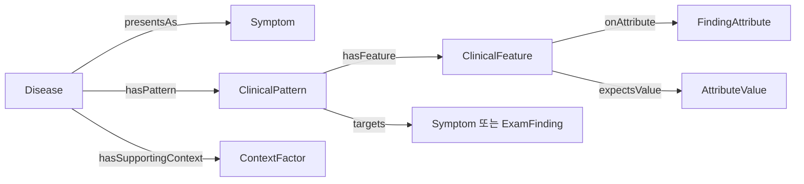

# Ontoward 기본 온톨로지

이 디렉터리는 공통 증상을 속성으로 구체화하고, 질환별 임상 특징과 패턴으로 연결하기 위한 기본 구조다. [D08](../../DECISION_STATE.md#D08)의 사용자 결정을 반영한다. 임상 관계를 추출한 완성 지식이나 진단 프로그램은 아직 아니다.

## 파일과 기본 용어

| 파일 | 내용 |
|---|---|
| [schema.ttl](schema.ttl) | v4.2 클래스 11개, 객체 관계 12개, 데이터 속성 6개와 관계 의미 |
| [vocabulary.ttl](vocabulary.ttl) | 증상 42개, 속성 13개, 계통 15개, 범주 값 77개와 진찰 방법 24개 |
| [vocabulary-candidates.md](vocabulary-candidates.md) | 의료인 사용자가 승인한 일곱 객체의 영어 자연어 항목 510개 |
| [vocabulary-approval.json](vocabulary-approval.json) | 사용자 승인일·기록 시점·승인 당시 파일 SHA-256·항목 수 |
| [AGENTS.md](AGENTS.md) | 에이전트가 적용할 제약과 관찰·조회·SDK 경계 |
| [원본 경로 목록](../catalog/guideline_paths.txt) | 제공 카탈로그의 프로젝트 루트 기준 원본 문서 경로만 보관 |

공통 URI 접두사는 `urn:ontoward:`이며 아래 예시의 `ow:`는 이 접두사를 뜻한다. 한국어·영어 명칭은 같은 URI에 붙인다. 동의어는 `skos:altLabel`로 관리한다.

기초 어휘는 구체적인 통증 증상 19개와 기존 비통증 증상 23개를 포함한다. 통증 개념의 영어 명칭은 [승인 목록](vocabulary-candidates.md)의 Symptom 표 첫 19개와 대응하며, 목록에 지정되지 않은 새 통증 개념의 계통 분류는 후속 어휘 수용 계약에서 정한다. Anxiety와 Depression은 환자가 보고하는 불안감·우울감이며 정신과 질환 진단을 의미하지 않는다. 검토 목록 전체의 어휘 수용과 임상 관계 추출은 후속 작업이다.

사용자는 2026-10-12 Disease 100개·Symptom 100개·ExamFinding 60개·AttributeValue 100개·ContextFactor 60개·Test 40개·ExamMethod 50개의 영어 목록을 승인했다. AttributeValue의 첫 77개와 ExamMethod의 첫 24개는 기존 영어 명칭을 유지한다. 승인된 목록과 속성·contextType 검토 메타데이터를 작업 기준으로 사용하되 대상별 확정 연결은 후속 계약에서 정한다. 510개는 승인된 자연어 항목 수이며 RDF 수용 개념 수가 아니다. 이번 승인 기록으로 Turtle·기존 진찰 요청문·임상 관계를 추가하지 않는다.

속성은 `Location`, `Laterality`, `Quality`, `Onset`, `Course`, `EpisodeDuration`, `Frequency`, `Timing`, `Severity`, `Trigger`, `AggravatingFactor`, `RelievingFactor`, `Radiation`이다. 증상별로 의미가 적합한 속성만 연결하며, 현재 Quality의 기초 값은 구체적인 통증 증상의 양상에 해당한다. 정도 범주는 환자가 직접 확인한 표현에만 사용하고 NRS 수치에서 자동 변환하지 않는다. 정확한 수치·지속 시간·빈도·단위·날짜는 환자 상태에 남긴다.

계통은 전신·눈·이비인후·심혈관·호흡기·소화기·비뇨기·생식기·근골격·신경·피부·내분비·혈액·면역·정신을 포함한다. 문진을 위한 비배타적 분류이며 질환 후보를 제한하지 않는다.

## 구체적인 통증과 환자 표현

통증은 AbdominalPain·ChestPain·Headache·Dysuria 등 일반적인 임상 주호소 단위의 Symptom으로 구분한다. 부위를 모르는 “아프다”는 원문과 미해결 상태로 남겨 확인하며 특정 증상으로 강제 연결하지 않는다.

| 확인한 표현 | 환자 상태에서 유지할 의미 |
|---|---|
| 복통이 있다 | AbdominalPain의 환자 보고; 확인한 세부 속성을 함께 보존 |
| 가슴이 아프다 | ChestPain의 환자 보고; 확인한 세부 속성을 함께 보존 |
| 오른쪽이 아프다 | 증상 개념은 미특정; 확인한 Laterality=Right와 원문 보존 |
| 우하복부라고만 답했다 | AbdominalPain과 Location=RightLowerQuadrant; Abdomen 값은 자동 추가하지 않음 |
| 배뇨통이 있다 | Dysuria와 원문·출처·추가 확인한 속성 보존 |
| 흉통은 없다 | ChestPain의 명시적 음성; AbdominalPain 등 다른 증상까지 부정하지 않음 |
| 흉통과 별개의 허리 통증이 있다 | ChestPain과 BackPain을 서로 다른 에피소드로 구분; 위치와 양상을 섞지 않음 |

Location 값 45개는 평면 구조다. 넓은 위치와 세부 위치를 각각 확인했다면 같은 에피소드에 출처와 함께 병렬 기록한다. RUQ·LUQ·RLQ·LLQ는 해당 사분면 값의 영어 별칭이며 세분 Symptom을 만들지 않는다.

환자 원문, 확인한 위치·상황, 정규화한 증상과 해석 불확실성을 구분한다. 문진·진찰 근거로 해석을 갱신하고 정정 전 원문을 보존하며, 진단 후보에 맞춰 증상을 바꾸지 않는다. 근거가 있는 미확정 개념 후보는 검색 합집합에 사용할 수 있지만 하나의 관찰을 여러 확정 증상이나 독립 근거로 중복 계산하지 않는다. 이러한 환자 관찰은 Turtle에 쓰지 않는다.

## 질환 특징과 가장 단순한 조회 구조

질환 지식을 추가할 때 다음 경로를 사용한다.

각 패턴은 질환 하나와 Symptom 또는 ExamFinding Target 하나를 가지며 특징은 0개 이상이다. 각 특징은 패턴 하나에 귀속하고 부모의 Target을 따른다. 선택적 기대 상태는 present 또는 absent, 수동 검토한 선택적 역할은 supportive·characteristic·opposing이다. Pattern의 선택적 importance=characteristic은 Feature의 역할과 별개다. onAttribute와 expectsValue는 유효한 쌍으로 기록하며, 속성 쌍이 없으면 명시적 기대 상태가 있어야 한다. 조건이 없는 Feature는 만들지 않는다.

한 질환은 문헌이 각각 뒷받침하는 서로 다른 증상 Target의 대안 Pattern을 소유할 수 있다. 문헌 근거가 있다면 StableAngina 아래의 ChestPain Pattern과 AbdominalPain Pattern을 각 Target에서 독립적으로 찾을 수 있으며 모든 Pattern의 동시 일치를 요구하지 않는다. 이는 구조 예시이고 이 디렉터리에 실제 임상 관계를 생성하지 않는다.

후속 프로그램은 hasPattern→targets로 후보를 조회한 뒤 각 후보의 패턴·특징을 같은 구조로 읽을 수 있다. 실제 진찰 소견도 Pattern의 targets를 역방향으로 따라 관련 질환을 조회한다. 확인된 특징의 역할과 미확인 항목을 반환하고, 순위와 다음 행동은 프로그램이 정한다. 특징 목록 전체를 필수 AND로 만들거나 매칭 수를 질환 확률로 바꾸지 않는다.

속성 값의 불일치는 해당 특징의 지지가 확인되지 않았다는 의미다. 곧바로 반대 근거나 질환 배제가 되지 않는다. 반대 특징도 실제 관찰과 매칭될 때에만 해석한다. 지지 맥락은 질환에 별도로 연결하고 패턴에서 중복 집계하지 않는다.

초기 어휘에는 질환·패턴·특징·맥락 요인·진찰 소견·검사 인스턴스와 그 임상 관계를 임의로 채우지 않았다. 이후 지침에서 관계를 추출하고 검토해야 이 구조를 이용한 진단 조회가 가능하다.

## 진찰 방법과 검사 계획

`ExamFinding → detectedBy → ExamMethod → examRequestText`로 구체적인 요청 문장을 찾는다. 나중에 애플리케이션이 문장을 검증하고 `client.exam(text)`로 전송한다.

| 방법 URI의 이름 | 요청 문장 |
|---|---|
| LungAuscultation | 폐음을 청진하겠습니다 |
| AbdomenAuscultation | 복부를 청진하겠습니다 |
| RightLowerQuadrantPalpation | 우하복부를 촉진하겠습니다 |

24개 방법은 결막·구강·인두·피부 시진, 동공 빛반사, 경부 림프절·갑상선 촉진, 심음·폐음 청진, 복부 시진·청진·타진, 명치·네 사분면 촉진, 좌우 늑골척추각 타진, 요골동맥 촉진, 정강이 함요 확인, 무릎 운동범위·슬개건 반사 확인, 보행 관찰을 포함한다.

[제공 SDK](../../assets/nova-starter/nova_sdk.py)는 공식 진찰 코드 목록 대신 구체적인 문장을 받는다. 따라서 examAction 코드를 선언하지 않고, 방법 URI를 내부 식별자로 사용한다. examRequestText는 언어 태그 없는 문자열이며 NFC 정규화 후 1–30 코드 포인트의 단일 동작 요청이다. 실제 서버의 인식 여부는 별도 실행으로 확인해야 한다. 요청·거절·결과 수신을 구분하며 예상 소견을 관찰로 기록하지 않는다.

`Disease → evaluatedBy → Test`는 SOAP의 `P.tests` 계획 조회에만 사용한다. 현재 후보 생성·특징 매칭·순위·다음 진단 행동에서는 읽지 않는다. 예선 `O.tests`는 비우고 TEST 행동은 실행하지 않는다.

## 원본 확인과 검증 한계

원본 문서는 `assets/guidelines/`에 보존한다. [경로 목록](../catalog/guideline_paths.txt)은 제공 catalog.csv의 경로만 프로젝트 루트 기준으로 정리한 것으로 원문 복사·추출·승인 목록이 아니다. 자료 확인의 시작점은 [카탈로그](../../assets/guidelines/catalog.csv)이며 관계별 원본 경로·절·적용 조건·라이선스·검토 기록은 data의 후속 준비 자료에서 관리한다.

실행 그래프에는 Source·ClinicalClaim·Evidence·SUPPORTED_BY 노드를 넣지 않는다. SOAP A.evidence에는 주진단을 판단하는 데 사용한 실제 문진·신체진찰 소견을 목록화한다. 지식 source나 “환자 표현에 근거했다”는 문구 대신 확인한 증상·관련 음성·진찰 소견 자체를 제시한다. 원문·출처·턴의 추적은 내부 CaseState에서 유지하며 미확인·미시행 항목을 근거 목록에 넣지 않는다. D12에 따라 주진단은 CaseState와 별도 diagnosis 인자로 관리한다. SOAP A에는 evidence와 differential만 넣으며 전송 형식은 [PRD](../../PRD.md)와 SDK 1.0.1을 따른다.

현재 결과는 스키마·기초 어휘·일곱 객체의 영어 검토 목록·경계 계약이다. 검증은 후보 표의 개수·명칭·순서·중복과 기존 Turtle의 보존을 대상으로 한다. 격리된 합성 RDF는 대안 Pattern 조회 경로의 구조 검증에만 사용한다. 실제 수행 결과는 [데이터 상태](../PROJECT_STATE.md)에 기록한다. 합성 Pattern은 임상 지식이나 제출 자산으로 수용하지 않으며, 실제 임상 관계 생성·검증, 환자 정규화 실행, EXAM 인식, SOAP 제출과 진단 실행은 후속 과제다.
