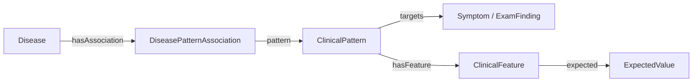

# 온톨로지 v5.0

현재 구조는 [schema.ttl](schema.ttl)과 [AGENTS.md](AGENTS.md)에 정의한다. 질환별 의미를 Association으로 분리하여 같은 관찰 표현을 공유하고 원천 라벨과 Feature 조건으로 점수를 계산한다.

Pattern은 질환·출처와 독립적인 단일 Target 표현이다. Feature는 한 Pattern의 상태 또는 속성 조건이며 expectedStatus와 타입 ExpectedValue를 사용한다. Association은 Disease + Pattern + 적용 조건과 선택한 원천 평가를 담는다.

| ExpectedValue | 의미 |
|---|---|
| concept | 정확 일치 또는 검증된 제한적 경로 |
| concept_set | any_of·all_of 조건 |
| quantity | 값·단위·비교 연산 |
| interval | 상·하한·단위·경계 포함 여부 |

발생 이후 경과시간(TimeSinceOnset)과 한 번의 지속시간(EpisodeDuration), 원래 위치와 RadiationLocation을 구분한다. 원천이 제공하지 않은 단위나 “만성”의 임계값을 만들지 않고 월·년은 달력 단위로 보존한다.

가중치는 [공개 점수 정책](../../submission/knowledge/scoring_policy.json)을 사용한다. BODHI 예측도는 zero/rare/low/medium/high/very_high = 0/0.5/1/2/3/4, 동일한 BODHI 평가가 없을 때의 SNOMED 기본값은 due_to=2, associated_with=1, 조건을 보존한 일반화=0.5다. 정교화 점수와 기준 점수의 차이는 한 조건이면 atomic, 여러 조건이면 joint로 유지한다.

후보 검색은 Target에서 넓게 수행한다. 전체 Feature와 적용 조건이 맞을 때만 점수를 활성화하고 구체적인 변형은 점수가 낮아져도 조상을 대체한다. 같은 Target의 반복·출처를 중복 가산하지 않고 다른 에피소드의 조건을 섞지 않는다. 점수는 감별 순위용이며 보정된 확률이 아니다.

D18에 따라 기존 seed 어휘·승인 영수증·v4.2 자료·이전 임상 배치와 지침 파생 데이터를 삭제했다. 이 디렉터리는 구조 계약만 소유하며 어휘와 관계는 원천 행 또는 명시적 파생 규칙에서 새로 추출한다. 깨끗한 빈 베이스와 새 후보는 [preparation/v5/](../preparation/v5/source-only-2026-10-16/README.md)에 분리한다.

14개 클래스 모두 추출 규칙·수·근거·미해결 이유를 보고한다. 원천의 역할과 실행 가능 역할을 구분하며 BODHI의 specialty·influence·prerequisite를 검사 계획이나 무조건적인 질환 지지로 바꾸지 않는다. 한국어 명칭은 같은 SCTID의 Korean RF2를 우선하고 모델 번역 출처와 별도 자동 의미 대조를 명시한다.

D19는 소견 후보를 BODHI 증상 루트 외에 RF2의 진찰 방법·임상 Observable·형태와 부위·Sign 근거에서 찾는다. 속성은 ClinicalObservable 비교 차원을 포함하며 같은 관계 그룹의 명확한 해석 값과 원천 단위·척도·기법 메타데이터를 구분한다. 획득 미확정·진찰 문구 누락은 그대로 남기고 확장 원천 그래프는 실행 preview와 분리한다. 분과·관찰 영역의 수와 공백은 `catalog/finding-coverage.json`에서 확인한다. 한국어 작업은 공유 근거 ID를 사용하고 상세 감사의 정본은 SQLite에 보존한다.

진찰은 ExamFinding → detectedBy → ExamMethod.examRequestText로 단일 동작을 실행하고 실제 결과·거절을 관찰한다. Test/evaluatedBy는 SOAP P.tests만 사용한다. A.evidence에는 실제 얻고 판단에 사용한 문진·진찰 소견을 담는다.

D20은 원천 Finding site·Location 값에서 실제 기관 계통으로 이어지는 경로를 `inSystem` 문진 분류로 수용한다. BODHI의 양성·0이 아닌 방향성 영향은 `hasSupportingContext`에 연결하고, 병력 역할은 실제 predicate `contextType`의 기존 열 범주로 분류한다. 필수 조건은 Association applicability로 보존한다. 연결별 근거와 정확한 승인 배치는 [공모전 그래프](../preparation/v5/competition-graph-2026-10-16/README.md)에 둔다. 한국어 문구가 없는 그래프 수용 상태와 실제 상담 준비 상태를 구분한다.

D23은 완전한 원천 기반 후보·매핑·한국어 환자 행동의 공모전용 사용을 승인한다. 기존 카탈로그의 의미 검토 대기 표시는 정확한 배치 영수증과 D23으로 해소하며 고정된 원천 기록은 다시 쓰지 않는다. 의미·단위·획득 방식이 불완전한 항목은 사용자 선택 대기가 아닌 기술적 제외다. 실제 원천 preview는 [준비 결과](../preparation/v5/source-only-2026-10-16/README.md), 공모전 승인·기술 제외는 [데이터 상태](../PROJECT_STATE.md), 실행 소비는 [submission 안내](../../submission/knowledge/README.md)에서 확인한다.
