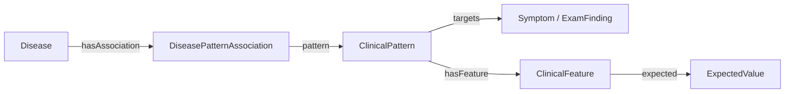

# 온톨로지 v5.0

현재 구조는 [schema.ttl](schema.ttl)과 [AGENTS.md](AGENTS.md)에 정의한다. 질환별 의미를 Association으로 분리하여 같은 관찰 표현을 공유하고 원천 라벨과 Feature 조건으로 점수를 계산한다.

Pattern은 질환·출처와 독립적인 단일 Target 표현이다. Feature는 한 Pattern의 상태 또는 속성 조건이며 expectedStatus와 타입 ExpectedValue를 사용한다. Association은 Disease + Pattern + 적용 조건과 선택한 원천 평가를 담는다.

| ExpectedValue | 의미 |
|---|---|
| concept | 정확 일치 또는 검증된 제한적 경로 |
| concept_set | any_of·all_of 조건 |
| quantity | 값·단위·비교 연산 |
| interval | 상·하한·단위·경계 포함 여부 |

발생 이후 경과시간(TimeSinceOnset)과 한 번의 지속시간(EpisodeDuration), 원래 위치와 RadiationLocation을 구분한다. 원천이 제공하지 않은 단위나 “만성”의 임계값을 만들지 않고 월·년은 달력 단위로 보존한다.

가중치는 [공개 점수 정책](../../submission/knowledge/scoring_policy.json)을 사용한다. BODHI 예측도는 zero/rare/low/medium/high/very_high = 0/0.5/1/2/3/4, 동일한 BODHI 평가가 없을 때의 SNOMED 기본값은 due_to=2, associated_with=1, 조건을 보존한 일반화=0.5다. 정교화 점수와 기준 점수의 차이는 한 조건이면 atomic, 여러 조건이면 joint로 유지한다.

후보 검색은 Target에서 넓게 수행한다. 전체 Feature와 적용 조건이 맞을 때만 점수를 활성화하고 구체적인 변형은 점수가 낮아져도 조상을 대체한다. 같은 Target의 반복·출처를 중복 가산하지 않고 다른 에피소드의 조건을 섞지 않는다. 점수는 감별 순위용이며 보정된 확률이 아니다.

기초 [vocabulary.ttl](vocabulary.ttl)은 기존 용어를 유지한다. [510개 승인 영어 용어](vocabulary-candidates.md)와 [영수증](vocabulary-approval.json)은 확장 가능한 시드이며 임상 관계·실행 자산 승인과 별개다. 출처별 후보 어휘와 관계는 data/preparation/v5/에 둔다.

기존 schema·vocabulary는 [v4.2/](v4.2/schema.ttl)에 원래 바이트로 보존했다. 추출 JSON과 과거 준비 자료는 [deprecated.json](deprecated.json)의 archival 목록이며 현재 v5.0의 입력이 아니다. Dev의 이전 SNOMED·가이드라인 파이프라인은 삭제했다. v5.0 reader가 옛 표현을 삭제하는 호환 변환을 제공하지 않는다.

진찰은 ExamFinding → detectedBy → ExamMethod.examRequestText로 단일 동작을 실행하고 실제 결과·거절을 관찰한다. Test/evaluatedBy는 SOAP P.tests만 사용한다. A.evidence에는 실제 얻고 판단에 사용한 문진·진찰 소견을 담는다.

실제 원천 preview는 [준비 결과](../preparation/v5/README.md), 검증과 임상 수용 경계는 [데이터 상태](../PROJECT_STATE.md), 실행 소비는 [submission 안내](../../submission/knowledge/README.md)에서 확인한다.
