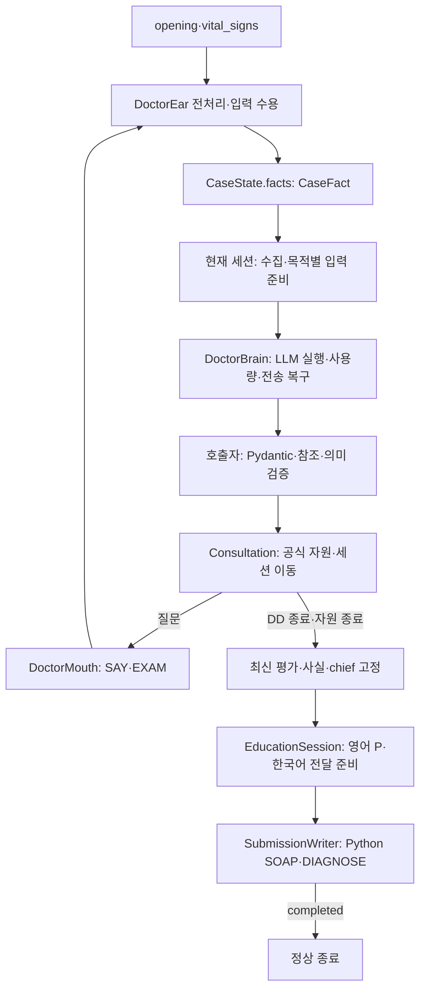
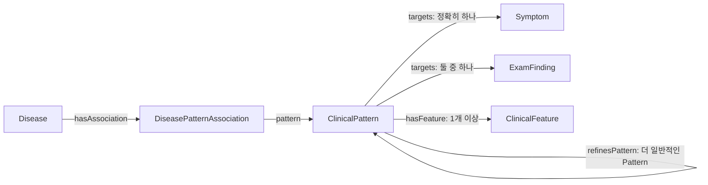
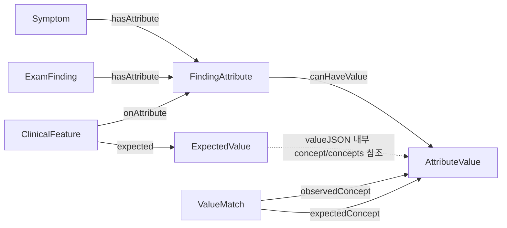
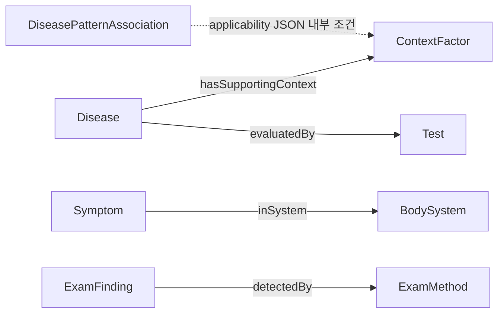

# Ontoward 진료 워크플로우 백서

현재 구현은 **D47·d47.1**이다. 다섯 세션 객체가 목적별 입력 전처리와 응답 검증을 소유하고 **DoctorBrain은 모든 LLM 호출의 공통 실행기**다. 환자 정보는 CaseState.facts의 **CaseFact 하나**에 저장한다. [D47 결정](../DECISION_STATE.md#D47), [PRD](../PRD.md), [상태 정의](workflow/state/models.py), [실행·ZIP 증빙](../data/provenance/algorithm-d47-2026-10-19.json)을 기준으로 읽는다. D42 임상 핀과 D45 공식 턴 예산은 유지한다.

## 1. 진료 실행 흐름

[run.py](run.py)는 원본 SDK의 prepare·consult 진입점을 유지한다. prepare는 제출 내부 경로·manifest·해시·스키마·준비 문구를 확인하고 읽기 전용 Graph를 준비한다. consult는 증례당 Brain 하나와 Ear·Mouth·다섯 세션을 조립한다. [Consultation](workflow/consultation.py)만 세션과 자원 종료를 조정한다.

[실제 LangGraph](workflow/graph.py)는 START·END 포함 18개 정점·30개 연결이다. 내부 계산이나 모델 호출을 행동 턴으로 계산하지 않는다. 전송 결과가 불명확하면 다음 행동으로 넘기지 않고 명시적으로 종료한다.

## 2. 다섯 세션의 책임과 호출 시점

| 객체 | 수집과 기능 | 임상 호출 |
|---|---|---|
| InitiationSession | 초기 입력 연결·인사·chief 명료화·공통 경과 | 정상 종료 때 최초 순위 1회 |
| ChiefComplaintSession | 대표 chief의 적용 가능한 전체 속성·Open Inquiry | 정상 종료 때 순위 1회 |
| ContextFactorSession | 기본 병력 다섯 영역·보호 Context·추가 Context | 정상 종료 때 순위 1회 |
| DifferentialDiagnosisSession | 집중 ROS·감별 문진·EXAM·다음 행동·평가 고정 | 진입 첫 행동은 기존 평가 사용; 이후 응답마다 순위와 행동 |
| EducationSession | 고정 진단·영어 P·Mouth 전달 준비 | 계획·표현 작업별 호출; 순위 갱신 없음 |

turn 0과 첫 세 세션 중간에는 순위를 계산하지 않는다. 후보가 없어도 정상 종료 요청은 수행하고 빈 순위만 받는다. 첫 세 세션의 평가는 각 세션 객체가 전처리→Brain 호출→검증·수용한다. DD의 unknown 응답도 응답 식별자로 판단하고 동일 응답의 내부 재진입은 중복 호출하지 않는다. 고정 시 이미 성공한 최신 판단을 재사용한다.

다섯 세션의 조건부 문진 목표/상한은 5/7·7/14·7/9·3/10·5/10이다. CC 마지막 슬롯은 Open Inquiry에 보호한다. 집중 ROS는 DD에서 chief 계통·최대 여섯 대상·중복·존재 확인을 지키며 기존 10행동 상한을 공유한다. 기본 병력은 과거력·약물·알레르기·가족력·사회력이다. Context 질문의 질환 출처는 CC 종료의 유효 평가로 고정하고 현재 답변으로 실행 가능성만 검사한다. 유효 평가가 없으면 기본 병력과 준비 불가 사유를 남긴다.

## 3. 실행 객체와 상태 수명

| 소유자 | 책임 |
|---|---|
| DoctorBrain | 지정 모델·역할별 effort/한도·사용량·오류 분류·동일 요청 일시 재전송 |
| DoctorEar | 입력 전처리·문맥 해석·정규화·통합 사실 수용; 원문 대화 한 벌 |
| 다섯 세션 | 목적별 수집·그래프 자료·프롬프트 선택·출력 검증·임상 수용 |
| DoctorMouth | 공감·한국어 표현 자료·출력 검증·검증된 SAY/EXAM 실행 |
| Consultation | 세션 진입·입력 수용 후 작업·종료·자원 종료 조정 |
| SubmissionWriter | 통합 사실·frozen Assessment·계획·전달 결과의 SOAP·DIAGNOSE·완료 확인 |

별도 ModelClient 계층이나 환자 상태 사본·세션 프레임워크는 없다. 작은 공통 그래프·질문 함수만 재사용한다. 모델은 openai/gpt-6-luna이고 임상·영어 P는 high, Ear·Mouth는 medium이다. Brain은 임상 schema·그래프 조회·의미 수용을 소유하지 않는다.

| 상주 경계 | 내용 |
|---|---|
| case | 통합 facts·chief ID·단일 Assessment·영어 plan·revision |
| interview | 현재 세션·대기 질문·compact Answer·수집 사유·공감·교육 상태 |
| session | 공식 제약·사용량·종료·completed receipt |
| 선택적 turn | 현재 행동/입력/제출; 처리 뒤 해제 |

후보 views·지역 참조·LLM 교환·복구는 각 호출 작업의 지역값이다. Test가 외부 관측으로 실제 호출·변환·상태 변경을 보존한다.

## 4. 통합 사실과 입력 수용

ClinicalFact·NoteFact·CaseState.notes를 제거했다. CaseFact에 정규화된 영어 내용·상태·범주·수치·단위·주체·가족 구성원·보고자·시점·관찰·episode·조건·acquisition·source·turn을 보관한다. 선택적 graph_binding이 등록 target·attribute·values·연결 방식·그래프 사용 자격을 보관한다. 한 진술의 매핑과 설명을 중복 저장하지 않는다.

age·sex·historian·약물·보고 성장 수치·조건부 정보도 같은 정본에서 임상 판단과 계획으로 간다. 그래프 매칭과 supports/against에는 명시적으로 적격인 연결만 쓰며 조건부 표현을 무조건적 양성으로 바꾸지 않는다. 내용·수치·조건·상태가 바뀌면 revision을 올리고 Assessment 수용 자체는 올리지 않는다.

Ear는 초기 opening과 vital_signs를 첫 SAY 전에 해석한다. 매 입력의 문맥을 분석하고 정확한 영어 연결은 Python이 처리하며 미해결 항목만 공급 DB 후보로 정규화한다. 유효 행은 보존하고 무효 행·형식·강제 완료의 기존 한도를 유지한다. 내부 ID·source·turn은 Python이 부여한다. 실제 모름과 미표현을 구별한다.

초기 구간 인용·취득 검증을 지키며 보고값·가정 측정은 S, 신뢰된 객관 구간·실제 EXAM은 O에 둔다. 정정은 기존 취득·범위 정책을 유지한다. 환자 원문은 Ear의 참조 해석에만 남고 임상·계획·SOAP에는 전달하지 않는다. Education 답변은 transcript-only다.

## 5. 목적별 임상 입력

[rules/assessment.py](workflow/rules/assessment.py)가 현재 적격 사실과 등록 관계로 후보를 회수하고 supports·against·unresolved를 만든다. 부분 패턴·음성·미확인 applicability도 검토 경로가 될 수 있으나 자동 지지는 아니다. Feature 매칭과 Association 적용 조건을 따로 판정하며 관찰·episode·주체를 합쳐 완성하지 않는다. 수치·값 불일치에는 실제 fact 참조를 남긴다.

[rules/decision.py](workflow/rules/decision.py)는 호출 목적에 필요한 Key와 Value만 고른다. 사실 f_, 후보 d_, 근거 e_, 질문 q_, 범위 s_, 조건 condition_를 지역 참조로 연결하고 같은 사실·조건·미확인을 한 번 정의한다. 전체 상태 model_dump·큰 Pydantic schema·그래프 profile 전문을 프롬프트에 넣지 않는다. 기존 유효 후보를 보존하고 고정 Top-K를 두지 않는다. 순위 전용 요청에는 질문을 넣지 않으며 행동 복구는 수용 순위와 실행 가능한 질문 중심이다.

**프롬프트 바이트 측정·목표·제한·진단 통계·크기 비교는 없다.** 이를 맞추기 위한 절단·배치·조각 읽기·근거 결합 경로도 제거했다. 의미별 전처리와 공유 참조는 필요한 정보를 명확히 전달하기 위해 사용한다. 공식 토큰·호출·행동·시간 예산은 각자 유지한다.

## 6. 작은 응답과 독립 수용

입력 해석·후보 매핑·순위·행동·계획 문장·한국어 표현은 작은 작업별 JSON으로 받는다. 호출자는 Pydantic 구조 검증 뒤 등록 참조·현재 범위·중복·누락·질문 실행 가능성을 검사한다. 첫 세 종료 응답은 ranked_disease_refs만, DD 정상 응답은 순위와 next_action만 받는다. Python이 전체 Assessment와 질문 객체를 조립한다.

기존 유효 후보 누락·미등록·중복 참조는 거절한다. 그래프 경로가 소실된 후보만 코드가 무효화한다. Python 점수로 수용 순위를 재정렬하지 않는다. 유효 순위와 잘못된 행동을 따로 처리하고 행동만 한 번 복구한다. Brain에는 임상 응답 검증을 넣지 않는다.

## 7. 질문과 평가 고정

필수 chief 속성·Open Inquiry·기본 병력은 해당 세션이 준비한다. 공통 QuestionTools가 등록 문구·존재 전제·계통·주체·가족 구성원·시점·관찰·중복·예산을 검사한다. DD의 선택 질문은 후보의 미확인 feature와 진찰에서 구성하며 질환별 기대 답과 조건을 보존한다. ask는 공급한 실행 가능한 질문 하나를 선택해야 한다.

DD 종료는 **마지막 응답 수용→필요 판단→최신 평가 재사용→현재 미확인·한계 확정→Assessment·기반 facts·chief 고정→Education**이다. 최신 질환 평가를 얻지 못하면 확인된 chief의 symptom-only 평가를 고정하고 chief도 없으면 명시적으로 실패한다. Writer는 다시 진단을 고르지 않는다. Education과 SOAP 복구는 같은 고정 평가를 사용한다.

## 8. 공식 자원·Education·종료

D45의 공식 turns_remaining이 행동 예산의 기준이다. SAY·EXAM의 실제 소비를 응답/조회로 정산하고 같은 요청 재전송은 중복 계산하지 않는다. 공통 상한은 50행동·모델 200회·입력 500,000·출력 100,000토큰이다. 내부 처리·모델 호출·세션 조회·SOAP·DIAGNOSE는 행동 턴이 아니다.

새 행동 전에 응답 해석·최종 판단과 복구·활성 계획·한국어 안내·제출을 보호한다. 임상 정상 출력은 4096·한 번의 복구 8000토큰이다. Education은 7턴을 보호하고 상한은 10이다. 명시적 비활성 설정은 교육 행동·예약·P.education을 사용하지 않는다. 일시 전송 오류는 동일 ID·payload로 2초 뒤 한 번 재전송한다.

EducationSession은 고정 진단과 통합 환자 사실, manifest로 해시 검증한 지침 원문으로 영어 P를 준비한다. 인용과 일반 모델 지식을 구별한다. 원문 문서는 NOVA_GUIDELINES_DIR 마운트에서 읽고 ZIP에 넣지 않는다. Mouth가 진단을 먼저 안내하며 각 발화를 NFC 1–30자로 검증한다. 공급자 응답 복구와 문구 복구는 별도이고 미전달 계획은 전달 완료로 기록하지 않는다. 이 개편은 기존 교육 실패·안전 우선순위 정책을 별도 변경하지 않는다.

## 9. Python SOAP와 완료 계약

Writer는 통합 사실·frozen Assessment·영어 P·실제 전달 결과만 사용한다. age·sex·historian을 HPI 선두에 쓰고 보고 수치는 S에, 실제 객관 취득은 turn과 함께 O에 둔다. 조건·가족·시점·수치 범위를 보존하고 같은 S/O 문구를 frozen A의 근거에서 재사용한다.

S의 cc/hpi/pmh/fh/sh/ros, O의 exam/tests, A의 evidence/differential, P의 tests/treatment/disposition/follow_up/education **15개 문자열**과 별도 diagnosis를 전송한다. 예선 O.tests는 빈 문자열이고 diagnosis는 고정 1위다. 형식 복구는 같은 평가로 한 번 재구성한다. 정상 완료는 DIAGNOSE의 completed 수신이다.

## 10. 설정·검증·독립 ZIP

[설정 안내](config/README.md)의 공개 경로로 임상 공통·세션별·Ear·Mouth·계획 프롬프트를 고른다. ONTOWARD_CLINICAL_PROMPT와 네 임상 세션 설정이 기존 brain.txt를 대체한다. 비밀 키와 서버 원문은 공개 설정에 넣지 않는다.

프로젝트 Docker에서 유지 행동 회귀·실제 수용 RDF 상담·관측 일치·SDK 내부 HTTP·읽기 전용 독립 ZIP을 구분해 검증한다. [Test/compare_d47.py](../Test/compare_d47.py)는 원본 C03의 네 수용 상태에서 모든 사실·기존 후보 전달과 공급자 오류 재현을 확인한다. 원본 결과는 보존하고 실제 모델 정확도·속도 개선·새 NOVA·공식 평가는 not_run으로 구분한다. 결과와 소스·ZIP 신원은 [D47 증빙](../data/provenance/algorithm-d47-2026-10-19.json)이 소유한다.

ZIP에는 필요한 실행 Python·requirements·SDK·공개 설정·프롬프트·manifest 자산만 넣는다. 문서·상태·Test·Dev·준비 DB·개발 키·원본 지침은 제외한다. 독립본은 부모 data나 원본 준비 자료 없이 검증한다.

## 11. 응답 하나의 변환

Ear는 환자의 보고와 조건을 하나의 CaseFact로 수용한다. 첫 세 세션은 수집을 계속하다 종료 때 순위만 판단한다. DD에서는 질문 응답이 unknown이어도 새 응답 식별자로 순위·행동을 판단한다. 같은 응답으로 그래프 노드가 재진입하면 성공한 판단을 재사용한다. 마지막 응답 처리 후 고정한 사실·chief·순위를 Education과 SOAP가 함께 읽는다.

## 12. 변경 경계

입력 의미는 Ear, 그래프 매칭은 rules, 세션별 임상 작업은 sessions, 모델 실행은 Brain, 환자 표현·행동은 Mouth, 세션 이동은 Consultation, SOAP·완료는 Writer에서 바꾼다. 임상 자산 확장·강제 매핑 정책·초기 진술 정정·가족 Context 집계·교육 실패/안전 정책은 이번 범위 밖이다. 다음 제한 작업은 별도 실제 모델 품질 평가다.

## 13. v5.0 스키마: 14개 클래스와 연결

구조의 기준은 [schema.ttl](../data/ontology/schema.ttl)이며 실행 시에는 [manifest](knowledge/manifest.json)가 고정한 동일 스키마를 읽는다. 아래 세 그림은 같은 스키마를 질문별로 나누어 보여준다. 모든 연결은 클래스 사이의 허용 관계를 표현하며, 각 노드가 실제 환자의 관찰이라는 뜻은 아니다. [atlas의 SVG](../Test/atlas.html#ontology)는 관계 이름·설명·현재 인스턴스 수를 함께 제공한다.

### 13.1 질환·공유 Pattern·Feature

Association은 Disease 소유자 하나와 Pattern 하나를 가진다. Pattern의 Target은 Symptom·ExamFinding 중 정확히 하나다. Feature는 Pattern 하나에 귀속되고 그 Target을 상속한다. **Target은 별도 RDF 클래스가 아니라 Symptom·ExamFinding의 역할 이름이다.** 매칭 결과와 근거 참조는 Python 지역값이다. 원천 점수의 차분 `FeatureContribution`은 준비 도구에만 남고 제출 런타임은 점수를 계산하지 않는다. `refinesPattern`은 구체적인 Pattern에서 일반 Pattern을 향한다. 같은 관찰·같은 적용 조건에서 세부 Pattern까지 모두 맞을 때만 대표 지지를 세부 Pattern으로 줄이며, 미확인·불일치 세부 조건 때문에 일반 지지를 지우지 않는다.

### 13.2 관찰 속성·기대 값·비교 경로

존재만 비교하는 Feature는 `expectedStatus`를 사용한다. 속성 조건은 `onAttribute`와 `expected`를 한 쌍으로 가진다. ExpectedValue의 `valueJSON`은 `concept`, `concept_set`, `quantity`, `interval` 중 하나다. 개념 집합의 any_of/all_of, 수치 연산자·단위·구간 경계를 보존한다. 점선은 JSON 내부 참조이며 새 RDF predicate가 아니다. 수치 값은 범주 AttributeValue가 없어도 표현할 수 있다.

ValueMatch는 `observedConcept → expectedConcept` 비교를 허용하는 근거 있는 방향성 경로다. `relationKind`의 is_a·regional_part·approved_region을 구분하고 `sourceRef`를 유지한다. 스키마에 정의되어 있어도 현재 수용 RDF의 ValueMatch 인스턴스는 0개다. 임의의 부위 포함 관계나 동의어를 이 클래스로 추가하지 않는다.

### 13.3 문진 계통·Context·진찰·검사 계획

`hasSupportingContext`는 등록 Context로 Disease를 회수하고 양성 맥락 근거를 구성하는 연결이며, `applicability`는 해당 Association의 지지가 활성화되는 필수 조건이다. 둘은 같은 의미가 아니다. ContextFactor는 `contextType`을 가지며 환자·가족·과거·현재는 증례 근거에서 구분한다. BodySystem은 집중 ROS 탐색에만 사용하고 Disease 회수를 제한하지 않는다. ExamFinding은 검토된 ExamMethod와 `examRequestText`가 있어야 실제 EXAM으로 취득한다. Test와 `evaluatedBy`는 P.tests 계획 역할이며 예선 진단 중 TEST 행동을 실행하지 않는다. D37의 생성 P.tests는 이 클래스의 인스턴스 유무와 별도로 출처·내용을 검증한다.

### 13.4 클래스별 역할과 현재 실행 인스턴스

수치는 2026-10-19에 manifest 고정 schema·vocabulary·clinical bundle을 하나의 RDFLib Graph로 읽어 집계한 값이다. 원천 전체 카탈로그의 규모와 구분하며 활성 manifest가 바뀌면 다시 집계해야 한다.

| 클래스 | 역할 | 실행 인스턴스 |
|---|---|---:|
| Disease | 질환 후보 | 843 |
| Symptom | 환자가 보고할 수 있는 증상 Target | 533 |
| ExamFinding | 실제 신체진찰 소견 Target | 2 |
| FindingAttribute | 위치·양상·두 시간 축 등 비교 차원 | 36 |
| AttributeValue | 속성에 허용된 범주 개념 | 1,153 |
| ClinicalPattern | 단일 Target의 공유 조건 묶음 | 1,925 |
| ClinicalFeature | Pattern에 귀속된 존재·속성 조건 | 3,530 |
| ExpectedValue | 엄격한 타입 기대 값 | 430 |
| DiseasePatternAssociation | 질환–Pattern–적용 조건·원천 평가 | 9,955 |
| ValueMatch | 근거 있는 개념 비교 경로 | 0 |
| ContextFactor | 병력·노출·인구학 맥락 | 310 |
| BodySystem | 비배타적 문진 계통 | 12 |
| ExamMethod | 준비된 진찰 방법 | 2 |
| Test | 검사 계획 개념 | 0 |

관계 화살표 이외의 스키마 속성은 다음과 같다. RDFS domain/range는 구조 설명이며 실제 개수·타입·의미 조건은 Python reader가 검증한다.

| 소유자 | 속성 | 의미 |
|---|---|---|
| OntologySchema | `schemaVersion` | 구조 버전 5.0; 클래스 목록 밖의 스키마 식별 노드 |
| ClinicalFeature | `expectedStatus` | 존재·부재 조건 |
| ExpectedValue | `valueJSON` | 타입·연산자·단위·범주/수치 값 |
| DiseasePatternAssociation | `predictiveness`, `typicality`, `strongPredictor` | 두 방향 원천 평가와 별도 원천 표지; strongPredictor를 추가 점수로 더하지 않음 |
| DiseasePatternAssociation | `relationBasis`, `derivationScope`, `applicability` | 원천 관계·정확/일반화 범위·주체/시점/상태를 가진 JSON 필수 조건 |
| ContextFactor | `contextType` | 정해진 열 가지 Context 분류 |
| ValueMatch | `relationKind` | 승인된 비교 경로의 의미 |
| Disease | `urgencyLabel` | 설명용 메타데이터; 라우팅·정렬 규칙 아님 |
| ExamMethod | `examRequestText` | NFC 1–30 codepoint 단일 진찰 요청 |
| 관련 지식 노드 | `sourceRef` | 원천·승인 비교 경로의 간결한 참조; 환자 근거 아님 |

## 14. 원천에서 질문과 실행 자산까지

준비 알고리즘은 `Dev/`에 있고 상담 코드는 이 파이프라인을 실행하지 않는다. 아래는 현재 결과를 만든 경로의 설명이며 새로운 원천 수집·모델 작업·배치 재개 명령이 아니다.

| 단계·구현 | 알고리즘에서 보존하는 것 |
|---|---|
| [database.py](../Dev/ontology/database.py) | 전체 공급 파일·행·원본 식별자·RF2 관계 그룹·행 위치·모듈 의존성·출처 해시. 최신 버전을 선택한 뒤 active 필터를 적용 |
| [source_projection.py](../Dev/ontology/source_projection.py)·[model_normalization.py](../Dev/ontology/model_normalization.py) | source variant의 모든 조건과 AND/OR 범위. 제한된 모델 정규화도 후보이며 누락 단위·수치·관계를 모델 지식으로 생성하지 않음 |
| [v5.py](../Dev/ontology/v5.py) | Disease·source와 독립적인 Pattern 동일성, Disease+Pattern+applicability Association, source score·정교화·원자/공동 차분 |
| [source_catalog.py](../Dev/ontology/source_catalog.py)·[findings.py](../Dev/ontology/findings.py) | 14개 클래스별 후보·원천 역할·직접 진찰 방법·grouped value·진료과 공백. 발견 후보와 실행 가능한 부분집합을 구분 |
| [connections.py](../Dev/ontology/connections.py) | 원천 부위의 계통 경로→inSystem, 양성·0이 아닌 영향→typed Context 보강, prerequisite→필수 applicability. 불완전 진찰 후보의 실행 제외 |
| [patient_text.py](../Dev/ontology/patient_text.py) | 그래프에 고정한 환자 행동만 생성. 요청 예약·실패 원문·별도 의미 대조·NFC/길이 결과를 보존하고 Korean RF2 용어와 모델 문구 출처를 구분 |
| [admission.py](../Dev/ontology/admission.py) | 정확한 build·후보 집합·선택 항목·필수 규칙·수용 영수증. D23이 수용한 완전 후보에 새 승인 대기를 추가하지 않음 |
| [guidelines/map.py](../Dev/guidelines/map.py) | 카탈로그 허용 문서·FTS5 검색·동일 SCTID 별칭·모델의 evidence_id 선택·Python의 원문 복사. background_only와 P 근거 공백을 보존 |
| [package_submission.py](../Dev/packaging/package_submission.py) | 허용 파일과 해시·개수·크기, 원본·준비 DB·비밀값·문서·테스트의 제외 |

`source_projection.py build/export/admit`는 원천 정본·후보·수용의 경계를, `connections`는 D20 파생 연결을 담당한다. D19의 `source-findings.ttl` 발견 자료 전체를 실행 그래프에 넣지 않는다. D20의 그래프만 수용한 중간 상태는 `graph_admitted_text_pending`이었으며 D23이 한국어 행동을 고정한 뒤 현재 `admitted`가 되었다. D37의 문서 탐색 인덱스와 D42의 일반 호소 배치를 유지한다. D46은 D38 점수·가상 답변 선택기를 대체하며 원래 그래프·행동 수용 기록과 점수 메타데이터를 보존한다. 과거 추론 정책 JSON은 현재 ZIP의 실행 입력이 아니다.

진료 중 RF2·BODHI 원본이나 부모 준비 DB를 다시 읽지 않는다. **추론은 ZIP 내부 RDF와 JSON, Education은 고정 탐색 인덱스와 제공 원문 마운트**를 사용한다. 환자의 실제 기록은 이 파이프라인의 새 일반 지식으로 되돌려 쓰지 않는다. 공모전 수용과 독립 임상 검증·실제 모델 품질·공식 평가의 최신 경계는 [D46 개편 기록](../data/provenance/algorithm-d46-2026-10-19.json)에 정리한다. 이전 [D43 입력 복구 기록](../data/provenance/input-recovery-d43-2026-10-18.json), [D41 수용 기록](../data/provenance/algorithm-d41-2026-10-18.json)과 [운영 상태](PROJECT_STATE.md)에 연결되어 있다.

D42의 [현재 데이터 배치와 작성 안내](../data/preparation/v5/common-complaints-2026-10-18-r2/README.md)는 기존 843개 질환·9,401개 Association을 보존하고 추가한 데이터와 남은 공백을 설명한다. 새 출처의 정성적 연관은 별도 정책 점수 1을 사용하며, 작성자 지정 수준은 작성자 판단으로 보존한다. 일반 구어·기록 속성·출처 재배포가 점수 보너스가 되지 않는다. 새 임상 그래프·문구·정책은 [D42 수용 기록](../data/provenance/common-complaints-d42-2026-10-18.json)의 새 manifest와 영수증으로 구분한다.
