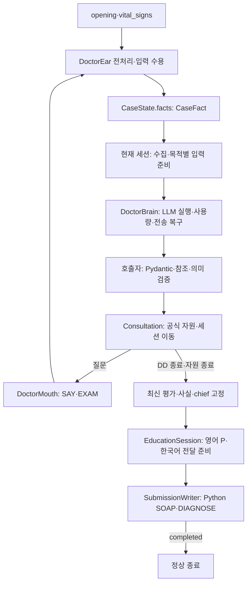
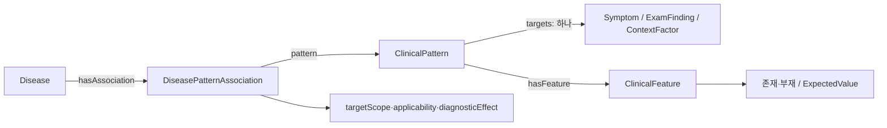
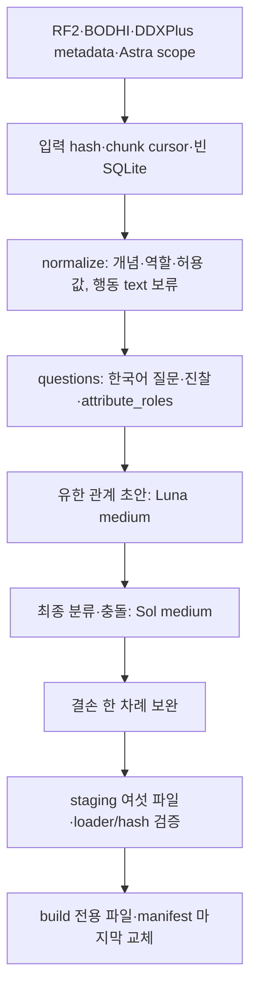

# Ontoward 진료 워크플로우 백서

현재 구현은 **D63 안정화·d50.12**다. 중간 오류의 scoped pass·세션 전진·독립 최소 SOAP와 실제 completed만 인정하는 완료 계약을 적용한다. 모델에 전달하는 그래프 relation/evidence/question/condition 상세 표는 각각 최대 50개다. 적격 disease 후보·모델 후보 참조·정상 수용 Assessment·주진단 외 SOAP 감별에는 고정 개수 상한을 두지 않는다. note가 100000 bytes를 넘으면 기존 명시적 오류·최소 Writer로 복구한다. 실제 환자 facts·수치·범위와 완전한 relation 조건은 보존한다. D55 strict 지식·D56 진찰·D57–D58 입력/원자 수집·D59 Education byte/인용 검증·D48 모듈과 기존 소유권은 유지한다. [D61 결정](../DECISION_STATE.md#D61), [D63 결정](../DECISION_STATE.md#D63), [현재 오프라인 검증](../Tmp/d63-2026-10-22/workflow.log), [PRD](../PRD.md)를 따른다. 실제 모델·임상·공식 평가는 미실행이다. 최신 부모 `1bcaba1dffb744c468bb191df3267dad`를 증분 보완한 `cec62f4596bedd9b9488aa75e3d38f04`를 활성화했다. 새 진단 3개·성장속도·행동 Context·구별 질문을 추가하고 허용된 관계만 수정했다. 기존 질문·단위·D56 진찰 문구·지침 payload는 같다. D58에서 변경 없는 run.py의 prepare와 활성 지식의 protocol double 상담 3개를 검증했다. D59는 좁은 회귀와 같은 활성 지식의 prepare·정규 로컬 ZIP만 추가 검증했으며 실제 모델 상담·임상·공식 평가·최종 버전 선택은 미실행이다. 합성 번들은 계속 Tmp/에서만 사용한다. 이번 빌드의 불필요한 체크포인트·중복 DB 산출물은 [별도 명세](../data/provenance/augmentation-d58-cleanup-2026-10-21.json)에 따라 삭제했다.

D56은 현재 저장된 시진·청진·촉진·타진 실행 문구 119개를 정규화한다. `목을 보여 주세요.`는 `목 시진합니다.`, `피부를 눈으로 살펴보세요.`는 `피부 시진합니다.`로 바뀌었다. 복합 동작·특수 수기·필요한 자세와 ID·임상 관계·질문 계약은 보존했다. 문구가 없던 메서드 37개는 그대로 두며 부위 미지정 공용 메서드 2개에는 임의 부위를 넣지 않는다. [D56 결정](../DECISION_STATE.md#D56)·[전체 전후 명세](../data/provenance/exam-text-normalization-plan-2026-10-21.json)·[현재 검증](../data/provenance/exam-text-normalization-2026-10-21.json)을 따른다. 실제 NOVA의 새 문구 수용 여부는 재검증하지 않았다.

처음 읽을 때는 [아틀라스의 진료 순서](../Test/atlas.html#consultation)를 먼저 보고 아래 백서를 따라오면 편합니다. 같은 문서에서 [환자 사실 스키마](../Test/atlas.html#facts), [실행 RDF](../Test/atlas.html#rdf), [추출 SQLite](../Test/atlas.html#sqlite)도 비교할 수 있습니다. 아틀라스는 2026-10-20의 정적 설명이며 이후 D57 입력·수집과 D58 변경은 이 백서를 따릅니다. 실행 결과는 [제출 상태](PROJECT_STATE.md)가 관리합니다.

## 1. 진료 실행 흐름

[run.py](run.py)는 원본 SDK의 prepare·consult 진입점을 유지한다. prepare는 제출 내부 경로·manifest·해시·스키마·준비 문구를 확인하고 읽기 전용 Graph를 준비한다. consult는 증례당 Brain 하나와 Ear·Mouth·다섯 세션을 조립한다. [Consultation](workflow/consultation.py)만 세션과 자원 종료를 조정한다.

[Consultation.run](workflow/consultation.py)은 입력→준비→예산→행동→세션 이동→최종화→제출을 순차 실행한다. LangGraph와 매 노드 전체 상태 복사·재검증을 제거하고 외부 데이터의 수용 검증은 유지한다. 내부 계산이나 모델 호출을 행동 턴으로 계산하지 않는다. 전송 결과가 불명확한 행동은 기존 동일 ID 복구 후 해당 질문을 마감하고 독립 행동·후속 세션으로 전진한다. 최종 제출이 불명확하면 payload와 요청 ID·오류를 보존해 반환한다.

## 2. 다섯 세션의 책임과 호출 시점

| 객체 | 수집과 기능 | 임상 호출 |
|---|---|---|
| InitiationSession | 초기 입력 연결·chief 명료화·공통 경과 직접 문진 | 정상 종료 때 최초 순위 1회 |
| ChiefComplaintSession | 대표 chief의 적용 가능한 전체 속성·Open Inquiry | 정상 종료 때 순위 1회 |
| ContextFactorSession | 기본 병력 다섯 영역·보호 Context·추가 Context | 정상 종료는 DD 진입 판단에 통합 |
| DifferentialDiagnosisSession | 집중 ROS·감별 문진·EXAM·다음 행동·평가 고정 | 진입과 이후 새 응답마다 순위와 행동의 공동 판단 |
| EducationSession | 고정 진단·영어 P·Mouth 전달 준비 | 영어 P·한국어 공동 생성; 잘못된 부분만 복구 |

turn 0과 수집 중간에는 순위를 계산하지 않는다. Initiation·CC는 종료 때 순위를 수용하고 Context는 CC의 후보 집합을 유지한다. Context 종료 순위와 DD 첫 행동은 joint decision으로 합친다. unknown으로 revision이 같아도 마지막 응답 식별자가 달라지면 판단하며, Context·DD 직전 자원 종료에서도 미처리 입력을 한 번 판단한 뒤 고정한다. 같은 응답의 재진입과 최신 성공 평가 고정에서는 재호출하지 않는다.

다섯 세션의 조건부 문진 목표/상한은 5/7·7/14·7/9·3/10·5/10이다. CC 마지막 슬롯은 Open Inquiry에 보호한다. 집중 ROS는 DD에서 chief 계통·최대 여섯 대상·중복·존재 확인을 지키며 기존 10행동 상한을 공유한다. 기본 병력은 과거력·약물·알레르기·가족력·사회력이다. Context 질문의 질환 출처는 CC 종료의 유효 평가로 고정하고 현재 답변으로 실행 가능성만 검사한다. 유효 평가가 없으면 기본 병력과 준비 불가 사유를 남긴다.

Consultation이 CC 종료 성공·현재 revision과 chief 일치·미고정 상태를 확인한 평가 자료만 ContextFactor에 전달한다. ContextFactor는 다른 세션 객체를 보유하거나 호출하지 않는다.

## 3. 실행 객체와 상태 수명

| 소유자 | 책임 |
|---|---|
| DoctorBrain | 지정 모델·역할별 effort/한도·사용량·오류 분류·동일 요청 일시 재전송 |
| DoctorEar | 입력 전처리·문맥 해석·정규화·통합 사실 수용; 원문 대화 한 벌 |
| 다섯 세션 | 목적별 수집·그래프 자료·프롬프트 선택·출력 검증·임상 수용 |
| DoctorMouth | 한국어 표현 자료·출력 검증·검증된 SAY/EXAM 실행 |
| Consultation | 세션 진입·입력 수용 후 작업·종료·자원 종료 조정 |
| SubmissionWriter | 통합 사실·frozen Assessment·계획·전달 결과의 SOAP·DIAGNOSE·완료 확인 |

별도 ModelClient 계층이나 환자 상태 사본·세션 프레임워크는 없다. 작은 공통 그래프·질문 함수만 재사용한다. 모델은 openai/gpt-6-luna이고 임상·영어 P는 high, Ear·Mouth는 medium이다. Brain은 임상 schema·그래프 조회·의미 수용을 소유하지 않는다.

| 상주 경계 | 내용 |
|---|---|
| case | 통합 facts·chief ID·단일 Assessment·영어 plan·revision |
| interview | 현재 세션·대기 질문·compact Answer·수집 사유·교육 상태 |
| session | 공식 제약·사용량·종료·completed receipt |
| 선택적 turn | 현재 행동/입력/제출; 처리 뒤 해제 |

후보 views·지역 참조·LLM 교환·복구는 각 호출 작업의 지역값이다. Test가 외부 관측으로 실제 호출·변환·상태 변경을 보존한다.

## 4. 통합 사실과 입력 수용

ClinicalFact·NoteFact·CaseState.notes를 제거했다. CaseFact에 정규화된 영어 내용·상태·범주·수치·단위·주체·가족 구성원·보고자·시점·관찰·episode·조건·acquisition·source·turn을 보관한다. 선택적 graph_binding은 등록 target·attribute·values·연결 방식을 보관한다. 그래프 사용 자격은 현재 같은 대상·주체·구성원·시점·관찰·episode·주관/객관 취득 범위의 존재 확인에서 계산한다. 한 진술의 매핑과 설명을 중복 저장하지 않는다.

age·sex·historian·약물·보고 성장 수치·조건부 정보도 같은 정본에서 임상 판단과 계획으로 간다. 그래프 매칭과 supports/against에는 명시적으로 적격인 연결만 쓰며 조건부 표현을 무조건적 양성으로 바꾸지 않는다. 내용·수치·조건·상태가 바뀌면 revision을 올리고 Assessment 수용 자체는 올리지 않는다.

Ear는 초기 opening과 vital_signs를 첫 SAY 전에 해석한다. 정확한 단답은 등록된 문구와 scope가 고정된 경우에만 결정론적으로 수용한다. 활성 질문의 허용 values·units를 첫 해석에 제공하되 질문 밖 정보도 추출한다. 인사·공감 SAY와 관련 signal·큐·템플릿·별도 카운터는 삭제했으며 첫 행동은 Initiation의 첫 미확인 질문이다. chief가 없으면 필요한 명료화를 먼저 수행한다. 매 입력의 문맥을 분석하고 정확한 영어 연결은 Python이 처리하며 미해결 항목만 공급 DB 후보로 정규화한다. 유효 행을 보존하며 문맥과 매핑 각각 기본 1회와 복구 최대 1회로 처리한다. 초기 chief 검토와 무효 행은 같은 문맥 복구, 매핑의 형식·참조·미해결 의미는 같은 매핑 복구를 공유한다. 일반 Ear에서 첫 후보 강제 확정은 하지 않으며 미해결 내용은 영어·수치·조건·scope가 있는 unbound 사실로 남긴다. 내부 ID·source·turn은 Python이 부여한다. 실제 모름과 미표현을 구별한다.

초기 구간 인용·취득 검증을 지키며 보고값·가정 측정은 S, 신뢰된 객관 구간·실제 EXAM은 O에 둔다. 정정은 기존 취득·범위 정책을 유지한다. 환자 원문은 Ear의 참조 해석에만 남고 임상·계획·SOAP에는 전달하지 않는다. Education 답변은 transcript-only다.

D57에서는 첫 입력과 여러 내용을 함께 답한 일반 응답의 onset·개별 발작 지속시간·변화량·의도성을 원자 속성으로 나눈다. Mapping은 수치를 재작성하지 않고 한 target·attribute의 `{"use_measurement":true}`만 선택하며 Python이 이미 검증된 quantity/interval·단위·상하한·근사값을 기존 validator에 전달한다. marker와 숫자를 섞거나 수치 대신 임의 범주를 고르면 거절한다. 현재 체중·기준 체중을 단위가 같다는 이유로 감소량에 연결하지 않는다. normalized_claim 외의 meaning에 기존 대상·속성·값 hint·시점을 보존한다.

미매핑 note에도 동일한 로컬 anchor의 observation·episode를 부여하고 note ID로 독립성을 유지한다. 같은 관찰 안의 3개월과 7kg가 서로 충돌하지 않으며 동일 bound 속성의 실제 모순은 계속 uncertain으로 검출한다. 전달된 observation과 다른 episode를 조합할 수 없다. Initiation은 현재 chief의 같은 사람·시점·관찰·episode·보고 취득 범위만 사용하며 모든 duration을 onset으로 치환하지 않는다. 초기의 과거 안정적 체중·미보고 재발력·치료력·6개월 비교는 임의 확정하지 않는다.

## 5. 목적별 임상 입력

[rules/assessment.py](workflow/rules/assessment.py)가 현재 적격 사실과 등록 관계로 후보를 회수하고 supports·against·unresolved를 만든다. 새 후보는 support·strong_support의 scoped Target 또는 applicability 경로로 넓게 회수하며 against-only 관계로 확장하지 않는다. 전체 Pattern과 applicability가 맞을 때만 등록 effect를 활성화한다. 부분 일치·불일치는 자동 지지/반대가 아니다. 명시적 모순으로 불가능해진 관계의 남은 조건은 질문하지 않는다. Feature 매칭과 Association 적용 조건을 따로 판정하며 관찰·episode·주체를 합쳐 완성하지 않는다. 수치·값 불일치에는 실제 fact 참조를 남긴다.

[rules/decision.py](workflow/rules/decision.py)는 호출 목적에 필요한 Key와 Value만 고른다. 사실 f_, 후보 d_, 근거 e_, 질문 q_, 범위 s_, 조건 condition_, 관계 r_를 지역 참조로 연결하고 같은 사실·조건·미확인을 한 번 정의한다. relations 표에 effect·scope·전체 Pattern·applicability를 한 번 정의하고 근거와 expected_by_disease에서 참조한다. 필요한 dict/list를 한 JSON 객체로 직렬화한다. 전체 상태 model_dump·큰 Pydantic schema·그래프 profile 전문을 프롬프트에 넣지 않는다. 기존 prior·route 순서로 모든 적격 임상 후보를 제공하며 고정 개수로 자르지 않는다. graph relation·evidence·question·condition 표는 각각 최대 50개의 완전한 레코드를 보내고 참조·미사용 조건·scope를 함께 정리한다. 환자 facts와 그 scope는 이 제한으로 삭제하지 않는다. 순위 전용 요청에는 질문을 넣지 않으며 행동 복구는 수용 순위와 실행 가능한 질문 중심이다.

**D59는 Education에만 고정 JSON byte 상한을 적용한다.** 원자 발췌는 2048 bytes, 전체 documents는 8192 bytes, 실제 messages는 system/user/repair를 포함해 32768 bytes다. JSON의 ensure_ascii=False·compact separators·allow_nan=False 직렬화를 UTF-8로 측정한다. 초기 초과 시 마지막 발췌 묶음부터 통째로 제거하며 고정 환자 사실·진단·지시는 자르지 않는다. clinical/gateway의 기존 정책과 호출별 출력·호출 수·행동·시간 예산은 유지하며 bytes를 tokens로 환산하거나 동적 예약을 추가하지 않는다.

D54는 초기 원문을 opening/vital_signs별 input_segments로 한 번 보내고 mapping에 Context의 해석 의미 normalized_claim을 전달한다. 어휘 후보는 영어 hint·한국어 인용 전체를 통합한 뒤 상한을 적용하고 별칭 수만으로 점수를 누적하지 않는다. recall과 근거 구성은 같은 관찰별 Pattern/applicability 판정을 공유하여 모순 경로를 차단한다. unknown 부분 후보·Target 미관찰 Context 경로·유효한 prior opposition은 유지한다. 질문은 미관찰 observation도 구분하는 scopes 참조를 가지며, relation/feature로 기대값을 복원한다. full_pattern과 applicability는 그대로 두고 Context·존재 전제는 명시한다.

[D52 수정](../DECISION_STATE.md#D52)은 서로 다른 질환 Association의 관계 정의가 target·effect·순서가 있는 전체 Pattern·rule scope·applicability까지 동일할 때 전송 정의를 공유한다. 모든 후보·조건·관찰별 사실 연결과 Python의 원래 그래프 근거는 유지한다. clinical/gateway의 CONTEXT_LIMIT_EXCEEDED는 출력 잘림과 구별하여 같은 입력의 출력 한도 확대 재호출을 하지 않는다. D61에서는 오류를 반환하고 소유자가 해당 작업을 pass하여 후속 단계나 최종 작성으로 진행한다. Education 두 role은 D59 예외로 예산 동기화를 요구하고 기존 최종화를 사용한다. 실제 NOVA에서 수정 입력의 수용과 C10 완료 여부는 별도 검증이다.

## 6. 작은 응답과 독립 수용

입력 해석·후보 매핑·순위·행동·계획 문장·한국어 표현은 작은 작업별 JSON으로 받는다. 호출자는 Pydantic 구조 검증 뒤 등록 참조·현재 범위·중복·누락·질문 실행 가능성을 검사한다. Initiation·CC 종료와 자원 종료의 rank-only 응답은 ranked_disease_refs만, DD 정상 응답은 순위와 next_action만 받는다. Python이 전체 Assessment와 질문 객체를 조립한다.

기존 유효 후보 누락·미등록·중복 참조는 거절한다. 그래프 경로가 소실된 후보만 코드가 무효화한다. Python 점수로 수용 순위를 재정렬하지 않는다. 유효 순위와 잘못된 행동을 따로 처리하고 행동만 한 번 복구한다. Brain에는 임상 응답 검증을 넣지 않는다.

## 7. 질문과 평가 고정

필수 chief 속성·Open Inquiry·기본 병력은 해당 세션이 준비한다. 질문을 완전한 scope key로 먼저 합친 뒤 고유 질문마다 검사하고, 그래프 관찰 묶음과 행동 복구의 후보 자료는 같은 작업 안에서 재사용한다. 공통 QuestionTools가 등록 문구·존재 전제·계통·주체·가족 구성원·시점·관찰·중복·예산을 검사한다. 질문 순서·SOAP category·clarification은 attribute_roles에서 읽고 실제 명료화 문구의 NFC·한글·1–30자를 prepare에서 확인한다. Context의 고정 CC 규칙은 진입 때 준비하고 requirements와 질문 준비는 같은 작업의 specs를 공유하며 응답·예산 변경 뒤에는 다시 계산한다. Context는 별도 supporting-context 없이 같은 CaseFact를 매칭한다. rule any와 실제 질문의 current/past/unspecified를 분리하고 원래 rule scope로 해결 여부를 검사한다. 속성만 있는 Pattern도 같은 Target·scope의 존재 확인을 먼저 제공한다. DD의 선택 질문은 후보의 미확인 feature와 진찰에서 구성하며 질환별 기대 답과 조건을 보존한다. D58은 그 현재 평가에 연결된 미확인 Context의 context·clarification 목적을 같은 자격·범위·중복 방지·기존 예산 안에서 허용한다. 전체 Context를 무작위로 추가하지 않는다. ask는 공급한 실행 가능한 질문 하나를 선택해야 한다.

target|attribute 질문 override의 선택적 collect_via는 같은 target의 기존 원자 문항을 한 단계로 참조한다. CC 준비·required_actions·이미 쌓인 질문 제거·DD 옵션이 같은 전개를 사용하며 완전한 scope key로 중복을 제거한다. Weight loss의 감소량·기간 복합 문항은 감소량과 발현 후 경과 문항에 위임한다. 기간만 있으면 감소량만, 감소량만 있으면 기간만 남는다. 수집 완료로 복합 범주 fact나 Answer를 만들지 않으며 DD collection_only는 원래 전체 임상 조건을 보존한다. 최근 6개월 감소율은 따로 확인한다.

DD 종료는 **마지막 응답 수용→필요 판단→최신 평가 재사용→현재 미확인·한계 확정→Assessment·기반 facts·chief 고정→Education**이다. 최신 질환 평가를 얻지 못하면 확인 chief 또는 실제 원문과 연결된 symptom route를 사용한다. 근거 없는 안정 순서 route만 있으면 평가 불완전성을 가진 working problem을 고정한다. Writer는 다시 진단을 고르지 않는다. Education과 SOAP 복구는 같은 고정 평가를 사용한다.

## 8. 공식 자원·Education·종료

D45의 공식 turns_remaining이 행동 예산의 기준이다. 성공 응답의 자원을 재사용하고 최초·불명 소비·서버 한도 오류·제출 직전만 조회한다. 세션이 실제 필수 질문 수를 계산해 Budget에 전달하고 공유 비용 표와 기존 종료 보호 하한을 유지한다. SAY·EXAM의 실제 소비를 응답/조회로 정산하고 같은 요청 재전송은 중복 계산하지 않는다. D63 제출용 정책은 50행동·모델 200회·누적 입력 500,000·누적 출력 100,000·보고된 요청 입력 100,000·호출 출력 최대 8,000이다. 실제 completion usage와 optional 서버 입력·출력 잔량만 정산하고 출력 잔량이 0이면 새 모델 없이 기존 Writer 최종화·DIAGNOSE로 진행한다. reasoning 세부 사용량을 중복 가산하지 않으며 Education 입력 reserve는 없다. 내부 처리·모델 호출·세션 조회·SOAP·DIAGNOSE는 행동 턴이 아니다.

정상 input 2회와 최종 임상·교육 호출 수를 보호하며 선택적 복구도 남은 호출 수와 호출별 출력 상한으로 제한한다. max_tokens는 역할 한도와 실제 남은 누적 출력의 최솟값이며 예상 비용을 만들지 않는다. 새 행동 전에 응답 해석·최종 판단과 복구·활성 계획·한국어 안내·제출을 보호한다. 호출별 출력 상한은 정상·복구 모두 현재 설정의 8000토큰이다. Education은 7턴을 보호하고 상한은 10이다. 명시적 비활성 설정은 교육 행동·예약·P.education을 사용하지 않는다. 일시 전송 오류는 동일 ID·payload로 2초 뒤 한 번 재전송한다.

EducationSession은 고정 진단 안내 후 환자 사실과 단일 frozen primary Disease의 기존 매핑으로 영어 P·한국어 발화를 high 호출 한 번에 준비한다. exact AND care_navigation 안정 분할과 그룹 내 순서는 유지하며 다섯 문서 제한을 제거한다. 동일 경로는 한 번, 채택 파일은 최대 1048576 bytes, 성공·실패의 실제 누적 읽기는 최대 16777216 bytes다. read_cap=min(1048576+1, 잔여 총량)에 닿으면 EOF 불명으로 제외하며 완전한 원문만 전체 hash·UTF-8을 검증한다. 실패 뒤 같은 매핑의 후속 후보를 볼 수 있다.

짧은 ATX leaf 전체와 상위 도입 본문·heading path를 원자 묶음으로 공급하고 표·HTML·fenced code·각주·원거리 조건 참조는 제외한다. direct 그룹부터 문서별 경고 우선·순환 선택으로 패킷을 구성한다. 모델용 documents는 document_id·relation·evidence_use·의미 있는 scope와 excerpts의 heading_path·spans.text만 가진다. 확정 패킷으로 contexts를 만든 뒤 초기·최대 한 번의 plan repair에서 같은 근거를 사용한다. 모든 공급 span의 인용 출현을 절대 UTF-8 위치 set으로 모아 한 위치일 때만 승인하며 repair에는 내부 offsets를 보내지 않는다. 과대 repair는 생략하고 검증된 영어를 보존한다. 근거가 없으면 model_knowledge와 빈 references를 사용한다. 교육 생성·Mouth 표현·진단 fallback은 같은 current_facts의 f_ map을 유지한다.

Brain은 education·education_doctor 호출 전에 pending sync·32768-byte messages를 검사하고 로컬 거절이면 ID·usage·실제 요청을 만들지 않는다. finalizing에서도 동일하다. 알려진 Education CONTEXT_LIMIT_EXCEEDED는 실제 요청을 남기고 token 소비를 추정하지 않은 채 pending sync로 전환한다. 같은 prepare의 한국어 복구 호출은 차단하고 기존 외부 snapshot·최종화·Writer·실제 DIAGNOSE receipt를 사용한다. 검증된 영어 P와 사용 가능한 한국어 캐시는 유지하고 미전달을 전달로 기록하지 않는다.

영어 내용·인용과 한국어 발화를 독립 검증하고 한국어만 실패하면 정상 영어 P를 보존하여 해당 그룹만 medium으로 복구한다. 원문 문서는 NOVA_GUIDELINES_DIR 마운트에서 읽고 ZIP에 넣지 않는다. EducationSession이 안내/계획의 순서·턴 배분·큐·실패 결과를 관리하고 Mouth는 큐·준비 상태를 바꾸지 않고 NFC 1–30자 표현과 실제 SAY를 담당한다. 공급자·문구 복구 상한과 미전달 receipt·재진입 비재생성·공통 QuestionLifecycle을 유지한다. 빈 selections는 명시적 model-knowledge 출처로 계획을 생성한다. 문서는 참고 자료이며 원래 요청·환자 사실·안전·출력 계약이 우선한다. 이 선택 정책은 실제 NOVA 입력 수용이나 임상 품질을 보장하지 않는다.

## 9. Python SOAP와 완료 계약

Writer는 통합 사실·frozen Assessment·영어 P·실제 전달 결과만 사용한다. age·sex·historian을 HPI 선두에 쓰고 보고 수치는 S에, 실제 객관 취득은 turn과 함께 O에 둔다. 조건·가족·시점·수치 범위를 보존하고 같은 S/O 문구를 frozen A의 근거에서 재사용한다.

S의 cc/hpi/pmh/fh/sh/ros, O의 exam/tests, A의 evidence/differential, P의 tests/treatment/disposition/follow_up/education **15개 문자열**과 별도 diagnosis를 전송한다. 예선 O.tests는 빈 문자열이고 diagnosis는 고정 1위다. 정상 Writer의 조립·정합성·직렬화 실패는 그래프·LLM 없는 최소 builder로 전환한다. 최소 경로는 실제 호소·활력징후·수용 facts·미해석 실제 수신·검증 계획만 쓰고 순수 전송 형식을 검사한다. note differential은 최대 5개이며 diagnosis는 CR/LF 없는 단일 행이다. 마지막 GET 실패 뒤에도 가능한 POST를 시도한다. 불명 결과는 동일 ID/body 복구만 사용하고 확정 형식 반려는 한 번의 실질 축소 payload와 새 ID를 사용한다. 생성 결과는 session.final_payload, 최종 ID는 session.submission_request_id에 남기며 matching completed만 submitted다.

## 10. 설정·검증·독립 ZIP

[설정 안내](config/README.md)의 ONTOWARD_PROMPTS가 [작업별 조합](config/prompts.json)을 가리킨다. Ear·세션·Education·Mouth가 Python에서 현재 작업을 고르고 공통 규칙·작은 출력 계약·현재 상황 모듈만 조립한다. 초기 정보·문진·EXAM, 일반 매핑·통합 복구, 순위·행동, 전체 계획·부분 복구, 질환·증상 안내와 한국어 전달은 서로 다른 경로를 사용한다. 복구 지시는 해당 복구 호출에만 넣는다. 이전 혼합 프롬프트와 개별 환경변수는 제거했으며 비밀 키·서버 원문은 공개 설정에 넣지 않는다.

프로젝트 Docker에서 유지 행동 회귀·임시 새 합성 RDF 상담·관측 일치·원본 SDK HTTP·읽기 전용 독립 ZIP을 검증한다. 과거 비교 도구와 atlas는 당시 스냅샷의 증거다. D51 당시 실제 모델·로그인·생성·실제 설치·정식 ZIP·공식 평가는 not_run이며 [D51 후속 증빙](../data/provenance/algorithm-d50-2-2026-10-20.json)이 소스·합성 artifact와 수행 검증을 기록한다. 소스와 독립 ZIP의 회귀는 각각 176개, 정상 3상담 전후 결과 일치, 관측은 16시나리오·1,516 작업 snapshot, SDK는 21행동·44 HTTP 요청과 completed를 확인했다. 진단 안내 LLM 제거는 실제 번들 전체의 의미·한국어·길이 보장 뒤에 수행하며 현재 fallback은 유지한다.

ZIP에는 필요한 실행 Python·requirements·SDK·공개 설정·프롬프트·manifest 자산만 넣는다. 문서·상태·Test·Dev·준비 DB·개발 키·원본 지침은 제외한다. 독립본은 부모 data나 원본 준비 자료 없이 검증한다.

## 11. 응답 하나의 변환

Ear는 환자의 보고와 조건을 하나의 CaseFact로 수용한다. 부분 복구는 요청한 statement와 demographic 행만 교체하고 정상 형제·생략된 영역을 유지한다. typed age는 Python으로 영어 표기하며 미매핑 메모의 영문 정규화 실패도 제한 복구한다. 정확한 unknown·감사와 검증된 단일 affirmative presence 단답만 모델을 생략한다. DD는 마지막 응답 식별자까지 확인하여 판단하며 Education과 SOAP는 같은 frozen 결과를 읽는다.

## 12. 변경 경계

입력 의미는 Ear, 그래프 매칭은 rules, 세션별 임상 작업은 sessions, 모델 실행은 Brain, 환자 표현·행동은 Mouth, 세션 이동은 Consultation, SOAP·완료는 Writer에서 바꾼다. 일반 관계는 Extraction/에서 생성하고 런타임이 새로운 질환·관계를 만들지 않는다. 실제 모델 품질·임상 정확성은 별도다. 별도 추출 빌드의 진행·설치와 이후 실제 번들 상담 검증은 해당 운영 상태를 따른다.

## 13. 새 v5.0 / v5-enum-1 지식

Association의 effect는 support·strong_support·against·strong_against다. neutral은 생성 작업 DB의 완료 결과로 남고 실행 RDF에는 없다. Pattern은 Target과 전체 조건으로 공유하며 Association 동일성은 질환·Pattern·target_scope·applicability로 정한다. 관계별 출처·confidence·reviewer·점수·전형성·weight·policy는 실행 계약에 없다. 실제 환자 취득 source/turn은 CaseFact에 유지한다.

ExpectedValue는 concept·concept_set·quantity·interval과 any_of/all_of·연산자·단위·구간 경계를 보존한다. ValueMatch는 등록된 is_a·regional_part·approved_region 방향성 값 비교 경로다. 속성 역할·질문은 URI localname 대신 새 JSON에서 읽는다. Context의 환자/가족·구성원·시점과 관찰/episode를 섞지 않으며 한 가족 구성원의 부재를 전체 가족 부재로 만들지 않는다. 같은 관찰·scope·applicability·effect에서 완전히 일치한 refinement만 일반 지지를 대표한다.

manifest에는 schema_version·knowledge_contract·build_id와 schema·vocabulary·clinical·questions·guidelines 다섯 asset의 상대 경로·SHA-256만 둔다. 번들은 manifest 포함 여섯 파일이다. 각 경로는 manifest 디렉터리를 기준으로 검증하며 경계 이탈·hash 불일치·이전 형식을 거절한다. 실제 설치 전 현재 실행 인스턴스 수는 제공하지 않는다. 스키마와 loader는 각각 [schema.ttl](knowledge/schema.ttl)·[graph.py](knowledge/graph.py), 상세 계약은 [지식 안내](knowledge/README.md)에서 확인한다.

D54의 getter 방어는 잘못된 hasAttribute/canHaveValue 타입을 임상 후보로 내보내지 않고 속성 조회 실패를 존재 질문으로 바꾸지 않는다. D55는 [당시 432개 위반 edge](../data/provenance/runtime-link-audit-2026-10-21.json)를 명시적으로 제외한 새 immutable build `0fd42155c3171c9c9dcf66cb7f733245`와 strict loader를 로컬 활성화했다. hasAttribute range 9개와 canHaveValue domain 423개·range 146개 위반은 전수 검사에서 모두 0개다. parent `87e8b4c54b0689453cea91b3bb316290`는 원형으로 보존하고 폐기된 checkpoint는 재개하지 않았다. Weight decreased→Weight loss, Breathlessness→Dyspnea는 검토된 같은 역할·의미에 한해 통합했으며 Decreased body weight는 근거 부족으로 별도 상태다. 전체 관계·조건·effect·scope·질문 계약·값 owner·physical EXAM·지침 membership 보존은 [정정 증빙](../data/provenance/v5-maintenance-correction-2026-10-21.json), 수행 검사는 [d50.6 증빙](../data/provenance/algorithm-d50-6-2026-10-21.json)을 따른다.

## 14. 원자료에서 새 실행 번들까지

[Extraction/](../Extraction/README.md)은 원자료 네 종류에서 빈 작업 SQLite로 시작한다. RF2 Snapshot/배포 의존성·BODHI CSV·DDXPlus metadata·Astra 후보/속성/값/CPX를 처리하며 옛 생성 DB·어휘·질문·source-custody SQLite·Astra snapshot/정책을 새 정본으로 읽지 않는다. 일반 관계는 최종 분류 모델의 내부 지식으로 완성할 수 있으나 환자 관찰을 생성하지 못한다.

nova_dev·codex_subscription·openai_api 중 한 빌드의 공급자를 고정한다. 요청 payload/ID·응답·유효 행·사용량·retry·unknown을 체크포인트에 보존하고 완료·neutral을 재호출하지 않는다. pause/SIGINT/SIGTERM은 진행 중 한 응답을 저장한 뒤 종료한다. 같은 fingerprint는 --resume, 불명 API/CLI 전송의 새 시도는 --retry-unknown이 필요하다. 설치는 검증된 파일 뒤 manifest를 원자적으로 바꾼다.

옛 생성기·정책·runtime 자산은 [철회 영수증](../data/extraction/retired-d42-2026-10-19/withdrawal.json)과 과거 준비 결과에 보존합니다. D49 구현 수용은 이미지·합성 오프라인 범위였습니다. 이후 별도로 승인된 실제 빌드는 설치를 완료했고 완료 추출 체크포인트는 사용자 요청으로 삭제했습니다. [루트 상태](../PROJECT_STATE.md)와 [데이터 상태](../data/PROJECT_STATE.md)가 설치 및 보존 경계를 관리합니다. 설치된 실제 manifest를 사용한 상담과 정식 패키징은 별도 수용 작업입니다. 이번 문서 갱신은 모델 호출·생성 제어·설치를 실행하지 않았습니다.

## 15. 데이터를 어디에서 찾아야 하나요?

| 질문 | 저장소와 정의 | 자세한 지도 |
|---|---|---|
| 이 환자가 실제로 말하거나 측정된 내용인가요? | 메모리 `CaseFact`와 선택적 `GraphBinding`; [state/models.py](workflow/state/models.py) | [환자 정보 스키마](../Test/atlas.html#facts) |
| 어떤 질환과 전체 조건이 연결되나요? | manifest의 RDF Graph; [schema.ttl](knowledge/schema.ttl)과 [conditions.py](knowledge/conditions.py) | [14클래스·23속성](../Test/atlas.html#rdf) |
| 실제로 무슨 질문을 할 수 있나요? | questions와 attribute_roles; [loader](knowledge/graph.py) | [번들·JSON 계약](../Test/atlas.html#bundle) |
| 생성 요청이 저장되었고 재개해도 되나요? | 추출 전용 jobs.sqlite3; [jobs.py](../Extraction/ontoward_extraction/jobs.py) | [7테이블·열·키](../Test/atlas.html#sqlite) |
| 실제 SDK에 무슨 내용을 보냈나요? | Test의 별도 관측·model-calls·최종 제출 결과 | [Test 안내](../Test/README.md) |

환자 사실과 등록 지식은 서로 다른 역할입니다. 그래프가 제공하는 것은 일반 조건이며, 환자에게 그 조건이 실제로 확인되었는지는 CaseFact의 사람·시점·episode·취득 경로로 판정합니다. 추출 SQLite에는 환자 사실을 저장하지 않습니다.

## D63 제출 안정화

보호자 age·sex와 patient_context 사실은 HISTORY 완료 근거가 아니다. 가족의 약물·과거력은 환자 슬롯을 완료하지 않으며 가족력은 실제 가족 병력 또는 실제 전달한 전체 가족력 질문 답변으로 완료한다. 정확한 unknown SAY 하나 뒤 revision·chief가 그대로이고 재평가가 실패한 경우에만 직전 미고정 질환 평가와 원래 응답 기준을 한계 표시와 함께 보존한다. 미해석 발화·새 사실·parser 실패에는 적용하지 않는다. 진단 안내 뒤에는 모든 미처리 계획에서 safety 그룹을 routine보다 먼저 배정하고 그룹·30자·capacity·실제 receipt를 보존한다.

## D61 오류 뒤 전진과 수집 경로

QuestionLifecycle.pass_step은 실제 request/response/turn을 먼저 보존하고 실패 질문의 full semantic scope를 passed_unasked 또는 passed_unknown으로 마감한다. 로컬 미전송에는 가짜 Answer를 쓰지 않는다. 입력·준비·rank·close 오류는 한 질문 소비·다음 세션·최종 작성으로 전진하며 같은 실패 연산을 반복하지 않는다. CaseState에는 원래 opening·제공 vital_signs와 route를, Answer에는 실제 수신 response를, SessionContext에는 최종 payload·요청 ID·진짜 receipt를 보존한다.

정상 chief에는 추가 호출이 없다. 기존 두 번 이하의 clarification 뒤에는 chief.select 경로로 등록 Symptom 최대 여덟 개 중 하나를 gateway 논리 호출 한 번에서 고르며 호출 불가·실패는 어휘 순위 또는 안정 ID 순서로 끝난다. chief_route는 실제 present chief와 독립적이며 선택만으로 fact·support·속성을 만들지 않는다. 일반 DD의 parent-presence/evidence 자격은 그대로다.

known_patient_context는 이전 문맥이며 출력 patient_context는 현재 인용에서 새로 추출한 내용이다. 동일 canonical 값·measurement·scope·비교정과 현재 quote 부재를 확인한 순수 echo만 로컬 제거한다. partial repair의 null/빈/생략 영역은 새 교체 없음으로, 잘못된 개수는 해당 영역만 거절하며 정상 형제·원래 index와 anchor 의미를 보존한다. 문맥 2회·매핑 2회 상한은 같다.

Education 계획은 발화 실패로 지우지 않는다. 실제 성공 SAY만 delivered이며 expected utterance 수와 남은 큐·실패를 확인해 계획 전체/일부 전달을 구분한다. 최초 세션을 끝내 받지 못하면 case/deadline을 발명하지 않고 명시적 unknown을 반환한다. prepare·기동·manifest 오류는 여전히 준비 실패다.
