# Ontoward 진료 워크플로우

이 문서는 현재 코드에 구현된 D17 진료 흐름을 세 가지 관점에서 설명한다. 먼저 전체 그래프에서 한 응답이 다음 행동으로 이어지는 과정을 보고, 이어서 다섯 내부 세션의 목적과 종료 조건을 살펴본다. 마지막에는 실행 환경의 시작부터 환자와의 대화, 최종 제출까지 시간순으로 따라간다.

에이전트는 준비된 한국어로 문진하고 환자의 자유로운 응답을 지정 모델로 해석한다. 임상 추론과 다음 질문 선택은 Python이 수행하며, 진료 중에는 승인된 읽기 전용 RDF만 사용한다. 실행·검증 결과는 [제출 상태](PROJECT_STATE.md), 사용자 선택은 [결정 문서](../DECISION_STATE.md)가 소유한다.

**실행 전제:** D23에서 D20 그래프와 D22의 한국어 환자 행동을 함께 실행 수용했다. 현재 [지식 manifest](knowledge/manifest.json)는 `admitted`이며 `prepare()`가 문진·진찰 문구까지 검증한다. 문구와 완전한 원천 기반 후보의 공모전용 사용은 추가 승인 대기 없이 가능하다. 한국어 합성 환자·스크립트 Gateway로 Context 양성·음성·미확인 전체 상담과 별도 진찰 획득, SOAP·확인 종료를 검증했고, 같은 검증을 부모 data/assets 없는 독립 ZIP에서도 통과했다. [수용 결과](../data/preparation/v5/runtime-text-2026-10-16/README.md)가 정확한 영수증과 증빙을 연결한다. 실제 모델·공식 환경 E2E는 실행하지 않았다. 아래 도식은 이 실행 구조를 설명한다.

원하는 관점부터 읽어도 된다.

- [전체 그래프와 분기](#workflow-graph)
- [다섯 세션과 최종화의 세부 파이프라인](#session-pipelines)
- [실행 시작과 실제 대화 순서로 보는 흐름](#runtime-dialogue)

<a id="workflow-graph"></a>

## 1. 전체 그래프 워크플로우

### 그래프와 내부 세션을 함께 읽는 방법

하나의 공식 NOVA 세션 안에 다섯 내부 세션이 있다. `Consultation` 하나가 순서를 조정하며 각 세션에 고정 턴 수를 배정하지 않는다. 내부 세션은 “지금 무엇을 확인하는가”를 나타내고, 그래프 노드는 “응답 처리·질문 선택·전송 중 어떤 작업을 하는가”를 나타낸다. 따라서 세션이 바뀌어도 같은 그래프의 질문·응답 루프를 사용한다.

| 내부 세션 | 하는 일 |
|---|---|
| Initiation | 초기 정보와 활력징후를 보존하고 인사·주호소 유도를 전달 |
| ChiefComplaint | 최소 핵심 HPI, Open Inquiry 한 번, 주호소 계통의 집중 ROS와 나머지 속성 |
| ContextFactor | 현재 후보의 관련 병력·적용 조건을 확인 |
| DifferentialDiagnosis | 현재 근거에서 가치 있는 특징·진찰을 선택하고 새 답에 따라 재계획 |
| Education | 준비 설명과 이해 확인, 판단이 바뀌면 정정 설명 |
| 최종화 | 확보 사실로 SOAP를 만들고 DIAGNOSE의 completed를 확인 |

### 현재 LangGraph의 노드와 분기

아래 이름은 [graph.py](workflow/graph.py)의 실제 노드 이름이다. 사각형은 작업, 마름모는 작업 후 상태에 따라 이동할 곳이 달라지는 지점이다. `check_budget`과 `recheck_action_budget`은 같은 예산 판단을 호출하며, 후자는 전송 직전에 한 번 더 확인한다.

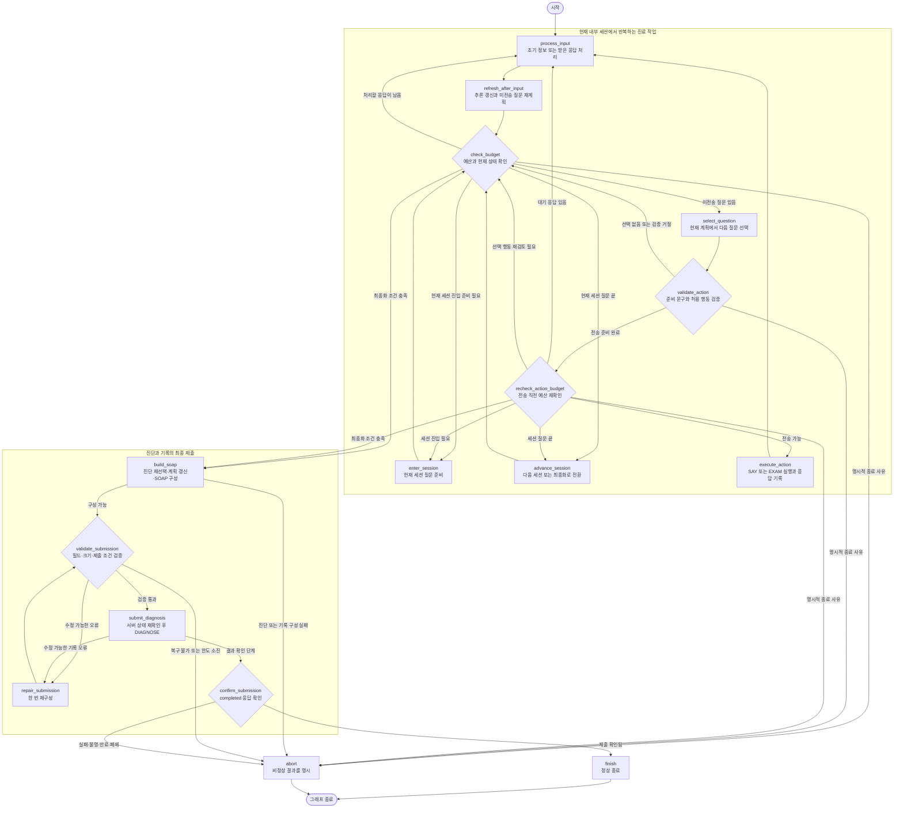

한 번의 대화는 `select_question → validate_action → recheck_action_budget → execute_action → process_input → refresh_after_input` 순으로 돈다. 질문의 문구를 먼저 확인하고, 전송 시점의 예산까지 확보한 뒤 환자에게 전달한다. 답을 받으면 새 사실을 기존 기록에 반영하고 후보와 미전송 질문을 다시 살핀다. 행동 사용량은 그래프의 이동 횟수와 구분하며, 서버가 알려 준 SAY·EXAM의 남은 턴 변화를 반영한다.

`check_budget`의 이동 우선순위는 **명시적 종료 → 대기 응답 처리 → 최종화 → 세션 진입 → 질문 선택 또는 세션 전환**이다. 이미 받아 둔 응답은 최종화보다 먼저 처리하므로 마지막 답을 기록에서 잃지 않는다. 시간이 부족해지거나 행동·모델 예산이 소진되면 남은 문진을 줄이고 확보한 사실로 최종화한다. 기한이 이미 끝난 경우에는 만료로 종료한다.

`advance_session`은 현재 세션을 초기화했고, 대기 응답과 미전송 질문이 없을 때 다음 단계로 이동한다. 주호소나 후보가 불분명하면 허용된 명료화를 준비하고 현재 단계에서 다시 확인할 수 있다. 세션을 다섯 번 새로 열거나 이전 세션으로 자동 되돌아가는 방식은 아니다.

마지막의 `END`는 그래프 실행이 끝났다는 뜻이다. 성공은 `confirm_submission`이 DIAGNOSE 응답의 `completed`를 확인하여 `submitted`로 기록했을 때만 성립한다. 수정 가능한 SOAP 오류에는 전체 흐름에서 한 번의 재구성을 허용하며, 복구할 수 없는 실패와 결과 불명은 각각 명시한다.

각 노드는 상태를 깊은 복사한 뒤 작업하고 Pydantic으로 다시 검증한다. 환자 사실·예산·질문·전달 이력이 정의된 경계를 유지하는지 확인하는 장치이며, 임상적으로 올바른 진단을 보증하는 절차는 아니다.

<a id="session-pipelines"></a>

## 2. 세션별 파이프라인

아래 도식은 한 내부 세션의 준비·반복·종료를 풀어 쓴 것이다. 도식의 “공통 실행 루프”는 앞의 질문 선택, Doctor 검증·전송, InputInterpreter 응답 처리, 추론 갱신을 묶어 표현한다. 별도의 LangGraph나 세션별 실행 클래스를 추가한 것은 아니다.

### 2.1 Initiation — 진료 시작과 주호소 확보

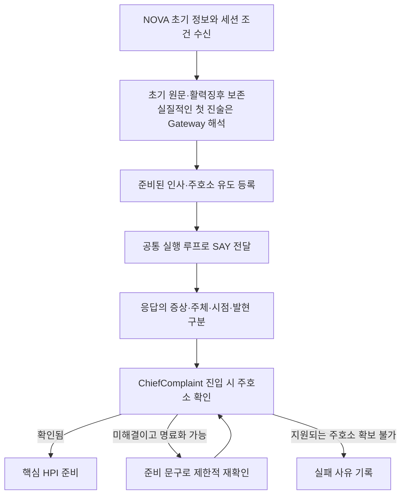

진료의 첫 환자 행동은 “안녕하세요. 무엇이 어떻게 불편하세요?”라는 SAY다. 초기 정보에 증상이 적혀 있어도 인사와 주호소 유도는 수행한다. 초기 활력징후는 제공된 사실로 따로 보존하고, 환자의 말에서 얻은 증상과 혼동하지 않는다.

초기 `opening`에 실질적인 진술이 있으면 이를 먼저 지정 모델로 해석한다. 초기 진술이 비어 있으면 인사 후 처음 받은 실질적인 답이 그 대상이 된다. 이후 단계에서 주호소를 확보하지 못했을 때는 증례 전체 두 번의 명료화 범위에서 확인하며, 지원되는 주호소가 끝내 없으면 임의 진단으로 채우지 않는다.

### 2.2 ChiefComplaint — 핵심 HPI, 열린 질문, 집중 ROS

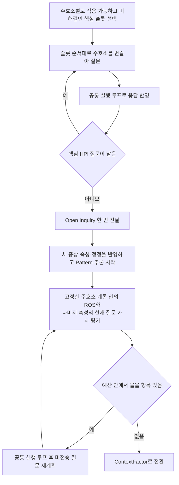

HPI는 현재 불편의 구체적인 모습이다. 먼저 **Location → Laterality → PainQuality 또는 Quality → TimeSinceOnset → EpisodeDuration → Severity** 순으로 적용 가능한 미해결 항목을 확인한다. 주호소가 두 개라면 첫 증상의 모든 항목을 끝낸 뒤 둘째로 가는 대신, 위치를 각각 확인하고 다음 속성으로 넘어가는 식이다. 환자가 이미 명확하게 말했거나 해당 증상에 적용되지 않는 항목은 건너뛴다.

`TimeSinceOnset`은 시작한 뒤 지금까지의 시간이고 `EpisodeDuration`은 한 번의 발현이 지속되는 시간이다. “한 달 전 시작했고 한 번에 10분씩 아프다”는 두 정보를 분리해서 남긴다. 월·년을 임의의 고정 일수로 바꾸지 않는다.

그다음 “그 밖에 불편한 증상이 있나요?”라는 Open Inquiry를 한 번 전달한다. 이 답까지 반영한 뒤 공유 Pattern 추론을 시작하고, 이후에는 집중 ROS와 미해결 세부 속성을 현재 가치에 따라 고른다. 집중 ROS는 관련 계통의 다른 증상을 확인하는 문진이며, 처음 확인한 주호소의 BodySystem 합집합 안에서 **총 여섯 번 이내**다. 새 ROS 증상으로 계통을 연쇄 확장하지 않고, BodySystem을 질환 검색 필터로 사용하지 않는다.

도식은 정상적으로 예산이 확보된 순서다. 공통 예산이 부족하면 일부 문진을 생략할 수 있으며, 생략·unknown·명시적 부재를 서로 다른 상태로 유지한다.

### 2.3 ContextFactor — 병력과 질환 연관의 적용 조건

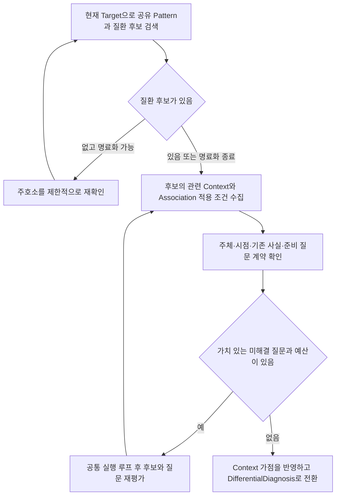

이 단계는 환자의 과거력·가족력·사회력 등 현재 후보를 판단하는 데 필요한 배경을 묻는다. 가족의 병력과 환자 본인의 병력, 과거와 현재를 구분하며, 승인된 지식에 연결된 내용만 질문 후보로 만든다. 관련 Context가 원천에 없으면 필수 병력 목록을 임의로 만들어 채우지 않는다.

질환과 Pattern의 연관에는 “어떤 배경 조건에서 이 연관이 적용되는가”라는 조건이 있을 수 있다. 이 조건을 모르면 Pattern 일부가 맞아도 해당 원천 지지를 확정하지 않는다. 적용 조건 확인과 별도의 Context 가점은 역할이 다르며, 다음 감별 단계로 넘어갈 때 Context 가점을 포함해 다시 평가한다.

후보가 없다는 이유만으로 즉시 종료하지 않는다. 허용된 명료화로 주호소를 보완하고, 이후에도 질환 진단 자격이 없으면 최종 진단 선택에서 확인된 주호소의 증상 수준 잠정진단을 검토한다. 물을 수 있는 Context가 없으면 이 세션은 추가 행동 없이 넘어갈 수 있다.

### 2.4 DifferentialDiagnosis — 판단을 바꿀 질문과 진찰


이 단계는 가능한 모든 질문을 소진하는 과정이 아니다. 답에 따라 후보의 순위가 달라질 가능성, 여러 조건을 함께 해소하는 데 필요한 질문 수, 현재 주호소와의 관련성을 Python으로 비교한다. 선두 후보에 아직 중요한 미해결 조건이 있으면 그 조건을 확인할 수 있다. 미전송 질문의 우선순위는 새 임상 사실이 들어올 때 바뀐다.

SAY로 속성을 물으려면 같은 관찰·에피소드에서 해당 증상이 있다는 사실이 확인되어야 한다. 일반 전달 질문은 반복하지 않으며, 답했지만 의미가 해결되지 않은 경우에만 공통 명료화 한도 안에서 재확인한다. EXAM은 승인된 소견·진찰 방법·준비 요청문이 있을 때 별도 획득 행동으로 실행한다. 거절이나 오류는 진찰 소견이 아니다.

Pattern은 관찰·에피소드별로 매칭하고, 질환별 Association의 적용 조건과 원천 가중치를 적용한다. 점수는 후보의 적합도이며 진단 확률이 아니다. 현재 단계의 질문과 대기 응답이 정리되면 Education으로 이동한다. 이후 교육 응답에서 새 사실을 얻어도 앞 세션으로 자동 회귀하지 않고 현재 상태에서 추론을 갱신한다.

### 2.5 Education — 설명, 이해 확인, 필요한 정정

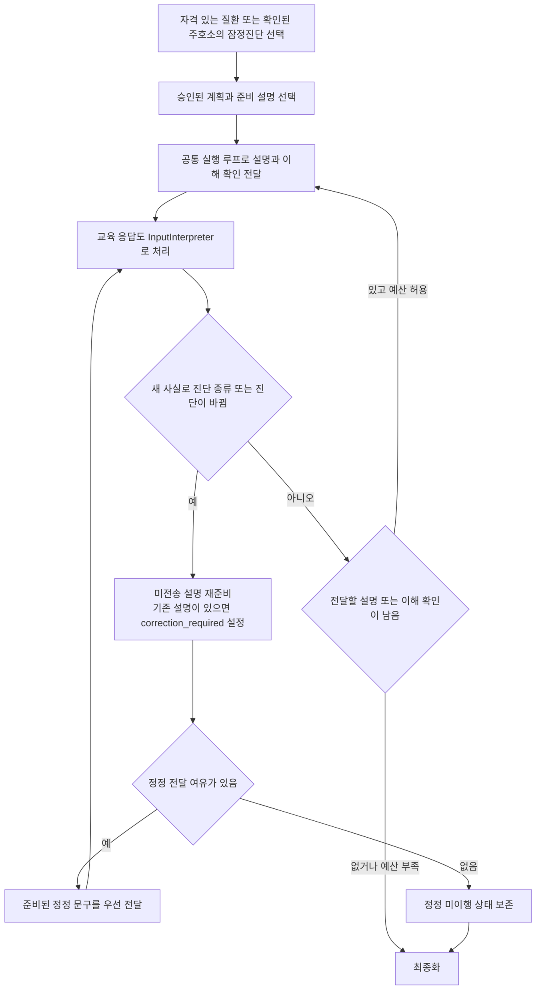

Education에 들어오면 현재 확보한 사실에서 진단을 선택한다. 양성 지지·양수 적합도·현재 주호소를 완전 매칭으로 설명하는 지지가 있는 질환이 대상이며, 적격 질환이 없으면 확인된 주호소의 증상 수준 잠정진단을 사용한다. 그 주호소조차 뒷받침되지 않으면 명시적으로 실패한다.

설명은 승인된 계획과 준비 문구에서 가져온다. 질환별 계획이 없으면 이를 누락으로 남기고 공통 잠정 안내를 사용한다. “원인을 아직 확정하지 못했다”는 설명이 특정 질환의 치료·추적 계획을 대신 생성하는 근거가 되지는 않는다. 문진 단계에서는 설명·이해 확인 두 턴과 정정 여유 한 턴을 보호한다.

환자가 “이해했어요. 그런데 아까 말씀드린 것과 달라요”처럼 답할 수도 있으므로 교육 응답도 입력 처리 대상으로 삼는다. 이미 설명한 뒤 진단이 바뀌면 `correction_required`를 설정하고 “새 답변으로 판단이 바뀌었습니다.”라는 준비 문구를 우선 전달한다. 이후 바뀐 판단에 맞는 승인 설명과 이해 확인을 준비한다. 턴·시간이 없으면 정정을 완료했다고 표시하지 않는다. 실제 전달 이력은 뒤의 파싱 실패나 재계획으로 지워지지 않는다.

### 2.6 최종화 — 확보한 사실을 제출하고 결과 확인

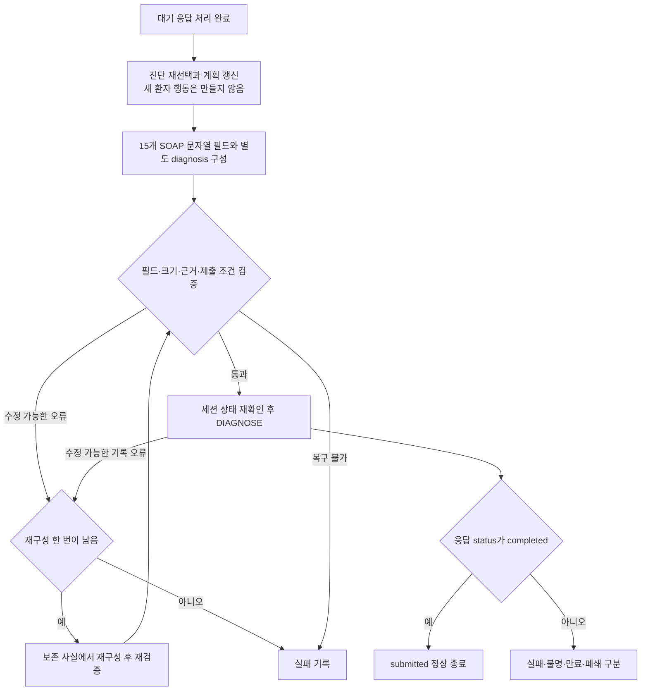

최종화는 여섯 번째 내부 세션이 아니라 제출 단계다. 최신 사실에서 진단을 다시 선택하고, 새 대화 없이 계획과 SOAP를 구성한다. S는 환자가 보고한 내용, O는 제공된 초기 정보와 실제 획득한 진찰, A는 판단에 사용한 근거와 감별, P는 승인된 계획과 교육을 담는다. 환자가 말한 진찰 결과를 실제 EXAM 결과처럼 바꾸거나 시행하지 않은 검사를 O에 넣지 않는다.

SOAP의 `S` 6개, `O` 2개, `A` 2개, `P` 5개 필드는 모두 문자열이며 주진단 `diagnosis`는 별도다. 예선의 `O.tests`는 비우고 계획 검사는 `P.tests`에 둔다. 로컬 검증 통과와 서버 수락은 다른 단계이며, 마지막 DIAGNOSE의 `completed` 응답을 확인해야 정상 종료한다.

## 누가 무엇을 담당하는가

| 코드와 주요 함수 | 책임 |
|---|---|
| [runtime.py](workflow/runtime.py)의 prepare·consult | 지식/설정 준비와 증례별 실행 객체·상태 조립 |
| [Consultation](workflow/consultation.py)의 enter_session·refresh_after_input·advance_session·finalize | 내부 세션 전환, 입력 뒤 추론·재계획, 최종화 |
| [Doctor](workflow/doctor.py)의 validate_action·execute_action | 준비 발화의 독립 검증, SAY/EXAM 전달과 응답 기록 |
| [InputInterpreter](workflow/input_interpreter.py)의 process_input·_request_parse·_apply_facts | 단축 답 처리, Gateway 호출, 사실별 검증·복구·반영 |
| [InterviewPlanner](workflow/interview_planner.py)의 prepare_chief_complaint·replan·select_question·prepare_education | 무엇을 언제 물을지와 어떤 준비 설명을 전달할지 결정 |
| [ClinicalReasoner](workflow/clinical_reasoner.py)의 refresh_hypotheses·select_diagnosis | 공유 Pattern 평가, Association 적용, 적합도와 진단 |
| [SubmissionWriter](workflow/submission_writer.py)의 build_soap·submit_diagnosis·confirm_submission | 기록 조립·검증·한 번의 재구성·확인된 제출 |
| [graph.py](workflow/graph.py)의 build_graph·run_node | 노드·분기와 기존 깊은 복사/검증 경계 |
| [rules](workflow/rules)의 BudgetPolicy·validate_facts | 순수 예산 판단과 외부 사실 경계 |
| [state](workflow/state)의 QuestionLifecycle·InteractionLifecycle·UsageAccounting | 질문·원문/전달·사용량 변경 연산 |

CaseState는 SOAP 사실과 진단, SessionContext는 현재 세션과 공통 예산, DifferentialState는 Pattern 진행·후보·증례 캐시, QuestionPlan은 미전송 질문과 재계획 개정, InteractionState는 실제 대화·모델 기록·파싱 격리·제출·설명 정정을 보관한다. 공유 PreparedResources에 환자 기억을 쌓지 않는다.

## Doctor와 준비된 질문

Doctor는 LLM을 호출하지 않는다. knowledge manifest의 질문 계약과 config의 고정 문구를 사용하고, 전달 직전 NFC 1–30자를 독립 확인한다. 공백·문장부호·줄바꿈도 센다. 생성 실패용 재시도나 문장 절단은 없다.

질문 계약에는 text, answer_type, affirmative, interviewable, reason이 있다. 대상 URI 또는 속성 URI가 키이며 대상|속성 예외가 우선한다. {symptom}은 실제 한국어 표시 이름으로 대입한 결과까지 prepare에서 검증한다.

원인을 전제하는 Target은 승인된 관찰 가능한 매핑 없이 직접 질문하지 않는다. 예를 들어 일반적인 두통에 대한 긍정을 “종양에 의한 두통”으로 연결하지 않는다. D18에서 이전 질문 배치와 승인을 철회했으므로 질문 수나 사용 가능 범위는 앞으로 수용하는 manifest와 질문 계약을 기준으로 확인한다. 준비 문구의 길이 검증과 임상 의미 검토는 각각 필요하다.

## Gateway의 문맥과 정보 보존

전체 실제 대화는 InteractionState에 남긴다. 모델 입력은 현재 응답·실제 질문·관련 관찰/에피소드와 필요한 원문 구간이다.

| 입력 영역 | 기본 | 한 번의 확장 |
|---|---:|---:|
| 과거 기록 | 24개 | 64개 |
| 과거 대화 | 6개 | 12개 |
| 과거 문맥 합계 | 16 KiB | 64 KiB |
| 어휘 | 256개·32 KiB | 1,024개·128 KiB |

현재 응답은 과거 문맥 한도 밖에서 온전히 처리한다. 문맥을 고를 때 현재 질문, 같은 관찰·에피소드, 원문에 나온 다른 증상, 정정의 원래 출처를 우선한다. 오래된 관련 원문도 선택할 수 있다. 모델은 제공된 기록·대화 ID만 참조할 수 있다.

첫 실질적인 환자 진술은 openai/gpt-6-luna로 해석한다. 이후에는 의미가 고정된 긍정형 존재 질문의 완전한 짧은 답, 명확한 기간·별칭, 단순 교육 확인만 규칙으로 처리한다. “아니요, 예전에는 있었어요” 같은 답은 전체를 Gateway로 보낸다.

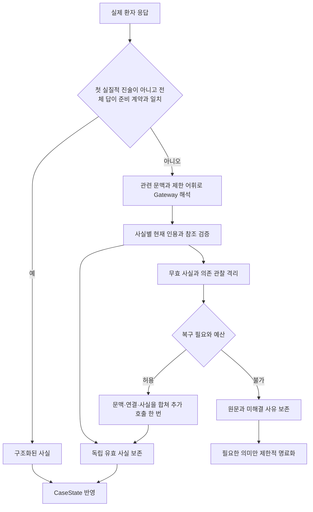

accepted_facts, rejected_facts, unresolved_links를 구분한다. 잘못된 사실 하나가 독립된 다른 증상까지 없애지 않는다. 무효 관찰의 종속 속성과 충돌 정정은 함께 보류한다. 복구가 실패해도 먼저 수용한 사실은 유지한다. 잘못된 JSON이나 진찰 거절에 무제한 확장을 하지 않는다.

## Pattern에서 질환으로

ClinicalReasoner는 관찰 Target의 공유 Pattern을 먼저 평가하고, 그 결과에 질환별 Association 조건과 가중치를 적용한다.

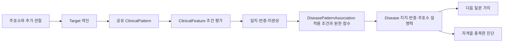

PatternMatch는 관찰·에피소드별로 일치/반증/미확인 조건과 근거 ID를 남긴다. 확정 반증은 미확인 조건에 가려지지 않는다. 같은 공유 Pattern을 각 질환에서 반복 매칭하지 않는다.

원천 지지는 모든 조건이 충족됐을 때 활성화한다. 구체적인 변형은 점수가 낮아져도 조상을 대체하므로 2→1→4가 2+1+4가 되지 않는다. 같은 Disease–Target은 한 번 집계하고 에피소드나 출처 수로 가산하지 않는다. 비교 불가능한 매칭이 여럿이면 기존 최대값과 조합 근거의 한계를 함께 기록한다.

D17 적합도는 원천 지지 + Context 가점 − 제한 반증이다. 적용 조건이 확인된 기본 존재 Pattern에서 같은 활성 주호소 에피소드의 명시적 부재만 typicality high=0.5, very_high=1로 반영한다. Target당 최대 1, 질환당 최대 2다. unknown·미질문·상세 불일치·다른 에피소드 부재는 감점하지 않는다. 원래 scoring_policy와 별도 reasoning_policy는 각각 manifest에 고정한다.

정렬은 적합도, 현재 주호소 설명 비율, 명시적 충돌 수, URI 순이다. 진단에는 양성 지지·양수 적합도·현재 주호소를 설명하는 완전 매칭이 필요하다. 자격이 없으면 확인된 주호소의 증상 수준 잠정진단을 사용한다. 지지와 적합도는 확률이 아니다.

공개 Target/Pattern/Association/Feature·별칭·refinement 색인은 지식 자원에 둔다. 환자 검색과 매칭은 증례 상태에만 둔다. 정정·관찰·에피소드·Context 모드 변화에 맞춰 재평가하며 임상 사실이 그대로인 교육 확인에서 전체 점수를 다시 계산하지 않는다.

## 적응형 질문과 예산

핵심 HPI와 Open Inquiry 뒤에는 새 근거에 따라 미전송 질문을 재계획한다. 가능한 답의 순위 변경, 후보 간 점수 변화의 차이, 공동 조건의 남은 질문 비용, 주호소 관련성과 typicality를 비교한다. 이는 결정론적 선택 휴리스틱이며 확률 기반 정보이득이 아니다.

질문 의미 키는 행동·Target·Attribute·주체·시간·관찰·에피소드다. 저우선순위로 제외한 미전송 질문은 새 임상 개정에서 돌아올 수 있다. 전달한 일반 질문은 반복하지 않는다. 부재 증상의 속성을 묻지 않으며 명료화는 증례 전체 최대 두 번이다.

행동은 공통 50턴 안에서 사용한다. 이전 1/20/10/14/5 상한은 없다. 교육·이해 확인 두 턴과 정정 한 턴을 보호하고 사용하지 않은 진료 턴을 다른 단계에서 쓸 수 있다. 턴을 모두 쓰는 것을 목표로 삼지 않는다.

새 행동 전 Gateway 한 호출과 출력 여유, 응답 처리 120초, 최종화 120초를 남긴다. 이미 받은 답은 응답 여유로 처리한다. 모델 한도는 증례 전체 200회·입력 500,000·출력 100,000토큰이며 실제 usage와 서버 제한을 반영한다.

## 설명·복구·제출

교육 계획은 전달 사실과 다르다. Doctor의 실제 정상 응답에서만 전달을 기록하며 이후 Gateway 실패로 지우지 않는다. 교육 중 판단이 바뀌면 correction_required를 설정하고 준비된 정정 문구를 먼저 전달한다. 여유가 없으면 미이행 상태를 남긴다.

D18에서 이전 임상 배치와 지침 기반 교육 초안을 삭제했다. D20은 새 그래프의 typed Context·ROS·필수 조건과 선택한 직접 진찰 경로를 수용한다. 질환별 계획과 행동 문구는 실제 수용한 자산만 사용하며, 공통 잠정 안내와 이해 확인은 config에 준비되어 있다. 그래프 승인과 문구 준비를 구분하고 누락 문구를 임의 생성하여 진료를 시작하지 않는다.

| 상황 | 처리 |
|---|---|
| 미해결 입력 | 유효 사실과 원문 보존, 필요한 의미에 제한적 명료화 |
| 일시 전송 오류 | 동일 요청 ID·payload를 2초·5초 뒤 최대 두 번 재전송 |
| 명시적 환자/진찰 응답 형식 오류 | 새 요청 ID로 한 번 재시도 |
| EXAM 거절 | 획득 소견으로 만들지 않음 |
| SOAP 오류 | 보존 사실에서 한 번 재구성 |
| 결과 불명·만료·폐쇄 | 명시적 비정상 종료 |
| DIAGNOSE completed | 정상 종료 |

SDK 1.0.1 원본은 바꾸지 않는다. SOAP는 정확히 15개 문자열 필드이며 diagnosis는 별도 인수다. O.tests는 비우고 계획 검사는 P.tests에 둔다. A.evidence는 실제 획득한 소견만 기록한다. 50번째 응답 뒤에도 마감 전 DIAGNOSE는 가능하다.

## 설정과 독립 ZIP

```dotenv
ONTOWARD_KNOWLEDGE_MANIFEST=knowledge/manifest.json
ONTOWARD_PARSER_PROMPT=config/input_parser.txt
ONTOWARD_TEXTS=config/texts.ko.json
```

공개 .env는 ZIP에 포함한다. 같은 환경변수가 우선하며 manifest는 knowledge, 프롬프트·문구는 config 안의 상대 경로여야 한다. 개발 키가 있는 root .env와 준비 data/assets는 런타임 입력이 아니다.

아래 명령은 오프라인 검증·패키징 절차다. 합성 워크플로우와 D20 실제 그래프의 영어 테스트 문구 기반 상담은 별도로 검증한다. `test_admitted.py`의 준비 자산 상담은 한국어 행동 문구까지 수용한 뒤 실행한다. 현재 그래프 전용 ZIP은 독립 추출·그래프 로드와 문구 미완료의 명시적 거부를 확인한다.

```sh
docker compose -f compose.yaml -f Dev/tests/workflow/compose.offline.yaml run --rm --no-deps --pull never -T dev python -B Dev/tests/workflow/test_workflow.py
docker compose -f compose.yaml -f Dev/tests/workflow/compose.offline.yaml run --rm --no-deps --pull never -T dev python -B Dev/tests/ontology/verify_connections.py /workspace/data/preparation/v5/competition-graph-2026-10-16
docker compose build package
docker compose run --rm -T package
```

ZIP은 실행 Python·고정 requirements·공개 .env·지정 config·필요 지식만 포함한다. README·AGENTS·운영 상태·테스트·합성 자료·캐시는 제외한다. 코드/합성 검증, 승인 RDF와 스크립트 환자의 실행, 독립 ZIP 실행, 실제 Luna·공식 API·임상 성능은 각각 다른 증거다.

`test_admitted.py`의 `--candidate /workspace/data/preparation/v5/source-only-2026-10-16/build`는 새 후보의 격리 상담 검증이다. 전체 한국어 자산의 생성·의미 대조가 끝난 경우만 준비 자원에 주입하고 실제 manifest의 승인 경계를 변경하지 않는다. 미완료면 상담 실행을 `not_run`으로 기록한다.

<a id="runtime-dialogue"></a>

## 3. 실행 환경에서의 대화별 흐름

이 절은 새 지식과 문구를 수용한 제출물이 실행될 때의 동작을 시간순으로 설명한다. 앞의 그래프는 “프로그램이 어디로 이동하는가”, 세션 도식은 “각 단계에서 무엇을 확인하는가”를 보여 주었다. 여기서는 “실행기가 시작한 뒤 어떤 요청과 답이 오가는가”를 따라간다. **환자 발언 예시는 이해를 위한 가상 대화이며 실행 로그나 새 임상 자산이 아니다.**

### 3.1 시작 준비 — 환자 접근 전에 지식과 문구 확인

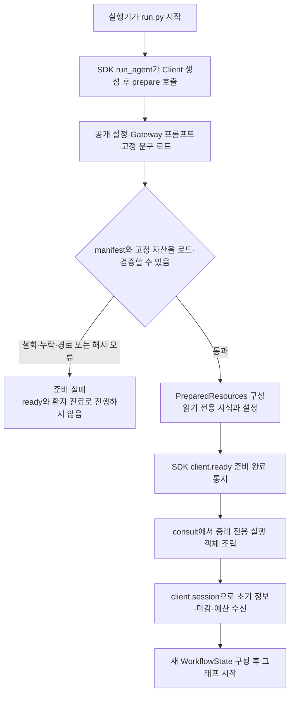

[run.py](run.py)는 SDK에 `prepare`와 `consult`를 전달하는 얇은 진입점이다. `prepare()`에서는 환자를 보지 않고 사용할 설정과 지식의 파일 경계·해시·문구 계약을 확인한다. 지식은 하나의 RDFLib Graph로 읽으며 환자의 관찰을 그 Graph에 쓰지 않는다. 이 단계에서 실패하면 준비 완료 통지를 보내거나 빈 지식으로 계속하지 않는다.

준비가 끝나면 SDK가 `client.ready()`를 호출하고 `consult(client, resources)`로 들어간다. `consult`는 Doctor·입력 해석·질문 계획·추론·제출 객체와 증례별 상태를 새로 만든다. `client.session()`에서 받은 초기 정보, 마감 시각, 남은 턴, 허용 행동과 서버 예산을 사용한다. 준비 지식과 설정에 이전 환자의 대화나 후보를 쌓지 않는다.

### 3.2 대화 한 번 — 선택부터 응답 반영까지

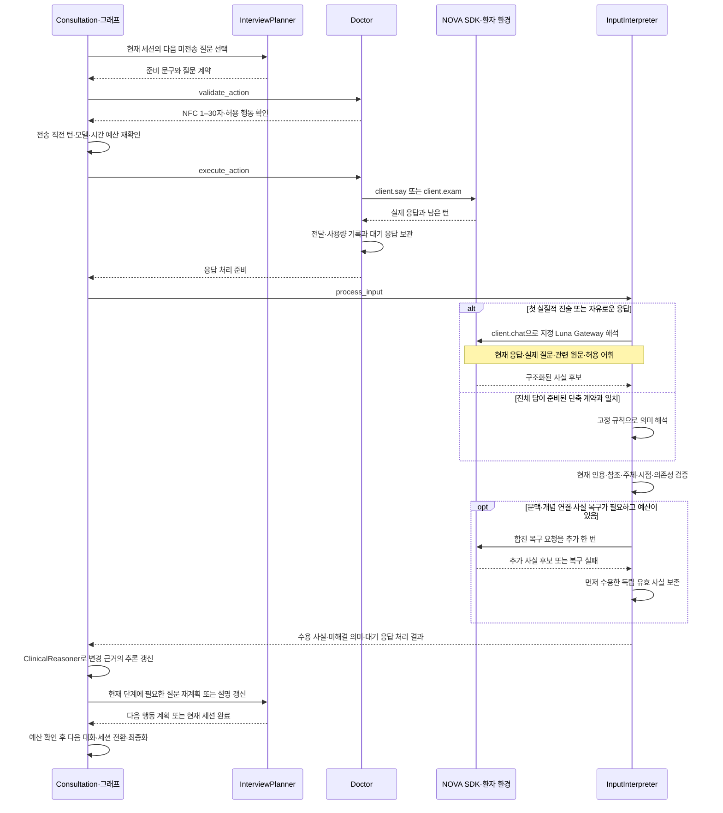

환자에게 보이는 한 번의 질문 뒤에는 **문구 검증 → 실제 전송 → 원문 보존 → 사실 해석 → 추론 갱신 → 다음 질문 재계획**이 이어진다. Doctor는 문장을 생성하거나 진단을 선택하지 않는다. 지정 모델도 다음 행동을 고르는 대신 실제 응답의 의미를 해석한다. 위 도식의 `client.chat()`은 같은 NOVA SDK를 통한 Gateway 호출이다.

“네”처럼 짧은 답이라도 무엇에 동의했는지가 질문 계약으로 완전히 정해질 때만 고정 규칙으로 처리한다. “아니요, 작년에는 있었어요”는 현재 부재와 과거 존재를 함께 말하므로 전체 응답을 Gateway로 보낸다. 한 응답의 사실 일부가 잘못됐을 때 독립된 다른 유효 사실까지 지우지 않는다. 복구용 추가 호출은 응답당 최대 한 번이며 일반 문진·교육과 같은 증례 예산을 공유한다.

실제 전송이 성공한 뒤에만 전달 이력을 만든다. 질문 후보에만 있었던 문구, 거절된 초안, 전송 오류는 환자와 나눈 대화가 아니다. 다음 질문은 마지막 응답을 처리한 뒤 선택하므로, 앞서 만든 질문 목록을 환자의 답과 무관하게 끝까지 읽지 않는다. 핵심 HPI까지는 준비한 순서를 따르고, Open Inquiry 뒤의 문진은 새 근거로 재계획한다. Education에서는 진단 변경을 확인하여 필요한 설명과 정정을 갱신한다.

### 3.3 첫 인사부터 제출까지 따라가는 예시

아래에서 `Python 진료 흐름`은 Consultation·InterviewPlanner·ClinicalReasoner·SubmissionWriter의 협력을 묶은 표현이다. `NOVA 환경`은 SDK가 연결하는 환자 응답·진찰·제출 인터페이스다. 초기 `opening`에 실질적인 진술이 없고 인사 후 “배가 아파요”라는 첫 답을 받는 경우를 가정한다. HPI·ROS·병력·진찰 문구는 새 배치에서 실제 승인된 질문을 사용한다고 표시했다.

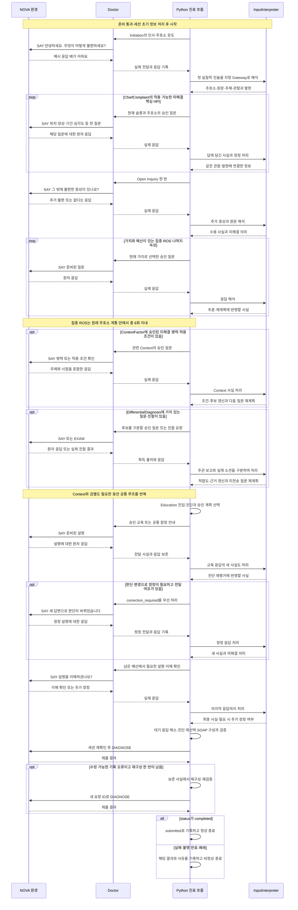

첫 인사에 “배가 아파요”라는 답을 받았다고 바로 특정 질환을 정하지 않는다. 복통이라는 주호소를 원문과 연결한 뒤 위치·시간·양상처럼 아직 모르는 정보를 묻고, 열린 질문으로 추가 불편을 확인한다. 이후에는 그때까지의 사실이 공유 Pattern과 어떻게 맞는지에 따라 다음 질문이 달라진다. 이 예시가 특정 질환이나 고정된 질문 순서를 임상 자산으로 추가하는 것은 아니다.

ContextFactor와 DifferentialDiagnosis는 새로운 공식 세션을 만드는 시점이 아니다. 같은 환자의 기존 사실·대화·남은 예산을 이어받아 질문의 목적만 바뀐다. 승인된 Context나 진찰 연결이 없거나 물을 가치가 없으면 해당 행동을 생략한다. 반대로 질문이 필요하면 같은 단계의 공통 루프를 여러 번 반복한다.

설명 후의 대화도 마지막까지 입력으로 처리한다. 위 도식은 정정 한 번과 이해 확인을 보여 주지만, 실제 코드는 새 답마다 판단 변경과 전달 여유를 다시 확인한다. 준비된 설명을 전부 끝내지 못한 경우에는 그 이행 상태를 남기고, 이미 확보한 사실로 최종 기록을 구성한다. 최종화는 별도의 환자 대화를 생성하지 않는다.

### 3.4 대화 수와 예산을 해석하는 방법

| 흐름 | 실제 대화 수를 결정하는 것 | 다음 단계로 남기는 것 |
|---|---|---|
| 인사·주호소 유도 | 준비된 첫 SAY, 필요한 제한적 명료화 | 확인된 주호소와 초기 정보 |
| 핵심 HPI | 주호소 수, 적용 가능한 미해결 슬롯 | 관찰·발현별 속성과 원문 |
| Open Inquiry·집중 ROS | Open Inquiry 한 번, 현재 가치에 따른 ROS 총 여섯 번 이내 | 추가 증상·명시적 부재·미해결 정보 |
| Context·감별 | 승인 질문·진찰 연결, 현재 질문 가치와 남은 예산 | 적용 조건·실제 소견·진단 근거 |
| 설명·이해·정정 | 승인 설명, 환자의 새 사실, 보호한 턴과 남은 시간 | 실제 전달·이해 확인·정정 이행 상태 |
| SOAP·DIAGNOSE | 검증 결과와 전체 한 번의 재구성 한도 | 서버 결과와 확인된 종료 상태 |

루프 안에서 실행한 SAY·EXAM의 서버 턴 변화가 실제 행동 사용량이다. 공통 상한 50턴 안에서 서버가 알려 준 남은 턴을 따르며, 예를 들어 “10번째 대화부터 ContextFactor”처럼 세션 경계를 고정하지 않는다. 그래프 노드 수, SAY·EXAM 행동 수, Gateway 호출 수는 각각 구분하고 DIAGNOSE는 환자에게 질문하는 행동과 별도로 처리한다. 마지막 행동 응답까지 처리한 뒤 마감 전에 제출한다.

새 SAY·EXAM 전에 Gateway 한 호출과 출력 여유, 응답 처리 120초, 최종화 120초를 확보한다. 기한·모델·행동 예산이 부족하면 문진을 계속 늘리는 대신 최종화로 이동한다. 이 절의 순서는 그 조건을 충족했을 때의 실행 계획이며, Mermaid 원문의 시각 렌더링·실제 Luna 호출·공식 진료 실행·임상 성능은 별도 검증 대상이다.
