# Ontoward 진료 워크플로우 백서

이 문서는 **2026-10-17의 D38 대표 CC·공유 추론·질문 선택과 D34·D36·D37 흐름**을 기준으로 진료 순서·추론·질문 선택·교육·제출을 설명한다. 코드와 수용 지식·정책을 설명의 기준으로 삼으며 사용자 선택은 [결정 문서](../DECISION_STATE.md), 수행된 검증과 남은 경계는 [제출 상태](PROJECT_STATE.md)가 소유한다. 과거 스냅샷과 현재 D38 결과는 각각의 증빙으로 구분한다.

핵심 흐름은 **준비 질문 선택 → Doctor 검증·전달 → 실제 응답 보존 → Gateway 구조화 → Python 추론·다음 질문 → 진단 고정 → 가이드라인·전체 대화 기반 영어 P → Doctor 한국어 전달 → SOAP·진단 제출**이다. Python이 진단을 결정하며 모델은 해석·기록용 표현·공감과 D37 계획·한국어 변환을 맡는다. 진단 추론은 수용된 읽기 전용 RDF를 사용하고 교육은 별도 원문 마운트를 읽는다.

| 현재 동작을 정한 결정 | 백서에서 확인할 내용 |
|---|---|
| D08·D38 | 공유 Pattern·조건부 원천 지지, 대표 CC, 보강 상한, 실제 추론 기반 질문 선택 |
| D13·D14·D15 | 책임·상태 소유권, 제출 내부 자산, 원문·관찰·SOAP 정보 보존 |
| D20·D22·D23 | 원천 그래프 연결과 한국어 환자 행동의 수용 |
| D26 | 명시적 Education 비활성화 우회와 Context·진단 자격 보완; 현재 기본 교육은 D37 |
| D28 | Gateway 전체 요청 크기 제한과 더 작은 요청으로 한 번 복구 |
| D29 | 증례별 규칙 없이 기존 Symptom 하나를 고르는 주호소 매핑 |
| D30·D37 | 질환별 원문 연결, manifest 인덱스, 진단 고정 후 영어 계획·한국어 교육 |
| D33 | 영어 용어·키워드와 `Category: Content` 기반 초진 기록 |
| D34 | 질문 범주 어휘 바인딩·기록용 의학 표현·전 세션 공감 SAY |
| D35 | 세션 문진 목표·상한, 질문 가치에 따른 종료, 공감 공유 예산과 1회 재전송 |
| D36 | 최종 저장 필드·취득 경로 검증, 공통 현재 근거, 철회·충돌 처리와 미구조화 환자 보고 보존 |

**현재 제출 설정(D37):** `ONTOWARD_EDUCATION_ENABLED=true`이다. 앞선 수집에서 5턴을 보호하고 Education은 남은 공통 턴 안에서 계획을 전달한다. 진단 종류·Disease ID·진단명을 고정하고, 이후 환자 진술은 보존하되 재진단·계획 재생성은 하지 않는다. 명시적 false는 교육 행동·보호 턴 없이 우회하고 P.education을 비운다.

**실행 전제:** D23에서 D20 그래프와 D22의 한국어 환자 행동을 함께 실행 수용했다. 현재 [지식 manifest](knowledge/manifest.json)는 `admitted`이며 `prepare()`가 문진·진찰 문구까지 검증한다. D18의 철회와 D20의 `graph_admitted_text_pending`은 이전 준비 단계이고, 현재 실행 자산을 다시 승인 대기 상태로 해석하지 않는다. 원래 영수증은 [문구 수용 결과](../data/preparation/v5/runtime-text-2026-10-16/README.md)에, D28·D29의 오프라인 검증과 한계는 [문맥 복구 증빙](../data/provenance/context-limit-2026-10-17.json)과 [주호소 매핑 증빙](../data/provenance/chief-mapping-2026-10-17.json)에 연결되어 있다. 이 백서의 개정은 실제 모델·공식 서버 재검증을 수행했다는 뜻이 아니다.

원하는 관점부터 읽어도 된다.

- [전체 그래프와 분기](#workflow-graph)
- [다섯 세션과 최종화의 세부 파이프라인](#session-pipelines)
- [역할과 환자 상태의 읽는 법](#roles-and-state)
- [주호소 매핑·Gateway 검증·복구](#gateway)
- [추론 알고리즘과 점수 계산 예제](#reasoning)
- [다음 질문을 고르는 알고리즘](#question-selection)
- [예산·오류 복구·제출 의미](#budgets-and-submission)
- [설정·검증·제출 ZIP](#configuration)
- [실행 시작과 실제 대화 순서로 보는 흐름](#runtime-dialogue)
- [수정할 책임과 확인할 경계](#change-guide)

전체 흐름을 먼저 알고 싶다면 1·2·9절을, 판단 방식을 검토하려면 3절의 상태 구분을 읽은 뒤 4·5·6절을 이어 읽으면 된다. 아래의 숫자 예제와 가상 대화는 알고리즘 설명용이며 새 임상 지식이나 실제 진료 결과를 추가하지 않는다.

<a id="workflow-graph"></a>

## 1. 전체 그래프 워크플로우

### 그래프와 내부 세션을 함께 읽는 방법

하나의 공식 NOVA 세션 안에 다섯 내부 세션이 있다. `Consultation` 하나가 순서를 조정하며 D35의 조건부 최소 목표와 세션별 문진 상한을 적용한다. 내부 세션은 “지금 무엇을 확인하는가”를 나타내고, 그래프 노드는 “응답 처리·질문 선택·전송 중 어떤 작업을 하는가”를 나타낸다. 세션이 바뀌어도 같은 질문·응답 루프를 사용하고 유용한 질문이 없으면 목표 전에 종료한다.

| 내부 세션 | 하는 일 |
|---|---|
| Initiation | 초기 정보와 활력징후를 보존하고 인사·주호소 유도를 전달 |
| ChiefComplaint | 대표 CC 하나의 전체 속성, Open Inquiry 한 번, 유용한 ROS·선택적 추가 상세 |
| ContextFactor | 현재 후보의 관련 병력·적용 조건을 확인 |
| DifferentialDiagnosis | 현재 근거에서 가치 있는 특징·진찰을 선택하고 새 답에 따라 재계획 |
| Education | 진단 고정·가이드라인 원문·영어 P 생성·한국어 변환·실제 SAY 전달 |
| 최종화 | 확보 사실로 SOAP를 만들고 DIAGNOSE의 completed를 확인 |

### 현재 LangGraph의 노드와 분기

아래 이름은 [graph.py](workflow/graph.py)의 실제 노드 이름이다. 사각형은 작업, 마름모는 작업 후 상태에 따라 이동할 곳이 달라지는 지점이다. `check_budget`은 세션과 공통 자원을 판단하고 `execute_action` 내부에서 전송 직전 경량 검사를 수행한다.

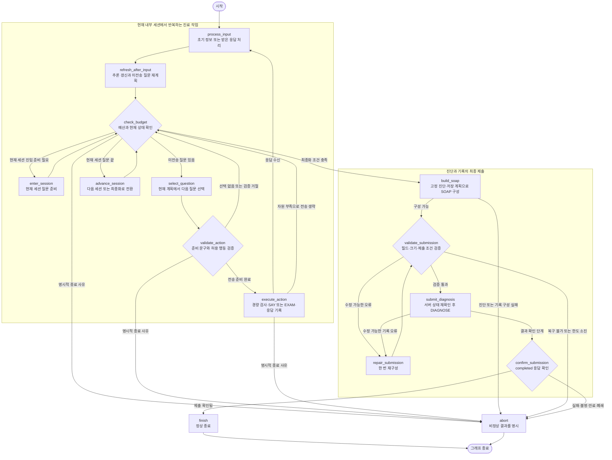

한 번의 대화는 `select_question → validate_action → execute_action → process_input → refresh_after_input` 순으로 돈다. 문구를 확인한 뒤 행동 종류별 남은 용량·모델·시간을 경량 검사하고 전달한다. 답을 받으면 새 사실과 미전송 질문을 갱신한다. 행동 사용량은 그래프 이동과 구분하며 서버가 알려 준 SAY·EXAM의 남은 턴 변화를 반영한다.

`check_budget`의 이동 우선순위는 **명시적 종료 → 최종화 → 세션 진입 → 질문 선택 또는 세션 전환**이다. 동기 실행은 응답 수신 직후 해석을 완료하므로 예산 검사에서 pending 복구로 돌아가지 않는다. 세션 문진 상한은 다음 세션으로 이동하는 조건이고 공통 행동·모델·시간 부족은 최종화 조건이다. 마지막 응답도 처리한 뒤 판단하며 기한이 이미 끝나면 만료로 종료한다.

`advance_session`은 현재 세션을 초기화했고, 대기 응답과 미전송 질문이 없을 때 다음 단계로 이동한다. 대표 CC를 확인하지 못하면 허용된 명료화 안에서 확인하며 임의의 첫 증상을 고르지 않는다. 확인된 대표 CC에 적격 Disease가 없으면 증상 진단으로 진행한다. 세션을 다섯 번 새로 열거나 이전 세션으로 자동 되돌아가는 방식은 아니다.

마지막의 `END`는 그래프 실행이 끝났다는 뜻이다. 성공은 `confirm_submission`이 DIAGNOSE 응답의 `completed`를 확인하여 `submitted`로 기록했을 때만 성립한다. 수정 가능한 SOAP 오류에는 전체 흐름에서 한 번의 재구성을 허용하며, 복구할 수 없는 실패와 결과 불명은 각각 명시한다.

각 노드는 상태를 깊은 복사한 뒤 작업하고 Pydantic으로 다시 검증한다. 환자 사실·예산·질문·전달 이력이 정의된 경계를 유지하는지 확인하는 장치이며, 임상적으로 올바른 진단을 보증하는 절차는 아니다.

<a id="session-pipelines"></a>

## 2. 세션별 파이프라인

아래 도식은 한 내부 세션의 준비·반복·종료를 풀어 쓴 것이다. 도식의 “공통 실행 루프”는 앞의 질문 선택, Doctor 검증·전송, InputInterpreter 응답 처리, 추론 갱신을 묶어 표현한다. 별도의 LangGraph나 세션별 실행 클래스를 추가한 것은 아니다.

### 2.1 Initiation — 진료 시작과 주호소 확보

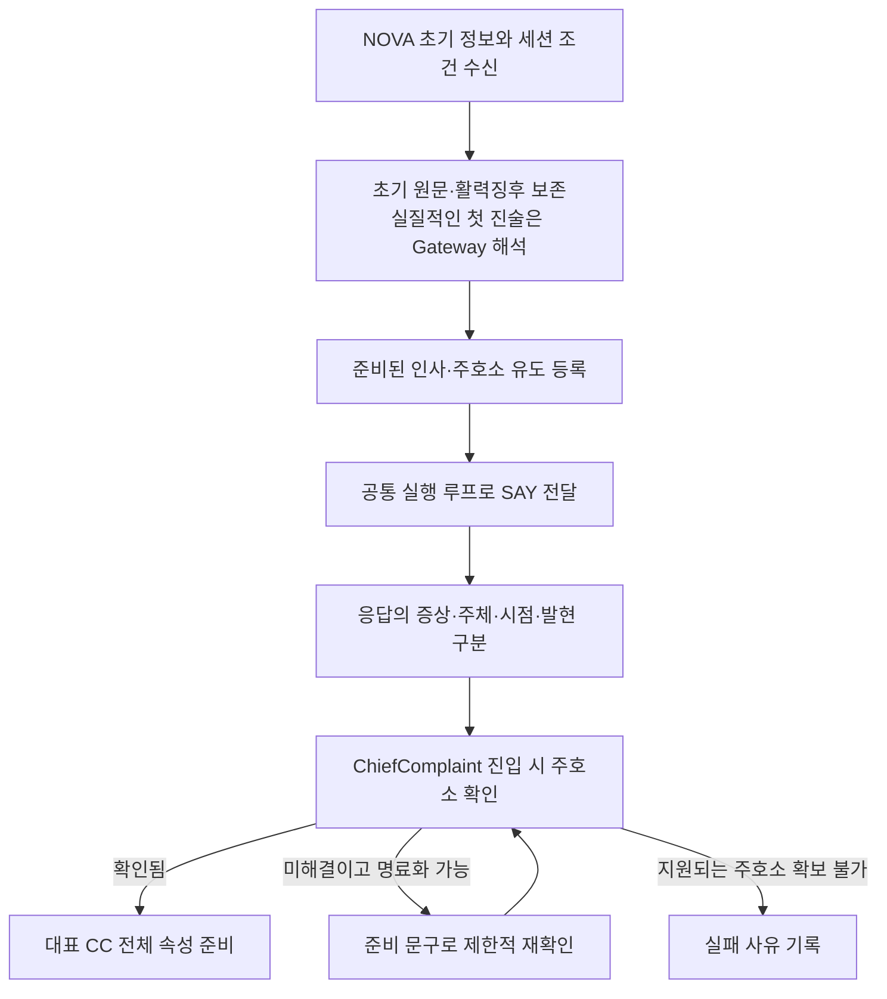

진료의 첫 환자 행동은 “안녕하세요. 무엇이 어떻게 불편하세요?”라는 SAY다. 초기 정보에 증상이 적혀 있어도 인사와 주호소 유도는 수행한다. 초기 활력징후는 제공된 사실로 따로 보존하고, 환자의 말에서 얻은 증상과 혼동하지 않는다.

초기 `opening`에 실질적인 진술이 있으면 이를 먼저 지정 모델로 해석한다. 초기 진술이 비어 있으면 인사 후 처음 받은 실질적인 답이 그 대상이 된다. 이후 단계에서 주호소를 확보하지 못했을 때는 증례 전체 두 번의 명료화 범위에서 확인하며, 지원되는 주호소가 끝내 없으면 임의 진단으로 채우지 않는다.

D29에서는 현재 주호소마다 기존 Symptom 중 가장 적합한 하나를 선택하도록 Gateway에 요구한다. 원천의 한국어·영어 라벨과 동의어를 함께 보고 더 넓은 관찰 가능한 증상도 검토한다. 매핑 품질은 exact·broader·ambiguous·unmapped로 따로 남기며 임상 존재 status와 구분한다. 양립하는 넓은 매핑은 분명한 존재를 불확실하게 바꾸지 않는다. 초기 후보로 부족하면 최대 8개의 증상 검색어로 전체 원천 색인을 다시 검색하고, 추가 1회 안에서 제공된 단일 ID를 선택한다. Python은 타입·ID 개수·인용·주체·시점과 보고하지 않은 진단 한정어를 검증한다. 증례별 매처나 임상 동의어 표는 두지 않는다.

### 2.2 ChiefComplaint — 대표 CC 전체 속성, 열린 질문, 집중 ROS

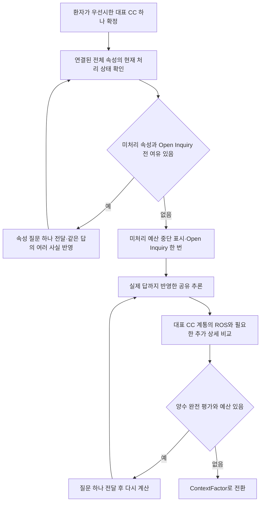

여러 증상이 보고되어도 **대표 CC 하나만** 전수 기술한다. 환자의 명시적 우선순위를 따르고 모호하면 기존 증례 전체 2회 명료화 안에서 확인한다. 결정하지 못하면 primary_chief_unresolved로 종료한다. 다른 증상과 원문은 추가 근거로 남는다.

고정 여섯 슬롯 대신 get_symptom_attributes()의 전체 목록을 사용한다. 기존 속성 순서 뒤 목록 밖 항목은 URI 순서로 둔다. 각 속성은 미질문·값 확보·모름·명시적 적용 불가·질문 자산 차단·예산 중단으로 관리한다. 같은 관찰에서 확보한 값은 건너뛰고 모름도 처리 결과로 인정한다. 처리율과 실제 값 확보율은 서로 다른 지표다. 현재 수용 그래프는 CC당 최대 11개 속성이며 진단 한정 개념의 13개 차단 쌍은 기존 이유를 유지한다.

TimeSinceOnset은 시작 후 경과, EpisodeDuration은 한 번의 발현 지속 시간이다. 월·년을 고정 일수로 환산하지 않으며 한 답변에서 여러 속성을 함께 얻을 수 있다. 마지막 가용 문진 슬롯은 Open Inquiry에 남기고 예산 때문에 못 물은 속성을 값 확보로 표시하지 않는다.

Open Inquiry의 답까지 반영한 뒤 선택적 문진을 시작한다. ROS는 대표 CC의 원래 BodySystem 안에서 최대 여섯 번이며 새 증상으로 계통을 늘리지 않는다. 추가 증상은 필요한 상세 하나를 다시 선택할 수 있으나 전체 속성 큐를 만들지 않는다. 대표 CC 정정은 속성·후보·ROS 기준을 재구성하며 전달 이력과 이미 수행한 Open Inquiry를 보존한다.

### 2.3 ContextFactor — 배경 지지와 Association 적용 조건

현재 후보의 미확인 Context 전제와 지지 Context를 실제 가능한 답변으로 비교한다. 환자 본인·가족, current·past·unspecified를 구분한다. 거짓 전제는 해당 연결의 가치를 없애며 모르는 전제는 선행 질문으로 둔다. 적용 조건은 원천 지지의 문턱이고 별도의 양성 Context 보강은 최대 1점이다. Context 보강은 확보한 시점부터 모든 세션에서 동일하게 계산한다.

더 가치 있는 증상·속성·EXAM이 나오면 추가 Context 행동 없이 감별 단계로 간다. 필요한 Context는 감별에서도 같은 선택기로 비교한다. 확인된 CC에 Disease 후보가 없다는 이유만으로 자동 명료화를 소비하지 않는다. 적격 Disease가 끝내 없으면 대표 CC의 증상 수준 잠정진단을 사용한다.

### 2.4 DifferentialDiagnosis — 판단을 바꿀 질문과 진찰

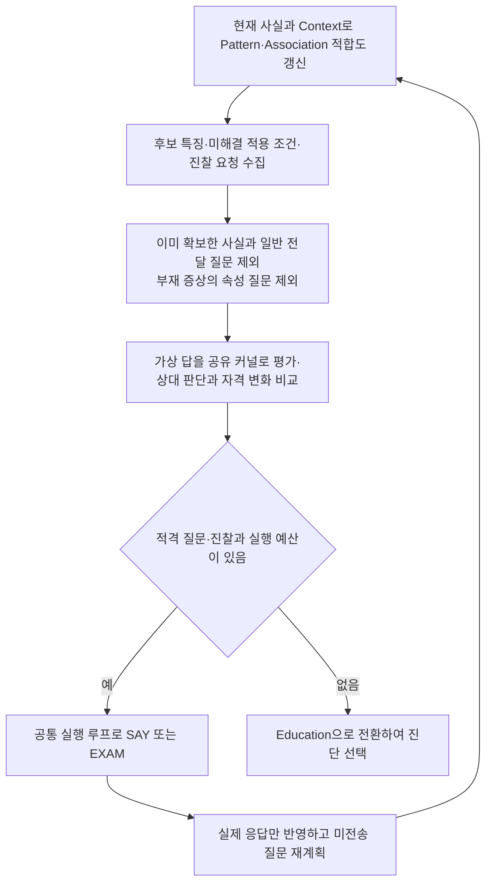

이 단계는 증상 존재·필요한 속성·Context·EXAM을 같은 계산기로 비교한다. 완전히 계산한 양수 구조적 판별 가치 질문만 전달한다. 임상 근거·질문 이력·모름·대표 CC·세션·예산이 바뀌면 다시 계산한다. 계산 한계와 유용한 질문 없음은 다른 사유이며 어느 쪽도 임상 확신도나 정보수집 최적성의 보증은 아니다.

SAY로 속성을 물으려면 같은 주체·관찰·에피소드·시점에서 해당 증상이 있다는 사실이 확인되어야 한다. 일반 전달 질문은 반복하지 않으며, 명시적 모름은 반복하지 않고 바인딩 실패의 명료화는 신규 질문과 같은 비용으로 비교한다. EXAM은 승인된 소견·진찰 방법·준비 요청문이 있을 때 별도 획득 행동으로 실행한다. 거절이나 오류는 진찰 소견이 아니다.

Pattern은 관찰·에피소드별로 매칭하고 질환별 Association의 조건·가중치를 적용한다. 점수는 적합도이며 확률이 아니다. 감별 질문과 응답 처리를 마치면 Education에 진입하며 이때 선택한 진단을 고정한다. 교육 응답은 원문과 사실로 보존하지만 점수·진단·계획을 다시 선택하지 않는다.

### 2.5 Education — 고정 진단의 계획과 한국어 안내

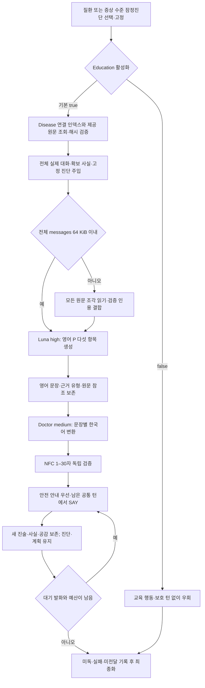

대표 CC의 양성 지지·적용 조건·양수 적합도 자격을 만족하는 질환을 선택하고 진단 종류·Disease ID·진단명을 고정한다. 적격 Disease가 없으면 확인된 주호소의 증상 진단을 고정하며 질환 문서 조회 없이 원인 미확정 상태에 맞는 계획을 생성한다. 뒷받침된 주호소도 없으면 기존 명시적 실패를 유지한다.

문서 연결은 [런타임 인덱스](knowledge/guideline-index.json)가 소유한다. 원문은 `NOVA_GUIDELINES_DIR` 기본 `/opt/nova/guidelines`에 상대 경로를 결합해 읽고 ZIP에 넣지 않는다. 연결된 모든 문서의 해시·관계·적용 범위를 확인하며 좁은 하위 질환이나 background_only 문서를 보편 치료 근거로 승격하지 않는다. 조회 오류는 별도로 남기고 사용 가능한 검증 원문과 모델 지식으로 생성한다.

Education은 이전 실제 대화 전체와 확보 사실을 제공한다. 전체 messages의 UTF-8 크기가 64 KiB를 넘으면 원문을 문단·문자 경계의 연속 조각으로 나누어 모두 읽고 원문 인용을 검증한 뒤 결합·최종 생성한다. 각 조각의 문서 ID·해시·바이트 범위와 미독 범위를 보존한다. 대화 자체를 잘라 요청을 맞추지 않는다.

영어 P의 tests·treatment·disposition·follow_up·education은 정상 생성 시 각각 한 문장 이상이다. 가이드라인에 관련 내용이 없으면 일반 의학 지식으로 보완하며 문장별 guideline·model_knowledge·mixed와 정확한 인용을 내부적으로 구분한다. 불필요한 처치는 불필요함을 설명할 수 있지만 미확인 환자 사실을 채우지는 않는다. 계획 형식 복구는 전체 단계에서 한 번이고 실패 후에도 유효 문장을 보존한다.

Doctor는 각 영어 문장을 한 개 이상의 한국어 문장으로 바꾸고 NFC 정규화 후 공백·문장부호 포함 1–30 codepoint를 검증한다. 잘못된 묶음은 한 번만 재생성하고 절단하지 않는다. 영어 P와 한국어 발화·전달 이력을 분리하며 실패한 변환·미전달은 영어 계획을 지우지 않는다. 안전 안내를 우선하고 나머지는 생성 순서로 전달한다. 새 환자 진술과 공감 응답도 처리하지만 재진단·재계획·진단 정정 루프나 필수 이해 확인 질문은 추가하지 않는다.

### 2.6 최종화 — 확보한 사실을 제출하고 결과 확인

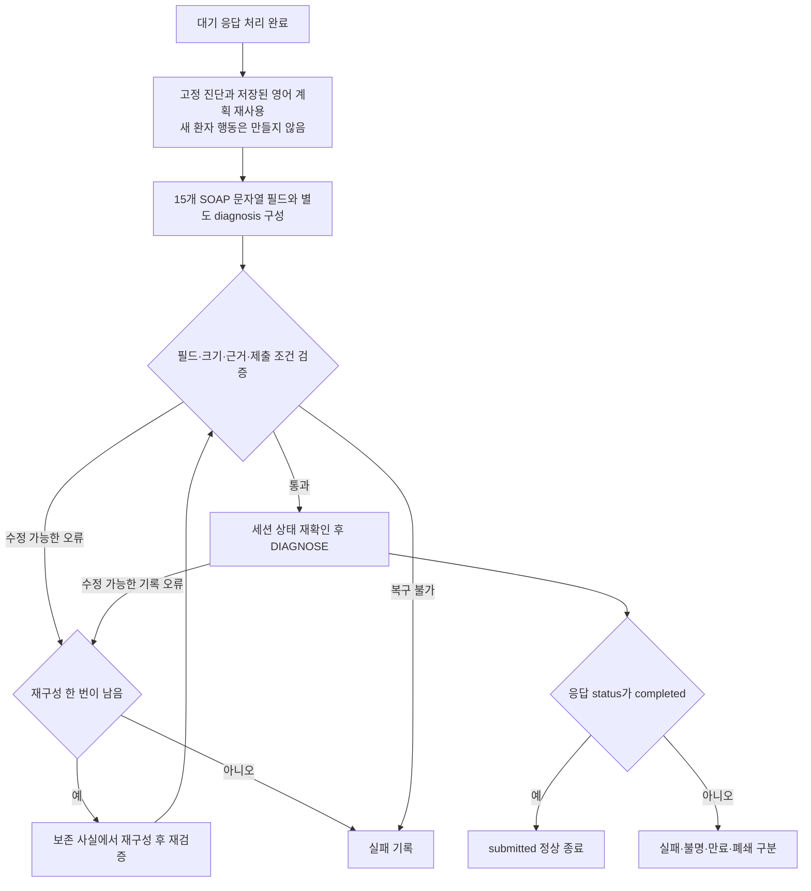

최종화는 제출 단계다. 고정 진단과 저장된 영어 P를 재사용하고 받은 마지막 응답까지 SOAP에 반영한다. 앞서 Education 준비를 수행하지 못했다면 확보한 사실에서 진단을 선택·고정하고 남은 모델 예산 안에서 계획을 준비한다. 환자 대화는 추가하지 않으며 주관 보고·실제 진찰·미시행·계획을 구분한다.

SOAP의 `S` 6개, `O` 2개, `A` 2개, `P` 5개 필드는 모두 문자열이며 주진단 `diagnosis`는 별도다. 예선의 `O.tests`는 비우고 계획 검사는 `P.tests`에 둔다. 로컬 검증 통과와 서버 수락은 다른 단계이며, 마지막 DIAGNOSE의 `completed` 응답을 확인해야 정상 종료한다.

<a id="roles-and-state"></a>

## 3. 역할과 환자 상태를 읽는 법

| 코드와 주요 함수 | 책임 |
|---|---|
| [runtime.py](workflow/runtime.py)의 prepare·consult | 지식/설정 준비와 증례별 실행 객체·상태 조립 |
| [Consultation](workflow/consultation.py)의 enter_session·refresh_after_input·advance_session·finalize | 내부 세션 전환, 입력 뒤 추론·재계획, 최종화 |
| [Doctor](workflow/doctor.py)의 prepare_education·validate_action·execute_action | 영어 계획의 한국어 변환, 발화의 독립 검증, SAY/EXAM 전달과 응답 기록 |
| [InputInterpreter](workflow/input_interpreter.py)의 process_input·_request_parse·_apply_facts | 단축 답 처리, Gateway 호출, 사실별 검증·복구·반영 |
| [InterviewPlanner](workflow/interview_planner.py)의 prepare_chief_complaint·replan·select_question·prepare_education | 질문 선택, 고정 진단의 영어 계획 생성, 교육 전달 순서 결정 |
| [ClinicalReasoner](workflow/clinical_reasoner.py)의 evaluate·evaluate_delta·refresh_hypotheses·select_diagnosis | 공유 Pattern 평가, Association 적용, 적합도와 진단 |
| [SubmissionWriter](workflow/submission_writer.py)의 build_soap·submit_diagnosis·confirm_submission | 기록 조립·검증·한 번의 재구성·확인된 제출 |
| [graph.py](workflow/graph.py)의 build_graph·run_node | 노드·분기와 기존 깊은 복사/검증 경계 |
| [rules](workflow/rules)의 BudgetPolicy·validate_facts | 순수 예산 판단과 외부 사실 경계 |
| [state](workflow/state)의 QuestionLifecycle·InteractionLifecycle·UsageAccounting | 질문·원문/전달·사용량 변경 연산 |

이 객체들은 서로 다른 모델 에이전트를 호출하는 팀이 아니라 하나의 진료 프로그램 안에서 책임을 나눈 Python 객체다. 공유 `PreparedResources`에는 지식과 설정을 두고, `consult()`마다 실행 객체와 아래 다섯 상태를 새로 만든다.

| 상태 | 주요 내용 | 코드를 읽을 때 확인할 것 |
|---|---|---|
| `CaseState` | 구조화된 S/O/A/P, `diagnosis`, `diagnosis_kind`, `diagnosis_evidence`, `fixed_diagnosis`, `primary_chief` | 어떤 사실과 고정 진단이 실제 기록에 들어갔는가 |
| `SessionContext` | 현재 내부 세션, 남은 턴·시간·모델 예산, 명료화 수 | 다음 행동을 할 여유가 있는가 |
| `DifferentialState` | 후보·기여·반증, Pattern/Association 매칭, 임상 개정·증례 캐시 | 무엇이 맞았고 왜 그 점수가 되었는가 |
| `QuestionPlan` | 전체 CC 속성 상태·처리/확보 수, 구조화된 평가·선택 기록, ROS 기준과 별도 교육 전달 대기열 | 무엇을 아직 묻거나 전달할 수 있는가 |
| `InteractionState` | 실제 요청·응답·모델 기록, 원문, 영어 계획의 근거·읽기 범위·변환 오류, 전달·거절·종료 결과 | 무엇을 읽고 생성하고 실제로 전달하거나 받았는가 |

### 3.1 처리 완료와 임상적 확정을 구분한다

`RecordItem.status`의 `unasked/done`은 처리 상태이고, 그 안의 `ClinicalValue.status`는 사실의 의미다. “모르겠어요”를 받고 질문을 `done`으로 닫아도 해당 증상을 음성으로 확정한 것이 아니다.

| 값 | 의미 | 추론에서의 역할 |
|---|---|---|
| `present` | 해당 내용이 있다고 확인 | 완전 매칭의 재료가 될 수 있음 |
| `absent` | 해당 내용이 없다고 명시 | 조건의 반증 또는 제한된 부재 감점의 재료 |
| `uncertain` | 임상 존재가 아직 불확실 | 후보 검색에 쓸 수 있으나 존재 조건은 미확정 |
| `unknown` | 답으로 해결하지 못함 | 확인한 양성·음성으로 바꾸지 않음 |
| `unasked` 또는 실제 EXAM 미수행 | 아직 획득하지 않은 내용 | 환자 근거로 사용하지 않음 |

`was_asked()`는 실제 전달 이력으로 반복 질문을 막고, `has_resolved_evidence()`는 출처가 있으며 상태·대상·속성 값이 해결되었는지 확인한다. 둘은 같지 않다. 명시적 모름은 다시 묻지 않고 바인딩 실패만 증례 전체 두 번의 명료화 안에서 신규 질문과 비교한다.

`CaseState.chief_complaints(confirmed=True)`는 **공통 현재 근거에서 충돌이 없는 처리 완료 S.cc 중 출처가 있으며 환자 본인의 `present` 증상이고 과거로 표시되지 않은 것**을 반환한다. 코드상 `time_context=unspecified`도 과거가 아닌 쪽에 포함된다. 대표 CC는 이 집합에서 환자 우선순위로 하나를 선택해 `primary_chief`에 고정한다. mapping_status는 존재와 분리하며 ambiguous·unmapped는 현재 근거에서 지지 불가로 투영한다. Symptom ID 하나를 얻었어도 `uncertain`이거나 같은 관찰의 양성·음성 보고가 충돌하면 확정 주호소 집합에 들어가지 않는다. “모델이 무언가 반환함”, “개념이 연결됨”, “진단 근거가 확정됨”은 각각 확인해야 한다.

### 3.2 관찰과 발현을 섞지 않는다

`observation_id`는 어느 증상·소견을 말하는지, `episode_id`는 그 증상·소견의 어느 발현인지를 구분한다. 같은 부위 통증이라도 지난번 발현의 위치와 이번 발현의 기간을 합쳐 하나의 완전 Pattern을 만들면 안 된다. 환자와 가족, 현재와 과거도 별도 필드다.

환자 원문은 상호작용 이력과 별도 환자 보고에 남고 구조화 사실의 `source_refs`가 그 입력을 가리킨다. 정정은 `record_id`로 기존 기록을 지정하면서 관찰·발현 신원을 보존한다. D36에서 명시적 정정인데 ID가 없으면 `correction=true`와 완전한 동일 근거 키로 유일한 기록을 찾는다. 여러 기록이나 불완전한 발현은 임의로 마지막 값을 채택하지 않는다. 같은 키의 상충 보고는 원본을 남기고 공통 현재 근거에서 불확실하게 취급하므로, 예전 양성만 주호소나 증상 진단으로 다시 선택하지 않는다. 새로운 발현과 기존 값의 정정을 구분하는 책임은 Gateway 해석과 Python 검증이 함께 맡는다. Graph에는 일반 지식을 두고 이 환자의 사실을 쓰지 않는다.

### 3.3 Doctor와 준비된 질문

문진·진찰에는 manifest의 질문 계약과 config의 고정 문구를 사용한다. D34 공감과 D37 교육 한국어는 지정 모델로 생성하며 모든 발화는 전달 직전 NFC 1–30자를 독립 확인한다. 공감 오류는 준비 공감 문구로 처리하고 교육 변환 오류는 해당 묶음 한 번 복구 후 미전달로 남긴다. 어느 경로도 문장을 자르지 않는다.

질문 계약에는 text, answer_type, affirmative, interviewable, reason이 있다. 대상 URI 또는 속성 URI가 키이며 대상|속성 예외가 우선한다. {symptom}은 실제 한국어 표시 이름으로 대입한 결과까지 prepare에서 검증한다.

원인을 전제하는 Target은 승인된 관찰 가능한 매핑 없이 직접 질문하지 않는다. 예를 들어 일반적인 두통에 대한 긍정을 “종양에 의한 두통”으로 연결하지 않는다. 현재 질문은 D23에서 수용한 manifest의 계약을 기준으로 사용하며, `interviewable=false`인 Target의 차단은 속성별 예외보다 우선한다. 준비 문구의 길이 검증과 의미의 적절성은 별도 문제다.

<a id="gateway"></a>

## 4. Gateway: 환자 말에서 검증된 사실까지

### 4.1 모델의 역할과 첫 입력

실제 호출은 [ModelClient](workflow/io/model_client.py)의 `complete()`가 맡는다. 모델은 `openai/gpt-6-luna`, `reasoning_effort=medium`이며 한 호출의 출력 여유는 최대 2,048토큰이다. 모델이 내놓는 것은 사실 후보이고, 단계·질문·점수·진단·계획은 출력할 수 없다. [프롬프트](config/input_parser.txt), Pydantic 스키마, Python 검증이 이 경계를 함께 만든다.

초기 `opening`을 포함한 첫 실질적 환자 진술은 Gateway에 보낸다. 최초 해석의 판단 기준은 Gateway의 비어 있지 않은 응답 수인 `gateway_successes`다. 공통 `doctor_successes`는 세 역할을 합친 **비어 있지 않은 모델 응답 문자열 수**다. 유효 JSON이나 주호소 연결 성공 횟수가 아니므로, 비어 있지 않은 잘못된 응답도 이 수를 올릴 수 있다. 이후에는 전체 답이 준비된 계약과 완전히 맞는 경우에만 고정 규칙을 쓴다. 명확한 긍정형 존재 질문의 짧은 긍정·부정, 단일 기간 표현, 유일하게 연결되는 범주 별칭 등이 그 예다. 복합 답·시간 전환·주체 변경은 Gateway로 보낸다.

### 4.2 D29: 기존 Symptom 하나를 선택하는 절차

주호소 매핑은 자연어와 그래프 사이의 첫 연결이다. 이 단계가 틀리면 뒤의 조건 매칭이 결정론적이어도 잘못된 Target에서 출발하므로 별도로 살펴야 한다.

1. 아직 개념이 연결된 주호소가 없고 초기 입력 또는 주호소용 답을 처리하는 경우 `chief_mapping_required`를 켠다. 이때 주호소 선택 후보만 `Symptom`으로 제한하고 부수 정보에 필요한 속성·값은 전체 해석 어휘에 함께 둔다.
2. 원문과 원천 라벨·동의어를 검색한다. `search_concepts()`는 NFC 정규화·대소문자 통일·공백 제거 뒤 라벨 포함 여부와 두 글자 조각의 겹침으로 정렬하고 검색당 최대 64개를 반환한다. 이는 문자열 검색 순위이고 의미적 정확도를 보증하는 값이 아니다.
3. Gateway에 한·영 라벨·별칭과 허용 Symptom을 제공한다. 보고된 현재 주호소마다 가장 적합한 하나를 고르도록 요청하고, 정확한 인용과 별도 mapping_status를 남긴다. 넓지만 양립하면 broader, 의미가 모호하면 ambiguous로 두며 원문에 없는 원인·속성을 만들지 않는다. 이 요청만으로 모든 주호소의 누락 없는 추출을 보장하지는 않는다.
4. 요청별 스키마의 `concept_ids`를 길이 1·전송한 Symptom ID 열거형으로 제한한다. 첫 요청에는 적절한 후보가 없을 때 `needs_context=true`와 `lookup_terms`를 내는 선택지도 있다.
5. 검색어는 최대 8개·각 80자이며 전체 **수용 어휘 색인**을 다시 검색하는 힌트다. 원본 RF2를 열거나 외부 검색을 하는 과정은 아니다. 확장 요청은 기존 추가 한 호출 안에서 수행한다.
6. Python은 전송 어휘 소속·Symptom 타입·단일 ID·정확한 현재 인용·참조·주체·발현 등을 검증한다. 일반적인 표현으로 보고하지 않은 원인 한정 개념을 확정하는 것도 막는다. 복구 후에도 실패하면 원문과 미해결 상태를 유지한다.

하나의 주호소 사실에 여러 Symptom ID를 남기는 것은 거절된다. 서로 다른 주호소는 별도 사실로 표현할 수 있다. Disease를 Symptom으로 대신 쓰거나 증례 ID별 매처를 적용하지 않는다. `lookup_terms`는 검색 힌트이며 환자가 말했다는 근거로 수용하지 않는다.

### 4.3 D34: 질문 범주 바인딩과 전 세션 공감

현재 질문에는 Target·FindingAttribute·허용 AttributeValue·답변 형식·주체·관찰·에피소드를 담은 `binding_contract`를 제공한다. 해당 속성의 전체 허용 값과 한·영 원천 동의어를 검색하고 전송 후보에 맞춘 enum과 Python 검증을 함께 적용한다. 정확한 동등 표현 다음으로 양립하는 넓은 관찰 용어를 broader로 연결하고 존재 status와 매핑 품질을 분리한다. 현재 질문의 참조는 선택 문맥에서 자리표시자를 줄여도 유효하며, 복구된 속성은 먼저 수용한 같은 응답의 관찰을 기준으로 검증할 수 있다.

키처럼 수용된 수치 속성이 없는 보고는 원문 인용과 영어 `record_details`를 가진 기록용 text로 남긴다. “어머니가 집에서 측정한 일 년 전 100 cm·현재 약 105 cm”는 모든 시점·수치·보고 맥락을 유지하는 주관적 기록이다. 새 높이 속성·저신장 해석·객관 진찰 결과를 만들지 않고 점수 근거에도 사용하지 않는다. 질문의 필요한 의미가 해결되지 않으면 명료화 대상으로 남는다.

Gateway는 `clinical_content`와 정확한 인용을 동반한 `empathy` 신호를 함께 낸다. 정서만 있는 발화는 의료 정보 부재로 구분하고, 혼합 발화는 임상 사실과 공감 요청을 함께 보존한다. `new_distress`·`renewed_request`는 공감 대기 이벤트가 되고 `repeat`·`acknowledgement`는 문진을 재개한다. 출처별 중복 생성·전달을 막는다.

Consultation은 필수 인사 뒤 다음 임상 질문보다 먼저 공감을 선택한다. Doctor가 별도 `empathy` 호출로 진단·치료 조언·추가 질문 없이 환자 감정을 인정하는 한국어 문장을 만들고 SAY 한 턴으로 전달한다. Initiation·ChiefComplaint·ContextFactor·DifferentialDiagnosis·Education 모두에서 같은 경로를 쓰며 교육 활성화 여부와 독립적이다. 공감은 임상 질문 자리표시자나 P.education 완료가 아니고, 환자 답은 다시 InputInterpreter로 처리한다.

공감 이벤트는 pending·attempted·delivered·skipped와 요청 출처·미전달 사유를 보존한다. 생성과 다음 응답 해석에 필요한 호출·출력 여유 및 최종화 시간을 확보한 경우만 진행한다. 입력 하나당 임상 최대 세 호출과 공감 최대 한 호출이며, 실제 NOVA 의미 해석·공감 품질은 오프라인 대역으로 입증하지 않는다.

### 4.4 전체 대화 보존과 제한된 전송

전체 실제 대화는 InteractionState에 남긴다. 모델 입력은 현재 응답·실제 질문·관련 관찰/에피소드와 필요한 원문 구간이다.

| 입력 영역 | 기본 | 한 번의 확장 |
|---|---:|---:|
| 과거 기록 | 24개 | 64개 |
| 과거 대화 | 6개 | 12개 |
| 과거 문맥 합계 | 16 KiB | 64 KiB |
| 어휘 | 256개·32 KiB | 1,024개·128 KiB |

부분별 상한과 별개로 system 지시문·스키마·현재 입력·질문·문맥·어휘를 합친 전체 messages JSON은 UTF-8 기준 기본 12 KiB, 일반 확장 16 KiB로 제한한다. 현재 원문 검색을 먼저 배치하며 선택 어휘와 과거 문맥을 줄인다. 현재 입력·질문·스키마·필수 Target/Attribute ID는 자르지 않고, 이것만으로 상한을 넘으면 전송을 보류하고 명료화로 넘긴다. 이 바이트 상한은 서버 토큰 수를 측정한 값이 아니다.

초기 주호소 후보는 Symptom으로 제한하고, 모델이 낸 유한한 lookup_terms가 있으면 전체 색인에서 먼저 검색한다. 전송 후보를 줄일 때 요청 스키마의 허용 ID도 함께 줄이며 최소 한 Symptom을 유지한다. `facts: []`도 주호소가 연결되지 않은 결과로 추가 한 호출의 복구 대상이 된다. `model_history[].parser_result`에 수용 사실·연결된 주호소·미연결·거절 개수를 남긴다. `doctor_successes`는 비어 있지 않은 응답 문자열의 개수여서 의미 매핑 성공과 구분한다.

현재 응답은 과거 문맥 한도 밖에서 온전히 처리한다. 문맥을 고를 때 현재 질문, 같은 관찰·에피소드, 원문에 나온 다른 증상, 정정의 원래 출처를 우선한다. 오래된 관련 원문도 선택할 수 있다. 모델은 제공된 기록·대화 ID만 참조할 수 있다.

전체 요청을 맞출 때는 먼저 선택 어휘를 우선 후보 수까지 줄이고, 이어 과거 대화·기록을 줄이며, 필요하면 나머지 선택 어휘도 줄인다. 주호소 스키마의 허용 ID는 매번 남은 후보에 맞춰 다시 만든다. 최소 필수 내용조차 들어가지 않으면 현재 원문을 잘라 보내지 않고 요청을 보류한다. 위 표의 부분별 최댓값을 동시에 전송한다는 의미가 아니다.

### 4.5 사실별 수용과 단계별 해석 복구

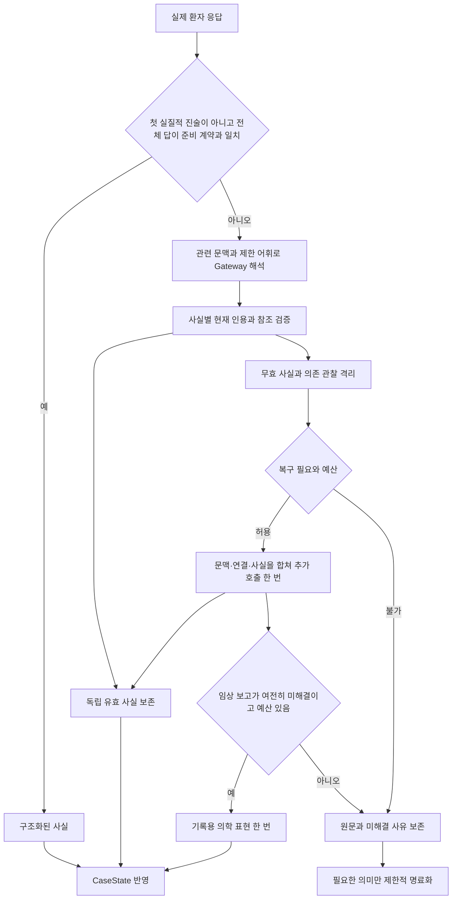

`accepted_facts`, `rejected_facts`, `unresolved_links`를 구분한다. `quote`는 비어 있지 않은 현재 입력의 정확한 부분 문자열이어야 하며 `value.text`와 같아야 한다. 모델은 제공된 어휘와 기록·대화 참조만 사용할 수 있고, 실제 EXAM 응답이 아니면 O.exam을 만들 수 없다. 환자 말에서 A·P 또는 실제 검사 결과를 생성하는 것도 허용하지 않는다.

잘못된 사실 하나가 독립된 다른 증상까지 없애지는 않는다. 잘못된 관찰에 의존한 속성이나 충돌 정정은 함께 격리한다. D34는 **최초 해석 → 바인딩·구조 복구 1회 → 기록용 의학 표현 1회**의 최대 세 호출을 사용한다. JSON 오류·빈 실질 답·문맥·연결·거절 사실은 한 바인딩 복구를 공유한다. `repair_of`는 입력 내 원래 사실의 인덱스이며 거부된 타입·필드를 바로잡을 수 있다. 이미 수용한 독립 사실은 동결하고 미연결 사실의 ID·매핑 품질과 보수적인 존재 불확실 전환만 보완한다. 원래 거부와 각 단계의 결과는 `parse_rejections`·`parse_recoveries`에 보존한다.

`CONTEXT_LIMIT_EXCEEDED`이면 같은 내용을 그대로 보내지 않고 새 ID의 더 작은 요청을 만든다. 상한은 8 KiB이며 직전 요청보다도 작아야 한다. 이미 추가 호출을 사용했다면 또 복구하지 않는다. 반면 전송 결과가 불명확한 일시 오류의 같은 ID 재전송은 7절의 전송 복구이며, 이 해석 복구와 목적이 다르다.

<a id="reasoning"></a>

### 4.6 D36: 출처·정정·누락을 같은 경로에서 확인한다

기존 기록과 질문의 연결을 먼저 해석해 저장할 필드를 결정한 다음 검증하고, 저장 단계에서 목적지를 다시 바꾸지 않는다. 환자 SAY가 기존 진찰 기록의 ID를 가리켜도 O를 교체할 수 없다. 진찰 결과에 대한 이의는 S의 별도 보고로 남기며, 이미 획득한 O는 같은 대상·관찰·발현의 새 EXAM 결과로만 갱신한다. 초기 활력징후와 환자 발언의 취득 경로도 보존한다.

주체·관찰·발현·Target·Attribute와 정확한 current·past·unspecified 시점에 따른 현재 근거 해석을 주호소 확정, 질문 해결 여부, Pattern 추론, 증상 fallback과 SOAP가 함께 사용한다. 명시적 철회는 같은 기록을 갱신하지만, 정정인지 불분명한 양성·음성 충돌은 불확실하게 남겨 기존 제한 명료화를 요청한다. 다른 발현이나 가족·과거 보고를 현재 환자의 같은 사실로 합치지 않는다.

정확한 인용은 추출된 사실의 출처를 확인할 뿐 발언 전체의 추출 완료를 보장하지 않는다. 따라서 환자 원문과 수용 인용의 문자 구간을 별도로 보존한다. 예를 들어 “가상증상이 있어요. 항생제 알레르기가 있어요.”에서 첫 문장만 추출됐다면, 둘째 문장은 S.hpi의 `Patient report (unstructured):`에 원문으로 남고 확인이 필요한 입력으로 표시된다. 여러 문장을 통째로 인용했더라도 문장별 사실까지 추출했다고 간주하지 않는다. 이 원문은 진단 점수나 실제 진찰 소견으로 사용하지 않으며, 정상적으로 구조화된 항목은 기존 영어 기록을 유지한다. 문자 구간 확인을 실제 모델의 의미 이해나 임상적 완전성 검증으로 해석하지 않는다.

## 5. 추론 알고리즘: 관찰에서 질환 적합도까지

이 절의 기준은 [ClinicalReasoner](workflow/clinical_reasoner.py), [지식 reader](knowledge/graph.py), [조건 모델과 비교 함수](knowledge/conditions.py)다. 추론은 기존 지식과 관찰의 규칙 기반 비교다. 모델의 내부 사고를 읽거나 새 임상 관계를 생성하는 단계는 없다.

### 5.1 Target·Pattern·Feature·Association의 관계

| 개념 | 쉬운 설명 | 점수를 소유하는가 |
|---|---|---|
| `Target` | 확인하려는 증상 또는 신체진찰 소견 | 아니오 |
| `ClinicalPattern` | 하나의 Target에 대해 함께 맞아야 하는 조건 묶음 | 아니오; 여러 질환이 공유 |
| `ClinicalFeature` | 존재 여부, 위치, 양상, 기간 등 원자적 조건 | 아니오; Pattern에 귀속 |
| `DiseasePatternAssociation` | 특정 질환과 특정 Pattern의 연결 및 적용 조건·출처 | 질환별 원천 가중치를 결정 |
| `PatternMatch` | 이 환자의 어느 관찰·발현이 Pattern과 얼마나 맞는지 | 매칭 상태와 근거만 보존 |
| `ScoreContribution` | 완전 매칭 뒤 선택한 질환–Target 지지 | 실제 선택 점수와 근거를 보존 |

예를 들어 “증상 T가 있고 특정 위치·기간을 만족한다”는 Pattern을 두 질환이 공유해도, 그 표현이 각 질환을 얼마나 지지하는지는 서로 다른 Association에 둔다. 따라서 Feature마다 임의의 중요도를 더하지 않는다.

ClinicalReasoner는 관찰 Target의 공유 Pattern을 먼저 평가하고, 그 결과에 질환별 Association 조건과 가중치를 적용한다.

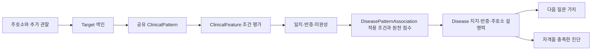

### 5.2 첫 번째: 관찰별로 나누고 후보를 넓게 검색한다

`EvidenceIndex`는 처리 완료·출처 있음·환자 본인·과거가 아닌 symptom/finding/attribute만 골라 `(observation_id, episode_id, time_context)`로 묶는다. 각 묶음에는 증상·소견의 기본 기록과 그 속성을 따로 둔다. 초기 활력징후처럼 원문만 있고 Target이 없는 기록은 SOAP에 남을 수 있지만 그것만으로 특정 임상 Pattern을 자동 활성화하지 않는다.

후보 질환은 현재 묶음의 **present 또는 uncertain Target**이 연결된 Association의 질환 합집합이다. 속성을 모두 맞춰야 후보가 되는 것은 아니다. 따라서 “후보로 검색됨”과 “확정 지지 점수가 생김”은 다르다. `absent`만으로 새 질환 후보를 만들지 않고, BodySystem으로 검색 범위를 자르지도 않는다. 원천에 관계가 없다는 사실은 이 환자에게 질환이 없다는 근거가 아니다.

같은 Target에 해석 후보가 여럿이거나 상태가 충돌하면 존재 상태를 `uncertain`으로 취급한다. 단일 개념의 명확한 present/absent 기록이 있으면 그 기록을 우선하여 존재 상태를 정한다. 불확실한 여러 해석을 여러 번 확인한 양성처럼 더하지 않는다.

### 5.3 두 번째: 공유 Pattern의 Feature를 평가한다

평가 단위는 `(Pattern, observation, episode, time_context)`다. 같은 Pattern을 여러 질환이 공유해도 이 단위의 Feature 비교는 한 번 수행한다. 다음 조건 비교 결과를 모아 `PatternMatch`를 만든다.

| 조건 | matched | contradicted | unknown |
|---|---|---|---|
| 존재·부재 | 확인 상태가 기대 상태와 같음 | present/absent가 기대와 반대 | uncertain·unknown 등 |
| 단일 개념 값 | 기대 값 또는 허용된 ValueMatch 경로의 값이 명시적으로 있음 | 기대 값이 명시적으로 없다고 확인 | 기대 값의 존재·부재를 결정할 수 없음 |
| `concept_set any_of` | 하나 이상 일치 | 모든 선택지가 반증 | 그 외 |
| `concept_set all_of` | 모든 조건이 일치 | 하나 이상 반증 | 그 외 |
| 수치·구간 | 관찰 구간 전체가 기대 구간 안에 있음 | 두 구간이 완전히 분리됨 | 일부만 겹치거나 단위가 비교 불가 |

예상 위치가 A인데 환자가 B라고 했다는 이유만으로 A의 명시적 부재를 자동 생성하지 않는다. 현재 범주 비교는 기대 값에 대응하는 양성·음성 기록을 찾으며, 대응하는 값이 없으면 대개 unknown이다. 수치 비교도 일부 겹침을 억지로 일치나 반증으로 정하지 않는다.

예를 들어 기대 범위가 **5–14일**이면 `168시간`은 7일이어서 matched, `20일`은 contradicted, `10–20일`은 일부 겹쳐 unknown이다. `1개월`과 `30일`도 unknown이다. 초·분·시간·일·주는 고정 시간 단위로, 월·년은 달력 단위로 비교하지만 두 계열을 임의 환산하지 않는다. `TimeSinceOnset`과 `EpisodeDuration`은 단위가 같아도 다른 속성이다.

여러 Feature는 모두 맞아야 한다. 결과에 contradicted가 하나라도 있으면 Pattern은 `contradicted`, 그렇지 않고 unknown이 있으면 `incomplete`, 전부 맞으면 `matched`다. **명시적 반증은 다른 조건의 unknown에 가려지지 않는다.** 다만 상세 Pattern의 반증이 곧 질환 점수 감점은 아니다.

ValueMatch는 수용된 `is_a`, `regional_part`, `approved_region` 경로를 이용하는 제한된 값 비교다. 환자가 말하지 않은 상위 위치를 새 관찰로 기록하거나 질환 계층을 따라 무제한 추론하는 기능은 아니다.

### 5.4 세 번째: 질환별 Association의 적용 조건을 확인한다

Pattern 자체가 맞아도 Association에 “환자 본인의 특정 현재 Context가 존재해야 한다”는 조건이 있으면 그것까지 확인해야 한다. `_applicability()`는 `(Context 개념, subject, time_context)`가 정확히 맞는 기록을 찾고 요구된 present/absent와 비교한다.

반대 상태가 명확하면 `contradicted`, 필요한 상태를 확정할 수 없으면 `unknown`, 모든 조건을 만족하면 `matched`다. 조건이 없는 Association은 적용 조건을 통과한다. **Pattern matched + applicability matched**인 경우만 다음 원천 지지 계산에 들어간다. 적용 조건이 unknown인 후보도 질문을 만드는 데에는 사용할 수 있다.

여기서의 적용 조건과 뒤의 Context 가점은 역할이 다르다. 적용 조건은 지지를 활성화하는 문턱이고, Context 가점은 별도로 확인한 지지 배경에 대한 최대 1점의 보완이다.

### 5.5 네 번째: 원천 가중치를 선택한다

[scoring_policy.json](knowledge/scoring_policy.json)의 `v5.0.1`은 원천 라벨을 정렬용 점수로 변환한다. manifest가 실제 사용 정책의 해시를 고정한다.

| BODHI `condition_given_symptom`의 라벨 | zero | rare | low | medium | high | very_high |
|---|---:|---:|---:|---:|---:|---:|
| 지지 점수 | 0 | 0.5 | 1 | 2 | 3 | 4 |

해당 표현·범위에 방향성 라벨이 없을 때는 원천 관계에 따라 직접 `due_to=2`, `associated_with=1`, `subtype_intersection=0.5`를 사용하고, 조건을 보존한 일반화는 0.5를 쓴다. 유효한 `zero`는 “가중치 없음”이 아니므로 다른 점수로 대체하지 않는다.

반대 방향인 `symptom_given_condition`의 라벨은 `typicality`로 보존하며 제한 반증에 사용한다. 질문 가치는 커널이 계산한 판단 변화를 사용한다. `strong_predictor`를 추가 가산하지 않는다. 이 숫자들은 프로젝트의 정렬 정책이며 확률·우도비·유병률 보정값이 아니다.

### 5.6 다섯 번째: 정교화 대체 후 Disease–Target을 한 번만 집계한다

같은 질환·Target·관찰·발현·시점에서 적용 조건까지 성립한 완전 매칭들을 모은다. 그중 더 구체적으로 맞은 Pattern이 있으면 그 조상 Pattern을 제거한다. 정교화는 부모의 모든 조건을 유지하면서 조건을 추가하거나 값·범위를 더 좁힌 표현이다. **점수가 내려가더라도 구체적인 표현을 채택한다.**

다음은 가상 질환 A와 Target T의 설명용 예다. 기본 존재 2점, 위치 조건까지 맞는 정교화 1점, 위치와 양상까지 맞는 정교화 4점이 원천에 있다고 가정한다.

| 현재까지 확인한 사실 | T에서 채택하는 표현 | T의 지지 점수 |
|---|---|---:|
| 존재만 확인 | 기본 존재 Pattern | 2 |
| 같은 발현의 위치까지 확인 | 위치 정교화가 기본 표현을 대체 | 1 |
| 같은 발현의 양상까지 확인 | 위치+양상 정교화가 이전 표현을 대체 | 4 |
| 양상이 다른 발현의 정보였음 | 현재 발현에서는 위치 정교화까지만 완성 | 1 |

2→1→4는 새 표현의 점수로 바뀌는 과정이며 2+1+4를 더하지 않는다. 새 정교화가 0점이어도 2점을 유지하는 식으로 우회하지 않는다. `FeatureContribution`은 정교화 점수−기준 점수의 차분을 기록한다. 여러 조건이 함께 바뀐 `joint` 차분을 개별 질문이나 Feature의 독립 점수로 나누지 않는다. 실제 합산은 선택한 Association 점수로 한다.

어느 쪽도 다른 쪽의 정교화가 아닌 완전 매칭들이 남으면 `incomparable_matches`에 함께 기록하고 점수는 최대값 한 번만 사용한다. 대표 CC는 정확히 고정한 관찰·발현·시점의 기여만 사용한다. 같은 Target의 다른 관찰을 추가 보강으로 계산하지 않는다. 다른 Target은 관찰별 결과에서 최대 기여 하나씩 선택하고 총 보강 상한 4를 적용한다. 출처와 반복 보고 수를 더하지 않는다.

### 5.7 여섯 번째: Context와 제한 반증을 반영한다

질환 D의 적합도는 다음과 같다.

```text
evidence_score(D) = chief_score(D) + min(4, supporting_raw(D))
fit(D) = evidence_score(D) + context_bonus(D) - contradiction_penalty(D)
```

**Context 가점:** 질환의 `hasSupportingContext`에 연결된 개념이 양성으로 확인되고 가족력/환자 본인의 주체가 맞으면 1, 아니면 0이다. 여러 Context가 있어도 1을 넘지 않는다. 부재나 unknown으로 감점하지 않는다. 이 가점 확인은 Association 적용 조건처럼 정확한 time_context 일치를 추가로 요구하는 절차는 아니다. 확보된 시점부터 세션에 관계없이 같은 값을 사용하므로 가상 평가와 실제 다음 세션의 값이 어긋나지 않는다.

**제한 반증:** [reasoning_policy](knowledge/d38-reasoning_policy.json)의 `d38.1`을 별도로 적용한다. 아래 조건을 모두 만족하는 기본 존재 Pattern에만 감점한다.

- Association 적용 조건이 matched이고 Pattern이 contradicted다.
- Pattern의 Feature가 상세 기대 값 없이 존재를 요구하는 조건이다.
- 해당 Target의 명시적인 `absent` 기록이 `time_context=current`이며 확정 주호소의 활성 발현에 속한다.
- 현재 추론 관찰들에 같은 Target의 present 기록이 없다.
- 원천 typicality가 high 또는 very_high다.

high는 0.5, very_high는 1이다. 같은 Target은 최대 1, 질환 전체는 최대 2를 뺀다. 예를 들어 매우 전형적인 증상 세 개를 명시적으로 부정했어도 합계 감점은 2다. 상세 위치의 불일치, 다른 발현의 부재, unknown, 미질문과 원천 연결 누락은 이 감점을 만들지 않는다. 코드에서는 다른 관찰에 같은 Target의 양성이 있으면 부재 감점을 막으므로, 발현 신원과 양성·음성 상태를 함께 살펴야 한다.

### 5.8 일곱 번째: 대표 CC 설명과 최종 진단 자격

후보는 fit 내림차순, chief_score 내림차순, 명시적 충돌 수 오름차순, Disease URI 순으로 정렬한다. 최종 질환 자격은 대표 CC의 양성 원천 지지와 적용 조건, 양수 fit을 요구한다. chief_coverage는 이 정확한 대표 관찰을 설명하면 1, 아니면 0이다. 추가 증상으로 회수됐다는 이유로 CC 설명 자격을 얻지 않는다.

| 설명용 후보 | CC 지지 | 추가 지지 합계→반영 | Context | 반증 | fit | 자격 |
|---|---:|---:|---:|---:|---:|---|
| A | 3 | 2→2 | 1 | 1.5 | 4.5 | 가능 |
| B | 0 | 7→4 | 1 | 0 | 5 | 불가: 대표 CC 미설명 |
| C | 4 | 0→0 | 0 | 0.5 | 3.5 | 가능 |

전체 목록에서 B가 먼저여도 적격 목록의 첫 번째 A를 선택한다. C는 감별 후보가 될 수 있다. 주진단과 최대 다섯 감별은 같은 자격을 쓰며 실제 획득 근거를 SOAP에 표시한다. 미완성 Pattern과 미래 완성 경로는 실제 지지가 아니다.

적격 Disease가 없으면 **확정된 대표 CC**를 증상 잠정진단으로 선택한다. 첫 보고를 임의로 고르지 않으며 주호소가 끝내 미확정이면 명시적으로 실패한다.

### 5.9 실제와 가상 답변이 같은 계산을 사용한다

```python
snapshot = reasoner.evaluate(evidence_index, chief_anchor, policy)
after = reasoner.evaluate_delta(snapshot, evidence_patch)
```

두 함수는 같은 매칭·적용 조건·정교화·중복 제거·반증·자격 계산을 사용한다. 실제 입력은 검증 후 현재 근거에 적용하고, 가상 입력은 격리된 EvidenceIndex에만 반영한다. 가상 평가로 환자 기록·질문 이력·사용량·SOAP·SDK를 바꾸지 않는다. 원문 표현만 달라지고 구조화 의미가 같으면 반복 점수 계산을 건너뛴다.

의존 색인은 입력→Pattern/Feature, Context→Association/지지 Disease와 refinement를 연결한다. 변경된 관찰의 Pattern과 영향을 받는 Disease를 갱신하고 다른 결과는 재사용한다. 검증에서는 증분 가상 평가와 같은 typed 패치를 적용한 격리 전체 평가의 매칭·기여·반증·자격·점수가 일치하는지 비교한다. 공유 지식에는 환자 사실을 저장하지 않는다.

<a id="question-selection"></a>

## 6. 다음 질문을 고르는 알고리즘

[InterviewPlanner](workflow/interview_planner.py)의 `_frontier`, `_comparison`, `replan`이 질문 경로·비교 후보·전달 대상을 만들고 [selection.py](workflow/rules/selection.py)가 답변 영역과 판별 가치를 계산한다. 진단 점수는 ClinicalReasoner에 위임한다. 대표 CC 전체 속성과 Open Inquiry의 답까지 받은 뒤 정밀 비교를 시작한다. 선택용 LLM 호출은 없다.

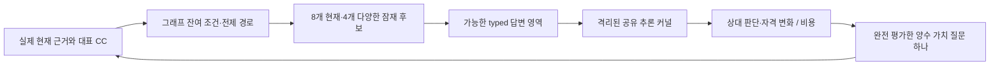

### 6.1 잔여 조건과 질문 자격

현재 관찰→Pattern→Association에서 충족·반증·미확인 조건을 추적한다. 동일 `(행동, Target, Attribute, 주체, 시점, 관찰, 발현)`은 질문 하나로 묶는다. 여러 Feature의 같은 기간 조건도 질문 한 번이다. 명시적으로 거짓인 적용 조건은 경로를 없애고 미확인 Context와 증상 존재는 선행 질문으로 둔다.

해결·명시적 모름·차단 자산은 일반 후보에서 제외한다. 속성 SAY는 동일 관찰·발현·주체·시점의 존재가 확인되어야 한다. EXAM은 수용된 실제 획득 방법이 있어야 한다. 바인딩 실패의 명료화는 비용 1과 전체 2회 한도 안에서 신규 질문과 비교한다.

전체 회수 후보는 보존한다. 정밀 비교는 CC 설명을 갖춘 현재 후보 최대 8개와 서로 다른 잔여 구조의 잠재 후보 최대 4개로 시작한다. 잠재 후보는 남은 질문 수·완성 가능한 CC 점수·URI 순이다. 양수 질문이 없으면 전체 CC 양립 후보로 확대하며 새 단서로 이전 제외 후보가 재진입할 수 있다.

### 6.2 실제 가능한 답변을 만든다

존재는 양성·음성, 수치는 관련 임계값·포함 경계·단위별 점과 구간, 범주는 승인된 동치·계층과 양립하는 긍정·명시적 부정 조합을 만든다. 같은 조건 평가 결과를 만드는 동의어·중복 영역은 합친다. 달력 단위와 고정 시간을 임의 환산하지 않는다. cardinality가 없는 다른 양성 범주값을 음성으로 만들지 않는다.

모름·거절·해석 실패는 임상 음성이 아니며 유효 정보 답변과 같은 확률의 분기로 넣지 않는다. 각 typed 패치를 커널에 적용해 실제 Association·정교화·Target 기여·반증·자격·점수 결과를 얻는다.

### 6.3 상대 판단과 자격 변화

후보 쌍이 모두 적격이면 `r=clip((F_i−F_j)/4,−1,1)`, 한쪽만 적격이면 ±1, 둘 다 부적격이면 0이다. 서로 다른 유효 답변 사이의 r 변화량을 평균해 D를 구한다. 현재 적격 쌍은 `1/(1+abs(F_i−F_j)/4)`로 가중하고 나머지 쌍은 1이다. E는 현재와 비교해 자격이 바뀌는 후보 비율의 답변 평균이다.

```text
U1(q) = (D(q) + 0.25 E(q)) / cost(q)     cost=1
Uplan = 0.5^(m−1) × Vjoint / m          m<=6
```

예를 들어 적격 A=4, B=3이고 두 답변 결과가 (A=4,B=5), (A=4,B=3)이면 r은 −0.25와 +0.25다. 차이를 2로 정규화한 D=0.25, 자격 변화 E=0이므로 직접 가치 0.25다. 두 후보를 똑같이 +1 보강하는 질문은 상대 판단이 같아 구별 가치가 없다. 이 값은 구조적 판별 정책 점수이며 진단확률이나 EIG가 아니다.

### 6.4 지금 점수가 변하지 않는 선행 질문도 평가한다

존재 확인 후 속성 하나, 전제 확인 후 마지막 속성처럼 두 질문이 필요한 경로는 첫 답변별 후속 가치를 0.5 할인해 두 행동 비용으로 나눈다. 세 질문 이상도 남은 세션 용량 안에서 최대 여섯 질문으로 완성 가능한 경로만 일관된 공동 답변으로 평가한다. 직접·두 단계·완성 경로 값 중 최대를 사용한다. 실제로는 첫 질문 하나만 전달하고 새 답 뒤 다시 계산한다. 음성·모름으로 불가능해진 경로를 계속 밀지 않으며 미래 지지를 실제 진단 점수로 가산하지 않는다.

### 6.5 계산 한도, 선택 기록, 세션 전환

선택당 가상 평가 상한은 512회다. 짧고 영향을 주는 후보가 많은 직접 질문부터 평가하고 나머지로 완성 경로를 검토한다. 불완전 답변 영역·경로는 별도 표시하며 완전히 계산한 양수 질문 중 최선을 고른다. 그런 질문이 없고 계산이 제한됐다면 computation_limit으로 진행한다. no_useful_question과 구분하며 정보 소진으로 주장하지 않는다.

선택 기록은 실제 근거→Pattern→Association 경로, 조건·전제, 답변별 점수 분해·기여·자격, 비용·가치·차점·제외 사유·정책 버전과 실제 답 뒤 결과를 남긴다. 기록을 위한 정보가 Gateway 요청으로 재전송되지는 않는다.

ChiefComplaint의 ROS는 최대 여섯 번이며 Context와 EXAM은 후속 세션에서 비교한다. ContextFactor에서 비Context 질문이 가장 유용하면 감별로 진행한다. 상한·모델·시간은 세션별 잔여 용량을 지키며 다른 세션의 미사용 횟수를 빌리지 않는다. 근거·질문 이력·모름·대표 CC·세션·예산 변경을 모두 재계획 키에 반영한다.

<a id="budgets-and-submission"></a>

## 7. 예산·오류 복구·SOAP 제출

### 7.1 새 행동을 시작할 수 있는 조건

현재 한도는 [limits.py](workflow/rules/limits.py), 순수 예산 판단은 [budget.py](workflow/rules/budget.py)에 있다. D35 세션 문진 상한과 공감 행동이 공통 풀을 공유하며 서버의 남은 양이 더 작으면 그 값을 반영한다.

| 내부 세션 | 조건부 최소 목표 | 최대 문진 횟수 |
|---|---:|---:|
| Initiation | 1 | 1 |
| ChiefComplaint | 7 | 16 |
| ContextFactor | 2 | 7 |
| DifferentialDiagnosis | 3 | 12 |
| Education | 별도 최소 없음 | 남은 공통 턴 |

최소 목표를 채우기 위해 이미 아는 정보나 가치 없는 질문을 추가하지 않는다. 미사용 횟수를 다른 세션에 넘기지 않으며 기본 문진 합계는 최대 36회다. 명료화와 서버가 소비한 거절 턴도 문진에 포함한다. Education은 앞선 수집에서 5턴을 보호하고 별도 3턴 상한 없이 남은 공통 턴을 사용한다.

공감 SAY는 `purpose="empathy"`로 식별하고 세션 문진 상한에서 제외한다. `Usage.actions`는 총 소비 턴이고 `empathy_actions`는 그중 공감 턴이며, 문진 사용량은 두 값의 차이다. 공감도 공통 50턴과 모델·토큰 예산을 사용한다. 문진 36회를 다 쓴 경우 14턴이 남지만 고정 공감 할당량은 아니다. `ModelClient.complete(role="empathy", ...)`는 지정 모델과 공통 예산을 사용하며 감지·생성 프롬프트·트리거는 기존 D34 구현을 사용한다. 공감 모델 성공으로 첫 환자 진술 Gateway 해석을 생략하지 않는다. 환자 답은 해석하되 내용 없는 공감 확인을 SOAP 임상 항목으로 만들지 않는다.

| 자원·보호량 | 현재 구현 |
|---|---|
| SAY·EXAM | 공통 최대 50턴; DIAGNOSE는 수집 행동과 별도 |
| 지정 모델 | 증례 전체 최대 200회, 입력 500,000·출력 100,000토큰 |
| 새 행동 전 모델 여유 | Gateway 1회와 2,048 출력토큰 이상 |
| 새 행동 전 시간 여유 | 응답 처리 120초 + 최종화 120초 초과 |
| 명료화 | 증례 전체 최대 2회 |
| 교육 보호 턴 | 기본 활성화; 앞선 수집 단계에서 5턴 보호 |
| SOAP 재구성 | 로컬·서버 오류를 합쳐 최대 1회 |

이 정책은 새 행동마다 최악의 두 번 Gateway 호출을 모두 보장하는 예약은 아니다. 첫 해석에 필요한 한 호출을 남기고, 추가 복구는 실제 남은 예산에서 가능할 때 수행한다. 입력 토큰은 이미 사용한 양과 서버 잔여량을 추적하며 새 요청의 실제 토큰 수를 로컬에서 정확히 예측하는 구조는 아니다.

전송 직전에는 전체 예산 정책을 재실행하지 않고 경량 검사만 수행한다. 새 질문을 시작할 여유가 없어도 이미 받은 응답은 동기 경로에서 해석한 뒤 최종화한다. 그래프 이동 횟수·서버가 소비한 SAY/EXAM 턴·모델 호출 수는 다른 값이며 단축 규칙으로 해석한 답은 모델 호출을 추가하지 않는다.

### 7.2 교육 설정과 복구의 의미

기본 true에서는 가이드라인과 전체 실제 대화로 계획을 생성하고 전달한다. explicit false는 D26 우회이며 교육 행동·보호 턴과 P.education을 사용하지 않는다. 생성 성공·원문 전체 처리·한국어 변환·실제 SAY 전달은 별도 상태다. 계획 형식 복구는 전체 단계에서 1회, 변환 복구는 각 잘못된 묶음에 1회다. 미해결 전송은 D35의 동일 요청 1회 재전송 뒤 unknown 종료를 유지한다.

원문 읽기·결합·계획·변환·Gateway·공감은 같은 모델·토큰·시간 한도를 사용한다. Education은 Luna high 최대 8000 출력 토큰, 한국어 변환은 medium 최대 4000을 요청하되 남은 예산과 응답 여유를 따른다. 예산이나 형식 실패 후에는 보존된 유효 문장으로 고정 진단을 제출하며 빈 항목·미독·미전달을 완료로 바꾸지 않는다. D18에서 삭제한 옛 교육 초안은 복원하지 않는다.


### 7.3 무엇이 SOAP에 들어가는가

[SubmissionWriter](workflow/submission_writer.py)는 현재 사실과 선택 진단의 근거 ID를 읽어 결정론적으로 기록한다. Gateway나 별도 요약 모델에 SOAP를 작성시키지 않는다.

| 구역 | 전송 필드 | 내용과 획득 경계 |
|---|---|---|
| S | `cc`, `hpi`, `pmh`, `fh`, `sh`, `ros` | 영어 용어·키워드, 범주·내용, (+)/(-), 필요한 주체·시점·발현 구분 |
| O | `exam`, `tests` | 초기 제공 활력징후와 실제 EXAM 결과; 예선 `tests`는 빈 문자열 |
| A | `evidence`, `differential` | 선택 진단에 사용한 실제 양성·음성 근거와 적격 감별 최대 다섯 개 |
| P | `tests`, `treatment`, `disposition`, `follow_up`, `education` | 고정 진단의 영어 계획; 한국어 실제 전달 이력은 별도 보존 |
| 별도 인수 | `diagnosis` | 비어 있지 않은 주진단 문자열 하나 |

S·O에는 공통 현재 근거에서 처리 완료·값 있음·출처 있음인 기록을 사용한다. D33은 가능한 모든 항목에 원천 영어 용어를 사용하고 각 줄을 `Category: Content`로 만든다. D36에서 수용 인용이 덮지 못한 환자 보고는 `Patient report (unstructured):` 범주에 원문으로 남긴다. 정상적으로 구조화된 짧은 “네”는 해당 용어와 (+)로 기록한다. 영어 원천 용어가 없는 환자 보고는 원래 표현을 보존한다.

예를 들어 기침 사례는 `S.cc`에 `C.C: Cough`·`Onset: 3 days before presentation`, `S.hpi`에 `P.I: Cough (+)`·`Duration: 1–2 min`·`Aggravating factor: At night`를 쓴다. 병력·ROS는 `Medicine history: (-)`·`Smoking: (-)`·`Dyspnea: (-)`처럼 표시한다. 일반적인 만성질환 부재를 개별 DM·HTN 음성으로 확장하지 않고, 모른다는 답은 `(Unknown)`이며 미질문은 추가하지 않는다. 통증이면 같은 관찰·발현에서 얻은 점수·부위·양상·기간을 `Pain assessment:`로 모으고, NRS 척도는 명시된 경우만 쓴다.

구조화된 개념·속성·값·수치를 우선하며, 추가 내용은 기존 Gateway가 고정 `record_category`와 정확한 원문 구간·짧은 영어 `record_details`를 함께 추출한다. 별도 요약 호출은 없고 Python이 인용의 실제 포함과 최종 필드·범주의 일치를 검증한다. 번역의 임상 의미가 맞는지는 스크립트 검증만으로 입증되지 않는다. 연결하지 못한 정규화 보고는 `Unmapped report`로 드러내며, 추출되지 않은 원문 구간도 미구조화 환자 보고로 별도 보존한다.

A.evidence는 `diagnosis_evidence` 중 실제 확보한 present/absent만 사용하고, 제한 반증에 사용한 음성 소견도 남긴다. `Diagnosis: #1. ...`·`Evidence: ...`로 구성하며, 감별은 확보 근거가 있는 `r/o Diagnosis: reason`만 표시한다. 내부 URI·request_id를 노출하지 않고 EXAM은 `PE:`와 획득 턴을, 초기 활력징후는 `V/S:`와 초기 제공 사실임을 표시한다. 가족·과거·여러 발현의 구분이 필요할 때만 주체·시간·발현을 붙이며 수치·단위·구간 경계를 보존한다.

모든 칸은 문자열이고 없는 내용은 빈 문자열이다. `note.A.diagnosis`를 추가하지 않으며 note와 별도로 진단을 보낸다. note의 JSON 크기는 UTF-8 100,000바이트 이내, diagnosis는 500바이트 이내여야 한다. 30자 한도는 SAY·EXAM 발화에 적용하며 SOAP 전체에 적용하지 않는다.

현재 manifest의 guidelines 인덱스는 문서 탐색을 고정하고 P는 증례별로 생성한다. 정상 생성은 다섯 항목에 영어 문장이 있으며 원문 근거와 모델 지식을 구분한다. 생성 실패 후에는 빈 항목이 남을 수 있고 오프라인 형식·전달 검증은 실제 모델의 계획 품질이나 점수를 입증하지 않는다.

[D30](../DECISION_STATE.md#D30)의 매핑과 [D37](../DECISION_STATE.md#D37)의 런타임 계획은 서로 다른 산출물이다. 문서가 연결되어도 해당 환자에게 모든 권고를 적용하지 않으며 관계 범위·원문 조건·background_only를 유지한다. D20–D23 그래프·문진 자산은 그대로 사용한다.

### 7.4 언제 성공이라고 기록하는가

`validate_submission()`은 필드·자료형·크기·비어 있지 않은 기록·진단뿐 아니라 `doctor_successes >= 1`과 DIAGNOSE 허용 여부도 검사한다. 이 최소 모델 조건 역시 의미 매핑의 정확도를 검증하는 장치는 아니다. 최종 전송 직전 세션 상태를 새로 확인하고, 로컬 또는 서버의 수정 가능한 기록 오류는 보존 사실에서 한 번 재구성한다.

`client.diagnose(note=..., diagnosis=..., request_id=...)`의 응답이 `status == "completed"`일 때만 `termination=submitted`다. 그래프 END, stdout 출력, 로컬 파일 저장만으로 제출 완료가 되지 않는다. `failed`, `unknown`, `expired`, `closed`는 별도로 남기고 `consult()`도 확인된 제출이 아니면 오류로 반환한다.

<a id="configuration"></a>

## 8. 설정·검증·독립 ZIP

```dotenv
ONTOWARD_KNOWLEDGE_MANIFEST=knowledge/manifest.json
ONTOWARD_PARSER_PROMPT=config/input_parser.txt
ONTOWARD_TERMINOLOGY_PROMPT=config/medical_terminology.txt
ONTOWARD_EMPATHY_PROMPT=config/empathy.txt
ONTOWARD_EDUCATION_PROMPT=config/education.txt
ONTOWARD_EDUCATION_DOCTOR_PROMPT=config/education_doctor.txt
ONTOWARD_TEXTS=config/texts.ko.json
ONTOWARD_EDUCATION_ENABLED=true
```

공개 .env는 ZIP에 포함한다. 같은 환경변수가 우선하며 manifest는 knowledge, 프롬프트·문구는 config 안의 상대 경로여야 한다. 개발 키가 있는 root .env와 준비 data/assets는 런타임 입력이 아니다.

아래는 유지 오프라인 검증 절차다. 합성 워크플로우·명시적 교육 비활성화 회귀·D37 원문과 계획·한국어 변환·실제 수용 RDF·Context 극성·진찰·SOAP·completed를 구분하여 검증한다. 모델과 환자 응답은 대역이며 실제 수행 결과는 상태 문서의 증빙을 따른다.

```sh
docker compose -f compose.yaml -f Dev/tests/workflow/compose.offline.yaml run --rm --no-deps --pull never -T dev python -B Dev/tests/workflow/test_workflow.py
docker compose -f compose.yaml -f Dev/tests/workflow/compose.offline.yaml run --rm --no-deps --pull never -T dev python -B Dev/tests/workflow/test_input_empathy.py
docker compose -f compose.yaml -f Dev/tests/workflow/compose.offline.yaml run --rm --no-deps --pull never -T dev python -B Dev/tests/workflow/test_admitted.py --submission /workspace/submission --output /workspace/Tmp/admitted-verification
docker compose -f compose.yaml -f Dev/tests/workflow/compose.offline.yaml run --rm --no-deps --pull never -T dev python -B Dev/tests/workflow/test_korean_admitted.py --submission /workspace/submission --output /workspace/Tmp/korean-verification
docker compose --profile tools run --rm --no-deps --pull never -T package
```

ZIP은 실행 Python·고정 requirements·공개 .env·지정 config·필요 지식만 포함한다. README·AGENTS·운영 상태·테스트·합성 자료·캐시는 제외한다. 코드/합성 검증, 승인 RDF와 스크립트 환자의 실행, 독립 ZIP 실행, 실제 Luna·공식 API·임상 성능은 각각 다른 증거다.

D27의 로컬 HTTP 평가 환경은 [Test](../Test/README.md)가 소유한다. 에이전트의 `run.py`와 SDK를 그대로 실행하면서 환자 대본·개발 키를 평가 측에 분리한다. 기본 scripted 모드는 전송·상태·SOAP 계약을 확인하는 대역이며 실제 자연어 해석 품질을 증명하지 않는다. 외부 NOVA 모델을 쓰는 모드는 별도 실행 범위다. 로컬 completed와 공식 서버의 completed, 공식 채점은 각각 다른 증거다.

<a id="runtime-dialogue"></a>

## 9. 실행 환경에서의 대화별 흐름

이 절은 현재 수용된 지식과 문구를 사용하는 제출물의 동작을 시간순으로 설명한다. 앞의 그래프는 “프로그램이 어디로 이동하는가”, 세션 도식은 “각 단계에서 무엇을 확인하는가”를 보여 주었다. 여기서는 “실행기가 시작한 뒤 어떤 요청과 답이 오가는가”를 따라간다. **환자 발언 예시는 이해를 위한 가상 대화이며 실행 로그나 새 임상 자산이 아니다.**

### 9.1 시작 준비 — 환자 접근 전에 지식과 문구 확인

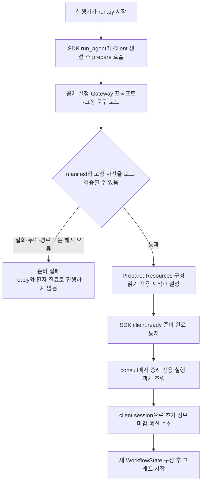

[run.py](run.py)는 SDK에 `prepare`와 `consult`를 전달하는 얇은 진입점이다. `prepare()`에서는 환자를 보지 않고 사용할 설정과 지식의 파일 경계·해시·문구 계약을 확인한다. 지식은 하나의 RDFLib Graph로 읽으며 환자의 관찰을 그 Graph에 쓰지 않는다. 이 단계에서 실패하면 준비 완료 통지를 보내거나 빈 지식으로 계속하지 않는다.

준비가 끝나면 SDK가 `client.ready()`를 호출하고 `consult(client, resources)`로 들어간다. `consult`는 Doctor·입력 해석·질문 계획·추론·제출 객체와 증례별 상태를 새로 만든다. `client.session()`에서 받은 초기 정보, 마감 시각, 남은 턴, 허용 행동과 서버 예산을 사용한다. 준비 지식과 설정에 이전 환자의 대화나 후보를 쌓지 않는다.

### 9.2 대화 한 번 — 선택부터 응답 반영까지

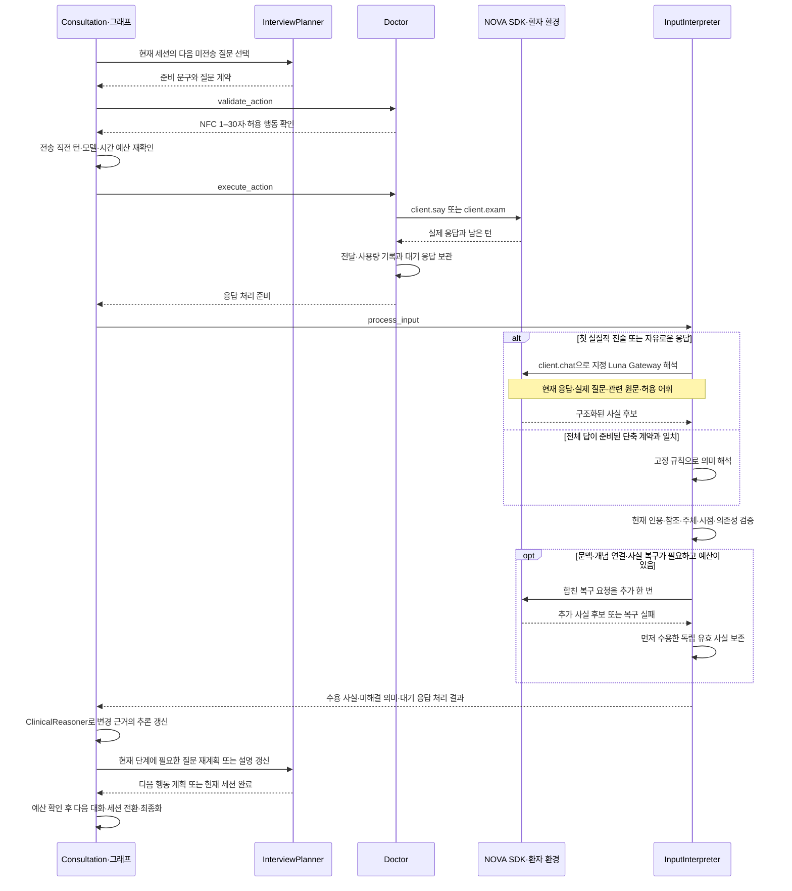

환자에게 보이는 문진 뒤에는 **문구 검증 → 실제 전송 → 원문 보존 → 사실 해석 → 추론 갱신 → 다음 질문 재계획**이 이어진다. Doctor는 진단이나 임상 질문을 선택하지 않으며 공감·D37 교육 한국어를 생성한다. Education 이후에는 해석과 원문 보존을 계속하되 고정 진단과 계획을 재선택하지 않는다.

“네”처럼 짧은 답이라도 무엇에 동의했는지가 질문 계약으로 완전히 정해질 때만 고정 규칙으로 처리한다. “아니요, 작년에는 있었어요”는 현재 부재와 과거 존재를 함께 말하므로 전체 응답을 Gateway로 보낸다. 한 응답의 사실 일부가 잘못됐을 때 독립된 다른 유효 사실까지 지우지 않는다. 임상 처리는 응답당 최대 세 호출이며 공감 생성은 별도 최대 한 호출이다. 모두 같은 증례 예산을 공유한다.

실제 전송이 성공한 뒤에만 전달 이력을 만든다. 질문 후보에만 있었던 문구, 거절된 초안, 전송 오류는 환자와 나눈 대화가 아니다. 다음 질문은 마지막 응답을 처리한 뒤 선택하므로, 앞서 만든 질문 목록을 환자의 답과 무관하게 끝까지 읽지 않는다. 대표 CC 전체 속성까지는 준비한 순서를 따르고, Open Inquiry 뒤의 문진은 새 근거로 재계획한다. Education에서는 진단·초기 계획을 고정하고 새 환자 보고와 공감만 보존한다.

### 9.3 첫 인사부터 제출까지 따라가는 예시

아래에서 `Python 진료 흐름`은 Consultation·InterviewPlanner·ClinicalReasoner·SubmissionWriter의 협력을 묶은 표현이다. `NOVA 환경`은 SDK가 연결하는 환자 응답·진찰·제출 인터페이스다. 초기 `opening`에 실질적인 진술이 없고 인사 후 “배가 아파요”라는 첫 답을 받는 경우를 가정한다. HPI·ROS·병력·진찰은 현재 수용 자산에 해당 질문·연결이 있고 실행 자격을 통과했을 때 수행한다.

```mermaid
sequenceDiagram
    participant N as NOVA 환경
    participant D as Doctor
    participant C as Python 진료 흐름
    participant I as InputInterpreter
    Note over N,I: 준비 통과·세션 초기 정보 처리 후 시작
    C->>D: Initiation의 인사·주호소 유도
    D->>N: SAY 안녕하세요. 무엇이 어떻게 불편하세요?
    N-->>D: 예시 응답 배가 아파요
    D-->>C: 실제 전달과 응답 기록
    C->>I: 첫 실질적 진술을 지정 Gateway로 해석
    I-->>C: 주호소·원문·주체·관찰과 발현
    loop 대표 CC의 연결된 전체 속성 처리
        C->>D: 대표 CC의 현재 속성 승인 질문
        D->>N: SAY 위치·양상·기간·심각도 등 한 질문
        N-->>D: 해당 질문에 대한 환자 응답
        D-->>C: 실제 응답
        C->>I: 답에 담긴 사실과 정정 처리
        I-->>C: 같은 관찰·발현에 연결한 정보
    end
    C->>D: Open Inquiry 한 번
    D->>N: SAY 그 밖에 불편한 증상이 있나요?
    N-->>D: 추가 불편 또는 없다는 응답
    D-->>C: 실제 응답
    C->>I: 추가 증상과 원문 해석
    I-->>C: 수용 사실과 미해결 의미
    loop 적격 질문과 예산이 남은 집중 ROS·나머지 속성
        C->>D: 현재 가치로 선택한 승인 질문
        D->>N: SAY 준비된 질문
        N-->>D: 환자 응답
        D-->>C: 실제 응답
        C->>I: 응답 해석
        I-->>C: 추론·재계획에 반영할 사실
    end
    Note over N,C: 집중 ROS는 원래 주호소 계통 안에서 총 6회 이내
    opt ContextFactor에 승인된 미해결 병력·적용 조건이 있음
        C->>D: 관련 Context의 승인 질문
        D->>N: SAY 병력 또는 적용 조건 확인
        N-->>D: 주체와 시점을 포함한 응답
        D-->>C: 실제 응답
        C->>I: Context 사실 처리
        I-->>C: 조건·후보 갱신과 다음 질문 재계획
    end
    opt DifferentialDiagnosis에 적격 미해결 질문·진찰이 있음
        C->>D: 후보를 구분할 승인 질문 또는 진찰 요청
        D->>N: SAY 또는 EXAM
        N-->>D: 환자 응답 또는 실제 진찰 결과
        D-->>C: 획득 출처와 응답
        C->>I: 주관 보고와 실제 소견을 구분하여 처리
        I-->>C: 적합도·근거 갱신과 미전송 질문 재계획
    end
    Note over N,C: Context와 감별도 필요한 동안 공통 루프를 반복
    C->>C: Education 진입·진단 고정
    Note over N,C: 기본 true; false는 교육 행동 없이 우회
    opt ONTOWARD_EDUCATION_ENABLED=true
    C->>C: 원문 전체·전체 실제 대화·고정 진단으로 영어 P 생성
    C->>D: 영어 문장별 한국어 변환·NFC 1–30 검증
    loop 대기 발화와 공유 예산이 남음
        D->>N: SAY 검증된 한국어 설명
        N-->>D: 환자 응답
        D-->>C: 영어 P와 분리한 전달 이력
        C->>I: 새 진술·사실·공감 처리
        I-->>C: 원문과 사실 보존; 진단·계획 유지
    end
    end
    C->>C: 대기 응답 해소·고정 진단·저장 계획으로 SOAP 구성
    C->>N: 세션 재확인 후 DIAGNOSE
    N-->>C: 제출 결과
    opt 수정 가능한 기록 오류이고 재구성 한 번이 남음
        C->>C: 보존 사실에서 재구성·재검증
        C->>N: 새 요청 ID로 DIAGNOSE
        N-->>C: 제출 결과
    end
    alt status가 completed
        C->>C: submitted로 기록하고 정상 종료
    else 실패·불명·만료·폐쇄
        C->>C: 해당 결과와 사유를 기록하고 비정상 종료
    end
```

첫 인사에 “배가 아파요”라는 답을 받았다고 바로 특정 질환을 정하지 않는다. 복통이라는 주호소를 원문과 연결한 뒤 위치·시간·양상처럼 아직 모르는 정보를 묻고, 열린 질문으로 추가 불편을 확인한다. 이후에는 그때까지의 사실이 공유 Pattern과 어떻게 맞는지에 따라 다음 질문이 달라진다. 이 예시가 특정 질환이나 고정된 질문 순서를 임상 자산으로 추가하는 것은 아니다.

ContextFactor와 DifferentialDiagnosis는 새로운 공식 세션을 만드는 시점이 아니다. 같은 환자의 기존 사실·대화·남은 예산을 이어받아 질문의 목적만 바뀐다. 승인된 Context나 진찰 연결이 없거나 물을 가치가 없으면 해당 행동을 생략한다. 반대로 질문이 필요하면 같은 단계의 공통 루프를 여러 번 반복한다.

설명 후의 대화도 마지막까지 입력으로 처리하며 새 진술·사실·공감과 미해결 의미를 보존한다. 진단과 초기 계획을 바꾸지 않고 남은 한국어 발화의 전달 여유만 판단한다. 전부 안내하지 못하면 미전달을 기록하고 영어 계획은 최종 기록에 유지한다. 최종화는 별도의 환자 대화를 생성하지 않는다.

### 9.4 대화 수와 예산을 해석하는 방법

| 흐름 | 실제 대화 수를 결정하는 것 | 다음 단계로 남기는 것 |
|---|---|---|
| 인사·주호소 유도 | 준비된 첫 SAY, 필요한 제한적 명료화 | 확인된 주호소와 초기 정보 |
| CC 속성 | 대표 CC, 연결된 전체 목록·처리 상태·남은 슬롯 | 관찰·발현·시점별 속성과 원문 |
| Open Inquiry·집중 ROS | Open Inquiry 한 번, 현재 가치에 따른 ROS 총 여섯 번 이내 | 추가 증상·명시적 부재·미해결 정보 |
| Context·감별 | 승인 질문·진찰 연결, 현재 질문 가치와 남은 예산 | 적용 조건·실제 소견·진단 근거 |
| Education | 기본 활성화, 고정 진단의 한국어 문장과 남은 공통 턴 | 영어 P·전체 실제 전달 이력·미전달 사유; 명시적 false는 우회 |
| SOAP·DIAGNOSE | 검증 결과와 전체 한 번의 재구성 한도 | 서버 결과와 확인된 종료 상태 |

루프 안에서 실행한 SAY·EXAM의 서버 턴 변화가 실제 행동 사용량이다. D35 세션 문진 상한과 공통 50턴을 함께 따르며 공감은 세션 상한에서 제외하지만 공통 턴을 쓴다. 최소 목표는 강제 횟수가 아니므로 고정 대화 번호로 세션을 나누지 않는다. 그래프 노드 수, 문진·공감 SAY/EXAM 수, 모델 호출 수는 구분하고 마지막 행동 응답까지 처리한 뒤 마감 전에 제출한다.

새 SAY·EXAM 전에 Gateway 한 호출과 출력 여유, 응답 처리 120초, 최종화 120초를 확보한다. 기한·모델·행동 예산이 부족하면 문진을 계속 늘리는 대신 최종화로 이동한다. 이 절의 순서는 그 조건을 충족했을 때의 실행 계획이며, Mermaid 원문의 시각 렌더링·실제 Luna 호출·공식 진료 실행·임상 성능은 별도 검증 대상이다.

<a id="change-guide"></a>

## 10. 수정 방향을 생각할 때 확인할 책임과 경계

아래는 변경을 구현한 목록이 아니라, 원하는 동작과 관련된 현재 코드·기록을 찾아가는 안내다. 한 단계의 품질 문제를 다른 단계의 점수 변경으로 가리는 일을 피하려면 입력부터 제출까지 어느 경계에서 기대와 달라졌는지 먼저 확인하는 편이 좋다.

| 확인하려는 현상 | 먼저 볼 기록 | 해당 책임·코드 |
|---|---|---|
| 환자 말을 다른 증상으로 연결함 | 실제 input·전송 vocabulary·별칭·`parser_result`·거절 사유 | [InputInterpreter](workflow/input_interpreter.py)의 `_search`, `_vocabulary`, `_request_parse`와 [입력 검증](workflow/rules/input.py) |
| 증상은 연결됐는데 주호소로 확정되지 않음 | S.cc의 status·subject·time_context·인용·개념 ID | [CaseState](workflow/state/models.py)의 `chief_complaints`와 입력 사실 반영 |
| 기대한 질환이 후보에도 없음 | Target ID와 그 Target의 Association | [ClinicalKnowledge](knowledge/graph.py)의 `get_patterns_by_target`; 원천 연결 변경은 준비·수용 범위 |
| 후보는 있지만 지지 점수가 0임 | `pattern_matches`, `association_matches`, 미해결 Feature·적용 조건 | [ClinicalReasoner](workflow/clinical_reasoner.py)의 `_match`, `_applicability`, `refresh_hypotheses` |
| 추가 정보를 얻었는데 점수가 낮아짐 | 선택 Contribution과 정교화·차분·관찰·발현 | 정교화 대체 규칙과 manifest의 scoring policy |
| 높은 점수의 질환이 최종 선택되지 않음 | `evidence_score`, fit, `chief_coverage` | `supported_hypotheses`, `select_diagnosis` |
| 예상과 다른 질문을 먼저 함 | `assessment`, selection_report, 임상·질문 개정·세션·예산 | [InterviewPlanner](workflow/interview_planner.py)의 `_frontier`, `replan`, `select_question`와 selection.py |
| 턴을 많이 쓰거나 Context가 먼저 끝남 | 0 가치 질문 여부, 정렬의 첫 비Context 위치, 남은 용량 | 질문 필터·사전식 비교·ContextFactor 절단 규칙 |
| 묻지 않거나 한 번 물은 내용을 다시 확인함 | 출처, 실제 delivered 이력, observation/episode, clarification 수 | `has_resolved_evidence`, `was_asked`, QuestionLifecycle |
| 제출 기록이 비거나 근거가 빠짐 | `diagnosis_evidence`, 실제 source_refs·획득 상태, 수용 plans | [SubmissionWriter](workflow/submission_writer.py)와 [지식 manifest](knowledge/manifest.json) |

특히 다음 네 가지는 현재 동작을 평가할 때 구분해야 한다. 첫째, Gateway의 단일 Symptom 선택은 출력 계약이고 그 의미가 맞았다는 임상 판정은 아니다. 둘째, 원천 지지와 fit은 정렬 점수이며 진단 확률이 아니다. 셋째, 질문 가치는 전체 추론의 확률적 최적화가 아니므로 높은 가치 질문 선택만으로 최소 턴을 보장하지 않는다. 넷째, 증상 수준 잠정진단·Education pass·빈 계획 필드 허용은 제출을 진행할 수 있는 경계이며 해당 평가 영역의 충족을 뜻하지 않는다.

현재 검증 이력은 [submission 상태](PROJECT_STATE.md)에 연결되어 있다. 합성 입력의 행동 검증, 실제 수용 RDF와 스크립트 응답의 상담, 독립 ZIP의 실행은 코드·자산·제출 계약을 확인한 증거다. 실제 Luna의 한국어 의미 매핑, 공식 서버 재검증, 임상 정확도·공식 점수는 별도 관측으로 남아 있다. 문서·그림·예제는 그 구분을 대신하지 않는다.
