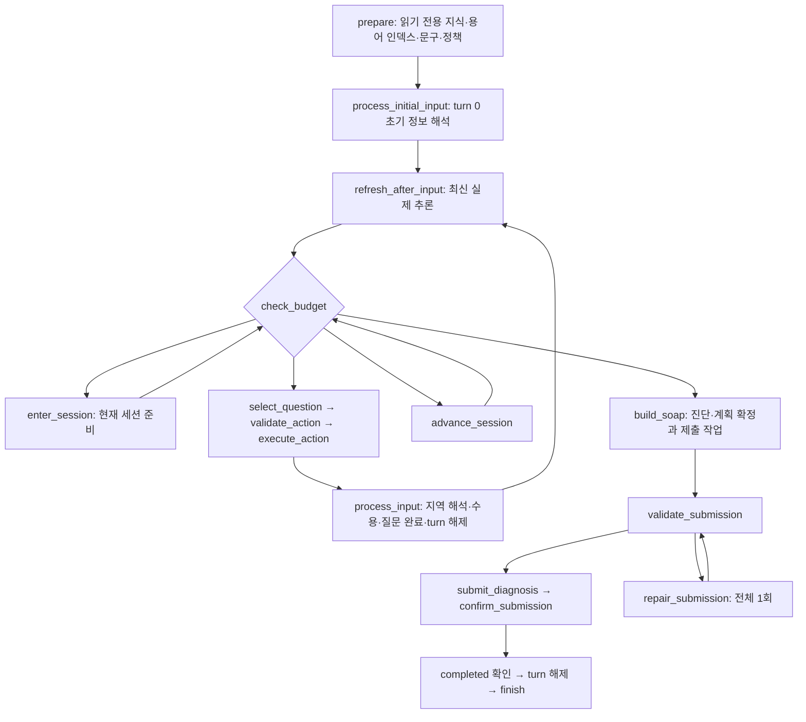
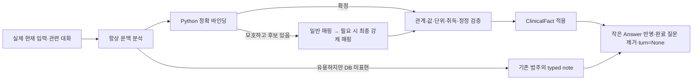
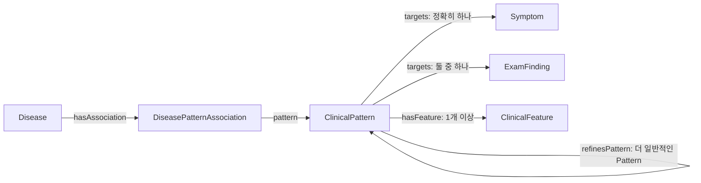
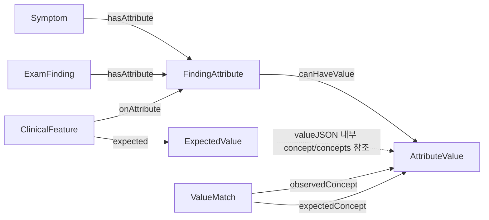
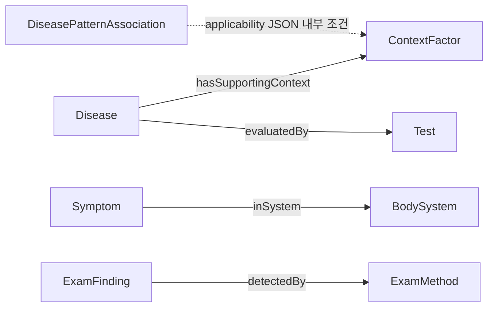
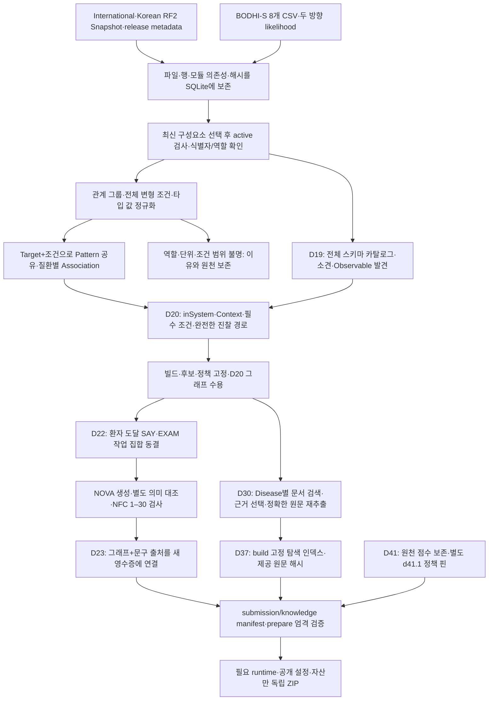

# Ontoward 진료 워크플로우 백서

이 문서는 2026-10-18의 **D44·d44.1 구현**을 설명한다. [사용자 결정](../DECISION_STATE.md#D44), [요구사항](../PRD.md), [실제 상태 정의](workflow/state/models.py)를 기준으로 읽는다. 지식과 점수는 기존 D42 수용 자산, 질문 효용은 D38 정책, 수집과 Education 예산은 D40을 유지한다. 수행 결과와 미실행 경계는 [제출 상태](PROJECT_STATE.md)와 [D44 증빙](../data/provenance/state-lifecycle-d44-2026-10-18.json)에 연결한다.

Python은 질문·추론·진단·SOAP 직렬화를 결정한다. 지정 모델은 문맥 분석, 모호한 진술의 DB 연결, 공감, 진단 후 계획과 한국어 전달을 맡는다. 수용된 사실은 처음부터 canonical한 작은 typed fields로 저장한다. 원문을 복사한 상태를 매번 정리하는 투영 계층은 없다.

<a id="workflow-graph"></a>
## 1. 실행 흐름과 소유권



[graph.py](workflow/graph.py)의 실제 작업 노드는 16개이며 START·END를 포함하면 18개다. 실패·만료·닫힘·불확실 전송은 `abort`로 종료한다. 각 노드는 이전 상태를 깊은 복사하고 작업한 뒤 Pydantic으로 검증한다. 복사·검증 대상은 상주 상태 3개와 현재 턴 작업뿐이다. 과거 원문·모델 응답·가상 평가·추론 캐시는 이 경계를 통과하지 않는다.

| 실행 책임 | 소유 코드 | 정보 경계 |
|---|---|---|
| 준비·상담 조립 | [runtime.py](workflow/runtime.py) | `PreparedResources` 재사용, 상담마다 실행 객체 생성, 종료 시 대화·reasoner 캐시 해제 |
| 세션 조정 | [consultation.py](workflow/consultation.py) | 다섯 내부 세션과 최종화만 조정 |
| 해석·수용 | [input_interpreter.py](workflow/input_interpreter.py) | 실제 원문 문맥의 유일한 실행 소비자, 지역 `InputResult`를 적용 |
| 문구 검증·행동 | [doctor.py](workflow/doctor.py) | 준비 질문·공감·교육 전달과 실제 SAY/EXAM |
| 질문 선택 | [interview_planner.py](workflow/interview_planner.py) | 현재 세션 대기열과 작은 완료 기록을 이용 |
| 실제·가상 추론 | [clinical_reasoner.py](workflow/clinical_reasoner.py), [selection.py](workflow/rules/selection.py) | 같은 순수 커널, 실제 캐시 한 벌과 선택 중 지역 캐시 |
| SOAP·제출 | [submission_writer.py](workflow/submission_writer.py) | 최종 직렬화와 확인, SOAP 사본을 CaseState에 저장하지 않음 |
| 수명·사용량 | [state/](workflow/state/), [budget.py](workflow/rules/budget.py) | 질문 완료·폐기·현재 턴과 한번씩 계산하는 예산 |
| 모델·세션·전송 | [io/](workflow/io/) | 직접 `ModelResult`, 최신 서버 제약, 동일 요청의 제한된 재시도 |

<a id="session-pipelines"></a>
## 2. 다섯 세션과 질문의 수명

하나의 공식 세션 안에서 다음 순서로 진행한다. 미래 세션의 질문은 미리 저장하지 않는다.

| 세션 | 현재 세션에서 준비할 일 | 조건부 목표 / 최대 문진 |
|---|---|---:|
| Initiation | 초기 호소를 재질문하지 않고 인사와 미확인 onset·course·recurrence·previous_care 수집 | 5 / 7 |
| ChiefComplaint | 환자가 우선시한 CC 하나, 전체 등록 속성, Open Inquiry, 유용한 집중 ROS | 7 / 14 |
| ContextFactor | 기본 병력 다섯 영역과 관련 Context 최대 두 개의 보호 수집, 이후 효용 비교 | 7 / 9 |
| DifferentialDiagnosis | 새 근거에서 판단을 바꾸는 증상·속성·Context·EXAM 선택 | 3 / 10 |
| Education | working diagnosis 고정, 영어 계획, 조건을 포함한 한국어 안내; 답변은 대화 기록 전용 | 5 / 10 |

`Question` 등록은 환자 기록을 만들지 않는다. 선택된 질문 ID를 현재 턴에서 참조하고, 실제 실행 응답을 해석한 뒤 사실·note와 `Answer`를 각각 반영한다. 완료 질문은 대기열에서 제거하고 `turn=None`으로 닫는다. 주호소가 바뀌면 이전 관찰에 묶인 대기 질문을 버린다. 완료된 질문 문구·응답 전체는 상태에 남기지 않는다.

최소 목표는 기확인·모름·자산 부족을 무시하고 질문을 채우라는 뜻이 아니다. 현재 필수 수집, 뒤 세션의 조건부 최소량, 활성화된 교육 5턴을 보호한다. 주호소의 마지막 수집 슬롯은 Open Inquiry에 남긴다. 집중 ROS 대상은 대표 CC의 계통에서 매번 계산하며 다른 증상으로 연쇄 확장하지 않는다.

공감은 네 수집 세션에서만 허용한다. 감정·요청 코드와 원문 대신 중복 억제용 해시를 보관한다. 실제 전달과 답변은 같은 행동 루프를 거친다. Education에서는 임상 해석·공감·재진단을 수행하지 않는다.

<a id="roles-and-state"></a>
## 3. 남긴 객체와 모든 필드의 수명

```text
WorkflowState
├─ case       상담 중 유지: 환자 사실·note·대표 fact 참조·최종 결과
├─ interview  상담 중 유지: 현재 단계·작은 대기열·완료와 중단 결과
├─ session    상담 중 유지: 서버 제약·실제 사용량·종료 증빙
└─ turn       현재 행동/초기 입력/제출 동안만 유지, 처리 후 None
```

아래 표에서 같은 생성·소비·폐기 이유를 가진 필드는 함께 적었다. 이름은 실제 코드 필드이며 별도 호환 필드가 없다. 상담 종료는 `consult()`의 `finally`에서 실행 객체의 환자 문맥과 캐시를 해제하는 시점이다. 반환된 최종 상태는 호출자/Test가 보유하는 결과다.

| 객체·필드 | 소유자 | 생성 시점 | 소비자 | 폐기·교체 시점 | 필요한 이유 |
|---|---|---|---|---|---|
| `PreparedResources.knowledge`, `config` | prepare | 준비 | 해석·질문·추론·행동·제출 | 준비 자원 수명 종료 | 여러 상담에 환자 없는 읽기 전용 자원 재사용 |
| `WorkflowState.case`, `interview`, `session` | Consultation | 상담 시작 | 그래프 노드 | 상담 결과 반환 | 서로 다른 상주 책임 구분 |
| `WorkflowState.turn` | 행동/제출 작업 | 초기 입력·행동 선택·최종화 | 다음 실행·처리 노드 | 입력 반영·완료·실패 | 노드 사이 현재 작업만 연결 |
| `CaseState.facts` | InputInterpreter | 검증된 임상 주장 수용 | 주호소·질문·reasoner·SOAP·모델 환자 문맥 | 유효 정정 또는 상담 종료 | 획득한 임상 사실의 단일 정본 |
| `CaseState.notes` | InputInterpreter | DB로 표현 못 하는 유용한 정보 수용 | SOAP·수집 판단 | 상담 종료 | 치료력·관찰·미등록 수치 보존, 진단 점수 제외 |
| `CaseState.chief_fact_id` | 주호소 선택 | 우선 호소 확정 | 질문·reasoner·SOAP | 선택 변경·정정 | 대상·관찰·에피소드를 복제하지 않고 참조 |
| `CaseState.diagnosis` | reasoner/Consultation | Education 진입 또는 최종화 | 계획·한국어 변환·SOAP | 상담 종료 | 한 번 고정한 working 진단의 정본 |
| `CaseState.plan` | 교육 생성 | 검증된 최종 영어 문장 생성 | Doctor·SOAP | 상담 종료 | 최종 계획 한 벌과 최소 출처 연결 |
| `CaseState.revision` | 사실 수용 | 사실·주호소 변경 | 실제 추론 캐시·재계획 | 변경 때 증가 | 최신 결과가 유효한지 판단 |
| `ClinicalFact.id` | 입력 수용 | 각 독립 주장 | 정정·주호소·근거·완료 기록 | 정정·상담 종료 | 질문과 다른 사실 신원 |
| `ClinicalFact.kind`, `target`, `attribute`, `values`, `measurement`, `status` | 입력 수용 | DB 관계·값·수치 검증 후 | 임상 소비자 | 유효 정정 | 단일 주장을 중첩 mapping 없이 표현 |
| `ClinicalFact.subject`, `subject_member`, `reported_by`, `time_context` | 입력 수용 | 문맥 검증 | 해석·충돌·추론·SOAP·교육 문맥 | 유효 정정 | 가족·보고자·과거와 현재 구분 |
| `ClinicalFact.observation_id`, `episode_id` | 입력 수용 | 참조 확인 또는 새 관찰 생성 | 속성 연결·질문·추론·SOAP | 유효 정정 | 다른 발현의 세부사항을 합치지 않음 |
| `ClinicalFact.category` | 입력 수용 | 의미 범주 결정 | 주호소·수집·SOAP | 유효 정정 | 저장 위치 대신 의미로 SOAP 배치 |
| `ClinicalFact.acquisition`, `source_ref`, `turn` | 입력 수용 | 실제 초기 입력·SAY·EXAM | 정정 검증·출처·SOAP | 유효 정정 | 환자 발화가 진찰을 대체하지 않게 함 |
| `ClinicalFact.polarity_scope`, `evidence_use`, `binding`, `resolves` | 입력 수용 | 조건부 부정·고립 속성·근사·명료화 수용 | 현재 사실·reasoner·질문·미해결 평가 | 유효 정정 | 한정 부정·record_only·강제 근사·해결된 불확실성을 구별 |
| `ObservedNumber.kind`, `value`, `unit` | 입력 수용 | 수치 검증 | 비교·SOAP | 소유 사실/note 수명 종료 | 실제 수량과 보고 단위 |
| `ObservedNumber.lower`, `upper`, `upper_unit`, `lower_inclusive`, `upper_inclusive`, `approximate` | 입력 수용 | 구간·근사 검증 | 수치 비교·SOAP | 소유 사실/note 수명 종료 | 경계·서로 다른 단위·근사 의미 보존 |
| `NoteFact.id`, `category`, `value`, `measurement`, `status` | 입력 수용 | note 수용 | 수집·SOAP | 상담 종료 | 기존 범주·영어 값과 별도 수치, polarity 보존 |
| `NoteFact.subject`, `subject_member`, `reported_by`, `time_context`, `observation_id`, `episode_id`, `source_ref`, `turn` | 입력 수용 | note 문맥 수용 | 수집·SOAP·감사 연결 | 상담 종료 | 기록용 정보의 주체·시간·출처 구별 |
| `Diagnosis.kind`, `name`, `evidence_ids`, `certainty`, `unresolved` | 최종 선택 | 진단 고정 | 계획·SOAP·결과 검토 | 상담 종료 | 질환/증상·working 상태·실제 근거·평가 한계 |
| `PlanSentence.id`, `field`, `text`, `basis`, `references`, `priority` | 교육 생성 | 문장 검증 | Korean 대기열·SOAP | 상담 종료 | 영어 P 정본과 provenance·안전 우선순위 |
| `SourceReference.document_id`, `start_byte`, `end_byte` | 교육 검증 | 정확한 인용 확인 | 최종 계획 출처 검토 | 문장 수명 종료 | 원문 전체와 인용 사본 없이 출처 위치 보존 |
| `InterviewState.current`, `status` | Consultation | 상담 시작·단계 준비 | 예산·라우팅·planner | 단계 전환 | 현재 단계와 명료화 뒤 준비 재개 |
| `InterviewState.queue` | planner/Doctor | 현재 세션 준비·재계획·교육 변환 | 선택·실행·입력 수용 | 완료·부적합·주호소 변경·세션 종료 | 지금 전달 가능한 작은 대기열 |
| `InterviewState.answers` | 질문 완료 | 실제 답 처리·전달 중단 | 반복 방지·수집·종료·교육 결과 | 상담 종료 | 완료 객체 전체 대신 작은 결과 |
| `InterviewState.collection` | planner/예산 | 자산 차단·예산 중단 | 필수 수집·재계획 | 상담 종료 | 답변 기록으로 구할 수 없는 중단만 저장 |
| `InterviewState.empathy` | 입력 수용 | 새 감정·요청 검증 | 공감 선택·중복 억제 | 전달·억제·Education 진입 | 처리할 감정 코드 한 건 |
| `InterviewState.education_status`, `education_reason` | 계획/변환 | 생성 종료 | 중복 생성 방지·결과 검토 | 상담 종료 | 성공·부분·실패·비활성 구분과 최소 사유 |
| `Question.item_id`, `kind`, `purpose`, `text`, `order`, `priority` | planner/Doctor | 대기열 등록 | 예산·행동 | 답 처리·취소 | 실행 문구·행동·목적·순서·보호 우선순위 |
| `Question.target`, `attribute`, `observation_id`, `episode_id`, `subject`, `time_context` | planner | 질문 바인딩 | 중복·해결 판단·해석 | 답 처리·취소 | 묻는 대상과 취득 범위 |
| `Question.affirmative_presence`, `answer_type`, `primary_choice`, `category`, `coverage`, `clarifies_id` | planner | 질문 계약 준비 | 해석·수집·명료화 | 답 처리·취소 | 질문 의미와 필수 수집·불확실성 연결 |
| `Question.plan_sentence_id`, `empathy_key` | Doctor | 교육/공감 등록 | 전달 결과 | 답 처리·취소 | 영어 문장/감정 중복 식별만 연결 |
| `Answer.question_id`, `source_ref`, `scope`, `purpose`, `key`, `outcome` | 질문 수명 | 답 처리·미전달 | 반복 방지·예산·수집 | 상담 종료 | 의미 키와 처리 결과, 원문 사본 제외 |
| `Answer.fact_ids`, `category`, `turn`, `coverage` | 질문 수명 | 답 처리 | 획득·질문/증거 연결·Context 보호 | 상담 종료 | 실제 획득과 모름을 구별 |
| `Answer.plan_sentence_id`, `reason`, `empathy_key` | 질문 수명 | 교육/공감 처리·미전달 | 결과·중복 억제 | 상담 종료 | 전달·중단의 최소 연결 |
| `PendingEmpathy.source_ref`, `emotion`, `intent`, `key` | 입력 수용 | 감정 검증 | Doctor·중복 억제 | 전달·억제 | 원문을 넘기지 않고 공감 작업 유지 |
| `SessionContext.session_id`, `deadline`, `turns_remaining`, `allowed_actions` | NovaSessionClient | 상담·최신 서버 조회 | 전송·예산·종료 | 최신 값으로 교체 | 공식 세션 제약 |
| `SessionContext.finalizing`, `reserve_seconds` | Consultation/예산 | 시작·자원 부족 | 라우팅·모델·전송 | 상담 종료 | 수집 종료와 최종 제출 시간 확보 |
| `SessionContext.usage` → `Usage.actions`, `empathy_actions` | 사용량 계산 | 소비된 행동 수신 | 세션 상한·공통 보호 | 상담 종료 | 총 실제 턴과 공감 부분집합 |
| `SessionContext.doctor_calls`, `doctor_successes`, `input_tokens`, `output_tokens` | ModelClient | 요청·응답 수신 | 모델 한도·SDK 제출 조건 | 상담 종료 | 중복 없는 실제 사용량 |
| `SessionContext.call_limit`, `input_token_limit`, `output_token_limit`, `models_available` | NovaSessionClient/ModelClient | 시작·최신 제약·모델 중단 | 모델/행동 예산 | 최신 제약으로 감소 | 불명확한 사용량 이후 수집 방지 |
| `SessionContext.clarifications` | planner | 명료화 예약 | 전체 최대 2회 | 상담 종료 | 미전달 예약까지 포함한 한도 |
| `SessionContext.termination`, `reason`, `receipt` | 종료·제출 확인 | 명시적 실패·completed | 그래프 종료·호출자 | 상담 결과 반환 | 결과와 최소 status/request ID 증빙 |
| `TurnContext.kind`, `question_id`, `request_id`, `stage` | 선택·제출 | 현재 작업 시작 | 다음 노드·동일 요청 복구 | 처리 완료·종료 | 행동 사본 없이 현재 작업 연결 |
| `TurnContext.response`, `payload`, `repairs`, `error` | Doctor/제출 | 수신·SOAP 구성·형식 검사 | 해석·제출·1회 복구 | 처리 완료·제출 확인·종료 | 응답과 SOAP를 필요한 동안만 유지 |

### 그래프 밖에서만 존재하는 정보

| 객체·필드 | 소유자·생성 | 소비·필요 이유 | 폐기 시점 |
|---|---|---|---|
| `ModelResult(content,error,request_id)` | ModelClient 현재 호출 | 호출자가 잘림·실패를 직접 분기 | 현재 호출 처리 후 |
| `ContextInput(statements,patient_context,empathy)`와 `ContextStatement` | 문맥 분석 | 인용·의미·주체·시점·참조·수치·note 값·정정의 단회 수용 검증 | 현재 입력 반영 후 |
| `EmpathySignal(quote,intent,emotion)`, `PatientContextFact(key,value,quote)` | 문맥 분석 | 현재 원문으로 감정·인구학 검증 | 감정 코드·해석기 문맥 반영 후 |
| `InputResult(facts,notes,outcomes,empathy,preferred)` | 해석 지역값 | 사실·note·완료·대표 fact ID 반영 | process_input 반환 |
| 문맥 후보·매핑 dictionary·행별 오류·형식 복구 | 해석 지역값 | 미해결 부분의 제한된 복구 | 현재 입력 반영 후 |
| `InputInterpreter.dialogue`, `patient_context` | 실제 입력/전달 | 후속 지시어·환자/보고자 문맥 해석 | 상담 종료 |
| `ClinicalReasoner._key`, `_snapshot` | 실제 평가 | 최신 임상 개정/주호소의 결과 재사용 | 사실·주호소 변경 시 교체, 상담 종료 시 clear |
| `ReasoningSnapshot(evidence,chief,policy,hypotheses,pattern_matches,association_matches,evaluations)` | reasoner | 실제 점수와 다음 질문에 필요한 최신 계산 | 최신 실제 캐시 교체 |
| `EvidenceIndex(raw,entries,groups,contexts,fingerprint)`, 내부 `EvidenceRecord` | 실제 또는 가상 평가 | 내부 URI와 사실 신원·수치·범위로 순수 계산, 임상 상태에 직렬화하지 않음 | 소유 실제/가상 평가 종료 |
| `Hypothesis(disease_id,evidence_score,chief_score,context_bonus,contradiction_penalty,chief_coverage,evidence_ids,contradiction_ids,unresolved_conditions,contradicted_conditions)` | reasoner | 적격 판단·순위·SOAP 감별·추가 질문 | 최신 실제 캐시 교체 |
| `PatternMatch(pattern_id,observation_id,episode_id,time_context,fingerprint,status,contradicted,unresolved,evidence_ids)`, `AssociationMatch(association_id,pattern_key,applicability,evidence_ids)` | reasoner | 공유 매칭 재사용과 실제/가상 일치 | 소유 평가/캐시 교체 |
| `QuestionPath(specs,profile,disease_id,pattern_id)`, `QuestionEvaluation`의 답변 영역·cache·used·limited·scalar utility | 질문 평가 | 경로 가능성과 선택 수식 계산 | 선택 완료 |
| `InterviewPlanner._last_plan_key` | 재계획 | 같은 실제 사실·질문 결과·예산에서 반복 계산 억제 | 다음 재계획으로 교체·상담 종료 |
| `_EducationWork(repairs,sentences,documents,notes,errors)`와 인용 원문 | 교육 생성 | 순차 원문 읽기·정확한 인용·형식 복구 | 검증된 최종 문장과 위치만 Case.plan에 전달 후 |
| 한국어 변환의 batch·rendered·failures | Doctor | 독립 문장 검증·전체 묶음 예약 | 대기열/미전달 receipt 반영 후 |
| 감사 event와 SDK 요청·응답 | Test 관측 | 원인 검토·재현·산출물 증빙 | Test 출력 보존 정책; 실행에서 다시 읽지 않음 |

읽기 전용 `TextConfig`는 `parser_prompt`, `normalization_prompt`, `empathy_prompt`, `education_prompt`, `education_doctor_prompt`, `texts`, `education_enabled`를 보관한다. 사용하지 않던 준비 문구·표시 형식 필드 14개를 제거했다. 이 자원은 그래프 노드마다 복사하지 않는다.

`RecordItem`, `ClinicalValue`, `ChiefAnchor`, `DifferentialState`, `QuestionPlan`, `InteractionState`, 별도 교육 진행 객체, `CanonicalSnapshot`, `ParsedInput`, `PatientReport`와 사용되지 않던 span·누적 진단 보고서는 삭제했다. 상충·모름·미등록이 사실 확보를 의미하지 않는다는 구분은 작은 완료 결과와 현재 사실에서 유지한다.

지역 `ContextStatement`의 `quote`, `role`, `focus`, `assertion`, `target_terms`, `attribute_terms`, `value_terms`, `subject`, `subject_member`, `reported_by`, `time_context`, `observation_id`, `episode_id`, `anchor`, `record_category`, `primary_concern`, `correction_id`, `polarity_scope`, `assertion_scope`, `measurement`, `note_value`는 현재 입력 검증·바인딩에만 필요하다. 해석 함수 반환 뒤 문맥 객체 전체를 버리고 수용한 사실·note·작은 질문 결과만 반영한다.

<a id="gateway"></a>
## 4. 문맥 분석과 필요한 정규화만 남기는 입력 경로



문맥의 인용은 현재 실제 입력에 있어야 한다. 기존 fact·관찰·발현 참조는 전송한 문맥에 있는 것만 허용한다. 독립 유효 행을 고정하고 잘못된 행만 한 번 복구한다. turn 0에서 관찰 존재와 원인 불확실성을 혼동한 우선 호소는 추가 집중 검토를 허용하며 진짜 모름을 양성으로 강제하지 않는다.

정식 영어 명칭과 동의어는 준비 인덱스로 정확히 연결한다. `Location → head`는 속성의 허용 값 범위에서 식별한다. 같은 값 이름의 전역 중복은 다른 속성으로 이어지지 않는다. 환자 사실에는 용어와 URI를 함께 저장하지 않는다. URI 변환은 EvidenceIndex·질문 계산·지침 조회 등 지식 경계에서만 수행한다.

모호한 임상 진술만 후보 8개/확장 32개와 등록 속성·값·단위를 제공해 매핑한다. `binding_repair`는 없다. 일반→최종 강제 단계와 배치당 형식 복구 1회가 남는다. 독립 수용 행을 재전송하지 않으며 빈 후보 매핑 호출은 하지 않는다. 정확한 DB 대상이 알려진 진술을 획득 방식이 다른 대상이나 수치 슬롯이 우연히 맞는 다른 호소로 옮기지 않는다.

유효한 정정은 같은 대상·주체·속성·관찰·에피소드·시점·취득 경로에만 적용한다. 대체 전 값은 감사 event로 내보낸다. SAY로 초기/EXAM 사실을 교체할 수 없다. 고립된 등록 속성은 record_only이며 진단 근거가 아니다. 검증한 사실을 하류에서 다시 파싱하거나 원문 필드를 반복 삭제하지 않는다.

DB로 표현하지 못한 유용한 진술은 기존 범주의 `NoteFact`로 보존한다. 영어 값과 수치를 분리해 구간 경계·단위·근사를 잃지 않는다. note는 진단 점수·교육 환자 사실에 들어가지 않는다. 인사·수긍·질문·미래 의도는 임상 주장으로 만들지 않는다. 포괄적 병력 부정은 개별 질환 음성으로 확장하지 않는다.

### C03 Turn 04의 재현 범위

저장된 문맥 응답을 바꾸지 않고 재현하면 `previous treatment (-)`와 `observation; monitoring (+)`가 `previous_care` note로 남는다. 저신장 자체의 양성·음성으로 바꾸지 않는다. 이전 세 매핑 요청은 후보가 비어 있었고 이번 경로는 문맥 1회, 매핑 0회다. [재현 결과](../Tmp/d44-2026-10-18/evidence/c03.json)는 저장 응답의 처리 경로 증거다. 수정 프롬프트의 실제 Luna 의미 품질은 미실행이다.

<a id="reasoning"></a>
## 5. 임상 추론과 실제 캐시

D38 점수 정책과 수용 원천 가중치를 유지한다. 현재 사실의 상태 충돌과 해결된 불확실성을 반영하고 patient·현재 관찰을 episode와 정확한 time context로 묶는다. 가족·과거 정보는 맞는 Context 조건에서 사용한다. note·record_only·한정된 일반 부정은 진단용 EvidenceIndex에서 제외한다.

공유 Pattern의 모든 Feature와 Association 적용 조건이 맞아야 지지가 활성화된다. matched 정교화는 ancestor를 대체하며 점수가 낮아져도 기존의 높은 점수를 합하지 않는다. Disease–Target별 지지는 한 번만 집계한다.

```text
fit = exact chief support + min(4, other Target support)
      + min(1, positive supporting Context) - bounded contradiction
```

부재 감점은 적용 조건이 맞는 기본 존재 Pattern, 활성 chief episode의 명시적 현재 부정과 원천 typicality에만 적용한다. Target당 최대 1, 질환당 최대 2이며 모름·누락·상세 불일치는 감점하지 않는다. 적격 질환은 양수의 정확한 chief 지지·맞는 적용 조건·양수 fit을 요구한다. 적격 질환이 없으면 확인한 chief의 증상 진단으로 제출하고, 확인한 chief도 없으면 명시적으로 실패한다.

증례별 reasoner 하나를 planner와 writer에 주입한다. 최신 임상 revision·chief fact ID의 실제 결과 한 벌만 유지한다. 가상 답변은 immutable 내부 evidence patch로 같은 커널에 적용하며 실제 상태·실제 캐시를 바꾸지 않는다. [고정 입력 비교](../Tmp/d44-2026-10-18/evidence/comparison/comparison.json)는 D43과 D44의 전체 해당 후보 점수·근거 일치를 확인한다.

<a id="question-selection"></a>
## 6. 질문 효용과 지역 계산

실제 근거에서 아직 남은 Feature·전제의 경로를 만든다. 대상 존재는 양성/음성, 범주는 명시적 긍정/부정 조합, 수치는 조건의 임계값·경계·단위별 구간으로 평가한다. 모름을 임상 음성이나 같은 확률의 유효 분기로 넣지 않는다. 현재 후보 8개와 구조가 다른 잠재 후보 4개를 먼저 비교하고 필요하면 chief와 양립하는 전체 후보로 넓힌다.

```text
직접 효용 = D + 0.25 E
후속 경로 = 0.5^(질문 수−1) × 공동 가치 / 질문 수
```

D는 후보 쌍의 상대 판단 변화이며 두 적격 후보의 점수 차를 scale 4로 제한한다. E는 적격 여부의 변화다. 최대 6질문 경로·512 가상 평가를 유지하며 완전하게 평가한 양수 가치 질문만 등록한다. 지금 점수가 변하지 않아도 존재→속성처럼 뒤에 판별력이 생기는 경로를 평가한다. 거짓 전제·모름·없는 자산·세션 용량으로 불가능한 경로를 제외한다.

가상 patch·경로·시뮬레이션 결과는 선택 함수 지역값이다. 대기 질문에는 실행 바인딩·목적·순서·우선순위만 들어간다. 관측이 꺼져 있으면 답변별 점수 보고 dictionary를 만들지 않는다. 관측이 켜지면 선택·가상 평가 event를 Test로 보내고, 실제 최신 reasoner 반환값과 함께 검토한다. 상태에는 선택 보고서나 가상 응답을 보존하지 않는다.

<a id="budgets-and-submission"></a>
## 7. 예산·Education·SOAP·완료

공통 50 SAY/EXAM 턴, 지정 모델 200회, 입력 500,000·출력 100,000토큰을 유지한다. 새 수집 전 문맥·매핑 최소 2회와 8,192 출력토큰, 응답 처리 120초·최종화 120초를 남긴다. 공감은 생성까지 3회분을 확보한다. 준비된 Education 전달은 답변 모델 예약이 없다. 서버 제약이 줄면 최신 제한을 반영한다.

모델 요청은 전체 messages로 크기를 잰다. 문맥 기본 12 KiB·복구 16 KiB·문맥 초과 뒤 8 KiB, 교육은 64 KiB다. 잘린 출력은 `ModelResult.error`이고 부분 의미 성공으로 사용하지 않는다. 일시 전송 오류는 2초 뒤 같은 ID·payload로 한 번 재시도한다. 해결되지 않으면 unknown으로 종료하며 기록 실패 때문에 행동을 재실행하지 않는다.

Education에서는 진단을 working 상태로 고정한다. 지침은 상대 경로·해시·관계 범위를 확인하고 원본 마운트에서 읽는다. 큰 원문은 연속 조각을 모두 읽고 정확한 인용을 검증한 지역 노트로 결합한다. 최종 문장과 document ID·바이트 위치만 남긴다. 영어 계획 생성은 high·최대 8,000, 한국어 변환은 medium·최대 4,000 토큰이며 동일 예산을 쓴다. 원문 근거/모델 지식/혼합을 구분하고 조건과 치료를 한 문장에 유지한다.

한국어는 NFC 1–30자 독립 문장으로 검증한다. 묶음 일부가 잘못되거나 전체를 전달할 용량이 없으면 그 묶음을 전달하지 않고 작은 미전달 결과만 남긴다. 영어 P는 보존한다. 명시적 `ONTOWARD_EDUCATION_ENABLED=false`는 교육 행동·보호 턴·P.education을 생략한다.

SOAP는 사실·note·고정 진단·최종 계획에서 Python이 결정론적으로 만든다. `CaseState.S/O/A/P`는 없으며 전송 payload는 제출 작업에만 존재한다.

| SDK 구역 | 문자열 필드 | 내용 |
|---|---|---|
| S | cc, hpi, pmh, fh, sh, ros | 대표 호소, 의미 범주별 임상 사실·note, 가족·과거·필요한 발현 구별 |
| O | exam, tests | 실제 objective 취득; 예선 tests는 빈 문자열 |
| A | evidence, differential | 고정 진단과 실제 근거, 적격 감별과 확보한 지지/반증 |
| P | tests, treatment, disposition, follow_up, education | 최종 영어 계획, 실제 한국어 전달 결과와 구별 |
| 별도 인수 | diagnosis | 최종 진단명 하나 |

영어 `Category: Content`·polarity·등록 값·수치·근사·구간 경계를 유지한다. 통증 세부사항은 같은 주호소·관찰·episode·시점의 확보 값만 사용한다. 환자 원문과 내부 URI·요청 ID는 SOAP에 넣지 않는다. 미시행 검사·미래 계획을 실제 O로 만들지 않는다. SOAP 100,000바이트와 진단명 500바이트, 실제 Doctor 성공 호출 조건을 검증하고 로컬/서버 형식 오류를 합쳐 1회 재구성한다.

성공은 `DIAGNOSE` 응답이 `completed`일 때다. 확인 뒤 SOAP·응답 전체를 해제하고 최소 status/request ID receipt와 `termination=submitted`를 남긴다. 단순히 질문이 끝나거나 진단명이 생긴 것을 성공으로 기록하지 않는다.

<a id="configuration"></a>
## 8. 설정·검증·독립 ZIP

[.env](.env)는 공개 경로와 교육 설정만 갖는다. [settings.py](settings.py)는 config와 knowledge 경로를 제출 내부로 제한한다. 모델 키는 패키지에 없다. [manifest](knowledge/manifest.json)의 알고리즘 표지는 d44.1이고 임상 RDF·어휘·원천 가중치·질문·지침 인덱스·기존 수용 receipt는 보존한다. 새 의존성을 추가하지 않았다.

기본 오프라인 회귀는 미리 준비한 프로젝트 dev 이미지에서 실행한다. 오프라인 overlay는 암묵적 이미지 빌드를 막고 네트워크와 개발 키를 끈다.

```sh
docker compose -f compose.yaml -f Dev/tests/workflow/compose.offline.yaml run --rm --no-deps --pull never -T dev python -B -m unittest discover -s Dev/tests/workflow -p 'test_*.py'
docker compose -f compose.yaml -f Dev/tests/workflow/compose.offline.yaml run --rm --no-deps --pull never -T dev python -B Dev/tests/workflow/test_admitted.py --submission submission --output Tmp/d44-admitted
```

회귀는 수명·독립 사실·가족·수치·정정·취득·충돌·강제 연결·전송·교육·완료와 캐시/관측 일치를 검증한다. 이전 타입에 결합된 테스트는 이 행동별 회귀로 재구성했으며 이전 204개 테스트를 그대로 실행했다고 주장하지 않는다. 수용 RDF의 별도 검증은 세 상담과 Context polarity·실제 EXAM을 포함한다. 독립 ZIP은 부모 프로젝트 데이터나 개발 키 없이 두 CPU·8 GiB·읽기 전용·네트워크 없음 환경에서 검증한다. 원본 SDK의 로컬 HTTP는 프로젝트 내부 Docker 네트워크에서 검증한다.

관측기·viewer 검증은 실제 브라우저의 시각 검증과 구분한다. 저장 C03 응답 재현은 새 모델 품질 검증과 다르다. 실제 Luna 해석·한국어 의미 품질·임상 정확도·실제 NOVA·공식 점수·게시·배포는 미실행이다. 수치 비교와 산출물 해시는 D44 증빙에 측정 범위와 함께 남긴다.

<a id="runtime-dialogue"></a>
## 9. 한 턴을 읽는 예

1. planner가 현재 세션의 질문을 등록한다. 환자 사실은 바뀌지 않는다.
2. `turn.question_id`와 새 request ID로 한 질문을 선택한다. 문구는 대기열에 한 번만 있다.
3. Doctor가 준비 문구·예산을 확인하고 실제 SAY/EXAM 응답을 받는다.
4. 원문 대화는 해석기 문맥에 한 번 보관한다. 문맥·후보·mapping·복구는 지역값이다.
5. 검증한 fact/note를 적용하고 해당 질문을 작은 완료 결과로 바꾼다.
6. 대기 질문과 TurnContext를 제거하고, 임상 revision이 바뀐 경우만 최신 실제 추론을 교체한다.

예를 들어 “치료받은 적은 없고 지켜봤어요”는 치료력 부정과 관찰 경험의 note 두 개다. 이를 위해 주호소의 양성/음성 사실을 다시 만들거나 세 번의 빈 후보 매핑을 수행할 필요가 없다. 미등록 수치가 있으면 값·단위·범위를 note의 수치에 보존하면서 진단 근거로 승격하지 않는다.

<a id="change-guide"></a>
## 10. 변경할 때 지킬 경계

정보를 추가하기 전에 다음 턴의 실행 판단에 필요한지 확인한다. 입력 함수에서 끝나는 정보는 지역값으로, 실제 환자 사실은 CaseState로, 질문 처리 결과는 InterviewState로, 서버 제약과 사용량은 SessionContext로 둔다. 노드 사이에서 현재 행동을 이어갈 때만 TurnContext를 사용한다. 해설과 감사 때문에 상태 객체나 mapping 사본을 늘리지 않는다.

원천·스키마·임상 수용은 Dev/data, 환자 워크플로우는 submission, 관측·개인 뷰어는 Test가 소유한다. 새 corpus·모델·기능·배포를 정보 객체 리팩토링에 섞지 않는다. 아래 온톨로지와 준비 파이프라인은 이 수명 구분과 별개의 읽기 전용 지식 구조다.

<a id="ontology-schema"></a>

## 11. v5.0 스키마: 14개 클래스와 연결

구조의 기준은 [schema.ttl](../data/ontology/schema.ttl)이며 실행 시에는 [manifest](knowledge/manifest.json)가 고정한 동일 스키마를 읽는다. 아래 세 그림은 같은 스키마를 질문별로 나누어 보여준다. 모든 연결은 클래스 사이의 허용 관계를 표현하며, 각 노드가 실제 환자의 관찰이라는 뜻은 아니다. [atlas의 SVG](../Test/atlas.html#ontology)는 관계 이름·설명·현재 인스턴스 수를 함께 제공한다.

### 11.1 질환·공유 Pattern·Feature



Association은 Disease 소유자 하나와 Pattern 하나를 가진다. Pattern의 Target은 Symptom·ExamFinding 중 정확히 하나다. Feature는 Pattern 하나에 귀속되고 그 Target을 상속한다. **Target·PatternMatch·ScoreContribution·FeatureContribution은 별도 v5.0 RDF 클래스가 아니다.** Target은 두 클래스의 역할 이름이고 나머지는 Python의 매칭·파생 계산 레코드다. `refinesPattern`은 더 구체적인 Pattern에서 일반 Pattern을 향하며 매칭 후 조상 기여를 대체한다.

### 11.2 관찰 속성·기대 값·비교 경로



존재만 비교하는 Feature는 `expectedStatus`를 사용한다. 속성 조건은 `onAttribute`와 `expected`를 한 쌍으로 가진다. ExpectedValue의 `valueJSON`은 `concept`, `concept_set`, `quantity`, `interval` 중 하나다. 개념 집합의 any_of/all_of, 수치 연산자·단위·구간 경계를 보존한다. 점선은 JSON 내부 참조이며 새 RDF predicate가 아니다. 수치 값은 범주 AttributeValue가 없어도 표현할 수 있다.

ValueMatch는 `observedConcept → expectedConcept` 비교를 허용하는 근거 있는 방향성 경로다. `relationKind`의 is_a·regional_part·approved_region을 구분하고 `sourceRef`를 유지한다. 스키마에 정의되어 있어도 현재 수용 RDF의 ValueMatch 인스턴스는 0개다. 임의의 부위 포함 관계나 동의어를 이 클래스로 추가하지 않는다.

### 11.3 문진 계통·Context·진찰·검사 계획



`hasSupportingContext`는 이미 회수한 Disease의 제한된 양성 보강이고, `applicability`는 충족해야 지지가 활성화되는 필수 조건이다. 둘은 같은 의미가 아니다. ContextFactor는 `contextType`을 가지며 환자·가족·과거·현재는 증례 근거에서 구분한다. BodySystem은 집중 ROS 탐색에만 사용하고 Disease 회수를 제한하지 않는다. ExamFinding은 검토된 ExamMethod와 `examRequestText`가 있어야 실제 EXAM으로 취득한다. Test와 `evaluatedBy`는 P.tests 계획 역할이며 예선 진단 중 TEST 행동을 실행하지 않는다. D37의 생성 P.tests는 이 클래스의 인스턴스 유무와 별도로 출처·내용을 검증한다.

### 11.4 클래스별 역할과 현재 실행 인스턴스

수치는 2026-10-17의 manifest 고정 schema·vocabulary·clinical bundle을 하나의 RDFLib Graph로 읽어 집계한 값이다. 원천 전체 카탈로그의 규모와 구분하며 활성 manifest가 바뀌면 다시 집계해야 한다.

| 클래스 | 역할 | 실행 인스턴스 |
|---|---|---:|
| Disease | 질환 후보 | 843 |
| Symptom | 환자가 보고할 수 있는 증상 Target | 533 |
| ExamFinding | 실제 신체진찰 소견 Target | 2 |
| FindingAttribute | 위치·양상·두 시간 축 등 비교 차원 | 36 |
| AttributeValue | 속성에 허용된 범주 개념 | 1,153 |
| ClinicalPattern | 단일 Target의 공유 조건 묶음 | 1,925 |
| ClinicalFeature | Pattern에 귀속된 존재·속성 조건 | 3,530 |
| ExpectedValue | 엄격한 타입 기대 값 | 430 |
| DiseasePatternAssociation | 질환–Pattern–적용 조건·원천 평가 | 9,955 |
| ValueMatch | 근거 있는 개념 비교 경로 | 0 |
| ContextFactor | 병력·노출·인구학 맥락 | 310 |
| BodySystem | 비배타적 문진 계통 | 12 |
| ExamMethod | 준비된 진찰 방법 | 2 |
| Test | 검사 계획 개념 | 0 |

관계 화살표 이외의 스키마 속성은 다음과 같다. RDFS domain/range는 구조 설명이며 실제 개수·타입·의미 조건은 Python reader가 검증한다.

| 소유자 | 속성 | 의미 |
|---|---|---|
| OntologySchema | `schemaVersion` | 구조 버전 5.0; 클래스 목록 밖의 스키마 식별 노드 |
| ClinicalFeature | `expectedStatus` | 존재·부재 조건 |
| ExpectedValue | `valueJSON` | 타입·연산자·단위·범주/수치 값 |
| DiseasePatternAssociation | `predictiveness`, `typicality`, `strongPredictor` | 두 방향 원천 평가와 별도 원천 표지; strongPredictor를 추가 점수로 더하지 않음 |
| DiseasePatternAssociation | `relationBasis`, `derivationScope`, `applicability` | 원천 관계·정확/일반화 범위·주체/시점/상태를 가진 JSON 필수 조건 |
| ContextFactor | `contextType` | 정해진 열 가지 Context 분류 |
| ValueMatch | `relationKind` | 승인된 비교 경로의 의미 |
| Disease | `urgencyLabel` | 설명용 메타데이터; 라우팅·정렬 규칙 아님 |
| ExamMethod | `examRequestText` | NFC 1–30 codepoint 단일 진찰 요청 |
| 관련 지식 노드 | `sourceRef` | 원천·승인 비교 경로의 간결한 참조; 환자 근거 아님 |

<a id="extraction-pipeline"></a>

## 12. 원천에서 질문과 실행 자산까지

준비 알고리즘은 `Dev/`에 있고 상담 코드는 이 파이프라인을 실행하지 않는다. 아래는 현재 결과를 만든 경로의 설명이며 새로운 원천 수집·모델 작업·배치 재개 명령이 아니다.



| 단계·구현 | 알고리즘에서 보존하는 것 |
|---|---|
| [database.py](../Dev/ontology/database.py) | 전체 공급 파일·행·원본 식별자·RF2 관계 그룹·행 위치·모듈 의존성·출처 해시. 최신 버전을 선택한 뒤 active 필터를 적용 |
| [source_projection.py](../Dev/ontology/source_projection.py)·[model_normalization.py](../Dev/ontology/model_normalization.py) | source variant의 모든 조건과 AND/OR 범위. 제한된 모델 정규화도 후보이며 누락 단위·수치·관계를 모델 지식으로 생성하지 않음 |
| [v5.py](../Dev/ontology/v5.py) | Disease·source와 독립적인 Pattern 동일성, Disease+Pattern+applicability Association, source score·정교화·원자/공동 차분 |
| [source_catalog.py](../Dev/ontology/source_catalog.py)·[findings.py](../Dev/ontology/findings.py) | 14개 클래스별 후보·원천 역할·직접 진찰 방법·grouped value·진료과 공백. 발견 후보와 실행 가능한 부분집합을 구분 |
| [connections.py](../Dev/ontology/connections.py) | 원천 부위의 계통 경로→inSystem, 양성·0이 아닌 영향→typed Context 보강, prerequisite→필수 applicability. 불완전 진찰 후보의 실행 제외 |
| [patient_text.py](../Dev/ontology/patient_text.py) | 그래프에 고정한 환자 행동만 생성. 요청 예약·실패 원문·별도 의미 대조·NFC/길이 결과를 보존하고 Korean RF2 용어와 모델 문구 출처를 구분 |
| [admission.py](../Dev/ontology/admission.py) | 정확한 build·후보 집합·선택 항목·필수 규칙·수용 영수증. D23이 수용한 완전 후보에 새 승인 대기를 추가하지 않음 |
| [guidelines/map.py](../Dev/guidelines/map.py) | 카탈로그 허용 문서·FTS5 검색·동일 SCTID 별칭·모델의 evidence_id 선택·Python의 원문 복사. background_only와 P 근거 공백을 보존 |
| [package_submission.py](../Dev/packaging/package_submission.py) | 허용 파일과 해시·개수·크기, 원본·준비 DB·비밀값·문서·테스트의 제외 |

`source_projection.py build/export/admit`는 원천 정본·후보·수용의 경계를, `connections`는 D20 파생 연결을 담당한다. D19의 `source-findings.ttl` 발견 자료 전체를 실행 그래프에 넣지 않는다. D20의 그래프만 수용한 중간 상태는 `graph_admitted_text_pending`이었으며 D23이 한국어 행동을 고정한 뒤 현재 `admitted`가 되었다. D37은 문서 탐색 인덱스, D38은 별도 추론 정책을 추가하며 원래 그래프·행동 수용 기록을 보존한다.

진료 중 RF2·BODHI 원본이나 부모 준비 DB를 다시 읽지 않는다. **추론은 ZIP 내부 RDF와 JSON, Education은 고정 탐색 인덱스와 제공 원문 마운트**를 사용한다. 환자의 실제 기록은 이 파이프라인의 새 일반 지식으로 되돌려 쓰지 않는다. 공모전 수용과 독립 임상 검증·실제 모델 품질·공식 평가의 최신 경계는 [D44 수명 리팩토링 기록](../data/provenance/state-lifecycle-d44-2026-10-18.json)에 정리한다. 이전 [D43 입력 복구 기록](../data/provenance/input-recovery-d43-2026-10-18.json), [D41 수용 기록](../data/provenance/algorithm-d41-2026-10-18.json)과 [운영 상태](PROJECT_STATE.md)에 연결되어 있다.

D42의 [현재 데이터 배치와 작성 안내](../data/preparation/v5/common-complaints-2026-10-18-r2/README.md)는 기존 843개 질환·9,401개 Association을 보존하고 추가한 데이터와 남은 공백을 설명한다. 새 출처의 정성적 연관은 별도 정책 점수 1을 사용하며, 작성자 지정 수준은 작성자 판단으로 보존한다. 일반 구어·기록 속성·출처 재배포가 점수 보너스가 되지 않는다. 새 임상 그래프·문구·정책은 [D42 수용 기록](../data/provenance/common-complaints-d42-2026-10-18.json)의 새 manifest와 영수증으로 구분한다.
