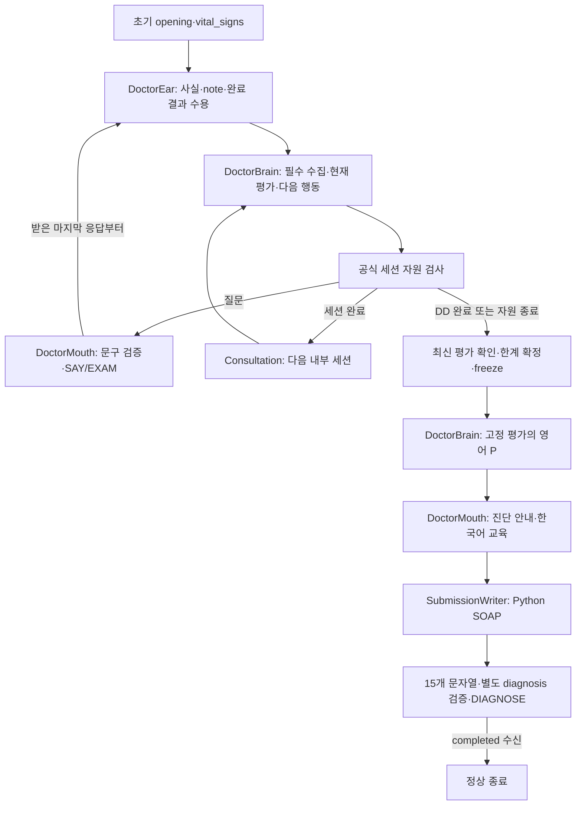
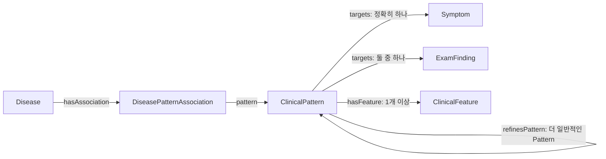
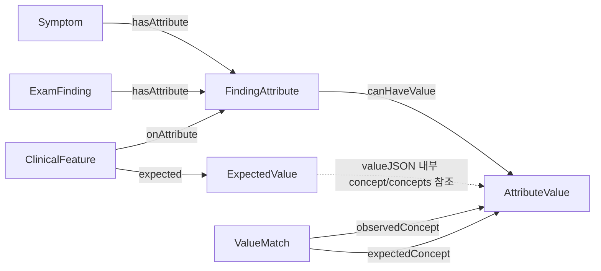
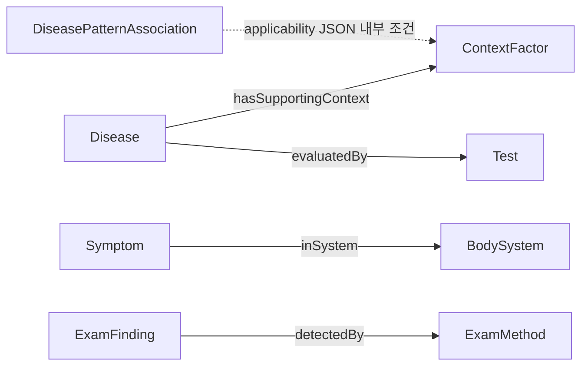

# Ontoward 진료 워크플로우 백서

이 문서는 **D46·d46.1 DoctorEar·DoctorBrain·DoctorMouth 알고리즘**을 설명한다. 그래프가 후보·근거·질문을 제공하고 DoctorBrain이 감별 순위와 다음 행동을 선택한다. DD 종료 때 고정한 단일 Assessment를 Education과 Python SOAP가 함께 소비한다. [D46 결정](../DECISION_STATE.md#D46), [PRD](../PRD.md), [상태 정의](workflow/state/models.py), [검증·산출물 기록](../data/provenance/algorithm-d46-2026-10-19.json)을 기준으로 읽는다. 기존 임상 자산 핀과 D45 공식 턴 예산을 유지한다.

## 1. 진료 실행 흐름

외부 진입점은 [run.py](run.py)의 `prepare()`·`consult()`다. `prepare()`는 제출 내부 경로·스키마·수용 영수증·해시·준비 한국어 문구를 검사하고 읽기 전용 RDFLib Graph 하나를 준비한다. `consult()`는 증례별 실행 객체를 만들고 초기 입력을 실제 SAY 이전에 처리한다. [LangGraph](workflow/graph.py)는 다음 순서를 실행한다.

실제 그래프에는 초기 입력·후속 입력·판단 갱신·세션 진입·예산·질문 선택·행동 검증/실행·세션 전환·SOAP·제출 검증/복구/전송/확인·finish/abort의 16개 실행 노드가 있다. Consultation만 세션 이동과 종료를 조정한다. 전송 결과가 불명확하면 새 환자 행동으로 진행하지 않고 명시적 실패·unknown으로 종료한다.

## 2. 다섯 세션과 필수 수집

| 세션 | 코드가 보호하는 수집 | 선택적 판단 |
|---|---|---|
| Initiation | 준비 인사, 발병·기간·경과·재발 등 초기 문맥 | 초기부터 잠정 감별 평가 |
| ChiefComplaint | 대표 등록 Symptom 하나, 같은 관찰의 전체 등록 속성, Open Inquiry | 같은 계통의 제한된 ROS·속성 |
| ContextFactor | 기본 병력과 준비 가능한 등록 Context 수집 | 현재 후보와 관계가 있는 Context |
| DifferentialDiagnosis | 받은 응답 처리와 최신 평가 확보 | 미확인 feature·applicability·등록 진찰·제한된 명료화 |
| Education | 고정 진단 안내, 활성화된 영어 계획과 한국어 전달 | 진단이나 사실을 다시 선택하지 않음 |

대표 주호소는 환자가 우선시한 하나의 현재 증상이다. 부수 증상은 별도 관찰로 유지한다. 필수 항목은 `acquired / unknown / recorded_unmapped / not_applicable / unsupported / conflict / blocked_asset / budget_stopped` 등 실제 결과를 남긴다. LLM의 종료 제안이 대기 중 필수 수집을 없애지 못한다. 자원 때문에 끝나면 완료로 바꾸지 않고 한계에 기록한다.

세션의 조건부 목표/상한은 D40의 **5/7·7/14·7/9·3/10·5/10**이다. 목표 턴은 무조건 채우는 할당량이 아니다. 수집할 유효 항목과 남은 공식 자원을 함께 검사하고 다른 세션의 상한을 빌리지 않는다.

## 3. 실행 객체와 상태 수명

| 소유자 | 권한 | 보관하는 증례 정보 |
|---|---|---|
| [DoctorEar](workflow/doctor_ear.py) | 초기·SAY·EXAM 해석, 정확한 Python 연결, 선택적 DB 정규화, 수용 | 후속 지시어 해석에 필요한 원문 대화 한 벌 |
| [DoctorBrain](workflow/doctor_brain.py) | 그래프 자료 구성, Assessment 갱신, 필수/선택 질문, 영어 P | 마지막 판단 revision·chief와 행동 입력 표지, 현재 오류만 |
| [DoctorMouth](workflow/doctor_mouth.py) | 준비 문구 검증, 공감·한국어 안내, SAY·EXAM 실행 | 별도 임상 정본 없음 |
| [Consultation](workflow/consultation.py) | 입력→판단→행동, 세션 전환, 예산 종료와 freeze | 세 실행 소유자와 공용 전송 참조 |
| [SubmissionWriter](workflow/submission_writer.py) | 고정 자료의 SOAP 변환·검증·DIAGNOSE·수신 확인 | 별도 진단·reasoner·LLM 없음 |

모든 LLM 호출은 이 세 역할 중 하나에 속한다. `ModelClient`·공식 SDK·동일 요청 재전송·사용량 계산은 공용 기반이다. Ear와 Mouth는 medium, Brain의 임상 판단과 영어 계획은 high를 사용한다. 모델은 모두 `openai/gpt-6-luna`다. 기존 이름의 호환 객체는 두지 않는다.

`WorkflowState`에는 다음 네 경계만 상주한다.

| 영역 | 내용과 수명 |
|---|---|
| `case` | 검증된 facts·notes, 대표 chief ID, 단일 assessment, 영어 plan. 사실의 source·취득 turn·관찰·episode를 보존. DD 고정 뒤 임상 변경 거절 |
| `interview` | 현재 세션·대기 질문, compact Answer, 수집 결과, 미전달 공감, 교육 상태. 완료 질문 객체는 제거하고 반복 방지 범위만 Answer에 유지 |
| `session` | 공식 세션 ID·기한·turns_remaining, 행동/모델 사용량, 자원 상한, 종료·수신 결과 |
| 선택적 `turn` | 지금 선택/전송/수신 중인 행동 또는 제출 payload와 복구 횟수. 입력 처리 또는 제출 확인 후 제거 |

`case.assessment`는 순서가 곧 순위인 후보, 후보별 `supports / against / unresolved` 참조, 기반 revision·chief, frozen 여부, 한계만 담는다. 별도 진단 정본·후보 이력·SOAP 상태가 없다. 모델 요청·매칭·후보·질문 자료는 호출 지역값이다. 환자와 무관한 graph index는 PreparedResources에서 재사용한다. 상세 이벤트·비교·재현·비용 분석은 Test가 외부 래퍼로 담당한다.

## 4. 입력 계약과 관찰 보존

[DoctorEar](workflow/doctor_ear.py)는 매 임상 입력의 문맥을 먼저 분석한다. 모델의 영문 typed statement를 Python이 등록 Target·Attribute·값에 정확히 연결하고, 모호한 항목만 제한된 DB 후보 정규화를 호출한다. 구조·참조·문구 검증 실패는 정해진 복구 경계에서 처리하며 각 행을 독립 수용한다. 잘못된 한 행이 나머지 사실을 지우지 않는다.

`opening`과 `vital_signs`는 코드가 발급한 별도 초기 구간이다. 모델의 quote가 실제 지정 구간에 있어야 해당 출처를 쓸 수 있다. 환자가 보고한 수치·집에서 측정한 값은 S, 신뢰된 초기 객관 구간과 실제 EXAM의 finding·attribute는 O로 간다. 기록 note도 `objective_observation`과 객관 취득 경계를 모두 충족해야 O에 들어간다.

환자 age·sex·명시한 historian은 typed `patient_context` note로 한 번 수용한다. 보호자 자신의 나이·병력은 가족 주체로 분리한다. 중복은 합치고 명시 정정은 대체하며 해결되지 않은 서로 다른 값은 uncertain으로 남긴다. 현재 자산에는 age·sex를 이용할 typed 적용 관계가 없으므로 HPI에만 기록한다.

임상 사실은 주체·가족 구성원·시점·관찰·episode·취득 방식·상태를 가진다. 불명·부정·조건부 표현을 양성으로 바꾸지 않는다. DB에 표현할 수 없는 유용한 기록과 조건문은 note에 남긴다. `record_only`와 조건부 `qualified` 보고는 진단 입력으로 승격하지 않는다. 환자 원문은 Ear의 대화 해석에만 사용하고 Brain·계획·SOAP는 수용된 typed 정보만 읽는다. Education 응답은 대화에만 남고 임상 사실을 바꾸지 않는다.

## 5. 알고리즘 ① 초기 그래프 설정과 지속 갱신

[rules/assessment.py](workflow/rules/assessment.py)는 초기 사실부터 현재 reasoning 정보의 Target·Attribute·등록 Context 관계로 관련 질환을 회수한다. 부분 패턴·실제 음성·unknown·미확인 applicability도 관련 질환을 검토하는 경로다. 회수와 지지는 별개다.

Feature matcher는 일치·불일치·미확인과 실제 fact ID를 반환한다. Pattern의 상태와 Association의 applicability를 따로 판정하고 코드가 supports·against·unresolved를 만든다. 수치 구간은 등록 단위와 경계를 비교하고, 개념 집합은 any_of/all_of와 개방 세계의 미확인을 보존한다. 기대 값의 명시적 부정과 실제 수치 불일치는 실제 fact 참조를 가진 반대 근거가 된다.

서로 다른 관찰·episode·주체의 속성을 합쳐 완성 Pattern을 만들지 않는다. 세부 조건이 미확인·불일치여도 일반 Pattern의 지지는 유지한다. 같은 관찰의 반복 출처는 독립 임상 지지로 늘리지 않는다. 불충족 applicability는 질환 전체의 부정을 뜻하지 않는다.

기존 유효 후보는 다음 요청에 모두 보호하고 신규 후보는 실제 근거 경로별로 고르게 배분한다. 전체 `messages` 직렬화가 **64 KiB**를 넘지 않게 하며 고정 Top-K를 두지 않는다. 먼저 compact 근거·조건을 제공하고 남는 공간에 상세 관계와 실행 가능한 질문을 넣는다. 보호된 현재 후보와 필수 사실만으로 상한을 넘으면 명시적 오류로 처리하며 후보를 조용히 삭제하지 않는다.

## 6. 알고리즘 ② 감별 순위·주진단·DD 고정

Brain의 정상 판단 출력은 `ranked_disease_refs`와 `next_action`뿐이다. 질환·질문 참조는 요청 지역값이다. 유효한 기존 후보 누락·미등록 질환·중복·잘못된 참조는 계약 오류다. 모델이 수용한 순위를 Python 점수로 재정렬하지 않는다. 근거는 코드가 연결하므로 모델 출력에서 반대 근거를 생략해도 사라지지 않는다.

임상 revision·chief가 바뀐 버전마다 정상 판단을 최대 한 번 하고 구조·참조 복구를 한 번 허용한다. unknown처럼 임상 사실이 바뀌지 않으면 현재 근거와 미확인 사유만 갱신한다. 행동 변경이 필요하면 순위 없는 `clinical_action`을 호출한다. 후보의 실제 현재 연결 경로가 모두 소실된 때만 무효화한다. 낮은 순위·지지 없음·프롬프트 공간 부족은 무효화 사유가 아니다.

DD 종료는 **마지막 응답 수용 → 최신 평가 확인 → 미확인·한계 확정 → assessment와 기반 facts·notes·chief 고정 → Education** 순서다. 최신 평가가 끝내 없으면 확인된 등록 chief 하나의 symptom-only Assessment로 이 경계에서 종결한다. 확인된 chief도 없으면 실패한다. Writer에는 fallback이 없다. freeze 뒤 입력·계획·한국어 전달·SOAP repair는 임상 순위와 A를 바꿀 수 없다.

## 7. 알고리즘 ③ 필수 수집과 선택 질문

필수 질문은 코드가 준비하고 완료 범위를 검사한다. 선택 질문은 현재 후보의 미확인 feature·applicability·구별 특징에서 만든다. `continue_required / ask / advance_stage / finish_collection`만 허용하고 `ask`는 제공된 질문 참조 하나를 선택한다.

같은 실행 질문은 하나로 묶되 질환별 기대 답과 적용 조건을 함께 전달한다. 질문 구조가 같아도 질환 후보는 합치지 않는다. 미확인 증상은 존재 여부부터 확인하며 속성 질문은 같은 관찰에서 존재가 확인된 뒤 허용한다. 등록 관계·준비 문구·단계·취득 방식·주체·가족 구성원·시점·완료 여부·남은 자원을 실행 직전에 검사한다.

`Question.subject_member`는 8항목 의미 키와 Answer 완료 범위에 들어간다. 보조 증상의 속성은 chief 속성을 완료시키지 않고 generic 가족 답변은 특정 어머니·아버지의 수집을 완료시키지 않는다. unknown·unsupported 등 이미 시도한 항목을 무한 반복하지 않는다.

유효 순위와 잘못된 행동은 분리한다. 순위가 수용되었다면 행동만 한 번 복구하며 순위를 바꾸지 않는다. 반복 실패는 수집의 명시적 미완료 사유다. 임의 질문으로 대체하거나 충분한 수집으로 기록하지 않는다. D38의 가상 답변·utility·전체 후속 경로 완성 gate·양수 점수·완성 chief Pattern 진단 gate는 현재 런타임에 없다.

## 8. 예산·Education·종료

D45의 공식 `turns_remaining`이 환자 행동 예산의 기준이다. SAY·EXAM의 실제 처리 비용을 공식 응답/조회로 정산하며 같은 요청 재전송은 동일 identity를 유지한다. 내부 판단·세션 조회·SOAP·DIAGNOSE는 행동 턴을 쓰지 않는다. 공통 상한은 **50턴·모델 200회·입력 500,000·출력 100,000토큰**이다.

새 행동 전에 받은 응답의 Ear 처리, 최신 Brain 판단과 허용 복구, 활성화된 영어 P·한국어 안내, 제출 시간을 보호한다. Brain 정상 출력 상한은 4,096, 복구는 8,000토큰이고 두 호출 모두 high다. Education 활성 시 진단 안내·증상 진단 설명·다섯 계획 영역을 위해 7턴을 보호한다. 비활성 설정에서는 교육 행동·예약이 없다. 공감은 별도 사용량으로 계산하지만 같은 공식 행동·모델 예산을 쓴다.

고정 뒤 Brain은 고정 진단·canonical 환자 정보와 build-pinned 가이드라인 인덱스로 영어 P를 생성한다. 원문은 `NOVA_GUIDELINES_DIR` 아래에서 해시 확인 후 필요한 부분만 읽는다. 원문 근거와 모델 지식 보완을 구분한다. Mouth가 고정 진단을 먼저 안내하고 계획을 NFC **1–30 codepoint** 한국어로 전달한다. 기존 공급자 응답 복구와 한국어 문구 검증 복구를 유지한다. 준비·미전달 계획을 전달 완료로 기록하지 않는다.

자원 종료도 이미 받은 마지막 응답부터 처리한 뒤 같은 freeze 절차를 거친다. 정상 완료는 유효 SOAP 전송 후 `DIAGNOSE completed` 수신까지다. 전송·검증 실패와 불명 수신을 정상 종료로 바꾸지 않는다.

## 9. 알고리즘 ④ 관찰 단위 Python SOAP

Writer는 현재 facts·유효 notes·frozen Assessment·영어 P·compact 전달 결과만 사용한다. 별도 모델 호출이나 진단 재선택이 없다. 환자 age·sex·historian을 HPI 앞에 두고 같은 관찰의 존재·속성·수치를 함께 표현한다. 실제 EXAM 속성은 O에 두며 각 취득 turn을 유지한다. 가족·과거·episode·조건·단위·수치 구간을 보존한다.

S/O를 만들며 fact ID→실제 문구의 지역 mapping을 만들고 A에서 재사용한다. A는 고정 순위와 코드가 연결한 지지·덜 부합·미확인을 읽는다. 미질문을 음성으로, 계획을 시행 결과로 바꾸지 않는다. P는 계획과 실제 전달 여부를 구별한다. SOAP repair는 같은 고정 평가를 다시 직렬화하며 Brain을 호출하지 않는다.

최종 계약은 S의 `cc/hpi/pmh/fh/sh/ros`, O의 `exam/tests`, A의 `evidence/differential`, P의 `tests/treatment/disposition/follow_up/education`이라는 **15개 문자열**과 별도 **diagnosis 문자열**이다. 예선의 `O.tests`는 비우고 diagnosis는 frozen 1위와 일치해야 한다.

## 10. 설정·검증·독립 ZIP

[공개 .env](.env)는 제출 내부 파일만 선택한다. 새 판단 프롬프트는 `ONTOWARD_BRAIN_PROMPT=config/brain.txt`다. Ear·정규화·공감·영어 계획·Mouth 프롬프트와 임상 문구도 `config/`에서 분리한다. 개발 키와 서버 원문은 공개 설정에 넣지 않는다.

검증은 프로젝트 소유 컨테이너의 `Dev/tests/workflow` 행동 회귀, 실제 수용 RDF의 대표 상담, Test 관측 유무 비교, SDK HTTP 경계, 독립 ZIP 실행으로 구분한다. Brain 고정 응답은 [Test/brain_double.py](../Test/brain_double.py)의 프로토콜 대역이다. 고정 이전 산출물과의 비교도 [Test/compare_d46.py](../Test/compare_d46.py)에서 수행한다. 재현·상세 로그 수집은 제출 실행 코드에 주입하지 않는다.

ZIP에는 필요한 runtime Python·고정 requirements·원본 SDK·공개 설정·프롬프트·실행 자산만 포함한다. 문서·상태·테스트·준비 DB·원본 문서·개발 키·과거 점수 정책은 제외한다. 압축 해제본은 부모 data 없이 네트워크 차단 상태로 확인하고 SDK HTTP 검증은 별도 프로젝트 내부망에서 한다. 모델·임상 정확도·공식 NOVA 평가는 이 오프라인 증거에 포함하지 않는다. 최신 실제 실행 수치·해시는 [D46 증빙](../data/provenance/algorithm-d46-2026-10-19.json)과 [운영 상태](PROJECT_STATE.md)를 따른다.

## 11. 한 턴에서 일어나는 일

예를 들어 복통과 별개 호흡 증상이 초기 보고되면 Ear가 각 관찰과 조건을 구별해 수용한다. Brain은 두 Target의 등록 경로에서 질환 후보를 회수하고 코드 근거와 질문 자료를 구성한다. LLM은 제공된 질환 참조 순서와 행동만 반환한다. 복통 속성이 필수 수집으로 남아 있으면 코드가 그 질문을 먼저 준비한다. 답변이 unknown이면 해당 수집 결과를 기록하고 같은 임상 revision의 순위는 다시 생성하지 않는다. 마지막 DD 답변이 새 사실이면 평가를 갱신한 뒤 고정하고, Education과 SOAP는 그 평가를 그대로 읽는다.

## 12. 변경할 때 확인할 경계

입력 의미는 Ear와 typed 계약, 질환 근거는 순수 matcher, 순위·질문은 Brain, 환자 전달은 Mouth, 세션 전환은 Consultation, SOAP와 완료는 Writer에서 바꾼다. 임상 텍스트 변경과 임상 자산 수용은 별개다. 새 source·문구·관계는 준비와 수용 영수증을 거치며 이번 알고리즘 개편에는 코퍼스 확장이 없다. 실제 수행 여부는 세 범위의 상태와 근거 파일에서 확인한다.

## 13. v5.0 스키마: 14개 클래스와 연결

구조의 기준은 [schema.ttl](../data/ontology/schema.ttl)이며 실행 시에는 [manifest](knowledge/manifest.json)가 고정한 동일 스키마를 읽는다. 아래 세 그림은 같은 스키마를 질문별로 나누어 보여준다. 모든 연결은 클래스 사이의 허용 관계를 표현하며, 각 노드가 실제 환자의 관찰이라는 뜻은 아니다. [atlas의 SVG](../Test/atlas.html#ontology)는 관계 이름·설명·현재 인스턴스 수를 함께 제공한다.

### 13.1 질환·공유 Pattern·Feature

Association은 Disease 소유자 하나와 Pattern 하나를 가진다. Pattern의 Target은 Symptom·ExamFinding 중 정확히 하나다. Feature는 Pattern 하나에 귀속되고 그 Target을 상속한다. **Target은 별도 RDF 클래스가 아니라 Symptom·ExamFinding의 역할 이름이다.** 매칭 결과와 근거 참조는 Python 지역값이다. 원천 점수의 차분 `FeatureContribution`은 준비 도구에만 남고 제출 런타임은 점수를 계산하지 않는다. `refinesPattern`은 구체적인 Pattern에서 일반 Pattern을 향한다. 같은 관찰·같은 적용 조건에서 세부 Pattern까지 모두 맞을 때만 대표 지지를 세부 Pattern으로 줄이며, 미확인·불일치 세부 조건 때문에 일반 지지를 지우지 않는다.

### 13.2 관찰 속성·기대 값·비교 경로

존재만 비교하는 Feature는 `expectedStatus`를 사용한다. 속성 조건은 `onAttribute`와 `expected`를 한 쌍으로 가진다. ExpectedValue의 `valueJSON`은 `concept`, `concept_set`, `quantity`, `interval` 중 하나다. 개념 집합의 any_of/all_of, 수치 연산자·단위·구간 경계를 보존한다. 점선은 JSON 내부 참조이며 새 RDF predicate가 아니다. 수치 값은 범주 AttributeValue가 없어도 표현할 수 있다.

ValueMatch는 `observedConcept → expectedConcept` 비교를 허용하는 근거 있는 방향성 경로다. `relationKind`의 is_a·regional_part·approved_region을 구분하고 `sourceRef`를 유지한다. 스키마에 정의되어 있어도 현재 수용 RDF의 ValueMatch 인스턴스는 0개다. 임의의 부위 포함 관계나 동의어를 이 클래스로 추가하지 않는다.

### 13.3 문진 계통·Context·진찰·검사 계획

`hasSupportingContext`는 등록 Context로 Disease를 회수하고 양성 맥락 근거를 구성하는 연결이며, `applicability`는 해당 Association의 지지가 활성화되는 필수 조건이다. 둘은 같은 의미가 아니다. ContextFactor는 `contextType`을 가지며 환자·가족·과거·현재는 증례 근거에서 구분한다. BodySystem은 집중 ROS 탐색에만 사용하고 Disease 회수를 제한하지 않는다. ExamFinding은 검토된 ExamMethod와 `examRequestText`가 있어야 실제 EXAM으로 취득한다. Test와 `evaluatedBy`는 P.tests 계획 역할이며 예선 진단 중 TEST 행동을 실행하지 않는다. D37의 생성 P.tests는 이 클래스의 인스턴스 유무와 별도로 출처·내용을 검증한다.

### 13.4 클래스별 역할과 현재 실행 인스턴스

수치는 2026-10-19에 manifest 고정 schema·vocabulary·clinical bundle을 하나의 RDFLib Graph로 읽어 집계한 값이다. 원천 전체 카탈로그의 규모와 구분하며 활성 manifest가 바뀌면 다시 집계해야 한다.

| 클래스 | 역할 | 실행 인스턴스 |
|---|---|---:|
| Disease | 질환 후보 | 843 |
| Symptom | 환자가 보고할 수 있는 증상 Target | 533 |
| ExamFinding | 실제 신체진찰 소견 Target | 2 |
| FindingAttribute | 위치·양상·두 시간 축 등 비교 차원 | 36 |
| AttributeValue | 속성에 허용된 범주 개념 | 1,153 |
| ClinicalPattern | 단일 Target의 공유 조건 묶음 | 1,925 |
| ClinicalFeature | Pattern에 귀속된 존재·속성 조건 | 3,530 |
| ExpectedValue | 엄격한 타입 기대 값 | 430 |
| DiseasePatternAssociation | 질환–Pattern–적용 조건·원천 평가 | 9,955 |
| ValueMatch | 근거 있는 개념 비교 경로 | 0 |
| ContextFactor | 병력·노출·인구학 맥락 | 310 |
| BodySystem | 비배타적 문진 계통 | 12 |
| ExamMethod | 준비된 진찰 방법 | 2 |
| Test | 검사 계획 개념 | 0 |

관계 화살표 이외의 스키마 속성은 다음과 같다. RDFS domain/range는 구조 설명이며 실제 개수·타입·의미 조건은 Python reader가 검증한다.

| 소유자 | 속성 | 의미 |
|---|---|---|
| OntologySchema | `schemaVersion` | 구조 버전 5.0; 클래스 목록 밖의 스키마 식별 노드 |
| ClinicalFeature | `expectedStatus` | 존재·부재 조건 |
| ExpectedValue | `valueJSON` | 타입·연산자·단위·범주/수치 값 |
| DiseasePatternAssociation | `predictiveness`, `typicality`, `strongPredictor` | 두 방향 원천 평가와 별도 원천 표지; strongPredictor를 추가 점수로 더하지 않음 |
| DiseasePatternAssociation | `relationBasis`, `derivationScope`, `applicability` | 원천 관계·정확/일반화 범위·주체/시점/상태를 가진 JSON 필수 조건 |
| ContextFactor | `contextType` | 정해진 열 가지 Context 분류 |
| ValueMatch | `relationKind` | 승인된 비교 경로의 의미 |
| Disease | `urgencyLabel` | 설명용 메타데이터; 라우팅·정렬 규칙 아님 |
| ExamMethod | `examRequestText` | NFC 1–30 codepoint 단일 진찰 요청 |
| 관련 지식 노드 | `sourceRef` | 원천·승인 비교 경로의 간결한 참조; 환자 근거 아님 |

## 14. 원천에서 질문과 실행 자산까지

준비 알고리즘은 `Dev/`에 있고 상담 코드는 이 파이프라인을 실행하지 않는다. 아래는 현재 결과를 만든 경로의 설명이며 새로운 원천 수집·모델 작업·배치 재개 명령이 아니다.

| 단계·구현 | 알고리즘에서 보존하는 것 |
|---|---|
| [database.py](../Dev/ontology/database.py) | 전체 공급 파일·행·원본 식별자·RF2 관계 그룹·행 위치·모듈 의존성·출처 해시. 최신 버전을 선택한 뒤 active 필터를 적용 |
| [source_projection.py](../Dev/ontology/source_projection.py)·[model_normalization.py](../Dev/ontology/model_normalization.py) | source variant의 모든 조건과 AND/OR 범위. 제한된 모델 정규화도 후보이며 누락 단위·수치·관계를 모델 지식으로 생성하지 않음 |
| [v5.py](../Dev/ontology/v5.py) | Disease·source와 독립적인 Pattern 동일성, Disease+Pattern+applicability Association, source score·정교화·원자/공동 차분 |
| [source_catalog.py](../Dev/ontology/source_catalog.py)·[findings.py](../Dev/ontology/findings.py) | 14개 클래스별 후보·원천 역할·직접 진찰 방법·grouped value·진료과 공백. 발견 후보와 실행 가능한 부분집합을 구분 |
| [connections.py](../Dev/ontology/connections.py) | 원천 부위의 계통 경로→inSystem, 양성·0이 아닌 영향→typed Context 보강, prerequisite→필수 applicability. 불완전 진찰 후보의 실행 제외 |
| [patient_text.py](../Dev/ontology/patient_text.py) | 그래프에 고정한 환자 행동만 생성. 요청 예약·실패 원문·별도 의미 대조·NFC/길이 결과를 보존하고 Korean RF2 용어와 모델 문구 출처를 구분 |
| [admission.py](../Dev/ontology/admission.py) | 정확한 build·후보 집합·선택 항목·필수 규칙·수용 영수증. D23이 수용한 완전 후보에 새 승인 대기를 추가하지 않음 |
| [guidelines/map.py](../Dev/guidelines/map.py) | 카탈로그 허용 문서·FTS5 검색·동일 SCTID 별칭·모델의 evidence_id 선택·Python의 원문 복사. background_only와 P 근거 공백을 보존 |
| [package_submission.py](../Dev/packaging/package_submission.py) | 허용 파일과 해시·개수·크기, 원본·준비 DB·비밀값·문서·테스트의 제외 |

`source_projection.py build/export/admit`는 원천 정본·후보·수용의 경계를, `connections`는 D20 파생 연결을 담당한다. D19의 `source-findings.ttl` 발견 자료 전체를 실행 그래프에 넣지 않는다. D20의 그래프만 수용한 중간 상태는 `graph_admitted_text_pending`이었으며 D23이 한국어 행동을 고정한 뒤 현재 `admitted`가 되었다. D37의 문서 탐색 인덱스와 D42의 일반 호소 배치를 유지한다. D46은 D38 점수·가상 답변 선택기를 대체하며 원래 그래프·행동 수용 기록과 점수 메타데이터를 보존한다. 과거 추론 정책 JSON은 현재 ZIP의 실행 입력이 아니다.

진료 중 RF2·BODHI 원본이나 부모 준비 DB를 다시 읽지 않는다. **추론은 ZIP 내부 RDF와 JSON, Education은 고정 탐색 인덱스와 제공 원문 마운트**를 사용한다. 환자의 실제 기록은 이 파이프라인의 새 일반 지식으로 되돌려 쓰지 않는다. 공모전 수용과 독립 임상 검증·실제 모델 품질·공식 평가의 최신 경계는 [D46 개편 기록](../data/provenance/algorithm-d46-2026-10-19.json)에 정리한다. 이전 [D43 입력 복구 기록](../data/provenance/input-recovery-d43-2026-10-18.json), [D41 수용 기록](../data/provenance/algorithm-d41-2026-10-18.json)과 [운영 상태](PROJECT_STATE.md)에 연결되어 있다.

D42의 [현재 데이터 배치와 작성 안내](../data/preparation/v5/common-complaints-2026-10-18-r2/README.md)는 기존 843개 질환·9,401개 Association을 보존하고 추가한 데이터와 남은 공백을 설명한다. 새 출처의 정성적 연관은 별도 정책 점수 1을 사용하며, 작성자 지정 수준은 작성자 판단으로 보존한다. 일반 구어·기록 속성·출처 재배포가 점수 보너스가 되지 않는다. 새 임상 그래프·문구·정책은 [D42 수용 기록](../data/provenance/common-complaints-d42-2026-10-18.json)의 새 manifest와 영수증으로 구분한다.
