# Ontoward 진료 워크플로우 백서

이 문서는 **2026-10-17의 D29 반영 구현**을 기준으로, 초기 정보가 어떻게 환자 관찰이 되고, 그 관찰이 어떻게 다음 질문과 최종 진단으로 이어지는지 설명한다. 프로그램을 읽고 수정 방향을 고안할 수 있도록 실행 순서뿐 아니라 점수 계산, 조건 매칭, 질문 우선순위의 실제 규칙과 한계도 함께 다룬다. 설명의 기준은 `submission/`의 코드와 수용된 지식·정책이며, 사용자 선택은 [결정 문서](../DECISION_STATE.md), 실행·검증 이력은 [제출 상태](PROJECT_STATE.md)가 소유한다.

핵심 흐름은 **준비 질문 선택 → Doctor의 검증·전달 → 실제 응답 보존 → Gateway의 사실 구조화 → Python의 조건 매칭·점수 갱신 → 다음 질문 재계획 → SOAP·진단 제출**이다. Doctor는 준비된 한국어를 전달하고, 지정 모델은 자유로운 답을 구조화한다. 질환 후보 검색, 임상 조건 비교, 점수·진단과 SOAP는 Python이 담당한다. 진료 중에는 수용된 읽기 전용 RDF를 사용한다.

| 현재 동작을 정한 결정 | 백서에서 확인할 내용 |
|---|---|
| D08·D17 | 공유 Pattern, 조건부 원천 지지, 제한 반증, 적합도, 적응형 문진 |
| D13·D14·D15 | 책임·상태 소유권, 제출 내부 자산, 원문·관찰·SOAP 정보 보존 |
| D20·D22·D23 | 원천 그래프 연결과 한국어 환자 행동의 수용 |
| D26 | Education 기본 pass, Context 질문 가치와 진단 자격 보완 |
| D28 | Gateway 전체 요청 크기 제한과 더 작은 요청으로 한 번 복구 |
| D29 | 증례별 규칙 없이 기존 Symptom 하나를 고르는 주호소 매핑 |
| D30 | 질환별 가이드라인 문서 매핑은 사전 준비이며 현재 추론·SOAP 계획에 자동 편입하지 않음 |

**현재 제출 설정(D26):** `ONTOWARD_EDUCATION_ENABLED=false`로 Education을 pass한다. 교육·이해 확인·정정 행동과 보호 턴은 0이고 `P.education`은 빈 문자열이다. 나머지 문진·진찰·해석·진단·SOAP·확인 종료를 수행한다. 아래 교육 설명은 명시적으로 활성화했을 때의 보존된 경로이며 교육 검색 구현이나 공식 채점 통과를 뜻하지 않는다.

**실행 전제:** D23에서 D20 그래프와 D22의 한국어 환자 행동을 함께 실행 수용했다. 현재 [지식 manifest](knowledge/manifest.json)는 `admitted`이며 `prepare()`가 문진·진찰 문구까지 검증한다. D18의 철회와 D20의 `graph_admitted_text_pending`은 이전 준비 단계이고, 현재 실행 자산을 다시 승인 대기 상태로 해석하지 않는다. 원래 영수증은 [문구 수용 결과](../data/preparation/v5/runtime-text-2026-10-16/README.md)에, D28·D29의 오프라인 검증과 한계는 [문맥 복구 증빙](../data/provenance/context-limit-2026-10-17.json)과 [주호소 매핑 증빙](../data/provenance/chief-mapping-2026-10-17.json)에 연결되어 있다. 이 백서의 개정은 실제 모델·공식 서버 재검증을 수행했다는 뜻이 아니다.

원하는 관점부터 읽어도 된다.

- [전체 그래프와 분기](#workflow-graph)
- [다섯 세션과 최종화의 세부 파이프라인](#session-pipelines)
- [역할과 환자 상태의 읽는 법](#roles-and-state)
- [주호소 매핑·Gateway 검증·복구](#gateway)
- [추론 알고리즘과 점수 계산 예제](#reasoning)
- [다음 질문을 고르는 알고리즘](#question-selection)
- [예산·오류 복구·제출 의미](#budgets-and-submission)
- [설정·검증·제출 ZIP](#configuration)
- [실행 시작과 실제 대화 순서로 보는 흐름](#runtime-dialogue)
- [수정할 책임과 확인할 경계](#change-guide)

전체 흐름을 먼저 알고 싶다면 1·2·9절을, 판단 방식을 검토하려면 3절의 상태 구분을 읽은 뒤 4·5·6절을 이어 읽으면 된다. 아래의 숫자 예제와 가상 대화는 알고리즘 설명용이며 새 임상 지식이나 실제 진료 결과를 추가하지 않는다.

<a id="workflow-graph"></a>

## 1. 전체 그래프 워크플로우

### 그래프와 내부 세션을 함께 읽는 방법

하나의 공식 NOVA 세션 안에 다섯 내부 세션이 있다. `Consultation` 하나가 순서를 조정하며 D33의 조건부 최소 목표와 세션별 문진 상한을 적용한다. 내부 세션은 “지금 무엇을 확인하는가”를 나타내고, 그래프 노드는 “응답 처리·질문 선택·전송 중 어떤 작업을 하는가”를 나타낸다. 세션이 바뀌어도 같은 질문·응답 루프를 사용하고 유용한 질문이 없으면 목표 전에 종료한다.

| 내부 세션 | 하는 일 |
|---|---|
| Initiation | 초기 정보와 활력징후를 보존하고 인사·주호소 유도를 전달 |
| ChiefComplaint | 최소 핵심 HPI, Open Inquiry 한 번, 주호소 계통의 집중 ROS와 나머지 속성 |
| ContextFactor | 현재 후보의 관련 병력·적용 조건을 확인 |
| DifferentialDiagnosis | 현재 근거에서 가치 있는 특징·진찰을 선택하고 새 답에 따라 재계획 |
| Education | D26 기본 pass; 명시적 활성화 때만 준비 설명·이해 확인·정정 |
| 최종화 | 확보 사실로 SOAP를 만들고 DIAGNOSE의 completed를 확인 |

### 현재 LangGraph의 노드와 분기

아래 이름은 [graph.py](workflow/graph.py)의 실제 노드 이름이다. 사각형은 작업, 마름모는 작업 후 상태에 따라 이동할 곳이 달라지는 지점이다. `check_budget`은 세션과 공통 자원을 판단하고 `execute_action` 내부에서 전송 직전 경량 검사를 수행한다.


한 번의 대화는 `select_question → validate_action → execute_action → process_input → refresh_after_input` 순으로 돈다. 문구를 확인한 뒤 행동 종류별 남은 용량·모델·시간을 경량 검사하고 전달한다. 답을 받으면 새 사실과 미전송 질문을 갱신한다. 행동 사용량은 그래프 이동과 구분하며 서버가 알려 준 SAY·EXAM의 남은 턴 변화를 반영한다.

`check_budget`의 이동 우선순위는 **명시적 종료 → 최종화 → 세션 진입 → 질문 선택 또는 세션 전환**이다. 동기 실행은 응답 수신 직후 해석을 완료하므로 예산 검사에서 pending 복구로 돌아가지 않는다. 세션 문진 상한은 다음 세션으로 이동하는 조건이고 공통 행동·모델·시간 부족은 최종화 조건이다. 마지막 응답도 처리한 뒤 판단하며 기한이 이미 끝나면 만료로 종료한다.

`advance_session`은 현재 세션을 초기화했고, 대기 응답과 미전송 질문이 없을 때 다음 단계로 이동한다. 주호소나 후보가 불분명하면 허용된 명료화를 준비하고 현재 단계에서 다시 확인할 수 있다. 세션을 다섯 번 새로 열거나 이전 세션으로 자동 되돌아가는 방식은 아니다.

마지막의 `END`는 그래프 실행이 끝났다는 뜻이다. 성공은 `confirm_submission`이 DIAGNOSE 응답의 `completed`를 확인하여 `submitted`로 기록했을 때만 성립한다. 수정 가능한 SOAP 오류에는 전체 흐름에서 한 번의 재구성을 허용하며, 복구할 수 없는 실패와 결과 불명은 각각 명시한다.

각 노드는 상태를 깊은 복사한 뒤 작업하고 Pydantic으로 다시 검증한다. 환자 사실·예산·질문·전달 이력이 정의된 경계를 유지하는지 확인하는 장치이며, 임상적으로 올바른 진단을 보증하는 절차는 아니다.

<a id="session-pipelines"></a>

## 2. 세션별 파이프라인

아래 도식은 한 내부 세션의 준비·반복·종료를 풀어 쓴 것이다. 도식의 “공통 실행 루프”는 앞의 질문 선택, Doctor 검증·전송, InputInterpreter 응답 처리, 추론 갱신을 묶어 표현한다. 별도의 LangGraph나 세션별 실행 클래스를 추가한 것은 아니다.

### 2.1 Initiation — 진료 시작과 주호소 확보

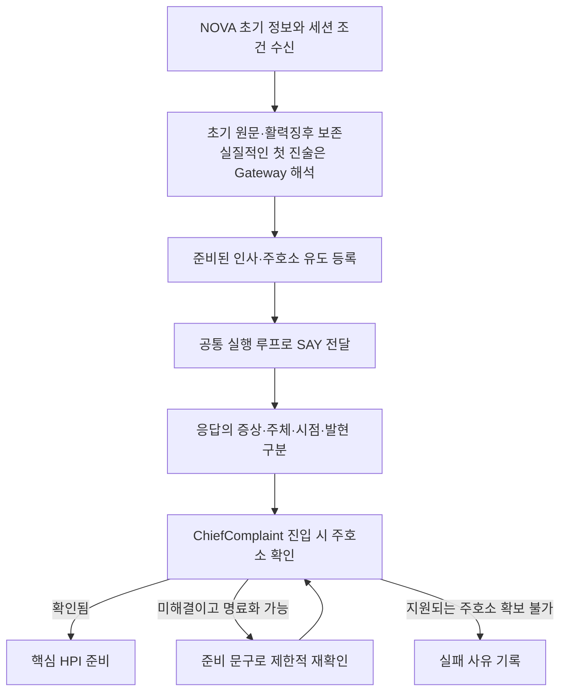

진료의 첫 환자 행동은 “안녕하세요. 무엇이 어떻게 불편하세요?”라는 SAY다. 초기 정보에 증상이 적혀 있어도 인사와 주호소 유도는 수행한다. 초기 활력징후는 제공된 사실로 따로 보존하고, 환자의 말에서 얻은 증상과 혼동하지 않는다.

초기 `opening`에 실질적인 진술이 있으면 이를 먼저 지정 모델로 해석한다. 초기 진술이 비어 있으면 인사 후 처음 받은 실질적인 답이 그 대상이 된다. 이후 단계에서 주호소를 확보하지 못했을 때는 증례 전체 두 번의 명료화 범위에서 확인하며, 지원되는 주호소가 끝내 없으면 임의 진단으로 채우지 않는다.

D29에서는 현재 주호소마다 기존 Symptom 중 가장 적합한 하나를 선택하도록 Gateway에 요구한다. 원천의 한국어·영어 라벨과 동의어를 함께 보고 더 넓은 관찰 가능한 증상도 검토한다. 근사 해석은 uncertain과 원문을 보존한다. 초기 후보로 부족하면 최대 8개의 증상 검색어로 전체 원천 색인을 다시 검색하고, 추가 1회 안에서 제공된 단일 ID를 선택한다. Python은 타입·ID 개수·인용·주체·시점과 보고하지 않은 진단 한정어를 검증한다. 증례별 매처나 임상 동의어 표는 두지 않는다.

### 2.2 ChiefComplaint — 핵심 HPI, 열린 질문, 집중 ROS

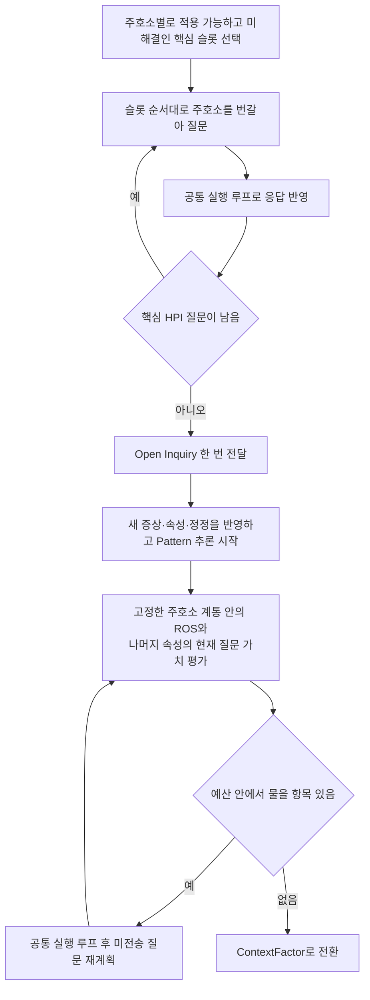

HPI는 현재 불편의 구체적인 모습이다. 먼저 **Location → Laterality → PainQuality 또는 Quality → TimeSinceOnset → EpisodeDuration → Severity** 순으로 적용 가능한 미해결 항목을 확인한다. 주호소가 두 개라면 첫 증상의 모든 항목을 끝낸 뒤 둘째로 가는 대신, 위치를 각각 확인하고 다음 속성으로 넘어가는 식이다. 환자가 이미 명확하게 말했거나 해당 증상에 적용되지 않는 항목은 건너뛴다.

`TimeSinceOnset`은 시작한 뒤 지금까지의 시간이고 `EpisodeDuration`은 한 번의 발현이 지속되는 시간이다. “한 달 전 시작했고 한 번에 10분씩 아프다”는 두 정보를 분리해서 남긴다. 월·년을 임의의 고정 일수로 바꾸지 않는다.

그다음 “그 밖에 불편한 증상이 있나요?”라는 Open Inquiry를 한 번 전달한다. 이 답까지 반영한 뒤 공유 Pattern 추론을 시작하고, 이후에는 집중 ROS와 미해결 세부 속성을 현재 가치에 따라 고른다. 집중 ROS는 관련 계통의 다른 증상을 확인하는 문진이며, 처음 확인한 주호소의 BodySystem 합집합 안에서 **총 여섯 번 이내**다. 새 ROS 증상으로 계통을 연쇄 확장하지 않고, BodySystem을 질환 검색 필터로 사용하지 않는다.

도식은 정상적으로 예산이 확보된 순서다. 공통 예산이 부족하면 일부 문진을 생략할 수 있으며, 생략·unknown·명시적 부재를 서로 다른 상태로 유지한다.

### 2.3 ContextFactor — 병력과 질환 연관의 적용 조건

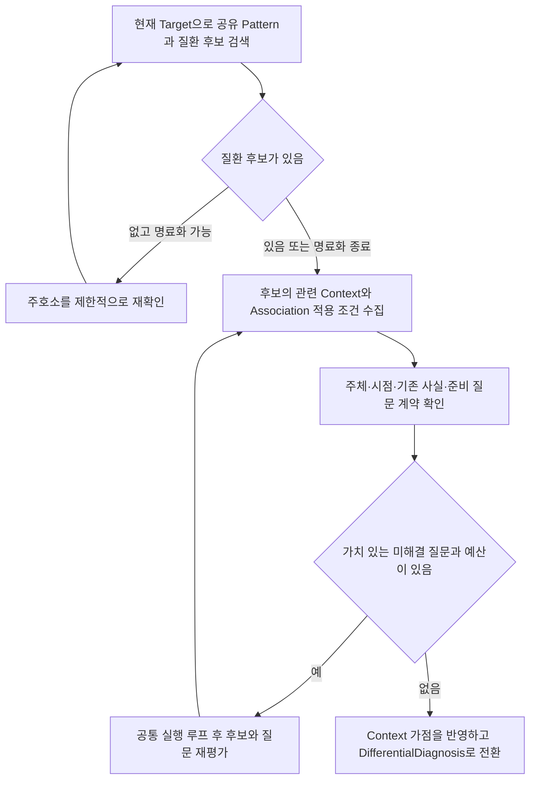

이 단계는 환자의 과거력·가족력·사회력 등 현재 후보를 판단하는 데 필요한 배경을 묻는다. 가족의 병력과 환자 본인의 병력, 과거와 현재를 구분하며, 승인된 지식에 연결된 내용만 질문 후보로 만든다. 관련 Context가 원천에 없으면 필수 병력 목록을 임의로 만들어 채우지 않는다.

질환과 Pattern의 연관에는 “어떤 배경 조건에서 이 연관이 적용되는가”라는 조건이 있을 수 있다. 이 조건을 모르면 Pattern 일부가 맞아도 해당 원천 지지를 확정하지 않는다. 적용 조건 확인과 별도의 Context 가점은 역할이 다르며, 다음 감별 단계로 넘어갈 때 Context 가점을 포함해 다시 평가한다.

후보가 없다는 이유만으로 즉시 종료하지 않는다. 허용된 명료화로 주호소를 보완하고, 이후에도 질환 진단 자격이 없으면 최종 진단 선택에서 확인된 주호소의 증상 수준 잠정진단을 검토한다. 물을 수 있는 Context가 없거나 정렬상 소견 질문·진찰이 먼저라면 이 세션은 추가 행동 없이 넘어갈 수 있다. 남은 Context는 감별 단계에서도 같은 질문 가치로 비교한다. 정확한 비교 규칙은 6절에서 설명한다.

### 2.4 DifferentialDiagnosis — 판단을 바꿀 질문과 진찰

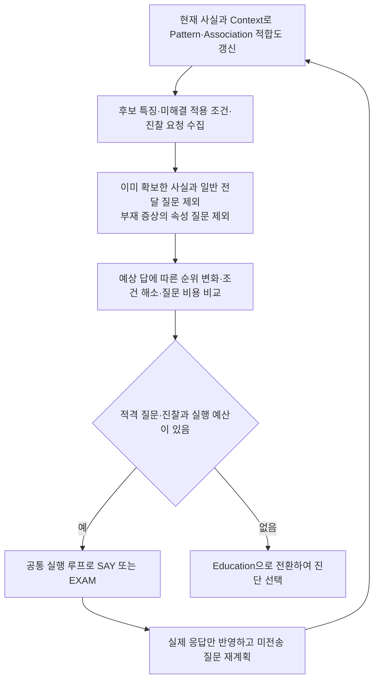

이 단계는 답에 따라 후보의 순위가 달라질 가능성, 여러 조건을 함께 해소하는 데 필요한 질문 수, 현재 주호소와의 관련성을 Python으로 비교한다. 미전송 질문의 우선순위는 새 임상 사실이 들어올 때 바뀐다. 현재 구현은 Context 외의 질문에 공통적인 양수 가치 문턱을 두지 않으므로 가치 벡터가 0인 질문도 남을 수 있다. 따라서 행동 종료를 확신도 문턱이나 최적 정보수집의 달성으로 해석하면 안 된다.

SAY로 속성을 물으려면 같은 관찰·에피소드에서 해당 증상이 있다는 사실이 확인되어야 한다. 일반 전달 질문은 반복하지 않으며, 답했지만 의미가 해결되지 않은 경우에만 공통 명료화 한도 안에서 재확인한다. EXAM은 승인된 소견·진찰 방법·준비 요청문이 있을 때 별도 획득 행동으로 실행한다. 거절이나 오류는 진찰 소견이 아니다.

Pattern은 관찰·에피소드별로 매칭하고, 질환별 Association의 적용 조건과 원천 가중치를 적용한다. 점수는 후보의 적합도이며 진단 확률이 아니다. 현재 단계의 질문과 대기 응답이 정리되면 Education으로 이동한다. 이후 교육 응답에서 새 사실을 얻어도 앞 세션으로 자동 회귀하지 않고 현재 상태에서 추론을 갱신한다.

### 2.5 Education — 기본 pass, 활성화한 경우의 설명과 정정

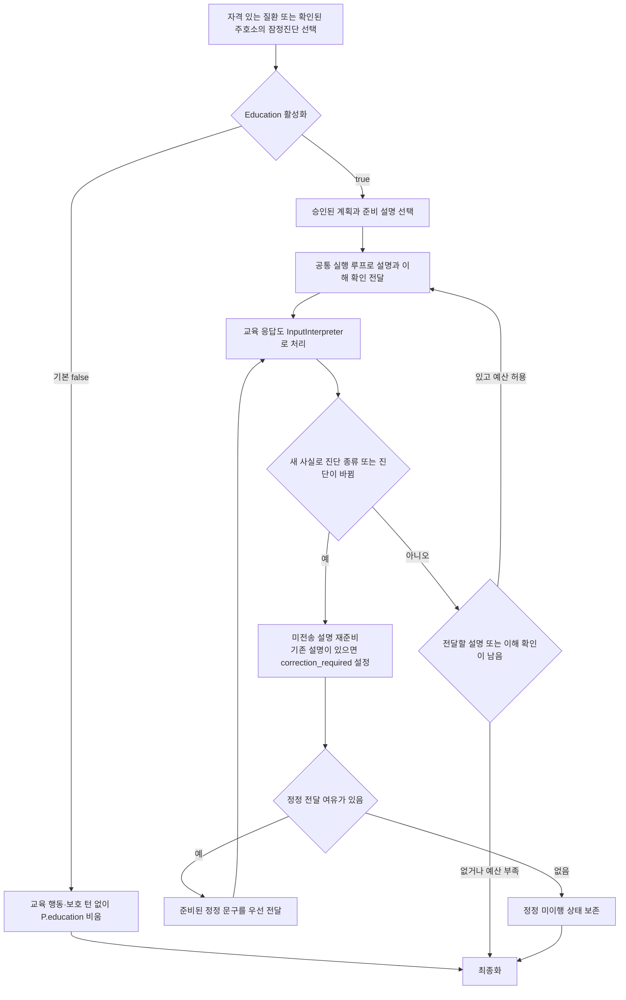

Education에 들어오면 현재 확보한 사실에서 진단을 선택한다. 양성 지지·양수 적합도·현재 주호소를 완전 매칭으로 설명하는 지지가 있는 질환이 대상이며, 적격 질환이 없으면 확인된 주호소의 증상 수준 잠정진단을 사용한다. 그 주호소조차 뒷받침되지 않으면 명시적으로 실패한다.

기본 설정에서는 교육 질문을 등록하지 않고 `P.education`을 비운다. 다른 P 필드에는 실제 수용된 계획·검사 연결만 반영한다. 교육을 활성화한 경우 설명은 승인된 계획과 준비 문구에서 가져온다. 질환별 계획이 없으면 이를 누락으로 남기고 공통 잠정 안내를 사용한다. “원인을 아직 확정하지 못했다”는 설명이 특정 질환의 치료·추적 계획을 대신 생성하는 근거가 되지는 않는다. 설명·이해 확인 두 턴과 정정 여유 한 턴은 활성화한 경우에만 보호한다.

교육을 활성화한 경우 환자가 “이해했어요. 그런데 아까 말씀드린 것과 달라요”처럼 답할 수도 있으므로 교육 응답도 입력 처리 대상으로 삼는다. 이미 설명한 뒤 진단이 바뀌면 `correction_required`를 설정하고 “새 답변으로 판단이 바뀌었습니다.”라는 준비 문구를 우선 전달한다. 이후 바뀐 판단에 맞는 승인 설명과 이해 확인을 준비한다. 턴·시간이 없으면 정정을 완료했다고 표시하지 않는다. 실제 전달 이력은 뒤의 파싱 실패나 재계획으로 지워지지 않는다.

### 2.6 최종화 — 확보한 사실을 제출하고 결과 확인

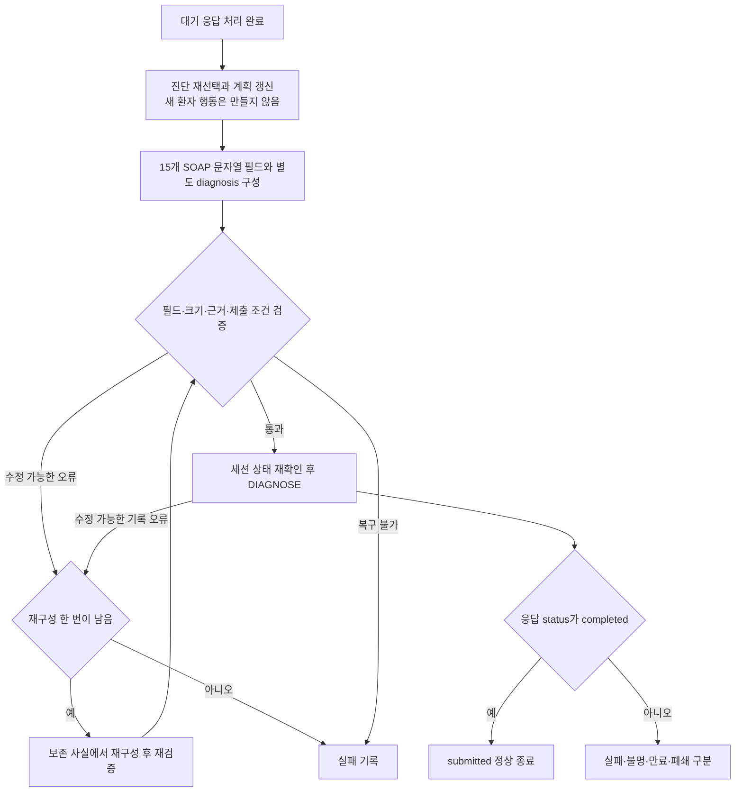

최종화는 여섯 번째 내부 세션이 아니라 제출 단계다. 최신 사실에서 진단을 다시 선택하고, 새 대화 없이 계획과 SOAP를 구성한다. S는 환자가 보고한 내용, O는 제공된 초기 정보와 실제 획득한 진찰, A는 판단에 사용한 근거와 감별, P는 승인된 계획과 교육을 담는다. 환자가 말한 진찰 결과를 실제 EXAM 결과처럼 바꾸거나 시행하지 않은 검사를 O에 넣지 않는다.

SOAP의 `S` 6개, `O` 2개, `A` 2개, `P` 5개 필드는 모두 문자열이며 주진단 `diagnosis`는 별도다. 예선의 `O.tests`는 비우고 계획 검사는 `P.tests`에 둔다. 로컬 검증 통과와 서버 수락은 다른 단계이며, 마지막 DIAGNOSE의 `completed` 응답을 확인해야 정상 종료한다.

<a id="roles-and-state"></a>

## 3. 역할과 환자 상태를 읽는 법

| 코드와 주요 함수 | 책임 |
|---|---|
| [runtime.py](workflow/runtime.py)의 prepare·consult | 지식/설정 준비와 증례별 실행 객체·상태 조립 |
| [Consultation](workflow/consultation.py)의 enter_session·refresh_after_input·advance_session·finalize | 내부 세션 전환, 입력 뒤 추론·재계획, 최종화 |
| [Doctor](workflow/doctor.py)의 validate_action·execute_action | 준비 발화의 독립 검증, SAY/EXAM 전달과 응답 기록 |
| [InputInterpreter](workflow/input_interpreter.py)의 process_input·_request_parse·_apply_facts | 단축 답 처리, Gateway 호출, 사실별 검증·복구·반영 |
| [InterviewPlanner](workflow/interview_planner.py)의 prepare_chief_complaint·replan·select_question·prepare_education | 무엇을 언제 물을지와 어떤 준비 설명을 전달할지 결정 |
| [ClinicalReasoner](workflow/clinical_reasoner.py)의 refresh_hypotheses·select_diagnosis | 공유 Pattern 평가, Association 적용, 적합도와 진단 |
| [SubmissionWriter](workflow/submission_writer.py)의 build_soap·submit_diagnosis·confirm_submission | 기록 조립·검증·한 번의 재구성·확인된 제출 |
| [graph.py](workflow/graph.py)의 build_graph·run_node | 노드·분기와 기존 깊은 복사/검증 경계 |
| [rules](workflow/rules)의 BudgetPolicy·validate_facts | 순수 예산 판단과 외부 사실 경계 |
| [state](workflow/state)의 QuestionLifecycle·InteractionLifecycle·UsageAccounting | 질문·원문/전달·사용량 변경 연산 |

이 객체들은 서로 다른 모델 에이전트를 호출하는 팀이 아니라 하나의 진료 프로그램 안에서 책임을 나눈 Python 객체다. 공유 `PreparedResources`에는 지식과 설정을 두고, `consult()`마다 실행 객체와 아래 다섯 상태를 새로 만든다.

| 상태 | 주요 내용 | 코드를 읽을 때 확인할 것 |
|---|---|---|
| `CaseState` | 구조화된 S/O/A/P, `diagnosis`, `diagnosis_kind`, `diagnosis_evidence` | 어떤 사실이 실제 기록에 들어갔는가 |
| `SessionContext` | 현재 내부 세션, 남은 턴·시간·모델 예산, 명료화 수 | 다음 행동을 할 여유가 있는가 |
| `DifferentialState` | 후보·기여·반증, Pattern/Association 매칭, 임상 개정·증례 캐시 | 무엇이 맞았고 왜 그 점수가 되었는가 |
| `QuestionPlan` | 질문, 순서·가치, ROS 고정 후보, 마지막 재계획 개정 | 무엇을 아직 물을 수 있는가 |
| `InteractionState` | 실제 요청·응답·모델 기록, 대기 행동·원문·거절·종료 결과 | 무엇을 실제로 전달하고 받았는가 |

### 3.1 처리 완료와 임상적 확정을 구분한다

`RecordItem.status`의 `unasked/done`은 처리 상태이고, 그 안의 `ClinicalValue.status`는 사실의 의미다. “모르겠어요”를 받고 질문을 `done`으로 닫아도 해당 증상을 음성으로 확정한 것이 아니다.

| 값 | 의미 | 추론에서의 역할 |
|---|---|---|
| `present` | 해당 내용이 있다고 확인 | 완전 매칭의 재료가 될 수 있음 |
| `absent` | 해당 내용이 없다고 명시 | 조건의 반증 또는 제한된 부재 감점의 재료 |
| `uncertain` | 개념 해석·존재 등이 아직 불확실 | 후보 검색에 쓸 수 있으나 존재 조건은 미확정 |
| `unknown` | 답으로 해결하지 못함 | 확인한 양성·음성으로 바꾸지 않음 |
| `unasked` 또는 실제 EXAM 미수행 | 아직 획득하지 않은 내용 | 환자 근거로 사용하지 않음 |

`was_asked()`는 실제 전달 이력으로 반복 질문을 막고, `has_resolved_evidence()`는 출처가 있으며 상태·대상·속성 값이 해결되었는지 확인한다. 둘은 같지 않다. 이미 물었지만 미해결인 내용은 일반 질문을 반복하는 대신 증례 전체 두 번의 명료화 안에서 확인할 수 있다.

`CaseState.chief_complaints(confirmed=True)`는 **출처가 있는 처리 완료 S.cc 중 환자 본인의 `present` 증상이며 과거로 표시되지 않은 것**을 반환한다. 코드상 `time_context=unspecified`도 과거가 아닌 쪽에 포함된다. D29에서 Symptom ID 하나를 얻었어도 `uncertain`이면 아직 이 확정 주호소 집합에 들어가지 않는다. “모델이 무언가 반환함”, “개념이 연결됨”, “진단 근거가 확정됨”은 각각 확인해야 한다.

### 3.2 관찰과 발현을 섞지 않는다

`observation_id`는 어느 증상·소견을 말하는지, `episode_id`는 그 증상·소견의 어느 발현인지를 구분한다. 같은 부위 통증이라도 지난번 발현의 위치와 이번 발현의 기간을 합쳐 하나의 완전 Pattern을 만들면 안 된다. 환자와 가족, 현재와 과거도 별도 필드다.

환자 원문은 상호작용 이력에 남고 구조화 사실의 `source_refs`가 그 입력을 가리킨다. 정정은 `record_id`로 기존 기록을 지정하면서 관찰·발현 신원을 보존한다. 새로운 발현을 말한 것과 기존 값을 고친 것을 구분하는 책임은 Gateway 해석과 Python 검증이 함께 맡는다. Graph에는 일반 지식을 두고 이 환자의 사실을 쓰지 않는다.

### 3.3 Doctor와 준비된 질문

Doctor는 LLM을 호출하지 않는다. knowledge manifest의 질문 계약과 config의 고정 문구를 사용하고, 전달 직전 NFC 1–30자를 독립 확인한다. 공백·문장부호·줄바꿈도 센다. 생성 실패용 재시도나 문장 절단은 없다.

질문 계약에는 text, answer_type, affirmative, interviewable, reason이 있다. 대상 URI 또는 속성 URI가 키이며 대상|속성 예외가 우선한다. {symptom}은 실제 한국어 표시 이름으로 대입한 결과까지 prepare에서 검증한다.

원인을 전제하는 Target은 승인된 관찰 가능한 매핑 없이 직접 질문하지 않는다. 예를 들어 일반적인 두통에 대한 긍정을 “종양에 의한 두통”으로 연결하지 않는다. 현재 질문은 D23에서 수용한 manifest의 계약을 기준으로 사용하며, `interviewable=false`인 Target의 차단은 속성별 예외보다 우선한다. 준비 문구의 길이 검증과 의미의 적절성은 별도 문제다.

<a id="gateway"></a>

## 4. Gateway: 환자 말에서 검증된 사실까지

### 4.1 모델의 역할과 첫 입력

실제 호출은 [ModelClient](workflow/io/model_client.py)의 `complete()`가 맡는다. 모델은 `openai/gpt-6-luna`, `reasoning_effort=medium`이며 한 호출의 출력 여유는 최대 2,048토큰이다. 모델이 내놓는 것은 사실 후보이고, 단계·질문·점수·진단·계획은 출력할 수 없다. [프롬프트](config/input_parser.txt), Pydantic 스키마, Python 검증이 이 경계를 함께 만든다.

초기 `opening`을 포함한 첫 실질적 환자 진술은 Gateway에 보낸다. 코드의 판단 기준인 `doctor_successes`는 **비어 있지 않은 Gateway 응답 문자열 수**다. 유효 JSON이나 주호소 연결 성공 횟수가 아니므로, 비어 있지 않은 잘못된 응답도 이 수를 올릴 수 있다. 이후에는 전체 답이 준비된 계약과 완전히 맞는 경우에만 고정 규칙을 쓴다. 명확한 긍정형 존재 질문의 짧은 긍정·부정, 단일 기간 표현, 유일하게 연결되는 범주 별칭 등이 그 예다. 복합 답·시간 전환·주체 변경은 Gateway로 보낸다.

### 4.2 D29: 기존 Symptom 하나를 선택하는 절차

주호소 매핑은 자연어와 그래프 사이의 첫 연결이다. 이 단계가 틀리면 뒤의 조건 매칭이 결정론적이어도 잘못된 Target에서 출발하므로 별도로 살펴야 한다.

1. 아직 개념이 연결된 주호소가 없고 초기 입력 또는 주호소용 답을 처리하는 경우 `chief_mapping_required`를 켠다. 이때 초기 어휘 후보를 `Symptom`으로 제한한다.
2. 원문과 원천 라벨·동의어를 검색한다. `search_concepts()`는 NFC 정규화·대소문자 통일·공백 제거 뒤 라벨 포함 여부와 두 글자 조각의 겹침으로 정렬하고 검색당 최대 64개를 반환한다. 이는 문자열 검색 순위이고 의미적 정확도를 보증하는 값이 아니다.
3. Gateway에 한·영 라벨·별칭과 허용 Symptom을 제공한다. 보고된 현재 주호소마다 가장 적합한 하나를 고르도록 요청하고, 표현이 근사하면 정확한 인용과 `uncertain`을 남긴다. 이 요청만으로 모든 주호소의 누락 없는 추출을 보장하지는 않는다.
4. 요청별 스키마의 `concept_ids`를 길이 1·전송한 Symptom ID 열거형으로 제한한다. 첫 요청에는 적절한 후보가 없을 때 `needs_context=true`와 `lookup_terms`를 내는 선택지도 있다.
5. 검색어는 최대 8개·각 80자이며 전체 **수용 어휘 색인**을 다시 검색하는 힌트다. 원본 RF2를 열거나 외부 검색을 하는 과정은 아니다. 확장 요청은 기존 추가 한 호출 안에서 수행한다.
6. Python은 전송 어휘 소속·Symptom 타입·단일 ID·정확한 현재 인용·참조·주체·발현 등을 검증한다. 일반적인 표현으로 보고하지 않은 원인 한정 개념을 확정하는 것도 막는다. 복구 후에도 실패하면 원문과 미해결 상태를 유지한다.

하나의 주호소 사실에 여러 Symptom ID를 남기는 것은 거절된다. 서로 다른 주호소는 별도 사실로 표현할 수 있다. Disease를 Symptom으로 대신 쓰거나 증례 ID별 매처를 적용하지 않는다. `lookup_terms`는 검색 힌트이며 환자가 말했다는 근거로 수용하지 않는다.

### 4.3 전체 대화 보존과 제한된 전송

전체 실제 대화는 InteractionState에 남긴다. 모델 입력은 현재 응답·실제 질문·관련 관찰/에피소드와 필요한 원문 구간이다.

| 입력 영역 | 기본 | 한 번의 확장 |
|---|---:|---:|
| 과거 기록 | 24개 | 64개 |
| 과거 대화 | 6개 | 12개 |
| 과거 문맥 합계 | 16 KiB | 64 KiB |
| 어휘 | 256개·32 KiB | 1,024개·128 KiB |

부분별 상한과 별개로 system 지시문·스키마·현재 입력·질문·문맥·어휘를 합친 전체 messages JSON은 UTF-8 기준 기본 12 KiB, 일반 확장 16 KiB로 제한한다. 현재 원문 검색을 먼저 배치하며 선택 어휘와 과거 문맥을 줄인다. 현재 입력·질문·스키마·필수 Target/Attribute ID는 자르지 않고, 이것만으로 상한을 넘으면 전송을 보류하고 명료화로 넘긴다. 이 바이트 상한은 서버 토큰 수를 측정한 값이 아니다.

초기 주호소 후보는 Symptom으로 제한하고, 모델이 낸 유한한 lookup_terms가 있으면 전체 색인에서 먼저 검색한다. 전송 후보를 줄일 때 요청 스키마의 허용 ID도 함께 줄이며 최소 한 Symptom을 유지한다. `facts: []`도 주호소가 연결되지 않은 결과로 추가 한 호출의 복구 대상이 된다. `model_history[].parser_result`에 수용 사실·연결된 주호소·미연결·거절 개수를 남긴다. `doctor_successes`는 비어 있지 않은 응답 문자열의 개수여서 의미 매핑 성공과 구분한다.

현재 응답은 과거 문맥 한도 밖에서 온전히 처리한다. 문맥을 고를 때 현재 질문, 같은 관찰·에피소드, 원문에 나온 다른 증상, 정정의 원래 출처를 우선한다. 오래된 관련 원문도 선택할 수 있다. 모델은 제공된 기록·대화 ID만 참조할 수 있다.

전체 요청을 맞출 때는 먼저 선택 어휘를 우선 후보 수까지 줄이고, 이어 과거 대화·기록을 줄이며, 필요하면 나머지 선택 어휘도 줄인다. 주호소 스키마의 허용 ID는 매번 남은 후보에 맞춰 다시 만든다. 최소 필수 내용조차 들어가지 않으면 현재 원문을 잘라 보내지 않고 요청을 보류한다. 위 표의 부분별 최댓값을 동시에 전송한다는 의미가 아니다.

### 4.4 사실별 수용과 한 번의 해석 복구

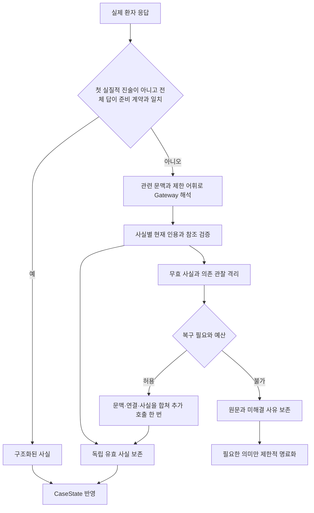

`accepted_facts`, `rejected_facts`, `unresolved_links`를 구분한다. `quote`는 비어 있지 않은 현재 입력의 정확한 부분 문자열이어야 하며 `value.text`와 같아야 한다. 모델은 제공된 어휘와 기록·대화 참조만 사용할 수 있고, 실제 EXAM 응답이 아니면 O.exam을 만들 수 없다. 환자 말에서 A·P 또는 실제 검사 결과를 생성하는 것도 허용하지 않는다.

잘못된 사실 하나가 독립된 다른 증상까지 없애지는 않는다. 다만 잘못된 관찰에 의존한 속성이나 같은 기록의 충돌 정정은 함께 격리한다. 복구는 응답 하나당 **추가 호출 한 번**이며 JSON 오류·빈 facts·문맥 부족·개념 연결·거절 사실이 이 한도를 공유한다. 복구가 실패해도 첫 통과의 독립 유효 사실은 보존한다. 미연결 사실을 고칠 때에는 원래 인용·관찰·발현·주체 등을 유지하고 개념 ID만 보완하도록 제한한다.

`CONTEXT_LIMIT_EXCEEDED`이면 같은 내용을 그대로 보내지 않고 새 ID의 더 작은 요청을 만든다. 상한은 8 KiB이며 직전 요청보다도 작아야 한다. 이미 추가 호출을 사용했다면 또 복구하지 않는다. 반면 전송 결과가 불명확한 일시 오류의 같은 ID 재전송은 7절의 전송 복구이며, 이 해석 복구와 목적이 다르다.

<a id="reasoning"></a>

## 5. 추론 알고리즘: 관찰에서 질환 적합도까지

이 절의 기준은 [ClinicalReasoner](workflow/clinical_reasoner.py), [지식 reader](knowledge/graph.py), [조건 모델과 비교 함수](knowledge/conditions.py)다. 추론은 기존 지식과 관찰의 규칙 기반 비교다. 모델의 내부 사고를 읽거나 새 임상 관계를 생성하는 단계는 없다.

### 5.1 Target·Pattern·Feature·Association의 관계

| 개념 | 쉬운 설명 | 점수를 소유하는가 |
|---|---|---|
| `Target` | 확인하려는 증상 또는 신체진찰 소견 | 아니오 |
| `ClinicalPattern` | 하나의 Target에 대해 함께 맞아야 하는 조건 묶음 | 아니오; 여러 질환이 공유 |
| `ClinicalFeature` | 존재 여부, 위치, 양상, 기간 등 원자적 조건 | 아니오; Pattern에 귀속 |
| `DiseasePatternAssociation` | 특정 질환과 특정 Pattern의 연결 및 적용 조건·출처 | 질환별 원천 가중치를 결정 |
| `PatternMatch` | 이 환자의 어느 관찰·발현이 Pattern과 얼마나 맞는지 | 매칭 상태와 근거만 보존 |
| `ScoreContribution` | 완전 매칭 뒤 선택한 질환–Target 지지 | 실제 선택 점수와 근거를 보존 |

예를 들어 “증상 T가 있고 특정 위치·기간을 만족한다”는 Pattern을 두 질환이 공유해도, 그 표현이 각 질환을 얼마나 지지하는지는 서로 다른 Association에 둔다. 따라서 Feature마다 임의의 중요도를 더하지 않는다.

ClinicalReasoner는 관찰 Target의 공유 Pattern을 먼저 평가하고, 그 결과에 질환별 Association 조건과 가중치를 적용한다.

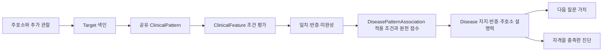

### 5.2 첫 번째: 관찰별로 나누고 후보를 넓게 검색한다

`observation_groups()`는 처리 완료·출처 있음·환자 본인·과거가 아닌 symptom/finding/attribute만 골라 `(observation_id, episode_id)`로 묶는다. 각 묶음에는 증상·소견의 기본 기록과 그 속성을 따로 둔다. 초기 활력징후처럼 원문만 있고 Target이 없는 기록은 SOAP에 남을 수 있지만 그것만으로 특정 임상 Pattern을 자동 활성화하지 않는다.

후보 질환은 현재 묶음의 **present 또는 uncertain Target**이 연결된 Association의 질환 합집합이다. 속성을 모두 맞춰야 후보가 되는 것은 아니다. 따라서 “후보로 검색됨”과 “확정 지지 점수가 생김”은 다르다. `absent`만으로 새 질환 후보를 만들지 않고, BodySystem으로 검색 범위를 자르지도 않는다. 원천에 관계가 없다는 사실은 이 환자에게 질환이 없다는 근거가 아니다.

같은 Target에 해석 후보가 여럿이거나 상태가 충돌하면 존재 상태를 `uncertain`으로 취급한다. 단일 개념의 명확한 present/absent 기록이 있으면 그 기록을 우선하여 존재 상태를 정한다. 불확실한 여러 해석을 여러 번 확인한 양성처럼 더하지 않는다.

### 5.3 두 번째: 공유 Pattern의 Feature를 평가한다

평가 단위는 `(Pattern, observation, episode)`다. 같은 Pattern을 여러 질환이 공유해도 이 단위의 Feature 비교는 한 번 수행한다. 다음 조건 비교 결과를 모아 `PatternMatch`를 만든다.

| 조건 | matched | contradicted | unknown |
|---|---|---|---|
| 존재·부재 | 확인 상태가 기대 상태와 같음 | present/absent가 기대와 반대 | uncertain·unknown 등 |
| 단일 개념 값 | 기대 값 또는 허용된 ValueMatch 경로의 값이 명시적으로 있음 | 기대 값이 명시적으로 없다고 확인 | 기대 값의 존재·부재를 결정할 수 없음 |
| `concept_set any_of` | 하나 이상 일치 | 모든 선택지가 반증 | 그 외 |
| `concept_set all_of` | 모든 조건이 일치 | 하나 이상 반증 | 그 외 |
| 수치·구간 | 관찰 구간 전체가 기대 구간 안에 있음 | 두 구간이 완전히 분리됨 | 일부만 겹치거나 단위가 비교 불가 |

예상 위치가 A인데 환자가 B라고 했다는 이유만으로 A의 명시적 부재를 자동 생성하지 않는다. 현재 범주 비교는 기대 값에 대응하는 양성·음성 기록을 찾으며, 대응하는 값이 없으면 대개 unknown이다. 수치 비교도 일부 겹침을 억지로 일치나 반증으로 정하지 않는다.

예를 들어 기대 범위가 **5–14일**이면 `168시간`은 7일이어서 matched, `20일`은 contradicted, `10–20일`은 일부 겹쳐 unknown이다. `1개월`과 `30일`도 unknown이다. 초·분·시간·일·주는 고정 시간 단위로, 월·년은 달력 단위로 비교하지만 두 계열을 임의 환산하지 않는다. `TimeSinceOnset`과 `EpisodeDuration`은 단위가 같아도 다른 속성이다.

여러 Feature는 모두 맞아야 한다. 결과에 contradicted가 하나라도 있으면 Pattern은 `contradicted`, 그렇지 않고 unknown이 있으면 `incomplete`, 전부 맞으면 `matched`다. **명시적 반증은 다른 조건의 unknown에 가려지지 않는다.** 다만 상세 Pattern의 반증이 곧 질환 점수 감점은 아니다.

ValueMatch는 수용된 `is_a`, `regional_part`, `approved_region` 경로를 이용하는 제한된 값 비교다. 환자가 말하지 않은 상위 위치를 새 관찰로 기록하거나 질환 계층을 따라 무제한 추론하는 기능은 아니다.

### 5.4 세 번째: 질환별 Association의 적용 조건을 확인한다

Pattern 자체가 맞아도 Association에 “환자 본인의 특정 현재 Context가 존재해야 한다”는 조건이 있으면 그것까지 확인해야 한다. `_applicability()`는 `(Context 개념, subject, time_context)`가 정확히 맞는 기록을 찾고 요구된 present/absent와 비교한다.

반대 상태가 명확하면 `contradicted`, 필요한 상태를 확정할 수 없으면 `unknown`, 모든 조건을 만족하면 `matched`다. 조건이 없는 Association은 적용 조건을 통과한다. **Pattern matched + applicability matched**인 경우만 다음 원천 지지 계산에 들어간다. 적용 조건이 unknown인 후보도 질문을 만드는 데에는 사용할 수 있다.

여기서의 적용 조건과 뒤의 Context 가점은 역할이 다르다. 적용 조건은 지지를 활성화하는 문턱이고, Context 가점은 별도로 확인한 지지 배경에 대한 최대 1점의 보완이다.

### 5.5 네 번째: 원천 가중치를 선택한다

[scoring_policy.json](knowledge/scoring_policy.json)의 `v5.0.1`은 원천 라벨을 정렬용 점수로 변환한다. manifest가 실제 사용 정책의 해시를 고정한다.

| BODHI `condition_given_symptom`의 라벨 | zero | rare | low | medium | high | very_high |
|---|---:|---:|---:|---:|---:|---:|
| 지지 점수 | 0 | 0.5 | 1 | 2 | 3 | 4 |

해당 표현·범위에 방향성 라벨이 없을 때는 원천 관계에 따라 직접 `due_to=2`, `associated_with=1`, `subtype_intersection=0.5`를 사용하고, 조건을 보존한 일반화는 0.5를 쓴다. 유효한 `zero`는 “가중치 없음”이 아니므로 다른 점수로 대체하지 않는다.

반대 방향인 `symptom_given_condition`의 라벨은 `typicality`로 보존하며 질문 가치와 제한 반증에 사용한다. `strong_predictor`를 추가 가산하지 않는다. 이 숫자들은 프로젝트의 정렬 정책이며 확률·우도비·유병률 보정값이 아니다.

### 5.6 다섯 번째: 정교화 대체 후 Disease–Target을 한 번만 집계한다

같은 질환·Target·관찰·발현·적용 조건 안에서 완전 매칭들을 모은다. 그중 더 구체적으로 맞은 Pattern이 있으면 그 조상 Pattern을 제거한다. 정교화는 부모의 모든 조건을 유지하면서 조건을 추가하거나 값·범위를 더 좁힌 표현이다. **점수가 내려가더라도 구체적인 표현을 채택한다.**

다음은 가상 질환 A와 Target T의 설명용 예다. 기본 존재 2점, 위치 조건까지 맞는 정교화 1점, 위치와 양상까지 맞는 정교화 4점이 원천에 있다고 가정한다.

| 현재까지 확인한 사실 | T에서 채택하는 표현 | T의 지지 점수 |
|---|---|---:|
| 존재만 확인 | 기본 존재 Pattern | 2 |
| 같은 발현의 위치까지 확인 | 위치 정교화가 기본 표현을 대체 | 1 |
| 같은 발현의 양상까지 확인 | 위치+양상 정교화가 이전 표현을 대체 | 4 |
| 양상이 다른 발현의 정보였음 | 현재 발현에서는 위치 정교화까지만 완성 | 1 |

2→1→4는 새 표현의 점수로 바뀌는 과정이며 2+1+4를 더하지 않는다. 새 정교화가 0점이어도 2점을 유지하는 식으로 우회하지 않는다. `FeatureContribution`은 정교화 점수−기준 점수의 차분을 기록한다. 여러 조건이 함께 바뀐 `joint` 차분을 개별 질문이나 Feature의 독립 점수로 나누지 않는다. 실제 합산은 선택한 Association 점수로 한다.

어느 쪽도 다른 쪽의 정교화가 아닌 완전 매칭들이 남으면 `incomparable_matches`에 함께 기록하고 점수는 최대값 한 번만 사용한다. 이후 다른 관찰·발현·적용 조건의 일치까지 비교하여 **같은 Disease–Target에서 최대 기여 하나**를 남긴다. 같은 증상을 여러 번 보고하거나 출처가 여러 개라는 이유로 더하지 않는다. 서로 다른 Target의 선택 지지만 합산하여 `evidence_score`를 만든다.

### 5.7 여섯 번째: Context와 제한 반증을 반영한다

질환 D의 적합도는 다음과 같다.

```text
evidence_score(D) = sum(selected contribution per distinct Target)
fit(D) = evidence_score(D) + context_bonus(D) - contradiction_penalty(D)
```

**Context 가점:** 질환의 `hasSupportingContext`에 연결된 개념이 양성으로 확인되고 가족력/환자 본인의 주체가 맞으면 1, 아니면 0이다. 여러 Context가 있어도 1을 넘지 않는다. 부재나 unknown으로 감점하지 않는다. 이 가점 확인은 Association 적용 조건처럼 정확한 time_context 일치를 추가로 요구하는 절차는 아니다. ChiefComplaint·ContextFactor 중의 기본 갱신에서는 아직 가점을 유보할 수 있고, 감별·교육·최종 진단 선택에서는 가점을 포함한다.

**제한 반증:** [reasoning_policy](knowledge/5b44871b970f5e98-reasoning_policy.json)의 `d17.1`을 별도로 적용한다. 아래 조건을 모두 만족하는 기본 존재 Pattern에만 감점한다.

- Association 적용 조건이 matched이고 Pattern이 contradicted다.
- Pattern의 Feature가 상세 기대 값 없이 존재를 요구하는 조건이다.
- 해당 Target의 명시적인 `absent` 기록이 `time_context=current`이며 확정 주호소의 활성 발현에 속한다.
- 현재 추론 관찰들에 같은 Target의 present 기록이 없다.
- 원천 typicality가 high 또는 very_high다.

high는 0.5, very_high는 1이다. 같은 Target은 최대 1, 질환 전체는 최대 2를 뺀다. 예를 들어 매우 전형적인 증상 세 개를 명시적으로 부정했어도 합계 감점은 2다. 상세 위치의 불일치, 다른 발현의 부재, unknown, 미질문과 원천 연결 누락은 이 감점을 만들지 않는다. 코드에서는 다른 관찰에 같은 Target의 양성이 있으면 부재 감점을 막으므로, 발현 신원과 양성·음성 상태를 함께 살펴야 한다.

### 5.8 일곱 번째: 순위와 최종 진단 자격을 따로 판단한다

모든 후보는 다음 우선순위로 정렬한다. 뒤의 항목은 앞의 항목이 같을 때만 비교한다.

1. `fit` 내림차순.
2. `chief_coverage` 내림차순.
3. `contradicted_conditions` 개수 오름차순.
4. Disease URI 사전순으로 동률 해소.

`chief_coverage`는 확정 주호소의 `(관찰, 발현, Target)` 조합 중 **양수 원천 점수의 완전 매칭으로 설명한 조합의 비율**이다. 같은 Target의 기여를 한 번 합산하는 규칙과 주호소마다 설명되었는지 확인하는 규칙은 별개다. 출처 없는 원문이나 uncertain 주호소를 확정 주호소로 올리지 않는다.

최종 질환 자격은 `evidence_score > 0`, `fit > 0`, `chief_coverage == 1`을 모두 만족해야 한다. 후보 목록의 첫 번째를 무조건 진단으로 내지 않고 자격을 통과한 목록의 첫 번째를 택한다.

| 설명용 후보 | 원천 지지 | Context | 반증 | fit | 주호소 설명 비율 | 최종 자격 |
|---|---:|---:|---:|---:|---:|---|
| A | 5 | 1 | 1.5 | 4.5 | 1 | 가능 |
| B | 7 | 1 | 0 | 8 | 0.5 | 불가: 일부 주호소 미설명 |
| C | 4 | 0 | 0.5 | 3.5 | 1 | 가능 |

이 경우 전체 정렬에서는 B가 먼저지만 선택 질환은 A다. C는 감별 후보가 될 수 있다. 주진단과 감별은 같은 자격을 쓰며, SOAP에는 선택 질환을 제외한 최대 다섯 감별과 실제 획득 근거를 표시한다. 미완성 Pattern은 질문의 재료로 남고 확정 지지로 가산하지 않는다.

적격 질환이 없으면 **확정된 현재 주호소 중 첫 번째**를 증상 수준 잠정진단으로 고른다. `diagnosis_kind=symptom`을 남기며 Disease를 새로 만들지 않는다. 여러 주호소의 원인을 모두 설명했다는 뜻도 아니다. 확정 주호소조차 없으면 `no_supported_diagnosis`로 실패한다. 개념 연결이 uncertain인 상태를 임의 확정하여 이 경계를 넘지 않는다.

### 5.9 전체 계산을 의사코드로 읽기

아래는 실제 제어 흐름을 이해하기 위한 요약이며 그대로 실행하는 함수는 아니다.

```text
groups = group_current_patient_observations_by_observation_and_episode()
candidates = recall_diseases_from_present_or_uncertain_targets(groups)
pattern_matches = evaluate_shared_patterns_once_per_group(groups)
association_matches = evaluate_exact_applicability(pattern_matches)

for disease in candidates:
    complete = keep_matched_patterns_with_matched_applicability(disease)
    maximal = replace_matched_ancestors_with_matching_refinements(complete)
    selected = choose_one_maximum_contribution_per_target(maximal)
    support = sum_selected_scores(selected)
    fit = support + capped_positive_context(disease) - bounded_absence(disease)
    coverage = measure_positive_complete_matches_for_confirmed_chiefs(disease)

rank_by_fit_coverage_conflicts_and_uri()
eligible = keep_positive_support_positive_fit_and_full_coverage()
select_first_eligible_or_first_confirmed_chief_symptom_or_fail()
```

### 5.10 언제 다시 계산하는가

`InputInterpreter._apply_facts()`는 증상·소견·속성·Context의 구조가 바뀌면 `clinical_revision`을 올린다. `ClinicalReasoner`는 임상 값과 확정 주호소의 fingerprint 및 Context 가점 모드를 비교하고, 같으면 반복 계산을 건너뛴다. 원문 표현만 달라지고 구조화 의미가 같으면 그 자체로 새 점수 계산을 요구하지 않는다.

변경된 관찰·발현의 Pattern 결과는 다시 평가하고 다른 묶음의 결과는 재사용한다. 적용 조건은 현재 Context에서 다시 확인한다. 공유 지식에는 Target/Pattern/Association/Feature·별칭·정교화 색인을 두고, 환자 검색과 매칭 결과는 증례의 `DifferentialState`에 둔다. 서로 다른 환자의 기억이 공유 지식에 쌓이지 않는다.

<a id="question-selection"></a>

## 6. 다음 질문을 고르는 알고리즘

질문 선택은 [InterviewPlanner](workflow/interview_planner.py)의 `_adaptive_options()`, `_eligible()`, `_value()`, `replan()`에서 이어진다. 핵심 HPI와 Open Inquiry까지는 준비한 기본 순서를 따르고, 그 뒤에 이 적응형 비교를 시작한다. 추론과 질문 선택은 별도 단계다. 점수가 아직 활성화되지 않은 미완성 Pattern도 “무엇을 더 확인하면 되는가”를 알려 준다.

### 6.1 먼저 질문 후보와 실행 자격을 만든다

ChiefComplaint에서는 원래 주호소 계통의 고정 ROS 후보와 주호소 속성을 검토한다. 이후 세션에서는 검색된 질환들의 Pattern Target, 미해결 적용 조건, 지지 Context를 후보로 만든다. EXAM은 수용된 ExamFinding의 연결된 방법과 요청문이 있을 때만 만든다. 일반 SAY는 문진 가능한 준비 질문 계약이 있어야 한다.

이미 해결된 정보나 실제로 전달한 일반 질문은 제외한다. SAY 속성 질문에는 같은 관찰·발현에서 단일 Target의 존재가 `present`로 확인되어 있어야 한다. 부재·불확실 증상의 세부 속성을 묻는 대신 존재 확인·명료화를 검토한다. `was_asked`와 `has_resolved_evidence`를 나누는 이유가 여기 있다.

질문 의미 키는 `(행동, Target, Attribute, 주체, 시점, 관찰, 발현)`이다. 이 키로 질문 ID를 안정적으로 만들고 전달·차단·중복 상태를 추적한다. 준비 문구가 검증에 실패한 키는 차단한다. 단순히 낮은 순위로 빠진 미전송 질문은 차단과 다르며, 다음 임상 개정에서 다시 후보가 될 수 있다.

### 6.2 질문 가치는 다섯 숫자를 순서대로 비교한다

`_value()`는 아래 벡터를 반환한다. 가중합이 아니라 **왼쪽부터 사전식으로 비교**하며 큰 값이 먼저다.

```text
selection_value = [rank_change, spread, unlock, is_chief_target, typicality]
```

| 위치 | 의미 | 구현상 계산 |
|---|---|---|
| 1 `rank_change` | 가정한 답에서 선두가 바뀔 수 있는가 | 다른 후보의 추정 fit이 현재 선두보다 엄격히 커지는 시나리오가 있으면 1 |
| 2 `spread` | 후보 사이에 점수 변화 차이가 얼마나 생기는가 | 답 시나리오별 최대 변화−최소 변화의 최댓값 |
| 3 `unlock` | 아직 남은 조건 비용에 비해 얼마의 지지를 바꿀 수 있는가 | 관련 Profile의 `abs(score−baseline) / max(1, unresolved_count)` 중 최댓값 |
| 4 `is_chief_target` | 현재 확정 주호소의 Target인가 | 해당하면 1, 아니면 0 |
| 5 `typicality` | 원천상 그 질환에서 얼마나 전형적인가 | 관련 typicality를 공개 라벨 점수로 변환한 최댓값 |

예를 들어 `[1, 0.2, 0.1, 0, 0]`은 `[0, 4, 4, 1, 4]`보다 먼저다. 첫 질문의 첫 숫자가 더 크기 때문이다. 큰 typicality가 앞의 순위 변경 가능성을 뒤집지는 않는다.

시나리오는 관련 Feature의 기대 조건별로 만든다. 같은 Target에서 이미 선택한 원천 지지를 baseline으로 잡고 `Profile 점수−baseline`을 변화량으로 본다. 미해결 조건이 하나 이하인 경우에 후보별 변화를 시나리오에 넣고, 같은 시나리오·질환에 여러 변화가 있으면 절댓값이 가장 큰 하나를 쓴다. 공동 조건이 여럿 남은 경우에는 주로 `unlock`이 그 남은 비용을 반영한다. 이미 반증된 Pattern만 남은 경우는 건너뛴다.

지지 Context는 아직 해당 질환의 양성 Context가 확인되지 않았을 때만 +1 시나리오를 만든다. 이미 Context 상한을 채웠다면 그 가치는 소진되지만 같은 질문이 Association의 필수 조건을 해결한다면 가치가 남을 수 있다.

이 계산은 **확률을 부여한 기대 정보이득이 아니다.** 실제 응답의 분포를 추정하지 않으며, 각 가상 답마다 전체 추론·반증·주호소 자격·최종 동률 규칙을 완전히 다시 실행하지도 않는다. 현재 fit에 원천 지지 변화량을 대입하는 결정론적 휴리스틱이다.

### 6.3 작은 계산 예제

현재 A의 fit이 4, B가 3이라고 가정한다. 어떤 준비 질문의 가상 답 하나가 A에는 변화 0, B에는 +2를 만들고 남은 조건도 하나라면 B의 추정 fit은 5가 된다. 이 시나리오에서 `rank_change=1`, `spread=2`, `unlock=2`가 될 수 있다. 이것은 “그 답이 나올 확률이 높다”는 뜻이 아니라 **그 답이 나오면 순위를 바꿀 여지가 있다**는 뜻이다.

같은 +2 변화를 여는 데 조건 두 개가 남아 있으면 `unlock`은 1로 낮아지고, 아직 직접 순위 변화 시나리오를 구성하지 못할 수 있다. 이 방식은 여러 질문이 함께 필요하다는 점을 반영하지만 joint 원천 가중치를 개별 질문의 임상 효과로 식별한 것은 아니다.

### 6.4 정렬·세션 전환·용량 제한

벡터가 같으면 비Context 질문을 먼저 두고 마지막에는 의미 키로 순서를 정한다. ContextFactor에서는 정렬된 목록의 첫 비Context 질문 앞까지만 Context를 유지한다. 따라서 더 유용한 소견 질문·진찰이 나오거나 같은 가치의 동률에서 비Context가 먼저 오면 감별 단계로 넘어갈 수 있다. DifferentialDiagnosis에서는 남은 Context와 소견·진찰을 함께 비교한다.

선택적 질문은 벡터의 첫 세 값이 모두 0이면 버린다. 최소 목표 이후에는 `rank_change > 0` 또는 `spread > 0`이거나, 적격 Disease가 없으면서 `unlock > 0`이어야 계속한다. 주호소 관련성·typicality만으로 질문을 늘리지 않는다. 핵심 HPI와 Open Inquiry·명료화·교육·공감은 이 필터의 예외지만 자원 상한은 따른다. 이 규칙은 확신도나 확률 기반 종료 조건은 아니다.

등록할 질문 수는 `min(현재 세션의 남은 문진 상한, 공통 행동 용량, 남은 모델 호출 수)`로 제한한다. 선택 시에도 가치를 다시 확인하므로 임상 개정 없이 최소 목표를 넘겨도 종료 조건을 적용한다. ChiefComplaint에서는 실제 전달 ROS 총 여섯 번의 잔여 한도를 적용한다. 핵심 HPI는 주호소별 순환 순서로 처리하고 예산 가지치기에서 Open Inquiry 자리를 보존한다.

### 6.5 새 답 뒤에는 미전송 목록을 다시 만든다

`replan()`은 대기 응답이 없고 임상 개정 또는 현재 세션이 달라졌을 때 미전송 일반 질문을 버리고 새 가치로 다시 만든다. 강제 재계획을 하는 세션 진입도 있다. 대기 행동·완료 사실·실제 전달 이력은 지우지 않고, 명료화와 공감 행동은 일반 재계획 폐기에서 제외한다.

따라서 “처음 만든 질문 목록을 전부 읽는 프로그램”이 아니다. 동시에 이미 전달한 질문의 미해결 답을 새 질문인 것처럼 무한 반복하지도 않는다. 제한된 명료화, 고정 ROS 범위, 공통 예산이 반복 범위를 제한한다.

<a id="budgets-and-submission"></a>

## 7. 예산·오류 복구·SOAP 제출

### 7.1 새 행동을 시작할 수 있는 조건

현재 한도는 [limits.py](workflow/rules/limits.py), 순수 예산 판단은 [budget.py](workflow/rules/budget.py)에 있다. D33 세션 문진 상한과 공감 행동이 공통 풀을 공유하며 서버의 남은 양이 더 작으면 그 값을 반영한다.

| 내부 세션 | 조건부 최소 목표 | 최대 문진 횟수 |
|---|---:|---:|
| Initiation | 1 | 1 |
| ChiefComplaint | 7 | 16 |
| ContextFactor | 2 | 7 |
| DifferentialDiagnosis | 3 | 12 |
| Education | 0 | 0 |

최소 목표를 채우기 위해 이미 아는 정보나 가치 없는 질문을 추가하지 않는다. 미사용 횟수를 다른 세션에 넘기지 않으며 기본 문진 합계는 최대 36회다. 명료화와 서버가 소비한 거절 턴도 문진에 포함한다. Education을 명시적으로 활성화한 경우에만 목표 2회·최대 3회다.

공감 SAY는 `purpose="empathy"`로 식별하고 세션 문진 상한에서 제외한다. `Usage.actions`는 총 소비 턴이고 `empathy_actions`는 그중 공감 턴이며, 문진 사용량은 두 값의 차이다. 공감도 공통 50턴과 모델·토큰 예산을 사용한다. 문진 36회를 다 쓴 경우 14턴이 남지만 고정 공감 할당량은 아니다. `ModelClient.complete(role="empathy", ...)`는 지정 모델과 공통 예산을 사용하며 감지·생성 프롬프트·트리거는 별도 구현이다. 공감 모델 성공으로 첫 환자 진술 Gateway 해석을 생략하지 않는다. 환자 답은 해석하되 내용 없는 공감 확인을 SOAP 임상 항목으로 만들지 않는다.

| 자원·보호량 | 현재 구현 |
|---|---|
| SAY·EXAM | 공통 최대 50턴; DIAGNOSE는 수집 행동과 별도 |
| 지정 모델 | 증례 전체 최대 200회, 입력 500,000·출력 100,000토큰 |
| 새 행동 전 모델 여유 | Gateway 1회와 2,048 출력토큰 이상 |
| 새 행동 전 시간 여유 | 응답 처리 120초 + 최종화 120초 초과 |
| 명료화 | 증례 전체 최대 2회 |
| 교육 보호 턴 | 기본 0; 활성화한 경우 수집 단계에서 3턴 보호 |
| SOAP 재구성 | 로컬·서버 오류를 합쳐 최대 1회 |

이 정책은 새 행동마다 최악의 두 번 Gateway 호출을 모두 보장하는 예약은 아니다. 첫 해석에 필요한 한 호출을 남기고, 추가 복구는 실제 남은 예산에서 가능할 때 수행한다. 입력 토큰은 이미 사용한 양과 서버 잔여량을 추적하며 새 요청의 실제 토큰 수를 로컬에서 정확히 예측하는 구조는 아니다.

전송 직전에는 전체 예산 정책을 재실행하지 않고 경량 검사만 수행한다. 새 질문을 시작할 여유가 없어도 이미 받은 응답은 동기 경로에서 해석한 뒤 최종화한다. 그래프 이동 횟수·서버가 소비한 SAY/EXAM 턴·모델 호출 수는 다른 값이며 단축 규칙으로 해석한 답은 모델 호출을 추가하지 않는다.

### 7.2 교육 설정과 복구의 의미

기본 설정에서는 교육 계획·전달을 주장하지 않고 Education을 pass한다. 교육을 활성화한 경우에도 계획과 전달 사실은 다르다. Doctor의 실제 정상 응답에서만 전달을 기록하며 이후 Gateway 실패로 지우지 않는다. 교육 중 판단이 바뀌면 correction_required를 설정하고 3회 상한 안에서 정정과 새 설명을 이해 확인보다 우선한다. 여유가 없으면 미이행 상태를 남긴다.

D18에서 이전 임상 배치와 지침 기반 교육 초안을 삭제했다. D20은 새 그래프의 typed Context·ROS·필수 조건과 선택한 직접 진찰 경로를 수용한다. 질환별 계획과 행동 문구는 실제 수용한 자산만 사용하며, 공통 잠정 안내와 이해 확인은 config에 준비되어 있다. 그래프 승인과 문구 준비를 구분하고 누락 문구를 임의 생성하여 진료를 시작하지 않는다.

| 상황 | 처리 |
|---|---|
| 미해결 입력 | 유효 사실과 원문 보존, 필요한 의미에 제한적 명료화 |
| Gateway JSON 오류·빈 출력 | 문맥·연결 복구와 공유하는 추가 한 호출로 재해석, 재실패 시 원문·미해결 보존 |
| Gateway CONTEXT_LIMIT_EXCEEDED | 기존 추가 한 호출 안에서 새 ID와 최대 8 KiB의 더 작은 요청으로 복구, 재거절 시 수용 사실·원문을 보존하고 기존 명료화·최종화 규칙 적용 |
| 일시 전송 오류 | 동일 요청 ID·payload로 2초 후 1회 재전송, 미해결이면 unknown 종료 |
| 명시적 환자/진찰 응답 형식 오류 | 미확인으로 보존하고 새 ID 자동 재시도 없이 다음 가능한 질문 |
| EXAM 거절 | 획득 소견으로 만들지 않음 |
| SOAP 오류 | 보존 사실에서 한 번 재구성 |
| 결과 불명·만료·폐쇄 | 명시적 비정상 종료 |
| DIAGNOSE completed | 정상 종료 |

SDK 1.0.1 원본은 바꾸지 않는다. SOAP는 정확히 15개 문자열 필드이며 diagnosis는 별도 인수다. O.tests는 비우고 계획 검사는 P.tests에 둔다. A.evidence는 실제 획득한 소견만 기록한다. 50번째 응답 뒤에도 마감 전 DIAGNOSE는 가능하다.

일시 전송 복구는 [RequestExecutor](workflow/io/request_executor.py)가 같은 payload·request_id로 2초 후 한 번 재전송한다. 최초 호출을 포함해 최대 두 번이며 여유가 부족하면 재전송하지 않는다. 각 timeout은 최대 240초와 남은 단계 여유 중 작은 값이고 호출 후 원래 값을 복원한다. 미해결 일시 오류는 unknown 종료하며 추가 환자 행동이나 DIAGNOSE를 보내지 않는다. 명시적 환자·진찰 응답 형식 오류는 자동 재시도하지 않는다. 실제 서버에서의 복구 성공은 별도 관측이다.

### 7.3 무엇이 SOAP에 들어가는가

[SubmissionWriter](workflow/submission_writer.py)는 현재 사실과 선택 진단의 근거 ID를 읽어 결정론적으로 기록한다. Gateway나 별도 요약 모델에 SOAP를 작성시키지 않는다.

| 구역 | 전송 필드 | 내용과 획득 경계 |
|---|---|---|
| S | `cc`, `hpi`, `pmh`, `fh`, `sh`, `ros` | 환자 보고, 속성·주체·시점·발현·원문 |
| O | `exam`, `tests` | 초기 제공 활력징후와 실제 EXAM 결과; 예선 `tests`는 빈 문자열 |
| A | `evidence`, `differential` | 선택 진단에 사용한 실제 양성·음성 근거와 적격 감별 최대 다섯 개 |
| P | `tests`, `treatment`, `disposition`, `follow_up`, `education` | 수용된 질환 계획·검사 연결; 기본 `education`은 빈 문자열 |
| 별도 인수 | `diagnosis` | 비어 있지 않은 주진단 문자열 하나 |

S·O에는 처리 완료·값 있음·출처 있음인 기록을 사용한다. A.evidence는 `diagnosis_evidence` 중 실제 확보한 present/absent만 사용하고, 제한 반증에 사용한 음성 소견도 함께 남긴다. 내부 URI·request_id를 근거 문장에 노출하지 않으며 “네”라는 원문도 대상·상태·주체·시간과 함께 읽을 수 있게 한다. EXAM은 획득 턴을, 초기 활력징후는 초기 제공 사실임을 표시한다.

모든 칸은 문자열이고 없는 내용은 빈 문자열이다. `note.A.diagnosis`를 추가하지 않으며 note와 별도로 진단을 보낸다. note의 JSON 크기는 UTF-8 100,000바이트 이내, diagnosis는 500바이트 이내여야 한다. 30자 한도는 SAY·EXAM 발화에 적용하며 SOAP 전체에 적용하지 않는다.

현재 manifest에는 질환별 `plans` 자산이 없다. P.tests도 실제 `evaluatedBy` 연결이 있는 경우에만 만들므로 계획 필드가 비어 있을 수 있다. 원천에 treatment 관계가 있다는 이유만으로 실행 가능한 치료 계획을 자동 작성하지 않는다. Education pass, 빈 P 필드 허용, 오프라인 형식 통과는 해당 임상 평가 항목의 점수를 확보했다는 뜻이 아니다.

[D30](../DECISION_STATE.md#D30)의 질환별 가이드라인 문서·구간 매핑은 향후 P 근거 추출을 위한 사전 준비다. 문서 매핑 결과가 있다고 현재 `plans`에 수용되거나 환자별 치료·추적 권고가 생성되는 것은 아니다. 이 준비 작업과 현재 D26 Education pass·D20–D23 실행 핀을 구분한다.

### 7.4 언제 성공이라고 기록하는가

`validate_submission()`은 필드·자료형·크기·비어 있지 않은 기록·진단뿐 아니라 `doctor_successes >= 1`과 DIAGNOSE 허용 여부도 검사한다. 이 최소 모델 조건 역시 의미 매핑의 정확도를 검증하는 장치는 아니다. 최종 전송 직전 세션 상태를 새로 확인하고, 로컬 또는 서버의 수정 가능한 기록 오류는 보존 사실에서 한 번 재구성한다.

`client.diagnose(note=..., diagnosis=..., request_id=...)`의 응답이 `status == "completed"`일 때만 `termination=submitted`다. 그래프 END, stdout 출력, 로컬 파일 저장만으로 제출 완료가 되지 않는다. `failed`, `unknown`, `expired`, `closed`는 별도로 남기고 `consult()`도 확인된 제출이 아니면 오류로 반환한다.

<a id="configuration"></a>

## 8. 설정·검증·독립 ZIP

```dotenv
ONTOWARD_KNOWLEDGE_MANIFEST=knowledge/manifest.json
ONTOWARD_PARSER_PROMPT=config/input_parser.txt
ONTOWARD_TEXTS=config/texts.ko.json
ONTOWARD_EDUCATION_ENABLED=false
```

공개 .env는 ZIP에 포함한다. 같은 환경변수가 우선하며 manifest는 knowledge, 프롬프트·문구는 config 안의 상대 경로여야 한다. 개발 키가 있는 root .env와 준비 data/assets는 런타임 입력이 아니다.

아래는 유지 중인 오프라인 검증 절차다. 필요한 프로젝트 이미지가 이미 로컬에 있다는 전제이며, 이 백서 개정에서 아래 상담·패키징 전체를 새로 실행했다는 뜻은 아니다. 합성 워크플로우, 실제 수용 RDF의 준비 문구 상담, 한국어 대화·Context 극성·별도 진찰 획득을 각각 검증한다. `test_admitted.py`와 `test_korean_admitted.py`는 엄격한 prepare를 사용하고 Education pass와 SOAP·completed 확인까지 검사한다.

```sh
docker compose -f compose.yaml -f Dev/tests/workflow/compose.offline.yaml run --rm --no-deps --pull never -T dev python -B Dev/tests/workflow/test_workflow.py
docker compose -f compose.yaml -f Dev/tests/workflow/compose.offline.yaml run --rm --no-deps --pull never -T dev python -B Dev/tests/workflow/test_admitted.py --submission /workspace/submission --output /workspace/Tmp/admitted-verification
docker compose -f compose.yaml -f Dev/tests/workflow/compose.offline.yaml run --rm --no-deps --pull never -T dev python -B Dev/tests/workflow/test_korean_admitted.py --submission /workspace/submission --output /workspace/Tmp/korean-verification
docker compose --profile tools run --rm --no-deps --pull never -T package
```

ZIP은 실행 Python·고정 requirements·공개 .env·지정 config·필요 지식만 포함한다. README·AGENTS·운영 상태·테스트·합성 자료·캐시는 제외한다. 코드/합성 검증, 승인 RDF와 스크립트 환자의 실행, 독립 ZIP 실행, 실제 Luna·공식 API·임상 성능은 각각 다른 증거다.

D27의 로컬 HTTP 평가 환경은 [Test](../Test/README.md)가 소유한다. 에이전트의 `run.py`와 SDK를 그대로 실행하면서 환자 대본·개발 키를 평가 측에 분리한다. 기본 scripted 모드는 전송·상태·SOAP 계약을 확인하는 대역이며 실제 자연어 해석 품질을 증명하지 않는다. 외부 NOVA 모델을 쓰는 모드는 별도 실행 범위다. 로컬 completed와 공식 서버의 completed, 공식 채점은 각각 다른 증거다.

<a id="runtime-dialogue"></a>

## 9. 실행 환경에서의 대화별 흐름

이 절은 현재 수용된 지식과 문구를 사용하는 제출물의 동작을 시간순으로 설명한다. 앞의 그래프는 “프로그램이 어디로 이동하는가”, 세션 도식은 “각 단계에서 무엇을 확인하는가”를 보여 주었다. 여기서는 “실행기가 시작한 뒤 어떤 요청과 답이 오가는가”를 따라간다. **환자 발언 예시는 이해를 위한 가상 대화이며 실행 로그나 새 임상 자산이 아니다.**

### 9.1 시작 준비 — 환자 접근 전에 지식과 문구 확인

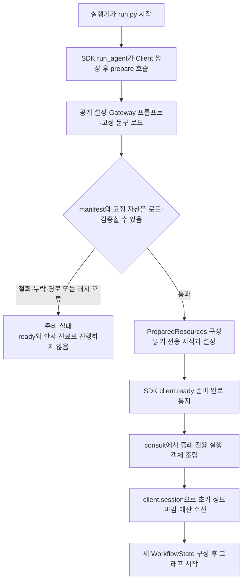

[run.py](run.py)는 SDK에 `prepare`와 `consult`를 전달하는 얇은 진입점이다. `prepare()`에서는 환자를 보지 않고 사용할 설정과 지식의 파일 경계·해시·문구 계약을 확인한다. 지식은 하나의 RDFLib Graph로 읽으며 환자의 관찰을 그 Graph에 쓰지 않는다. 이 단계에서 실패하면 준비 완료 통지를 보내거나 빈 지식으로 계속하지 않는다.

준비가 끝나면 SDK가 `client.ready()`를 호출하고 `consult(client, resources)`로 들어간다. `consult`는 Doctor·입력 해석·질문 계획·추론·제출 객체와 증례별 상태를 새로 만든다. `client.session()`에서 받은 초기 정보, 마감 시각, 남은 턴, 허용 행동과 서버 예산을 사용한다. 준비 지식과 설정에 이전 환자의 대화나 후보를 쌓지 않는다.

### 9.2 대화 한 번 — 선택부터 응답 반영까지

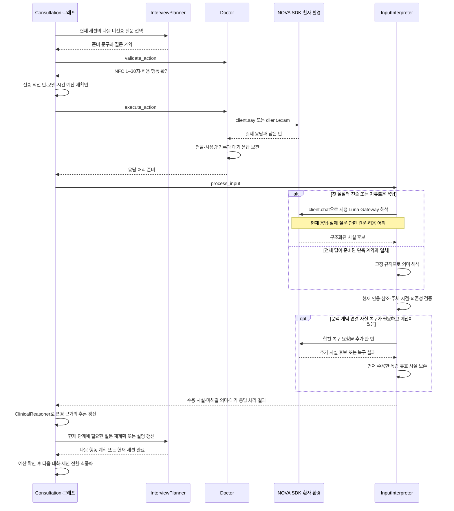

환자에게 보이는 한 번의 질문 뒤에는 **문구 검증 → 실제 전송 → 원문 보존 → 사실 해석 → 추론 갱신 → 다음 질문 재계획**이 이어진다. Doctor는 문장을 생성하거나 진단을 선택하지 않는다. 지정 모델도 다음 행동을 고르는 대신 실제 응답의 의미를 해석한다. 위 도식의 `client.chat()`은 같은 NOVA SDK를 통한 Gateway 호출이다.

“네”처럼 짧은 답이라도 무엇에 동의했는지가 질문 계약으로 완전히 정해질 때만 고정 규칙으로 처리한다. “아니요, 작년에는 있었어요”는 현재 부재와 과거 존재를 함께 말하므로 전체 응답을 Gateway로 보낸다. 한 응답의 사실 일부가 잘못됐을 때 독립된 다른 유효 사실까지 지우지 않는다. 복구용 추가 호출은 응답당 최대 한 번이며 일반 문진·교육과 같은 증례 예산을 공유한다.

실제 전송이 성공한 뒤에만 전달 이력을 만든다. 질문 후보에만 있었던 문구, 거절된 초안, 전송 오류는 환자와 나눈 대화가 아니다. 다음 질문은 마지막 응답을 처리한 뒤 선택하므로, 앞서 만든 질문 목록을 환자의 답과 무관하게 끝까지 읽지 않는다. 핵심 HPI까지는 준비한 순서를 따르고, Open Inquiry 뒤의 문진은 새 근거로 재계획한다. Education에서는 진단 변경을 확인하여 필요한 설명과 정정을 갱신한다.

### 9.3 첫 인사부터 제출까지 따라가는 예시

아래에서 `Python 진료 흐름`은 Consultation·InterviewPlanner·ClinicalReasoner·SubmissionWriter의 협력을 묶은 표현이다. `NOVA 환경`은 SDK가 연결하는 환자 응답·진찰·제출 인터페이스다. 초기 `opening`에 실질적인 진술이 없고 인사 후 “배가 아파요”라는 첫 답을 받는 경우를 가정한다. HPI·ROS·병력·진찰은 현재 수용 자산에 해당 질문·연결이 있고 실행 자격을 통과했을 때 수행한다.

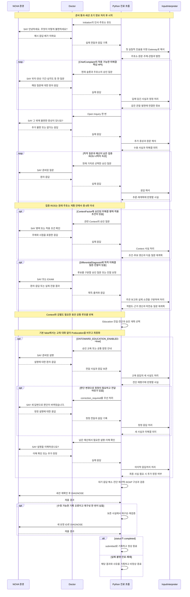

첫 인사에 “배가 아파요”라는 답을 받았다고 바로 특정 질환을 정하지 않는다. 복통이라는 주호소를 원문과 연결한 뒤 위치·시간·양상처럼 아직 모르는 정보를 묻고, 열린 질문으로 추가 불편을 확인한다. 이후에는 그때까지의 사실이 공유 Pattern과 어떻게 맞는지에 따라 다음 질문이 달라진다. 이 예시가 특정 질환이나 고정된 질문 순서를 임상 자산으로 추가하는 것은 아니다.

ContextFactor와 DifferentialDiagnosis는 새로운 공식 세션을 만드는 시점이 아니다. 같은 환자의 기존 사실·대화·남은 예산을 이어받아 질문의 목적만 바뀐다. 승인된 Context나 진찰 연결이 없거나 물을 가치가 없으면 해당 행동을 생략한다. 반대로 질문이 필요하면 같은 단계의 공통 루프를 여러 번 반복한다.

설명 후의 대화도 마지막까지 입력으로 처리한다. 위 도식은 정정 한 번과 이해 확인을 보여 주지만, 실제 코드는 새 답마다 판단 변경과 전달 여유를 다시 확인한다. 준비된 설명을 전부 끝내지 못한 경우에는 그 이행 상태를 남기고, 이미 확보한 사실로 최종 기록을 구성한다. 최종화는 별도의 환자 대화를 생성하지 않는다.

### 9.4 대화 수와 예산을 해석하는 방법

| 흐름 | 실제 대화 수를 결정하는 것 | 다음 단계로 남기는 것 |
|---|---|---|
| 인사·주호소 유도 | 준비된 첫 SAY, 필요한 제한적 명료화 | 확인된 주호소와 초기 정보 |
| 핵심 HPI | 주호소 수, 적용 가능한 미해결 슬롯 | 관찰·발현별 속성과 원문 |
| Open Inquiry·집중 ROS | Open Inquiry 한 번, 현재 가치에 따른 ROS 총 여섯 번 이내 | 추가 증상·명시적 부재·미해결 정보 |
| Context·감별 | 승인 질문·진찰 연결, 현재 질문 가치와 남은 예산 | 적용 조건·실제 소견·진단 근거 |
| 설명·이해·정정 | 기본 0회; 명시적 활성화 때만 승인 설명과 남은 시간 | 기본 P.education 빈 문자열; 활성화 때만 실제 전달 이력 |
| SOAP·DIAGNOSE | 검증 결과와 전체 한 번의 재구성 한도 | 서버 결과와 확인된 종료 상태 |

루프 안에서 실행한 SAY·EXAM의 서버 턴 변화가 실제 행동 사용량이다. D33 세션 문진 상한과 공통 50턴을 함께 따르며 공감은 세션 상한에서 제외하지만 공통 턴을 쓴다. 최소 목표는 강제 횟수가 아니므로 고정 대화 번호로 세션을 나누지 않는다. 그래프 노드 수, 문진·공감 SAY/EXAM 수, 모델 호출 수는 구분하고 마지막 행동 응답까지 처리한 뒤 마감 전에 제출한다.

새 SAY·EXAM 전에 Gateway 한 호출과 출력 여유, 응답 처리 120초, 최종화 120초를 확보한다. 기한·모델·행동 예산이 부족하면 문진을 계속 늘리는 대신 최종화로 이동한다. 이 절의 순서는 그 조건을 충족했을 때의 실행 계획이며, Mermaid 원문의 시각 렌더링·실제 Luna 호출·공식 진료 실행·임상 성능은 별도 검증 대상이다.

<a id="change-guide"></a>

## 10. 수정 방향을 생각할 때 확인할 책임과 경계

아래는 변경을 구현한 목록이 아니라, 원하는 동작과 관련된 현재 코드·기록을 찾아가는 안내다. 한 단계의 품질 문제를 다른 단계의 점수 변경으로 가리는 일을 피하려면 입력부터 제출까지 어느 경계에서 기대와 달라졌는지 먼저 확인하는 편이 좋다.

| 확인하려는 현상 | 먼저 볼 기록 | 해당 책임·코드 |
|---|---|---|
| 환자 말을 다른 증상으로 연결함 | 실제 input·전송 vocabulary·별칭·`parser_result`·거절 사유 | [InputInterpreter](workflow/input_interpreter.py)의 `_search`, `_vocabulary`, `_request_parse`와 [입력 검증](workflow/rules/input.py) |
| 증상은 연결됐는데 주호소로 확정되지 않음 | S.cc의 status·subject·time_context·인용·개념 ID | [CaseState](workflow/state/models.py)의 `chief_complaints`와 입력 사실 반영 |
| 기대한 질환이 후보에도 없음 | Target ID와 그 Target의 Association | [ClinicalKnowledge](knowledge/graph.py)의 `get_patterns_by_target`; 원천 연결 변경은 준비·수용 범위 |
| 후보는 있지만 지지 점수가 0임 | `pattern_matches`, `association_matches`, 미해결 Feature·적용 조건 | [ClinicalReasoner](workflow/clinical_reasoner.py)의 `_match`, `_applicability`, `refresh_hypotheses` |
| 추가 정보를 얻었는데 점수가 낮아짐 | 선택 Contribution과 정교화·차분·관찰·발현 | 정교화 대체 규칙과 manifest의 scoring policy |
| 높은 점수의 질환이 최종 선택되지 않음 | `evidence_score`, fit, `chief_coverage` | `supported_hypotheses`, `select_diagnosis` |
| 예상과 다른 질문을 먼저 함 | `selection_value`, order, priority, 임상 개정·세션 | [InterviewPlanner](workflow/interview_planner.py)의 `_value`, `replan`, `select_question` |
| 턴을 많이 쓰거나 Context가 먼저 끝남 | 0 가치 질문 여부, 정렬의 첫 비Context 위치, 남은 용량 | 질문 필터·사전식 비교·ContextFactor 절단 규칙 |
| 묻지 않거나 한 번 물은 내용을 다시 확인함 | 출처, 실제 delivered 이력, observation/episode, clarification 수 | `has_resolved_evidence`, `was_asked`, QuestionLifecycle |
| 제출 기록이 비거나 근거가 빠짐 | `diagnosis_evidence`, 실제 source_refs·획득 상태, 수용 plans | [SubmissionWriter](workflow/submission_writer.py)와 [지식 manifest](knowledge/manifest.json) |

특히 다음 네 가지는 현재 동작을 평가할 때 구분해야 한다. 첫째, Gateway의 단일 Symptom 선택은 출력 계약이고 그 의미가 맞았다는 임상 판정은 아니다. 둘째, 원천 지지와 fit은 정렬 점수이며 진단 확률이 아니다. 셋째, 질문 가치는 전체 추론의 확률적 최적화가 아니므로 높은 가치 질문 선택만으로 최소 턴을 보장하지 않는다. 넷째, 증상 수준 잠정진단·Education pass·빈 계획 필드 허용은 제출을 진행할 수 있는 경계이며 해당 평가 영역의 충족을 뜻하지 않는다.

현재 검증 이력은 [submission 상태](PROJECT_STATE.md)에 연결되어 있다. 합성 입력의 행동 검증, 실제 수용 RDF와 스크립트 응답의 상담, 독립 ZIP의 실행은 코드·자산·제출 계약을 확인한 증거다. 실제 Luna의 한국어 의미 매핑, 공식 서버 재검증, 임상 정확도·공식 점수는 별도 관측으로 남아 있다. 문서·그림·예제는 그 구분을 대신하지 않는다.
