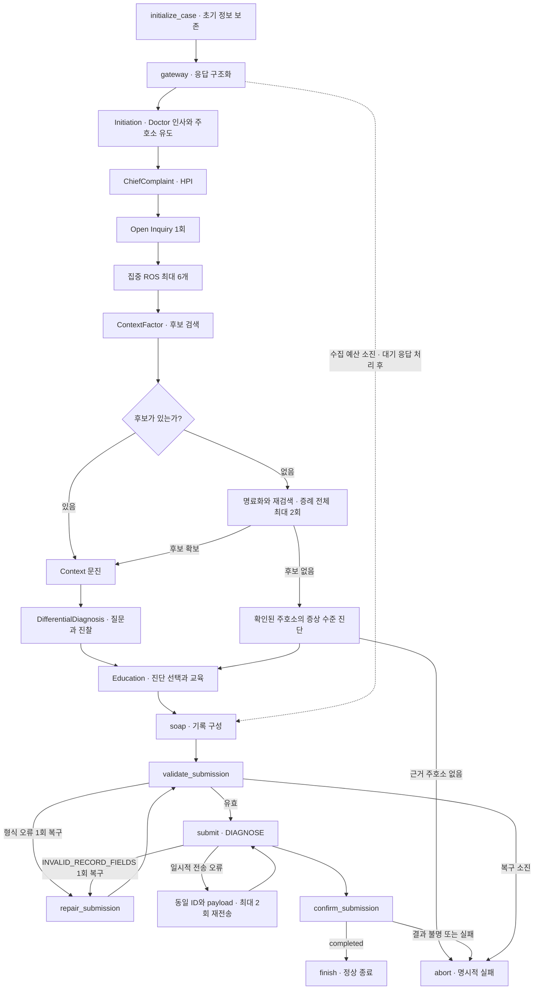
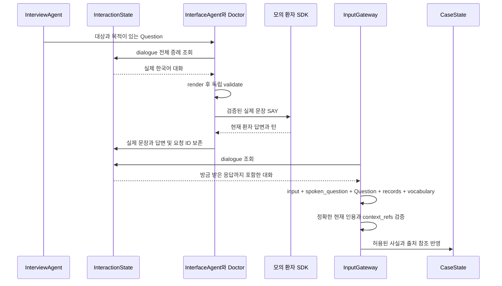
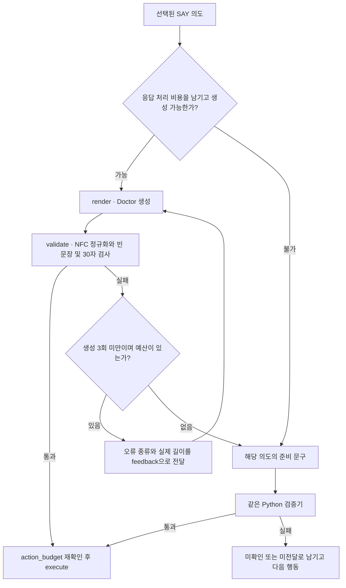

# Ontoward 제출 에이전트와 워크플로우 백서

Ontoward는 N.O.V.A. 예선의 모의 환자와 한국어로 문진하고, 실제로 받은 진찰 결과를 정리하여 **SOAP 초진 기록과 주진단 하나를 제출하는 에이전트**다. 이 디렉터리는 제출 실행 코드의 단일 원본이다. `run.py`가 `agents/runtime.py`의 `prepare()`와 `consult()`를 SDK에 전달한다.

이 백서는 2026-10-14 개정 구현을 처음 읽는 사람을 위한 안내다. 실행 코드와 합성 증례 검증을 설명한다. 현재 실제 승인 임상 RDF·질문·계획·manifest가 없으므로, 공식 환자를 대상으로 바로 실행할 준비가 완료된 상태는 아니다. 코드 검증, 임상 자료 승인, 실제 모델 품질, 공식 제출 성공은 각각 확인해야 한다.

## 1. 무엇을 모델이 하고, 무엇을 Python이 하는가

환자에게 무엇을 물을지와 그 질문을 어떻게 말할지는 서로 다른 일이다. Ontoward는 이 책임을 분리한다.

| 담당 | 하는 일 | 입력 |
|---|---|---|
| `InterviewAgent` | 질문 대상·목적·순서와 준비된 교육 내용 선택 | 기록, 예산, 온톨로지와 준비 문구 |
| Doctor / `InterfaceAgent.render()` | 선택한 질문·설명을 정중한 한국어 문장으로 표현 | 구조화된 질문 의도와 실제 한국어 대화 |
| `InputGateway` | 현재 환자 답을 문맥과 함께 읽고 구조화 | 실제 전달 문장, 원래 질문 의도, 대화, 기존 관찰, 허용 용어 |
| `ReasoningAgent` | 후보 검색·근거 점수·최종 진단 선택 | 출처가 있는 현재 관찰과 RDF 관계 |
| `SubmissionAgent` | SOAP 구성·검증·DIAGNOSE·제출 확인 | 확보한 사실, 선택 진단, 계획과 실제 교육 이력 |

Doctor와 Gateway는 모두 공식 경로의 `openai/gpt-6-luna`를 사용한다. Doctor는 `config/doctor.txt`, Gateway는 `config/input_parser.txt`로 지시하며 호출 기록도 `role=doctor`와 `role=gateway`로 구분한다. 질문 선택과 진단 판단은 Python이 담당한다. 별도의 ClinicalSynthesis 호출은 없다. EXAM은 검토된 단일 진찰 문구를 사용하며 Doctor의 문장 생성 대상은 SAY다.

## 2. 하나의 합성 증례로 따라가는 진료

다음 가상증상·가상질환A/B는 실행 검증용 이름이다. 실제 질환에 대한 진단 지침이 아니다.

1. **준비:** `prepare()`가 공개 설정과 manifest를 읽고 파일 해시를 확인한 뒤 하나의 RDFLib Graph와 준비 문구를 만든다. 증례나 환자에게 접근하지 않는다.
2. **인사:** `consult()`가 새 상태를 만들고 초기 정보·활력징후를 보존한다. 초기 정보에 증상이 있어도 첫 환자 행동은 인사와 주호소 유도다. 준비 문구는 “안녕하세요. 무엇이 어떻게 불편하세요?”다.
3. **HPI:** “가상증상이 있어요”라는 답을 Gateway가 허용된 개념에 연결한다. `fixed_hpi()`가 위치·양상 등 적용 가능한 질문을 준비한다. 초기 정보나 한 답변에서 이미 확인한 속성은 반복해서 묻지 않는다.
4. **Open Inquiry와 집중 ROS:** 유지된 HPI 다음 다른 불편함을 자유롭게 말할 기회를 한 번 준다. 이어 주호소 계통의 다른 증상을 최대 6개 확인한다. 계통 연결이 없으면 집중 ROS를 만들지 않는다.
5. **후보와 Context:** 주호소·추가 증상에서 질환 후보를 합집합으로 찾는다. 가상질환A/B와 연결된 병력이 있으면 질문하며, 없다는 답도 그대로 보존한다.
6. **감별:** 후보 순위와 특징에 따라 질문·진찰을 실행한다. 합성 정상 증례에서는 실제 반환된 가상 진찰 소견이 B를 선두로 바꾼다. 단독 선두라도 질문이 남으면 감별을 계속한다.
7. **교육:** `InterviewAgent.prepare_education()`이 B의 준비 계획·교육을 선택하고 Doctor가 표현한다. 환자가 새 사실을 말하면 후보를 다시 계산하고 아직 전달하지 않은 설명만 수정한다.
8. **제출:** 마지막 답까지 반영하여 SOAP 15개 문자열과 별도 주진단을 만든다. `DIAGNOSE`의 `completed` 응답을 확인한 뒤에만 정상 종료한다.

다섯 내부 세션은 하나의 공식 진료 세션 안에서 진행된다. 세션별 질문을 한 번 준비하며, 예산 때문에 삭제한 질문을 되살리지 않는다. 최대 2개의 명료화는 제한된 별도 질문이다.



세션 상자는 여러 LangGraph 노드를 묶은 설명이다. 실제 조립은 `ConsultationWorkflow.compile()`에 있다. 모든 응답은 `gateway → refresh → budget`으로 돌아오며, 예산 부족은 남은 수집을 접고 SOAP로 이동한다. 만료·폐쇄·복구 후에도 불명확한 전송은 어느 단계에서든 `abort`로 끝날 수 있다.

## 3. 코드를 읽을 때 따라갈 함수

표의 C·S·D·Q·I는 다음 절의 다섯 상태 객체를 줄여 쓴 것이다. 조회 함수는 공유 지식만 읽고 환자 상태를 바꾸지 않는다.

| 함수와 파일 | 입력 → 출력 또는 변경 | 상태 책임과 호출 순서 |
|---|---|---|
| [`prepare`, `consult`](agents/runtime.py) | 설정·자산 → Resources; client·Resources → 증례 결과 dict | 준비 후 증례마다 독립 C/S/D/Q/I 생성, 그래프 실행 |
| [`initialize_case`, `apply_session`](agents/session.py) | 서버 세션 → WorkflowState; 남은 예산 → S | 초기화에서 마감·턴·허용 행동 수용 |
| [`ingest`, `_parse`, `_validated`, `_apply`](agents/gateway.py) | 원문·실제 질문·의도·대화 → 검증된 관찰 | I 대기 응답 소비, C 출처·문맥 참조 갱신 |
| [`enter_scope`, `prepare_questions`](agents/workflow.py) | 현재 세션 → 질문 계획 | S 초기화/준비 여부, Q·C 질문 항목 |
| [`fixed_hpi`, `open_inquiry`, `focused_ros`](agents/interview.py) | 주호소·지식 → HPI/Open/ROS | C의 미질문 항목과 Q를 함께 생성 |
| [`collect_context`, `investigate`](agents/interview.py) | 후보 → Context·감별·진찰 질문 | 확인한 대상·속성·에피소드 제외 |
| [`clarify`, `select_question`](agents/interview.py) | 해석 실패/후보 없음 → 명료화; Q → 한 행동 | S 명료화 횟수, I.selected |
| [`budget_guard`, `advance_scope`](agents/session.py) | 예산 → 유지 항목·다음 세션 | C/Q 동시 삭제, S.finalizing 또는 다음 scope |
| [`render`, `validate`, `execute`](agents/interface.py) | 선택 의도 → 문장 → 검증 → SDK 응답 | 생성 기록, I 실제 요청·응답, 실제 턴 사용량 |
| [`complete`](agents/model.py) | 역할·프롬프트 → 문자열 또는 실패 | S 공유 호출·토큰, I.model_history |
| [`request_with_recovery`](agents/transport.py) | 보존 payload·호출 → 응답 또는 오류 | 동일 요청 재전송·시도 로그·timeout |
| [`refresh_hypotheses`, `select_diagnosis`](agents/reasoning.py) | 관찰 → 후보·점수·진단 | D 재계산, C 진단 종류·근거 ID |
| [`prepare_education`](agents/interview.py) | 진단·준비 계획 → P와 설명 질문 | C.P 계획, Q 미전달 교육; 전달 이력 보존 |
| [`finalize`, `repair_submission`](agents/workflow.py) | 최종 사실 → 진단·계획·SOAP; 오류 → 1회 재구성 | 복구 횟수·새 제출 ID |
| [`render_soap`, `validate_submission`](agents/submission.py) | C/D/I → 15필드 note + diagnosis | I.submission_payload와 검증 오류 |
| [`submit_diagnosis`, `confirm_submission`](agents/submission.py) | payload → 실제 제출 결과 | I ID·시도·결과, completed만 submitted |
| [`route_*`, `finish`, `abort`](agents/routing.py) | 상태 → 다음 노드; 종료 조건 확인 | 모델 없는 분기, 성공과 실패 분리 |
| [`load`, `get_symptom_systems`, `get_system_symptoms`](knowledge/graph.py) | manifest → 지식; 증상/계통 URI → URI 목록 | 해시 검증과 집중 ROS 범위 조회 |
| [`get_patterns_by_target`, `get_disease_patterns`, `get_pattern_features`](knowledge/graph.py) | 증상·질환·Pattern → 관계 | 계통 제한 없는 합집합 검색과 근거 평가 |

## 4. 다섯 상태 객체와 원문 대화 기억

상태는 [`agents/state.py`](agents/state.py)에 모여 있다. 객체를 늘리거나 외부 기억 저장소를 추가하지 않았다.

| 객체 | 소유 정보 | 구분해야 할 점 |
|---|---|---|
| CaseState | S/O/A/P, 진단, diagnosis_kind, 진단 근거 ID | source_refs는 실제 입력, context_refs는 참고 대화 |
| SessionContext | scope, 행동·모델·토큰·시간 예산, 명료화 횟수 | 동일 요청 재전송을 새 턴·모델 호출로 중복 계산하지 않음 |
| DifferentialState | 질환 후보·Pattern/Feature·점수·선택 ID | 증상 진단을 가짜 Disease 후보로 넣지 않음 |
| QuestionPlan | 대상·속성·목적·문구·순서·우선순위 | 선택 의도이며 실제 발화는 별도 |
| InteractionState | 요청·응답·턴·전달 여부, 역할별 모델 기록, 제출 결과 | 실패한 생성·미전송 문구·오류 로그는 환자 대화에서 제외 |

`RecordItem.status`의 `unasked/done`은 처리 상태다. `ClinicalValue.status`의 `present/absent/uncertain/unknown`은 임상 의미다. “모르겠어요”를 처리 완료로 표시해도 음성으로 바꾸지 않는다. 예산 때문에 보내지 못한 질문은 제거하며, 물었지만 해석하지 못한 답은 원문과 미확인 상태로 남긴다.

`InteractionState.dialogue()`는 전체 증례에서 전달된 SAY의 **실제 한국어 문장과 환자 답**을 투영한다. 요청 ID·턴·질문 ID를 붙인다. 초기 opening은 SAY와 구별한 초기 입력으로 포함한다. EXAM·DIAGNOSE·미전송 초안은 섞지 않는다. Doctor와 Gateway가 같은 함수를 사용하되 Gateway 호출 시에는 방금 받은 턴이 추가되어 있다. 새 증례는 새 기억으로 시작하며 공유 Resources에 대화를 쌓지 않는다.



준비 질문이 “증상이 있나요?”여도 실제 발화가 “증상은 없으시죠?”이면 “네”를 원래 템플릿만 보고 양성으로 처리하지 않는다. Doctor가 표현한 질문의 짧은 답은 Gateway가 실제 문장과 함께 해석한다. Python의 예/아니오 처리는 존재를 긍정형으로 묻는다고 명시된 준비 질문에만 적용한다. 기본 ROS 문구를 바꾸면 그 단축 처리를 해제한다. 정확한 모름·교육 확인 응답은 사실을 새로 만들지 않고 처리할 수 있다.

“거기도요”, “아까보다 덜해요”나 정정은 현재 답의 정확한 인용을 남기고 이전 대화 ID를 context_refs에 지정한다. 존재하지 않거나 미전달된 ID는 거절한다. 문맥 전달·검증은 합성 응답으로 확인하며 실제 Luna의 한국어 의미 해석 정확도는 별도 평가 대상이다.

## 5. 질문 선택과 문장 표현

Python이 선택한 Question에는 대상·속성·관찰·에피소드·목적이 들어 있다. Doctor는 이를 표현하되 대상·긍정/부정 의미·교육 내용을 보존하고 새 임상 판단을 추가하지 않도록 지시받는다. 이 지시 자체가 자동 임상 검증을 대신하지는 않는다.

`render()`는 문장 생성, `validate()`는 독립적인 NFC 정규화와 길이 검사를 담당한다. 실제 전송 문자열의 공백·문장부호·줄바꿈을 포함한 Python `len()` 기준이다. 분해형 한글은 NFC 후 길이를 사용하며 공백뿐인 출력도 거절한다.



최대 세 번은 최초 생성과 재생성 두 번이다. 길다고 자르지 않는다. 모델 요청의 전송 재시도는 동일 요청을 기다리는 일이므로 생성 횟수와 구분한다. 실패 문구는 실행 기록에만 남고 환자에게 전송되지 않는다. EXAM은 생성 없이 준비된 문구를 같은 길이 검증기에 보낸다.

## 6. 진단 제출까지 이어지는 복구와 예산

| 문제 | 처리 |
|---|---|
| 문장 생성·길이 실패 | 생성 최대 3회, 검증된 준비 문구, 그것도 불가하면 미확인/미전달 |
| 구조화 실패·불명확한 주호소·후보 없음 | 원문 보존, 증례 전체 명료화 최대 2회, 재검색 |
| 여전히 후보 없음 | 확인된 현재 주호소의 증상 수준 잠정진단, 원인 미확정 표시 |
| 진단 근거가 될 주호소 없음 | 근거를 만들지 않고 failed |
| 진찰 거절·실행 불가능 | 소견으로 만들지 않고 서버 턴 확인 후 다음 항목 |
| 일시적 전송 오류·REQUEST_PENDING | 동일 ID·payload로 2초·5초 후 최대 2회 재전송 |
| PATIENT_RESPONSE_INVALID·EXAMINER_RESPONSE_INVALID | 같은 문장, 새 요청 ID로 1회 재시도 |
| 수집 예산 소진 | 대기 응답 처리 후 새 수집 중단, 확보 사실로 최종화 |
| SOAP 형식 오류 | 사실에서 한 번 재구성·재검증; 서버 거절 후 복구는 새 제출 ID |
| 만료·폐쇄·복구 소진 후 전송 불명 | expired·closed·unknown 등 명시적 비정상 종료 |

증상 수준 진단은 diagnosis_kind=symptom과 근거 주호소 ID를 남긴다. 질환 전용 치료를 붙이지 않고 “증상의 원인은 아직 확실하지 않습니다.”라는 준비 안내를 사용한다. 제출 diagnosis에는 주호소 명칭, A.evidence에는 원인 미확정을 기록한다.

| 내부 세션 | 행동 상한 |
|---|---:|
| Initiation | 1 |
| ChiefComplaint | 20 |
| ContextFactor | 10 |
| DifferentialDiagnosis | 14 |
| Education | 5 |

행동 예산은 세션 간 빌려 쓰지 않는다. Doctor·Gateway·재생성은 **증례 전체 모델 200회, 입력 500,000토큰, 출력 100,000토큰**을 공유한다. 서버의 남은 예산이 더 작으면 그 값을 따른다. 질문 계획에서 표현·응답 처리 호출을 함께 계산하고, Doctor 생성·재생성에는 Gateway 한 호출과 최대 2,048 출력토큰을 남긴다. 실제 입력 토큰은 응답 usage로 누적하며 서버의 제한 오류가 오면 새 수집을 멈춘다. 역할을 나누어도 공식 한도가 두 배가 되지 않는다.

새 수집에는 최종 제출용 120초를 남긴다. SDK 사본을 수정하지 않고 호출 경계에서 timeout을 최대 240초, 남은 시간과 제출 여유 이내로 조절한 뒤 복원한다. 이미 받은 50번째 답도 Gateway를 거쳐 최종 진단에 반영하고 DIAGNOSE는 남은 시간 안에서 수행한다. finish()는 해당 DIAGNOSE의 completed를 확인한 경우에만 허용한다.

## 7. 집중 ROS, 온톨로지 검색과 SOAP

집중 ROS는 기존 `Symptom → inSystem → BodySystem`을 따른다. 확인된 주호소 계통들의 증상을 합집합으로 모으고 주호소 자체·기확인·중복을 제외해 URI 순서로 최대 6개 준비한다. HPI 준비 시 목록을 고정하고 Open Inquiry에서 답한 항목은 실행 전에 건너뛴다. 새 ROS 증상으로 다른 계통 문진을 연쇄 확장하지 않는다.

ChiefComplaint 20턴 배분은 **Open Inquiry → 집중 ROS → HPI** 순으로 자리를 보존한다. 실제 실행은 **HPI → Open Inquiry → 집중 ROS**다. ROS 6개가 있으면 HPI는 최대 13개를 유지할 수 있으며 명료화나 더 적은 서버 예산이 있으면 줄어든다. 계통 연결이 없으면 임의 계통을 추정하지 않는다.

질환 검색은 모든 확보된 현재 증상·진찰 소견의 Target에서 Pattern을 역조회한 합집합이다. **BodySystem으로 질환 후보를 제한하지 않는다.** 불확실한 개념은 검색에 사용할 수 있지만 여러 확정 소견으로 중복 가산하지 않는다. 속성은 같은 관찰·에피소드 안에서만 결합한다.

점수는 검토된 특징 지지 +2, 일반 지지 +1, 명시적 반대·모순 −1이며 관련 Context는 후보당 최대 +1이다. 음성 Context 때문에 감점하지 않는다. 동률은 질환 URI 순이다. 이는 정렬용 규칙이며 질환 확률이나 검증된 임상 정확도를 의미하지 않는다.

SOAP는 다음 **15개 문자열 칸**을 정확히 만든다. 주진단은 note 밖의 별도 diagnosis다.

| 영역 | 필드 |
|---|---|
| S | cc, hpi, pmh, fh, sh, ros |
| O | exam, tests |
| A | evidence, differential |
| P | tests, treatment, disposition, follow_up, education |

실제 진찰에는 획득 턴을, 초기 활력징후에는 초기 정보 표시를 남긴다. A.evidence는 확보하고 판단에 사용한 소견이다. 예선 O.tests는 빈 문자열이며 계획 검사는 P.tests에만 쓴다. P.education에서도 “계획”과 “전달”을 구분한다. SAY 후 응답 구조화가 실패해도 실제 교육 전달 이력은 보존한다.

## 8. 설정·Docker 검증·패키징·현재 한계

agents/는 실행 객체와 공통 상태, knowledge/graph.py는 조회, config/는 지시문·한국어 문구를 맡는다. [설정 편집 안내](config/README.md)에 자리표시자와 적용 방법이 있다.

```dotenv
ONTOWARD_KNOWLEDGE_MANIFEST=knowledge/manifest.json
ONTOWARD_DOCTOR_PROMPT=config/doctor.txt
ONTOWARD_PARSER_PROMPT=config/input_parser.txt
ONTOWARD_TEXTS=config/texts.ko.json
```

공개 submission/.env보다 같은 이름의 실행 환경변수가 우선한다. settings.py 위치를 기준으로 지식은 knowledge/, 프롬프트·문구는 config/ 내부 상대 경로만 허용한다. 셸 확장은 하지 않는다. 경로나 필수 파일이 잘못되면 prepare()에서 오류를 낸다. 수정 후 prepare()를 다시 실행해야 반영된다. 개발 키는 루트 .env에 두고 제출하지 않는다.

개발·검증은 프로젝트 소유 Docker에서 수행한다. 아래 명령은 **프로젝트 루트** 기준이다. 최초 이미지 빌드는 의존성 다운로드가 필요하므로 환경 소유자의 허용 범위에서 준비한다.

```sh
docker compose build dev
docker compose -f compose.yaml -f Tmp/workflow-revision-2026-10-14/compose.offline.yaml run --rm --no-deps --pull never -T dev python Tmp/workflow-revision-2026-10-14/verify.py
```

두 번째 명령은 이 개정의 로컬 검증 자료가 있는 체크아웃에서 실행한다. 네트워크·개발 키를 끄고 임시 제출 복사본의 합성 RDF·문구·SDK 대역만 사용한다. 결과는 Tmp/workflow-revision-2026-10-14/verification.json, 정상 증례 이력은 같은 위치의 synthetic-full-flow.json이다. 이전 Tmp/workflow-mvp-2026-10-13/ 자료도 보존한다. 임시 검증 도구와 자산은 제출 ZIP에 포함하지 않는다.

이번 개정에서는 **40개 행동 검증이 통과**했다. 수정 없는 SDK의 요청 경계를 로컬 응답 대역으로 연결한 전체 흐름도 포함한다. 압축 결과는 25개 파일이며 원본과의 바이트 일치·설정 및 프롬프트 포함·임시 임상 자산 제외를 확인했다. 문서의 로컬 링크 64개와 함수 참조 42개를 대조했고, 별도 자료 준비와 원본 등 보호 파일 16,372개의 해시가 유지되었다.

```sh
docker compose build package
docker compose run --rm -T package
```

결과는 Tmp/packaging/ontoward-submission.zip이다. ZIP 루트에 run.py·nova_sdk.py·requirements.txt·settings.py·공개 .env를 놓고 agents/·knowledge/·지정 config/ 경로를 유지한다. package 서비스는 submission을 읽기 전용으로 연결하고 전용 출력만 쓴다. README·AGENTS·PROJECT_STATE·캐시·개발 키·임시 자산은 제외한다. SDK 1.0.1 사본의 SHA-256은 `c6238ac466abc5b99b3e80de9ace2c7a54b51f7efc8d8a671d1c08bb0476f00d`이며 변경하지 않는다.

실제 승인 manifest가 없으므로 production prepare()는 파일 오류로 멈춘다. 빈 그래프로 넘어가지 않는다. ZIP 생성은 임상 실행 준비 완료를 뜻하지 않는다. 실제 Luna의 문장·한국어 해석 품질, 임상 자산 수용, 공식 API 복구·제출·평가는 합성 검증에 포함되지 않는다.

Mermaid 세 도식은 구현의 함수·분기와 대조했다. 프로젝트 dev 컨테이너에 Mermaid 렌더러·Node·브라우저가 없어 **시각 렌더링은 not_run**이다. 원문 검토를 렌더링 성공으로 표현하지 않는다. 최종 관측 결과는 [제출 상태](PROJECT_STATE.md)와 [검증 기록](../Tmp/workflow-revision-2026-10-14/review.md)을 기준으로 확인한다.

요구사항은 [PRD](../PRD.md), 선택은 [D01·D11·D12·D13·D14](../DECISION_STATE.md), 자료 승인·준비·검토는 [data 상태](../data/PROJECT_STATE.md)가 관리한다.
