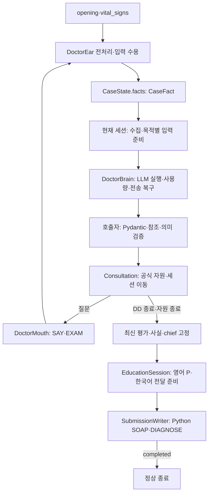
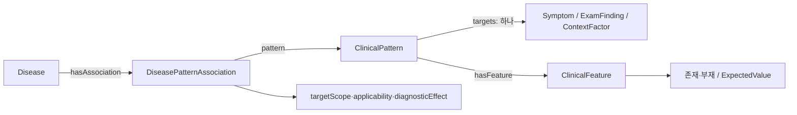
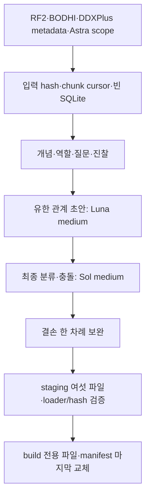

# Ontoward 진료 워크플로우 백서

현재 구현은 **D50·d50.1**이며 D49 무점수 지식, D48 프롬프트 모듈과 D47 객체·사실 소유권을 유지한다. 다섯 세션 객체가 목적별 입력 전처리와 응답 검증을 소유하고 **DoctorBrain은 모든 LLM 호출의 공통 실행기**다. 환자 정보는 CaseState.facts의 **CaseFact 하나**에 저장한다. [D48 프롬프트 결정](../DECISION_STATE.md#D48), [D47 객체 결정](../DECISION_STATE.md#D47), [PRD](../PRD.md), [상태 정의](workflow/state/models.py), [D50 오프라인 증빙](../data/provenance/algorithm-d50-2026-10-20.json)을 기준으로 읽는다. 기존 DB의 활성 사용은 철회했고 D45 공식 턴 예산을 유지한다. 실제 새 manifest가 없는 현재 prepare와 정식 패키징은 knowledge_bundle_not_installed로 실패한다. 합성 번들은 Tmp/에서만 검증했다.

## 1. 진료 실행 흐름

[run.py](run.py)는 원본 SDK의 prepare·consult 진입점을 유지한다. prepare는 제출 내부 경로·manifest·해시·스키마·준비 문구를 확인하고 읽기 전용 Graph를 준비한다. consult는 증례당 Brain 하나와 Ear·Mouth·다섯 세션을 조립한다. [Consultation](workflow/consultation.py)만 세션과 자원 종료를 조정한다.

[Consultation.run](workflow/consultation.py)은 입력→준비→예산→행동→세션 이동→최종화→제출을 순차 실행한다. LangGraph와 매 노드 전체 상태 복사·재검증을 제거하고 외부 데이터의 수용 검증은 유지한다. 내부 계산이나 모델 호출을 행동 턴으로 계산하지 않는다. 전송 결과가 불명확하면 다음 행동으로 넘기지 않고 명시적으로 종료한다.

## 2. 다섯 세션의 책임과 호출 시점

| 객체 | 수집과 기능 | 임상 호출 |
|---|---|---|
| InitiationSession | 초기 입력 연결·인사·chief 명료화·공통 경과 | 정상 종료 때 최초 순위 1회 |
| ChiefComplaintSession | 대표 chief의 적용 가능한 전체 속성·Open Inquiry | 정상 종료 때 순위 1회 |
| ContextFactorSession | 기본 병력 다섯 영역·보호 Context·추가 Context | 정상 종료는 DD 진입 판단에 통합 |
| DifferentialDiagnosisSession | 집중 ROS·감별 문진·EXAM·다음 행동·평가 고정 | 진입과 이후 새 응답마다 순위와 행동의 공동 판단 |
| EducationSession | 고정 진단·영어 P·Mouth 전달 준비 | 영어 P·한국어 공동 생성; 잘못된 부분만 복구 |

turn 0과 수집 중간에는 순위를 계산하지 않는다. Initiation·CC는 종료 때 순위를 수용하고 Context는 CC의 후보 집합을 유지한다. Context 종료 순위와 DD 첫 행동은 joint decision으로 합친다. unknown으로 revision이 같아도 마지막 응답 식별자가 달라지면 판단하며, Context·DD 직전 자원 종료에서도 미처리 입력을 한 번 판단한 뒤 고정한다. 같은 응답의 재진입과 최신 성공 평가 고정에서는 재호출하지 않는다.

다섯 세션의 조건부 문진 목표/상한은 5/7·7/14·7/9·3/10·5/10이다. CC 마지막 슬롯은 Open Inquiry에 보호한다. 집중 ROS는 DD에서 chief 계통·최대 여섯 대상·중복·존재 확인을 지키며 기존 10행동 상한을 공유한다. 기본 병력은 과거력·약물·알레르기·가족력·사회력이다. Context 질문의 질환 출처는 CC 종료의 유효 평가로 고정하고 현재 답변으로 실행 가능성만 검사한다. 유효 평가가 없으면 기본 병력과 준비 불가 사유를 남긴다.

Consultation이 CC 종료 성공·현재 revision과 chief 일치·미고정 상태를 확인한 평가 자료만 ContextFactor에 전달한다. ContextFactor는 다른 세션 객체를 보유하거나 호출하지 않는다.

## 3. 실행 객체와 상태 수명

| 소유자 | 책임 |
|---|---|
| DoctorBrain | 지정 모델·역할별 effort/한도·사용량·오류 분류·동일 요청 일시 재전송 |
| DoctorEar | 입력 전처리·문맥 해석·정규화·통합 사실 수용; 원문 대화 한 벌 |
| 다섯 세션 | 목적별 수집·그래프 자료·프롬프트 선택·출력 검증·임상 수용 |
| DoctorMouth | 공감·한국어 표현 자료·출력 검증·검증된 SAY/EXAM 실행 |
| Consultation | 세션 진입·입력 수용 후 작업·종료·자원 종료 조정 |
| SubmissionWriter | 통합 사실·frozen Assessment·계획·전달 결과의 SOAP·DIAGNOSE·완료 확인 |

별도 ModelClient 계층이나 환자 상태 사본·세션 프레임워크는 없다. 작은 공통 그래프·질문 함수만 재사용한다. 모델은 openai/gpt-6-luna이고 임상·영어 P는 high, Ear·Mouth는 medium이다. Brain은 임상 schema·그래프 조회·의미 수용을 소유하지 않는다.

| 상주 경계 | 내용 |
|---|---|
| case | 통합 facts·chief ID·단일 Assessment·영어 plan·revision |
| interview | 현재 세션·대기 질문·compact Answer·수집 사유·공감·교육 상태 |
| session | 공식 제약·사용량·종료·completed receipt |
| 선택적 turn | 현재 행동/입력/제출; 처리 뒤 해제 |

후보 views·지역 참조·LLM 교환·복구는 각 호출 작업의 지역값이다. Test가 외부 관측으로 실제 호출·변환·상태 변경을 보존한다.

## 4. 통합 사실과 입력 수용

ClinicalFact·NoteFact·CaseState.notes를 제거했다. CaseFact에 정규화된 영어 내용·상태·범주·수치·단위·주체·가족 구성원·보고자·시점·관찰·episode·조건·acquisition·source·turn을 보관한다. 선택적 graph_binding은 등록 target·attribute·values·연결 방식을 보관한다. 그래프 사용 자격은 현재 같은 대상·주체·구성원·시점·관찰·episode·주관/객관 취득 범위의 존재 확인에서 계산한다. 한 진술의 매핑과 설명을 중복 저장하지 않는다.

age·sex·historian·약물·보고 성장 수치·조건부 정보도 같은 정본에서 임상 판단과 계획으로 간다. 그래프 매칭과 supports/against에는 명시적으로 적격인 연결만 쓰며 조건부 표현을 무조건적 양성으로 바꾸지 않는다. 내용·수치·조건·상태가 바뀌면 revision을 올리고 Assessment 수용 자체는 올리지 않는다.

Ear는 초기 opening과 vital_signs를 첫 SAY 전에 해석한다. 정확한 단답은 등록된 문구와 scope가 고정된 경우에만 결정론적으로 수용한다. 활성 질문의 허용 values·units를 첫 해석에 제공하되 질문 밖 정보도 추출한다. 공감은 감정별 한국어 템플릿을 사용한다. 매 입력의 문맥을 분석하고 정확한 영어 연결은 Python이 처리하며 미해결 항목만 공급 DB 후보로 정규화한다. 유효 행은 보존하고 무효 행·형식·강제 완료의 기존 한도를 유지한다. 내부 ID·source·turn은 Python이 부여한다. 실제 모름과 미표현을 구별한다.

초기 구간 인용·취득 검증을 지키며 보고값·가정 측정은 S, 신뢰된 객관 구간·실제 EXAM은 O에 둔다. 정정은 기존 취득·범위 정책을 유지한다. 환자 원문은 Ear의 참조 해석에만 남고 임상·계획·SOAP에는 전달하지 않는다. Education 답변은 transcript-only다.

## 5. 목적별 임상 입력

[rules/assessment.py](workflow/rules/assessment.py)가 현재 적격 사실과 등록 관계로 후보를 회수하고 supports·against·unresolved를 만든다. 새 후보는 support·strong_support의 scoped Target 또는 applicability 경로로 넓게 회수하며 against-only 관계로 확장하지 않는다. 전체 Pattern과 applicability가 맞을 때만 등록 effect를 활성화한다. 부분 일치·불일치는 자동 지지/반대가 아니다. 명시적 모순으로 불가능해진 관계의 남은 조건은 질문하지 않는다. Feature 매칭과 Association 적용 조건을 따로 판정하며 관찰·episode·주체를 합쳐 완성하지 않는다. 수치·값 불일치에는 실제 fact 참조를 남긴다.

[rules/decision.py](workflow/rules/decision.py)는 호출 목적에 필요한 Key와 Value만 고른다. 사실 f_, 후보 d_, 근거 e_, 질문 q_, 범위 s_, 조건 condition_, 관계 r_를 지역 참조로 연결하고 같은 사실·조건·미확인을 한 번 정의한다. relations 표에 effect·scope·전체 Pattern·applicability를 한 번 정의하고 근거와 expected_by_disease에서 참조한다. 필요한 dict/list를 한 JSON 객체로 직렬화한다. 전체 상태 model_dump·큰 Pydantic schema·그래프 profile 전문을 프롬프트에 넣지 않는다. 기존 유효 후보를 보존하고 고정 Top-K를 두지 않는다. 순위 전용 요청에는 질문을 넣지 않으며 행동 복구는 수용 순위와 실행 가능한 질문 중심이다.

**프롬프트 바이트 측정·목표·제한·진단 통계·크기 비교는 없다.** 이를 맞추기 위한 절단·배치·조각 읽기·근거 결합 경로도 제거했다. 의미별 전처리와 공유 참조는 필요한 정보를 명확히 전달하기 위해 사용한다. 공식 토큰·호출·행동·시간 예산은 각자 유지한다.

## 6. 작은 응답과 독립 수용

입력 해석·후보 매핑·순위·행동·계획 문장·한국어 표현은 작은 작업별 JSON으로 받는다. 호출자는 Pydantic 구조 검증 뒤 등록 참조·현재 범위·중복·누락·질문 실행 가능성을 검사한다. Initiation·CC 종료와 자원 종료의 rank-only 응답은 ranked_disease_refs만, DD 정상 응답은 순위와 next_action만 받는다. Python이 전체 Assessment와 질문 객체를 조립한다.

기존 유효 후보 누락·미등록·중복 참조는 거절한다. 그래프 경로가 소실된 후보만 코드가 무효화한다. Python 점수로 수용 순위를 재정렬하지 않는다. 유효 순위와 잘못된 행동을 따로 처리하고 행동만 한 번 복구한다. Brain에는 임상 응답 검증을 넣지 않는다.

## 7. 질문과 평가 고정

필수 chief 속성·Open Inquiry·기본 병력은 해당 세션이 준비한다. 질문을 완전한 scope key로 먼저 합친 뒤 고유 질문마다 검사하고, 그래프 관찰 묶음과 행동 복구의 후보 자료는 같은 작업 안에서 재사용한다. 공통 QuestionTools가 등록 문구·존재 전제·계통·주체·가족 구성원·시점·관찰·중복·예산을 검사한다. 질문 순서·SOAP category·clarification은 attribute_roles에서 읽는다. Context는 별도 supporting-context 없이 같은 CaseFact를 매칭한다. rule any와 실제 질문의 current/past/unspecified를 분리하고 원래 rule scope로 해결 여부를 검사한다. 속성만 있는 Pattern도 같은 Target·scope의 존재 확인을 먼저 제공한다. DD의 선택 질문은 후보의 미확인 feature와 진찰에서 구성하며 질환별 기대 답과 조건을 보존한다. ask는 공급한 실행 가능한 질문 하나를 선택해야 한다.

DD 종료는 **마지막 응답 수용→필요 판단→최신 평가 재사용→현재 미확인·한계 확정→Assessment·기반 facts·chief 고정→Education**이다. 최신 질환 평가를 얻지 못하면 확인된 chief의 symptom-only 평가를 고정하고 chief도 없으면 명시적으로 실패한다. Writer는 다시 진단을 고르지 않는다. Education과 SOAP 복구는 같은 고정 평가를 사용한다.

## 8. 공식 자원·Education·종료

D45의 공식 turns_remaining이 행동 예산의 기준이다. 성공 응답의 자원을 재사용하고 최초·불명 소비·서버 한도 오류·제출 직전만 조회한다. 세션이 실제 필수 질문 수를 계산해 Budget에 전달하고 공유 비용 표와 기존 종료 보호 하한을 유지한다. SAY·EXAM의 실제 소비를 응답/조회로 정산하고 같은 요청 재전송은 중복 계산하지 않는다. 공통 상한은 50행동·모델 200회·입력 500,000·출력 100,000토큰이다. 내부 처리·모델 호출·세션 조회·SOAP·DIAGNOSE는 행동 턴이 아니다.

새 행동 전에 응답 해석·최종 판단과 복구·활성 계획·한국어 안내·제출을 보호한다. 임상 정상 출력은 4096·한 번의 복구 8000토큰이다. Education은 7턴을 보호하고 상한은 10이다. 명시적 비활성 설정은 교육 행동·예약·P.education을 사용하지 않는다. 일시 전송 오류는 동일 ID·payload로 2초 뒤 한 번 재전송한다.

EducationSession은 고정 진단 안내 후 통합 환자 사실과 해시 검증한 지침 원문으로 영어 P와 대응 한국어 발화를 high 호출 한 번에 준비한다. 영어 내용·인용과 한국어 발화를 독립 검증하고, 한국어만 실패하면 정상 영어 P를 보존하여 해당 그룹만 medium으로 복구한다. 인용과 일반 모델 지식을 구별한다. 원문 문서는 NOVA_GUIDELINES_DIR 마운트에서 읽고 ZIP에 넣지 않는다. EducationSession이 진단 안내와 계획 그룹의 순서·턴 배분·큐 등록·준비 실패 결과를 관리하고 Mouth가 한국어 표현과 실제 SAY를 담당한다. Mouth의 교육 표현은 큐·준비 상태를 수정하지 않으며 각 발화를 NFC 1–30자로 검증한다. 공급자 응답 복구와 문구 복구는 별도이고 미전달 계획은 전달 완료로 기록하지 않는다. 재진입 때 이미 큐나 전달·미전달 결과가 있는 계획 그룹은 다시 표현하거나 자동 재시도하지 않는다. 실제 완료·취소 기록에는 공통 QuestionLifecycle을 사용한다. 새 Disease의 guideline selections가 비어 있어도 model-knowledge 출처로 계획을 생성한다. 선택한 원문은 경로·hash·인용 검증을 유지한다.

## 9. Python SOAP와 완료 계약

Writer는 통합 사실·frozen Assessment·영어 P·실제 전달 결과만 사용한다. age·sex·historian을 HPI 선두에 쓰고 보고 수치는 S에, 실제 객관 취득은 turn과 함께 O에 둔다. 조건·가족·시점·수치 범위를 보존하고 같은 S/O 문구를 frozen A의 근거에서 재사용한다.

S의 cc/hpi/pmh/fh/sh/ros, O의 exam/tests, A의 evidence/differential, P의 tests/treatment/disposition/follow_up/education **15개 문자열**과 별도 diagnosis를 전송한다. 예선 O.tests는 빈 문자열이고 diagnosis는 고정 1위다. 형식 복구는 같은 평가로 한 번 재구성한다. 정상 완료는 DIAGNOSE의 completed 수신이다.

## 10. 설정·검증·독립 ZIP

[설정 안내](config/README.md)의 ONTOWARD_PROMPTS가 [작업별 조합](config/prompts.json)을 가리킨다. Ear·세션·Education·Mouth가 Python에서 현재 작업을 고르고 공통 규칙·작은 출력 계약·현재 상황 모듈만 조립한다. 초기 정보·문진·EXAM, 일반·강제 매핑, 순위·행동, 전체 계획·부분 복구, 질환·증상 안내와 한국어 전달은 서로 다른 경로를 사용한다. 복구 지시는 해당 복구 호출에만 넣는다. 이전 혼합 프롬프트와 개별 환경변수는 제거했으며 비밀 키·서버 원문은 공개 설정에 넣지 않는다.

프로젝트 Docker에서 유지 행동 회귀·임시 새 합성 RDF 상담·관측 일치·원본 SDK HTTP·읽기 전용 독립 ZIP을 검증한다. 과거 비교 도구와 atlas는 당시 스냅샷의 증거다. 이번 실제 모델·로그인·생성·실제 설치·정식 ZIP·공식 평가는 not_run이며 [D50 증빙](../data/provenance/algorithm-d50-2026-10-20.json)이 소스·합성 artifact와 수행 검증을 기록한다.

ZIP에는 필요한 실행 Python·requirements·SDK·공개 설정·프롬프트·manifest 자산만 넣는다. 문서·상태·Test·Dev·준비 DB·개발 키·원본 지침은 제외한다. 독립본은 부모 data나 원본 준비 자료 없이 검증한다.

## 11. 응답 하나의 변환

Ear는 환자의 보고와 조건을 하나의 CaseFact로 수용한다. 부분 복구는 요청한 statement와 demographic 행만 교체하고 정상 형제·생략된 영역·공감을 유지한다. typed age는 Python으로 영어 표기하며 미매핑 메모의 영문 정규화 실패도 제한 복구한다. 정확한 unknown·감사와 검증된 단일 affirmative presence 단답만 모델을 생략한다. DD는 마지막 응답 식별자까지 확인하여 판단하며 Education과 SOAP는 같은 frozen 결과를 읽는다.

## 12. 변경 경계

입력 의미는 Ear, 그래프 매칭은 rules, 세션별 임상 작업은 sessions, 모델 실행은 Brain, 환자 표현·행동은 Mouth, 세션 이동은 Consultation, SOAP·완료는 Writer에서 바꾼다. 일반 관계는 Extraction/에서 생성하고 런타임이 새로운 질환·관계를 만들지 않는다. 실제 모델 품질·임상 정확성은 별도다. 별도 추출 빌드의 진행·설치와 이후 실제 번들 상담 검증은 해당 운영 상태를 따른다.

## 13. 새 v5.0 / v5-enum-1 지식

Association의 effect는 support·strong_support·against·strong_against다. neutral은 생성 작업 DB의 완료 결과로 남고 실행 RDF에는 없다. Pattern은 Target과 전체 조건으로 공유하며 Association 동일성은 질환·Pattern·target_scope·applicability로 정한다. 관계별 출처·confidence·reviewer·점수·전형성·weight·policy는 실행 계약에 없다. 실제 환자 취득 source/turn은 CaseFact에 유지한다.

ExpectedValue는 concept·concept_set·quantity·interval과 any_of/all_of·연산자·단위·구간 경계를 보존한다. ValueMatch는 등록된 is_a·regional_part·approved_region 방향성 값 비교 경로다. 속성 역할·질문은 URI localname 대신 새 JSON에서 읽는다. Context의 환자/가족·구성원·시점과 관찰/episode를 섞지 않으며 한 가족 구성원의 부재를 전체 가족 부재로 만들지 않는다. 같은 관찰·scope·applicability·effect에서 완전히 일치한 refinement만 일반 지지를 대표한다.

manifest에는 schema_version·knowledge_contract·build_id와 schema·vocabulary·clinical·questions·guidelines 다섯 asset의 상대 경로·SHA-256만 둔다. 번들은 manifest 포함 여섯 파일이다. 각 경로는 manifest 디렉터리를 기준으로 검증하며 경계 이탈·hash 불일치·이전 형식을 거절한다. 실제 설치 전 현재 실행 인스턴스 수는 제공하지 않는다. 스키마와 loader는 각각 [schema.ttl](knowledge/schema.ttl)·[graph.py](knowledge/graph.py), 상세 계약은 [지식 안내](knowledge/README.md)에서 확인한다.

## 14. 원자료에서 새 실행 번들까지

[Extraction/](../Extraction/README.md)은 원자료 네 종류에서 빈 작업 SQLite로 시작한다. RF2 Snapshot/배포 의존성·BODHI CSV·DDXPlus metadata·Astra 후보/속성/값/CPX를 처리하며 옛 생성 DB·어휘·질문·source-custody SQLite·Astra snapshot/정책을 새 정본으로 읽지 않는다. 일반 관계는 최종 분류 모델의 내부 지식으로 완성할 수 있으나 환자 관찰을 생성하지 못한다.

nova_dev·codex_subscription·openai_api 중 한 빌드의 공급자를 고정한다. 요청 payload/ID·응답·유효 행·사용량·retry·unknown을 체크포인트에 보존하고 완료·neutral을 재호출하지 않는다. pause/SIGINT/SIGTERM은 진행 중 한 응답을 저장한 뒤 종료한다. 같은 fingerprint는 --resume, 불명 API/CLI 전송의 새 시도는 --retry-unknown이 필요하다. 설치는 검증된 파일 뒤 manifest를 원자적으로 바꾼다.

옛 생성기·정책·runtime 자산은 [철회 영수증](../data/extraction/retired-d42-2026-10-19/withdrawal.json)과 과거 준비 결과에 보존한다. 이번에는 이미지 빌드와 합성 오프라인 수용만 완료한다. 실제 로그인·유료 생성·실제 설치·정식 패키징을 실행하지 않았고 원문·이전 ZIP도 변경하지 않았다.
